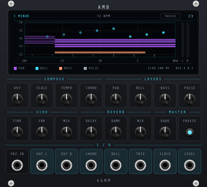

<!--
AGMM AUTOMATIC DOCUMENTATION
Source: AMB.cpp
-->

# AMB

## 1. Overview

`AMB` is a 28 HP generative ambient machine in the spirit of Brian Eno's AMB-1 tapes. It composes by itself: it picks a chord every few seconds, plays eight long bell loops of unequal prime lengths against it, holds a sub bass, adds a low rumble and soft Euclidean heartbeats, and sends the whole mix through a tape echo and a very long reverb. Nothing ever repeats exactly.

Key features:
- Ten scales (major, minor, dorian, phrygian, lydian, mixolydian, harmonic minor, locrian, minor pentatonic, whole tone)
- Automatic chord progression with equal-power cross-fade over 7 s
- Eight bell loops of unequal prime lengths (17, 23, 29, 31, 37, 41, 43, 47 beats)
- Six Euclidean heartbeat layers
- Tape-style ping-pong echo with wow, flutter, drift and saturating feedback
- Eight-line FDN reverb with Hadamard matrix (RT60 up to 32 s), freezable
- CV / gate outputs: chord root, bell pitch, bell trigger, clock, level

## Module Screenshot

## 2. Architecture

### Main Classes

- `AMB` — Rack module class inheriting from `rack::Module`
- `AmbEngine` — the entire generative engine (no Rack dependencies)
- `ambdsp::DelayLine`, `ambdsp::Allpass` — primitive DSP blocks
- `ambdsp::Reverb` — 8-line FDN with Hadamard mixing
- `ambdsp::Echo` — tape-style ping-pong delay
- `AMBPanel` — static panel artwork
- `AMBDisplay` — 380 × 124 piano-roll history + meters

### Inheritance

- `AMB` inherits from `rack::Module`
- `AmbEngine` is a standalone struct held by value in the module
- `AMBPanel` and `AMBDisplay` inherit from `rack::TransparentWidget`

### Structures

- `ambdsp::DelayLine { std::vector<float> buf; int w; int size; }` — linear-interpolated fractional delay
- `ambdsp::Allpass { std::vector<float> buf; int idx; float g; }` — fixed-integer Schroeder allpass
- `ambdsp::Reverb` — 8 delay lines + 3+3 allpasses + pre-delay + per-line LFO + Hadamard matrix
- `ambdsp::Echo` — 2 delay lines + wow/flutter/drift LFOs + feedback filtering
- `AmbEngine::PadSet { float note[4]; float phase[8]; float freq[8]; float gain; }`
- `AmbEngine::NoteEvent { double born; double end; float pitch; int layer; }`

### State (grouped)

| Group | Storage |
|-------|---------|
| Parameters | 16 floats on the module (key, scale, tempo, layer levels, echo / reverb, dark, chord interval) |
| Transport | `double beatPhase`, `int lastBeat`, `double time` |
| Pad | `PadSet pad[2]`, `int padCur`, `float padFade`, `float padLfo[8]`, `float padLfoRate[8]`, `float padTimer`, `int lastDegree` |
| Bells | `float bellPh[8]`, `bellModPh[8]`, `bellEnv[8]`, `bellAge[8]`, `bellFreq[8]`, `bellRatio[8]`, `bellVel[8]`, `bellPan[8]`, `int bellCycle[8]` |
| Bass / rumble | `float bassPitch, bassTarget, bassPhase, bassLfo`, `float texLp1, texLp2` |
| Pulse | `int euclidStep[6]`, `float pulseEnv[6], pulsePhase[6], tickEnv[6], tickLp[6]`, `bool euclidPat[6][32]`, `int euclidLen[6]` |
| Master | `mLp1L, mLp2L, mLp1R, mLp2R`, `dcXL, dcYL, dcXR, dcYR` |
| Outputs / display | `float outL, outR, level, meterL, meterR, chordRoot, lastBellSemis`, `int bellTrigCount, beatCount`, `float echoMs, reverbSec` |
| History | `NoteEvent hist[160]`, `int histPos` |
| RNG | `uint32_t rngState` |

## 3. DSP Theory

### Generative chord scheduling

The engine re-picks a chord every `CHORD` seconds (4 – 60 s, default 24 s). The previous chord and the new one are kept as two separate `PadSet` structures, and their gains cross-fade over 7 s using an equal-power curve:

$$
g_{\text{new}} = \sin\!\left(\tfrac{\pi}{2} t\right), \quad g_{\text{old}} = \cos\!\left(\tfrac{\pi}{2} t\right), \quad t = \min\!\left(1,\ \frac{\text{padFade}}{7\text{s}}\right)
$$

A cross-faded amplitude relation ensures the perceived loudness stays constant during the transition.

### Scale degree → semitones

Degrees are wrapped to the scale length `n` and mapped through the interval table:

$$
\text{degSemis}(d) = \text{INTERVALS}[(d \bmod n)] + 12 \left\lfloor \frac{d}{n} \right\rfloor
$$

`degSemis` handles negative degrees by using an exact integer division (`floorDiv`).

### Chord picking

1. Weighted random choice among the first 7 degrees (weights: 0.30, 0.08, 0.14, 0.18, 0.16, 0.10, 0.04).
2. Try up to 3 times to avoid repeating `lastDegree` (with 30 % acceptance of a repeat).
3. Root = `(degSemis(deg) + key) mod 12`, brought into [-4, 7] (kept low so the pad is dark).
4. Third = `degSemis(deg + 2) - degSemis(deg)`.
5. Fifth = `degSemis(deg + 4) - degSemis(deg)`.
6. Colour = ninth (`degSemis(deg + 1) - degSemis(deg) + 12`), seventh (`degSemis(deg + 6) - …`) or octave (12), picked uniformly.

The four note pitches are detuned per voice:

$$
f_{k,j} = 130.81 \cdot 2^{(n_k + \delta_{k,j})/12}, \quad \delta = \pm[0.05, 0.10] \text{ semitones}
$$

so eight oscillators are always active (four notes × two detuned voices).

### Bell scheduling (unequal loops)

Each of the eight bell layers has a loop length `L_b` in beats (17, 23, 29, 31, 37, 41, 43, 47), all prime so that they never align. The engine tests whether the current beat crossed a loop boundary:

$$
c_b = \left\lfloor \frac{\text{beatPhase} + \text{off}_b \, L_b}{L_b} \right\rfloor
$$

When `c_b ≠ bellCycle[b]`, there is a 78 % chance the layer fires a new bell:
- **Pitch**: 55 % chance a chord note + 12 or + 24 semitones; 45 % chance a random scale degree + key + 12 or + 24.
- **Clamp**: semitones in [12, 33] (one octave above C3 to roughly C5).
- **FM**: index `idx = (0.35 + 0.9 (1 − dark)) · vel · env² · 1.6` (bright = more FM modulation).
- **Envelope**: `exp(−dt/3.8)` — a very long bell tail, no release stage.
- **Pan**: uniform in [-0.8, +0.8].

### Pad synthesis

Each pad voice is a three-partial additive sine with one LFO per voice controlling both brightness and amplitude:

$$
\begin{aligned}
v &= \sin\theta + 0.5\, h_b \sin 2\theta + 0.28\, h_b \sin 3\theta \\
h_b &= \text{bright}\cdot (0.35 + 0.65\, lfo) \\
\text{amp} &= (0.55 + 0.45\, lfo) \cdot a_k
\end{aligned}
$$

where `bright = 0.06 + 0.55 (1 − dark)` and `a_0 = 1.15`, `a_k = 0.8` (root is a little stronger). Pan alternates between the two detuned voices (approximately ±0.3 around the note's base pan).

### Bass

A sine wave plus 22 % second harmonic, with a 0.5 Hz LFO multiplying the whole signal by `0.72 + 0.28 sin`, and a smoothed pitch following the chord root minus 12 semitones (clamped to [-12, 0] semitones relative to C3):

$$
f_{\text{bass}} = 130.81 \cdot 2^{\,p_{\text{bass}}/12}
$$

A low-passed noise rumble at 90 Hz is added on top (a two-pole lowpass of white noise × 9 × its own 0.5 Hz LFO).

### Heartbeat pulses (Euclidean)

Six layers with cycle lengths and pulse counts:

| Layer | Cycle | Pulses | Sound |
|---|---|---|---|
| 0 | 32 | 5 | low kick (~44 Hz) |
| 1 | 24 | 4 | low kick (~58 Hz) |
| 2 | 16 | 2 | low kick (~72 Hz) |
| 3 | 28 | 3 | low kick |
| 4 | 20 | 5 | low kick |
| 5 | 12 | 3 | low kick |

The pattern for each layer is stored as `euclidPat[p][i] = ((i·pulses) mod steps) < pulses`, i.e. a Bjorklund-style distribution. The engine detects a new step each sample and, with probability 85 %, fires both a low-frequency sine "pulse" (0.28 s exponential decay) and a filtered-noise "tick" (0.03 s decay, 1800 Hz lowpass).

### Tape echo

A stereo ping-pong delay with independent delay times per side:

$$
t_L = \text{timeSm} \cdot f_s \cdot (1 + w), \quad t_R = 1.5\, t_L \cdot (1 - 0.8 w)
$$

with `w` a combination of three LFOs (0.31 Hz, 4.7 Hz, 0.053 Hz) and timeSm gliding at 1.5 Hz. The feedback path (right into left, left into right) has a lowpass at `2800 · 0.35^dark`, a highpass at 150 Hz, and a soft clip.

### Reverb (8-line FDN)

The reverb uses an 8-line feedback delay network:

$$
\mathbf{y}_i = \text{lp}_i \cdot g_i, \quad \mathbf{f} = H_8 \mathbf{y}, \quad \mathbf{x}_i[w] \mathrel{+}= (\text{inL}\cdot\sigma_i + \text{inR}\cdot\epsilon_i)\cdot 0.5
$$

with $H_8$ the orthonormal 8×8 Hadamard matrix (`HH^T = I`, scaled by `1/√8`). Per-line RT60 gains:

$$
g_i = 10^{-3 \cdot d_i / (f_s \cdot T)}
$$

where `T` is RT60 in seconds and `d_i` is the delay length in samples. Each line has a one-pole lowpass at `fc = 12000 \cdot 0.0667^damp`, and a slow LFO modulating the read position by up to `modBase = 6` samples. **Freeze** sets `g_i = 1`, disables modulation, and mutes the input.

Three allpasses per side (~142, 107, 379 samples) diffuse the input before the FDN; a 30 ms pre-delay precedes them. Output is a Hadamard-style Hadamard-style Walsh sum (odd/even split for L/R), scaled by `0.55 / √max(T, 1)`.

A 15 Hz DC blocker finishes the reverb.

### Master

Two-pole lowpass whose cutoff follows the DARK knob:

$$
f_c = 12000 \cdot 0.06^{\text{dark}} \quad(\text{clamped to } [500, 0.45 f_s])
$$

a 12 Hz DC blocker, then `tanh(1.1 x)` for soft saturation.

### Xorshift32 RNG

All randomness (chord choice, bell pitch, detune, heartbeat acceptance) uses an xorshift32:

$$
x \leftarrow x \oplus (x \ll 13), \quad x \leftarrow x \oplus (x \gg 17), \quad x \leftarrow x \oplus (x \ll 5)
$$

The output is `(x >> 8) / 2²⁴ ∈ [0, 1)`.

## 4. Parameters and Controls

### Knobs

| Parameter | Min | Max | Default | Description |
|---|---|---|---|---|
| `KEY_PARAM` | 0 | 11 | 0 | Key (C, C#, D, … B), snapped |
| `SCALE_PARAM` | 0 | 9 | 1 | Scale (Major … Whole Tone) |
| `TEMPO_PARAM` | 40 | 180 | 72 | Tempo in BPM |
| `CHORD_INT_PARAM` | 4 | 60 | 24 | Chord change interval (seconds) |
| `PAD_LEVEL_PARAM` | 0 | 1 | 0.60 | Pad level |
| `BELL_LEVEL_PARAM` | 0 | 1 | 0.45 | Bell level |
| `BASS_LEVEL_PARAM` | 0 | 1 | 0.50 | Bass level |
| `PULSE_LEVEL_PARAM` | 0 | 1 | 0.25 | Pulse (heartbeat) level |
| `ECHO_TIME_PARAM` | 0.12 | 1.2 | 0.50 | Echo time (s) |
| `ECHO_FBK_PARAM` | 0 | 0.9 | 0.60 | Echo feedback |
| `ECHO_MIX_PARAM` | 0 | 1 | 0.45 | Echo mix |
| `REVERB_DECAY_PARAM` | 0 | 1 | 0.70 | Reverb decay (0.8 – 32 s RT60) |
| `REVERB_DAMP_PARAM` | 0 | 1 | 0.55 | Reverb damping |
| `REVERB_MIX_PARAM` | 0 | 1 | 0.60 | Reverb mix |
| `DARK_PARAM` | 0 | 1 | 0.60 | Overall tone (low = bright, high = dark) |
| `FREEZE_PARAM` | 0 / 1 | — | — | Latching reverb freeze |

### Button

| Parameter | Description |
|---|---|
| `FREEZE_PARAM` | Momentary toggle that latches the freeze state (saved with the patch) |

## 5. Inputs and Outputs

### Inputs

| Name | Type | Range | Description |
|---|---|---|---|
| `FREEZE_INPUT` | Gate | 0..10 V | > 1 V freezes the reverb (OR with the button) |

### Outputs

| Name | Type | Range | Description |
|---|---|---|---|
| `OUT_L_OUTPUT` | Audio | ±5 V | Left stereo audio |
| `OUT_R_OUTPUT` | Audio | ±5 V | Right stereo audio |
| `CHORD_OUTPUT` | CV | 1 V/oct | Chord root, C4 = 0 V |
| `BELL_OUTPUT` | CV | 1 V/oct | Pitch of the last bell |
| `TRIG_OUTPUT` | Trigger | 0/10 V | 5 ms pulse on every new bell |
| `CLOCK_OUTPUT` | Trigger | 0/10 V | 5 ms pulse on every beat |
| `LEVEL_OUTPUT` | CV | 0..10 V | Current output peak level (0 – 10 V) |

The `LEVEL_OUTPUT` is `clamp(level · 18, 0, 10)` where `level = max(meterL, meterR)`.

### Lights

- `FREEZE_LIGHT` — illuminated while the reverb is frozen (button or gate).

### Menu

No menu options.

## 6. Signal Processing Pipeline

1. **Sample rate** — `engine.setSampleRate(sr)` initialises the echo and reverb on the first sample after a rate change.
2. **Key / scale change** — if either changed, set `engine.key / scaleIdx`; first start calls `startChord()`, subsequent changes call `pickNewChord()`.
3. **Freeze** — button latches via `SchmittTrigger`; gate OR; light shows `frozen || gate > 1 V`.
4. **Copy parameters** — 16 values transferred into `AmbEngine`.
5. **`engine.process(dt)`** — the full DSP described in §3.
6. **Audio outputs** — `outL/R` × 5 V.
7. **Pitch outputs** — `(chordRoot - 12) / 12` and `(lastBellSemis - 12) / 12` (1 V/oct, C4 = 0 V).
8. **Trigger outputs** — edge-count change → 5 ms pulse via `dsp::PulseGenerator`.
9. **LEVEL output** — `clamp(level · 18, 0, 10)`.

Inside `engine.process`:
1. Smooth level controls (~50 ms one-pole).
2. Advance transport (`beatPhase`).
3. Scheduler: chord change if `padTimer ≥ chordInterval`; pad cross-fade step; `chordRoot` one-pole toward the new root (0.15 Hz).
4. Render pad (2 chord sets × 8 voices).
5. Render bells (8 loops).
6. Render bass + rumble.
7. Render heartbeats (6 Euclidean layers).
8. Dry sum with `tanh` soft clip.
9. Echo (`echo.process`) on dry.
10. Reverb (`reverb.process`) on dry + echoes.
11. Master: two-pole lowpass following DARK, 12 Hz DC blocker, `tanh`, meter decay.

## 7. Important Functions

### `void AmbEngine::pickNewChord()`

Chooses a new chord (see §3), starts the 7 s equal-power cross-fade, updates the bass target, and closes / opens the corresponding history events.

### `void AmbEngine::startChord()`

First-time chord: calls `pickNewChord()` then snaps `padFade = 1` and `bassPitch = bassTarget` (no cross-fade).

### `int AmbEngine::degSemis(int deg) const`

Maps a scale degree (can be negative) to semitones above C3 using the current scale table.

### `void AmbEngine::process(float dt)`

The main per-sample engine callback described in §6.

### `void ambdsp::Reverb::init(float sr)` / `void ambdsp::Reverb::process(...)`

Allocates all ring buffers and runs the FDN per sample (per §3).

### `void ambdsp::Echo::init(float sr)` / `void ambdsp::Echo::process(...)`

Allocates the two delay lines and runs the tape echo per sample.

### `void AMB::process(const ProcessArgs &args)`

The Rack-module wrapper: copies params, handles key / scale / freeze, calls `engine.process`, writes outputs and triggers.

### `json_t *AMB::dataToJson()` / `void AMB::dataFromJson(json_t *)`

Persist the `frozen` state with the patch.

## 8. Mathematical Implementation

### Scale degree lookup

$$
\text{semis}(d) = \text{INTERVALS}\!\left[(d \bmod n + n) \bmod n\right] + 12 \left\lfloor \frac{d}{n} \right\rfloor
$$

### Pad cross-fade (equal power)

$$
g_\text{new} = \sin\!\left(\tfrac{\pi}{2} t\right), \quad g_\text{old} = \cos\!\left(\tfrac{\pi}{2} t\right), \quad t = \min(1,\, \text{padFade}/7)
$$

### Pad voice

$$
\begin{aligned}
v(t) &= \sin\theta + 0.5\, h_b \sin 2\theta + 0.28\, h_b \sin 3\theta \\
h_b &= \text{bright} \cdot (0.35 + 0.65\, \text{lfo}_k) \\
\text{bright} &= 0.06 + 0.55 (1 - \text{dark}) \\
\text{amp} &= (0.55 + 0.45\, \text{lfo}_k) \cdot a_k \cdot 0.105 \cdot g_\text{set}
\end{aligned}
$$

### Bell loop cycle

$$
c_b = \left\lfloor \frac{\text{beatPhase} + \text{off}_b \, L_b}{L_b} \right\rfloor, \quad \text{off}_b = 0.93, 0.80, 0.61, 0.45, 0.30, 0.20, 0.12, 0.05
$$

A new bell is generated when `c_b` changes with probability 0.78.

### Bell FM synthesis

$$
\text{idx} = (0.35 + 0.9 (1 - \text{dark})) \cdot \text{vel} \cdot \text{env}^2 \cdot 1.6
$$

$$
\text{carrier} = \sin(2\pi \theta + \text{idx} \cdot \sin(2\pi \theta_m)), \quad \text{env}_{n+1} = \text{env}_n\, e^{-dt/3.8}
$$

### Euclidean rhythm

$$
\text{pat}_p[i] = \left((i \cdot \text{pulses}_p) \bmod \text{steps}_p\right) < \text{pulses}_p
$$

### Reverb RT60 gain (per line, per control period)

$$
g_i = 10^{-3 \cdot d_i / (f_s \cdot T)}, \quad T = 0.8 \cdot 40^{\text{decay01}}
$$

`g_i` clamped to `< 1` outside freeze mode.

### Reverb Hadamard (orthonormal)

$$
H_8 = \frac{1}{\sqrt{8}} \begin{bmatrix}
1 & 1 & 1 & 1 & 1 & 1 & 1 & 1 \\
1 & -1 & 1 & -1 & 1 & -1 & 1 & -1 \\
\vdots & & & & & & & \vdots
\end{bmatrix}
$$

Applied in three butterfly passes then scaled by `1/√8`.

### Echo time (with wow / flutter / drift)

$$
t_L = \text{timeSm} \cdot f_s \cdot (1 + w), \quad t_R = 1.5\, t_L \cdot (1 - 0.8 w)
$$

$$
w = 0.0030 \sin(2\pi \phi_w) + 0.0007 \sin(2\pi \phi_f) + 0.0020 \sin(2\pi \phi_d)
$$

with $\phi_w, \phi_f, \phi_d$ free-running at 0.31 Hz, 4.7 Hz, 0.053 Hz.

### Master lowpass

$$
f_c = 12000 \cdot 0.06^{\text{dark}}, \quad \alpha = 1 - e^{-2\pi f_c dt}
$$

$$
y \leftarrow y + \alpha (x - y) \quad \text{twice for a two-pole lowpass}
$$

### Level output

$$
V_\text{level} = \text{clamp}(\max(m_L, m_R) \cdot 18,\, 0,\, 10)
$$

## 9. Performance and Optimization

### CPU Usage

- Pad: 16 oscillators (four notes × two voices per chord set × two chord sets, with one inactive set at any time), each with 3 harmonics + per-voice LFO
- Bells: 8 FM oscillators, all active but often with tiny envelopes (env > 0.0008 required to run)
- Bass: 1 sine + 1 second harmonic + noise lowpass pair + 3 LFOs
- Pulse: 6 Euclidean layers × (sine + filtered noise)
- Echo: 2 delay lines with 3 wow / flutter / drift LFOs and a filtered feedback path
- Reverb: 8 FDN lines + 6 allpasses + 2 pre-delay lines (per sample)
- Master: 2 one-pole + DC blocker + tanh

Rough estimate: ≈ 2000–3000 flops per sample, mostly in the reverb, bells and pad.

### Memory Allocation

- All buffers allocated in `setSampleRate()`; no allocation in `process()`
- Reverb: 8 lines × `next_pow2(~5195)` samples ≈ 8 × 8192 × 4 B ≈ 260 KB
- Echo: 2 lines × `2.4 s × f_s` × 4 B ≈ 2 × 115 200 × 4 B ≈ 920 KB worst case
- History: `160 × NoteEvent` ≈ 6 KB

### Real-time Processing

- All inner loops fixed-size (8 pad voices, 8 bells, 6 pulses, 8 FDN lines)
- No allocation, no locks in the audio path

### Thread Safety

- All engine state written by the audio thread
- Display reads via torn reads (cosmetic only)

### Numerical Stability

- Xorshift32 RNG is deterministic for a given seed and never produces 0
- Bell envelope guaranteed > 0.0008 before running (avoids very long zero-multiplications)
- Echo time clamped to `[8 samples, 2.2 s]`
- Reverb feedback `g_i < 1` in normal mode; **freeze** sets `g_i = 1` and mutes the input, so the loop is lossless
- Master soft-clips with `tanh` before the output
- All output voltages clamped by Rack

## 10. Dependencies

### Libraries/Headers

- `plugin.hpp` — VCV Rack core
- `agmm_ui.hpp` — shared AGMM UI helpers
- `<cmath>`, `<cstdint>`, `<cstdio>`, `<cstring>`, `<algorithm>`, `<vector>`

### External Classes

- `rack::Module`, `rack::ModuleWidget`, `rack::TransparentWidget`
- `rack::ParamQuantity` and subclasses (`KeyParamQuantity`, `TempoParamQuantity`, `ChordIntervalParamQuantity`, `EchoTimeParamQuantity`)
- `dsp::SchmittTrigger`, `dsp::PulseGenerator`
- `rack::random` (only for the initial seed)
- `agmm::panelBase`, `agmm::bezel`, `agmm::cell`, `agmm::sectionHeader`, `agmm::screen`, `agmm::plotFrame`, `agmm::meter`, `agmm::chip`, `agmm::text`, `agmm::accent`, `agmm::violet`, `agmm::warm`, `agmm::bright`, `agmm::dim`, `agmm::withA`, `agmm::ALIGN_L/C/R`

## 11. Summary

`AMB` is a self-contained generative ambient instrument. Every few seconds it picks a new chord, and eight long bell loops of unequal prime lengths weave a slowly-shifting melody against it. A sub bass, a low rumble and six Euclidean heartbeats fill out the rhythm, and the whole mix runs through a tape echo and a very long, freezable FDN reverb.

The result never repeats: the prime loop lengths guarantee the bells never realign, the chord picker avoids the same root twice in a row (probabilistically), and the xorshift RNG is reseeded on every patch load. The single `FREEZE` gate is enough to lock the reverb into an endless drone, which is a natural performance point for the module — a single gate from a MIDI keyboard or a sequencer turns the generative background into a held pad on cue.

The display is a 20-second piano-roll history with colour-coded layers (pad = violet, bell = cyan, bass = warm, pulse = grey) plus stereo output meters. `CHORD`, `BELL`, `TRIG` and `CLOCK` outputs make it easy to route the generative material into other voices that track the harmony and rhythm.