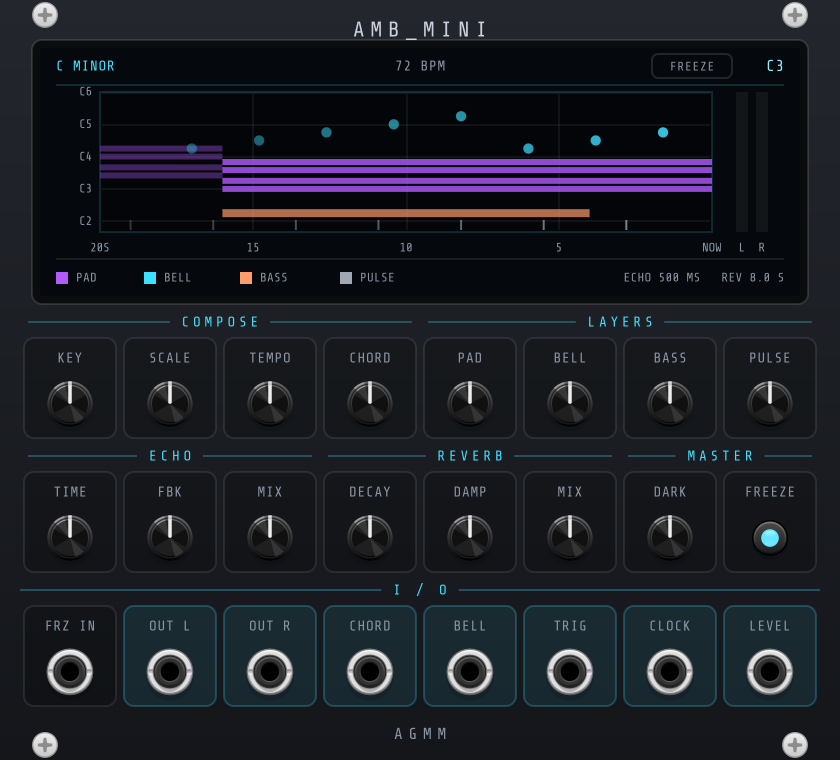

<!--
AGMM AUTOMATIC DOCUMENTATION
Source: AMB_MINI.cpp
-->

# AMB_MINI

## 1. Overview

`AMB_MINI` is a 28 HP compact generative ambient machine in the spirit of Brian Eno's AMB-1 tapes and its bigger sibling `AMB`. It composes by itself: it picks a chord every few seconds, and against that chord it plays four independent layers — a slow detuned pad, eight long FM bell loops of unequal prime lengths, a sub bass with a low rumble, and six Euclidean heartbeat layers. The whole mix then runs through a tape ping-pong echo and a very long reverb. Nothing ever repeats exactly.

`AMB_MINI` is intentionally a *different* module from `AMB`: it has its own scale tables, its own engine (`AmbEngine`), its own DSP primitives (in namespace `ambdsp`), its own panel class, and its own display class. Everything is wrapped in an anonymous namespace so that the two modules can coexist in the same VCV Rack process without colliding symbols.

Key features:
- Ten scales, automatic chord progression with 7 s equal-power cross-fade
- Four layers (PAD, BELL, BASS, PULSE) with independent levels
- Eight long bell loops of unequal prime lengths (17, 23, 29, 31, 37, 41, 43, 47 beats)
- Six Euclidean heartbeat layers
- Tape-style ping-pong echo with wow, flutter, drift, saturating feedback
- 8-line FDN reverb with Hadamard matrix (RT60 up to 32 s), freezable
- 380 × 124 display: 20 s piano-roll history, stereo meters
- CV / gate outputs: chord root, bell pitch, bell trigger, clock, level

## Module Screenshot

## 2. Architecture

### Main Classes

- `AMB_MINI` — Rack module class inheriting from `rack::Module`
- `AmbEngine` — the entire generative engine (no Rack dependencies)
- `ambdsp::DelayLine`, `ambdsp::Allpass` — DSP primitives
- `ambdsp::Reverb` — 8-line FDN with Hadamard mixing
- `ambdsp::Echo` — tape-style ping-pong delay
- `AMBPanel` — static panel artwork
- `AMBDisplay` — 380 × 124 composite display

### Inheritance

- `AMB_MINI` inherits from `rack::Module`
- `AmbEngine` is a standalone struct held by value
- `AMBPanel` and `AMBDisplay` inherit from `rack::TransparentWidget`

### Structures

- `ambdsp::DelayLine` — fractional delay line (linear interpolation)
- `ambdsp::Allpass` — Schroeder allpass with fixed integer delay
- `AmbEngine::NoteEvent { double born, end; float pitch; int layer; }`
- `AmbEngine::PadSet { float note[4]; float phase[8]; float freq[8]; float gain; }`

### Linkage and isolation

All symbols that would collide with `AMB` (`AmbEngine`, `ambdsp::*`, `*ParamQuantity`, `AMB_MINI`, `AMB_MINIWidget`, the panel/display widgets, the layout constants) are wrapped in a file-scoped anonymous namespace. Only `modelAMB_MINI` is exported, and its type is just `Model*`, so no layout information from either engine crosses the translation-unit boundary. This is what allows `AMB` and `AMB_MINI` to be loaded together in one plugin without an ODR violation crash.

### State (grouped)

| Group | Storage |
|-------|---------|
| Parameters | 16 params (key, scale, tempo, chord interval, 4 layer levels, echo/reverb, dark, freeze) |
| Transport | `double beatPhase`, `int lastBeat`, `double time` |
| Pad | `PadSet pad[2]`, `int padCur`, `float padFade`, `padLfo[8]`, `padLfoRate[8]`, `padTimer`, `lastDegree` |
| Bells | `bellPh[8]`, `bellModPh[8]`, `bellEnv[8]`, `bellAge[8]`, `bellFreq[8]`, `bellRatio[8]`, `bellVel[8]`, `bellPan[8]`, `bellCycle[8]` |
| Bass | `bassPitch, bassTarget, bassPhase, bassLfo`, `texLp1, texLp2` |
| Pulse | `euclidStep[6]`, `pulseEnv[6]`, `pulsePhase[6]`, `tickEnv[6]`, `tickLp[6]`, `euclidPat[6][32]`, `euclidLen[6]` |
| Smoothed controls | `sPad, sBell, sBass, sPulse, sEchoMix, sRevMix, sDark` |
| Effects | `echo`, `reverb` |
| Master | `mLp1L, mLp2L, mLp1R, mLp2R`, `dcXL, dcYL, dcXR, dcYR` |
| History | `NoteEvent hist[160]`, `histPos` |
| RNG | `uint32_t rngState` |

## 3. DSP Theory

### Transport

The engine runs a beat clock at `TEMPO` BPM. Beat phase is fractional and drives every time-based layer.

### Chord scheduling

Every `CHORD` seconds (4 – 60 s, default 24 s) the engine picks a new chord from the current scale, and cross-fades between the old `PadSet` and the new one over 7 s with an equal-power curve:

$$
g_{\text{new}} = \sin\!\left(\tfrac{\pi}{2} t\right), \quad g_{\text{old}} = \cos\!\left(\tfrac{\pi}{2} t\right)
$$

### Scale degrees

Degrees wrap through the scale table, with an exact integer divisor for negatives:

$$
\text{degSemis}(d) = \text{INTERVALS}[(d \bmod n)] + 12 \lfloor d/n \rfloor
$$

### Pad (LAYER_PAD)

Four chord tones (root, third, fifth, colour), each rendered as two detuned voices. Every voice is a three-partial additive sine with one LFO modulating brightness and amplitude:

$$
v = \sin\theta + 0.5\, h_b \sin 2\theta + 0.28\, h_b \sin 3\theta, \quad h_b = \text{bright}\cdot(0.35 + 0.65\, \text{lfo})
$$

$$
\text{bright} = 0.06 + 0.55(1 - \text{DARK})
$$

A 37 s breath LFO modulates the total pad gain.

### Bells (LAYER_BELL)

Eight loops of unequal prime lengths (17, 23, 29, 31, 37, 41, 43, 47 beats). A new bell is fired at each loop boundary with 78 % probability. Each bell is an FM oscillator with envelope `exp(−t/3.8)`:

$$
\text{idx} = (0.35 + 0.9\,(1 - \text{DARK})) \cdot \text{vel} \cdot \text{env}^2 \cdot 1.6
$$
$$
\text{carrier} = \sin(2\pi\theta + \text{idx} \cdot \sin(2\pi\theta_m))
$$

### Bass (LAYER_BASS)

A sine wave with 22 % second harmonic, a slow 0.5 Hz amplitude LFO, and a two-pole low-passed noise rumble at 90 Hz.

### Pulses (LAYER_PULSE)

Six Euclidean layers with cycle lengths/pulses: (32,5), (24,4), (16,2), (28,3), (20,5), (12,3). Each hit fires a low-frequency sine "kick" (0.28 s decay) and a filtered noise "tick" (0.03 s decay).

### Echo (post-dry, pre-reverb)

Stereo ping-pong with independent L/R delay times, wow + flutter + drift LFOs, a one-pole low-pass (frequency = `2800 · 0.35^DARK`) and high-pass at 150 Hz in the feedback path, `tanh` soft clip. Right channel feeds left, left feeds right.

### Reverb (final wet path)

8-line feedback delay network with the orthonormal 8 × 8 Hadamard matrix (`HH^T = I`, scaled by `1/√8`). Per-line RT60 gain `10^{−3·d_i / (f_s·T)}` with `T = 0.8·40^{DECAY}`, one-pole damping at `fc = 12000 · 0.0667^{DAMP}`, slow LFO read-position modulation. Three input allpasses per side and a 30 ms pre-delay. **Freeze** sets `g_i = 1`, disables modulation, mutes input.

### Master

Two-pole low-pass whose cutoff follows `DARK` (`f_c = 12000·0.06^{DARK}`), DC blocker at 12 Hz, `tanh(1.1 x)` soft saturation.

### RNG

xorshift32 with a fresh seed on patch load.

## 4. Parameters and Controls

### Row 1 — COMPOSE | LAYERS

| Parameter | Min | Max | Default | Description |
|-----------|-----|-----|---------|-------------|
| `KEY_PARAM` | 0 | 11 | 0 | Key (C, C#, D … B), snapped |
| `SCALE_PARAM` | 0 | 9 | 1 | Scale (Major, Minor, Dorian, Phrygian, Lydian, Mixolydian, Harm Minor, Locrian, Min Pent, Whole Tone) |
| `TEMPO_PARAM` | 40 | 180 | 72 | Tempo in BPM |
| `CHORD_INT_PARAM` | 4 | 60 | 24 | Chord change interval (s) |
| `PAD_LEVEL_PARAM` | 0 | 1 | 0.60 | Pad level |
| `BELL_LEVEL_PARAM` | 0 | 1 | 0.45 | Bell level |
| `BASS_LEVEL_PARAM` | 0 | 1 | 0.50 | Bass level |
| `PULSE_LEVEL_PARAM` | 0 | 1 | 0.25 | Pulse (heartbeat) level |

### Row 2 — ECHO | REVERB | MASTER

| Parameter | Min | Max | Default | Description |
|-----------|-----|-----|---------|-------------|
| `ECHO_TIME_PARAM` | 0.12 | 1.2 | 0.50 | Echo time (s) |
| `ECHO_FBK_PARAM` | 0 | 0.9 | 0.60 | Echo feedback |
| `ECHO_MIX_PARAM` | 0 | 1 | 0.45 | Echo mix |
| `REVERB_DECAY_PARAM` | 0 | 1 | 0.70 | Reverb decay (RT60 0.8 – 32 s) |
| `REVERB_DAMP_PARAM` | 0 | 1 | 0.55 | Reverb damping |
| `REVERB_MIX_PARAM` | 0 | 1 | 0.60 | Reverb mix |
| `DARK_PARAM` | 0 | 1 | 0.60 | Master tone (low = bright, high = dark) |
| `FREEZE_PARAM` | 0 / 1 | — | — | Latching reverb freeze |

### Row 3 — I/O

Row 3 has no parameters — only the freeze input and the seven outputs.

## 5. Inputs and Outputs

### Inputs

| Name | Type | Range | Description |
|------|------|-------|-------------|
| `FREEZE_INPUT` | Gate | 0..10 V | > 1 V freezes the reverb (OR with the button) |

### Outputs

| Name | Type | Range | Description |
|------|------|-------|-------------|
| `OUT_L_OUTPUT` | Audio | ±5 V | Left stereo audio |
| `OUT_R_OUTPUT` | Audio | ±5 V | Right stereo audio |
| `CHORD_OUTPUT` | CV | 1 V/oct | Chord root, C4 = 0 V |
| `BELL_OUTPUT` | CV | 1 V/oct | Pitch of the last bell |
| `TRIG_OUTPUT` | Trigger | 0 / 10 V | 5 ms pulse per new bell |
| `CLOCK_OUTPUT` | Trigger | 0 / 10 V | 5 ms pulse per beat |
| `LEVEL_OUTPUT` | CV | 0..10 V | Peak output level |

### Lights

- `FREEZE_LIGHT` — illuminated while frozen (button or gate).

### Menu

No menu options.

## 6. Signal Processing Pipeline

Per sample, `AmbEngine::process(dt)` runs:

1. **Smoothing** — 50 ms one-pole on all 7 level / mix / dark targets.
2. **Transport** — advance `beatPhase`; update `beatCount` on integer beat boundaries.
3. **Chord scheduling** — advance `padTimer`; pick a new chord on overflow; advance pad cross-fade and `chordRoot` one-pole.
4. **Render Pad** — 2 chord sets × 4 notes × 2 detuned voices.
5. **Render Bells** — 8 loops; envs > 0.0008 only.
6. **Render Bass** — sine + second harmonic + noise rumble.
7. **Render Pulses** — 6 Euclidean layers with kick + tick envelopes.
8. **Dry sum** — `tanh(pad + bell + bass + pulse)`.
9. **Echo** — tape ping-pong on dry; added to the mix.
10. **Reverb** — 8-line FDN on the mix.
11. **Master** — two-pole low-pass following DARK, DC blocker, soft limit.
12. **Meters** — smoothed peak with a 0.25 s release.

## 7. Important Functions

### `void AmbEngine::pickNewChord()`

Chooses a new chord via weighted-random degree selection (weights 0.30, 0.08, 0.14, 0.18, 0.16, 0.10, 0.04), then arms the 7 s cross-fade into the other `PadSet`. Updates the bass target and writes new history events for pad and bass.

### `void AmbEngine::startChord()`

First-time chord: calls `pickNewChord()`, snaps `padFade = 1`, `bassPitch = bassTarget`, `chordRoot = pad[padCur].note[0]`.

### `int AmbEngine::degSemis(int deg) const`

Maps a scale degree (may be negative) to semitones above C3 using `AMB_SCALE_INTERVALS`.

### `void AmbEngine::process(float dt)`

Main callback described in §6.

### `void ambdsp::Reverb::process(...)` / `void ambdsp::Echo::process(...)`

Per-sample effect blocks (see §3).

### `void AMB_MINI::process(const ProcessArgs &args)`

Rack wrapper: sets sample rate, handles key/scale change, button debounce, freeze OR gate, transfers 16 parameters into `AmbEngine`, calls `engine.process(dt)`, writes 7 outputs, drives 2 trigger generators from counter diffs.

### `json_t *AMB_MINI::dataToJson()` / `void AMB_MINI::dataFromJson(json_t *)`

Persist `frozen` with the patch.

## 8. Mathematical Implementation

### Scale degree lookup

$$
\text{semis}(d) = \text{INTERVALS}\!\left[(d \bmod n + n) \bmod n\right] + 12 \lfloor d/n \rfloor
$$

### Pad cross-fade

$$
g_\text{new} = \sin\!\left(\tfrac{\pi}{2} t\right), \quad g_\text{old} = \cos\!\left(\tfrac{\pi}{2} t\right), \quad t = \min(1, \text{padFade}/7)
$$

### Pad voice

$$
\begin{aligned}
v(t) &= \sin\theta + 0.5\, h_b \sin 2\theta + 0.28\, h_b \sin 3\theta \\
h_b &= \text{bright}\,(0.35 + 0.65\, \text{lfo}_k) \\
\text{amp} &= (0.55 + 0.45\, \text{lfo}_k) \, a_k \, 0.105 \, g_\text{set}
\end{aligned}
$$

### Bell loop cycle

$$
c_b = \left\lfloor \frac{\text{beatPhase} + \text{off}_b \, L_b}{L_b} \right\rfloor,\quad L_b \in \{17, 23, 29, 31, 37, 41, 43, 47\}
$$

### Bell FM

$$
\text{idx} = (0.35 + 0.9\,(1-\text{DARK})) \cdot \text{vel} \cdot \text{env}^2 \cdot 1.6
$$

### Euclidean rhythm

$$
\text{pat}_p[i] = ((i \cdot \text{pulses}_p) \bmod \text{steps}_p) < \text{pulses}_p
$$

### Reverb RT60 gain

$$
g_i = 10^{-3 \cdot d_i / (f_s \cdot T)}, \quad T = 0.8 \cdot 40^{\text{DECAY}}
$$

### Hadamard (orthonormal)

Three butterfly passes then scale by `1/√8` — so `H^T H = I`.

### Echo (wow + flutter + drift)

$$
w = 0.0030\sin(2\pi\phi_w) + 0.0007\sin(2\pi\phi_f) + 0.0020\sin(2\pi\phi_d)
$$
$$
t_L = \text{timeSm} \cdot f_s \cdot (1 + w), \quad t_R = 1.5\,t_L \cdot (1 - 0.8 w)
$$

### Master low-pass

$$
f_c = 12000 \cdot 0.06^{\text{DARK}}, \quad \alpha = 1 - e^{-2\pi f_c dt}
$$

## 9. Performance and Optimization

### CPU Usage

- Pad: 16 oscillators (8 active × 2 chord sets, one inactive) × 3 partials + 8 LFOs
- Bells: up to 8 FM oscillators
- Pulses: 6 Euclidean layers × (sine + filtered noise)
- Echo: 2 delay reads + filtered feedback
- Reverb: 8 FDN lines + 6 allpasses + 2 pre-delay lines
- Master: 2 one-poles + DC + tanh, per channel

Rough estimate: 400 – 700 flops/sample, dominated by the reverb.

### Memory Allocation

- All buffers allocated in `setSampleRate()`; no allocation in `process()`
- Reverb: 8 lines × `next_pow2(~5099 + 8)` samples × 4 B ≈ 260 KB
- Echo: 2 lines × 2.4 s × 4 B ≈ 920 KB worst case
- `hist[160]` ≈ 3 KB

### Real-time Processing

- All inner loops bounded by fixed constants (8 pad voices, 8 bells, 6 pulses, 8 FDN lines)
- No allocation, no locks in the audio path

### Thread Safety

- All engine state written by the audio thread
- Display reads via torn reads (cosmetic)

### Numerical Stability

- xorshift32 RNG never returns 0
- Bell env gated at 0.0008 before running
- Echo time clamped to `[8 samples, 2.2 s]`
- Reverb feedback `g_i < 1` outside freeze; freeze sets `g_i = 1` and mutes input so the loop is lossless
- Master soft-clips with `tanh` before the output
- All output voltages clamped by Rack

## 10. Dependencies

### Libraries/Headers

- `plugin.hpp` — VCV Rack core
- `agmm_ui.hpp` — shared AGMM UI helpers
- `<cmath>`, `<cstdint>`, `<cstdio>`, `<cstring>`, `<algorithm>`, `<vector>`

### External Classes

- `rack::Module`, `rack::ModuleWidget`, `rack::TransparentWidget`
- `rack::ParamQuantity` and subclasses (`KeyParamQuantity`, `TempoParamQuantity`, `ChordIntervalParamQuantity`, `EchoTimeParamQuantity`)
- `dsp::SchmittTrigger`, `dsp::PulseGenerator`
- `rack::random` (initial seed)
- `agmm::panelBase`, `agmm::bezel`, `agmm::cell`, `agmm::sectionHeader`, `agmm::screen`, `agmm::plotFrame`, `agmm::meter`, `agmm::chip`, `agmm::text`, `agmm::accent`, `agmm::violet`, `agmm::warm`, `agmm::bright`, `agmm::dim`, `agmm::withA`, `agmm::ALIGN_L/C/R`

### Symbol Isolation

Because `AMB` and `AMB_MINI` are compiled into the same plugin library, every non-exported symbol in `AMB_MINI.cpp` lives in an anonymous namespace so that the linker cannot merge it with the identically-named symbol in `AMB.cpp`. Only `modelAMB_MINI` has external linkage.

## 11. Summary

`AMB_MINI` is the compact sibling of `AMB`: a self-contained generative ambient instrument that schedules its own chords from a ten-scale selection, plays four independent layers against them, and washes the result through a tape echo and a very long freezable FDN reverb. The prime-loop bells and the equal-power chord cross-fade guarantee that no two minutes are ever the same, while the DARK control lets you tilt the entire machine from bright shimmer to a dark, sub-dominated wash.

The 380 × 124 display shows a 20 s piano-roll history with four colour-coded layers, stereo meters, the current key/scale, the live BPM, the chord root, and a FREEZE chip. The pitch / trigger outputs make the generative material easy to drive external voices in key and time.

Compared with `AMB`, `AMB_MINI` drops the choir, pluck, air, and glass layers and the granular / glitch stages, bringing CPU and memory down by roughly an order of magnitude while keeping the same composing spirit. Its anonymous-namespace layout means it can be loaded alongside the full `AMB` in the same patch without symbol collision.