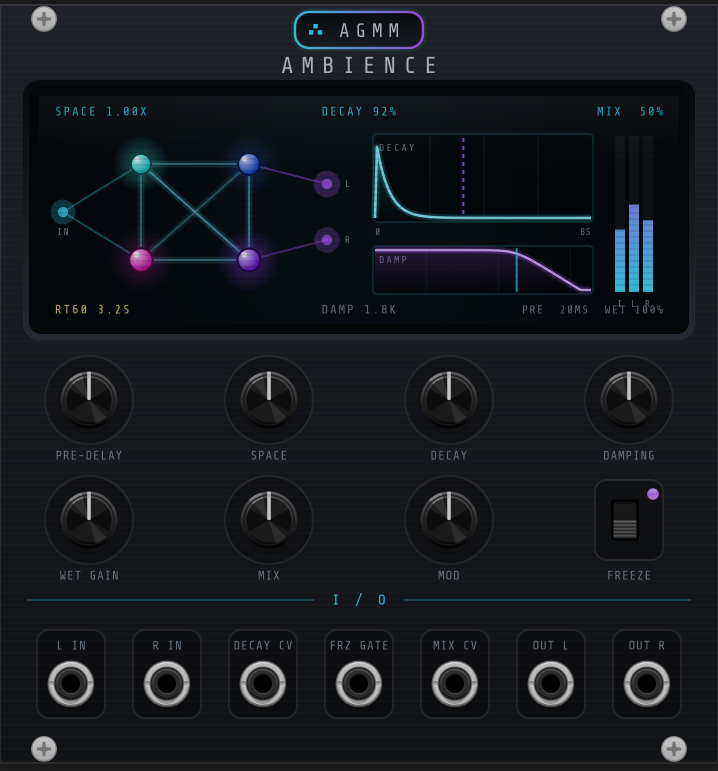

<!--
AGMM AUTOMATIC DOCUMENTATION
Source: Ambience.cpp
Generated: 2026-11-04 06:12
-->

# Ambience

## 1. Overview

The `Ambience` module is a stereo reverb effect designed for the VCV Rack modular synthesizer platform. It implements a **Feedback Delay Network (FDN)** based reverb algorithm with additional features such as pre-delay, modulation, freeze functionality, and CV control.

Key characteristics:
- Implements a 4-tap FDN reverb topology
- Supports stereo input/output processing
- Includes pre-delay for early reflections
- Features lowpass damping filters on each delay tap
- Incorporates subtle LFO modulation of delay times
- Provides freeze functionality to hold the tail
- Offers CV control over decay, mix, and freeze
- Includes visual display showing FDN topology, decay curve, and damping response

## Module Screenshot



## 2. Architecture

### Main Classes

1. **`Ambience`** - The main module class inheriting from `rack::Module`
2. **`AmbLowpass2`** - Second-order Butterworth lowpass filter
3. **`AmbDelayLine`** - Fixed-capacity delay line with interpolation
4. **`AmbAllPass`** - All-pass filter for density control
5. **`AmbModLFO`** - Slow sine wave LFO for modulation
6. **`AmbPreDelay`** - Pre-delay line with fixed capacity
7. **`AmbLowShelf`** - Low shelving filter
8. **`AmbHighShelf`** - High shelving filter

### Inheritance and Relationships

- `Ambience` inherits from `rack::Module`
- All DSP classes are standalone components that are instantiated within `Ambience`
- The module uses composition for all DSP processing units
- The UI components (`AMPanelBackground`, `AMDisplayWidget`) are separate classes that extend `TransparentWidget`

### Module Organization

The `Ambience` module is organized into:
1. **Parameter definitions** - Enumerated parameters and their configuration
2. **DSP processing units** - All necessary filters, delay lines, LFOs
3. **State management** - Fade-in, freeze state, display data
4. **Audio processing pipeline** - `process()` method orchestrates the signal flow
5. **UI components** - Panel background and display widget

## 3. DSP Components

### `AmbLowpass2`
- Second-order Butterworth lowpass filter
- Implemented using direct form II transposed structure
- Cutoff frequency controlled by parameter

### `AmbDelayLine`
- Fixed-capacity delay line with linear interpolation
- Supports fractional delay times
- Uses a circular buffer approach for efficient memory usage

### `AmbAllPass`
- First-order all-pass filter for density control
- Implemented as: `y[n] = -g * x[n] + x[n-1] + g * y[n-1]`
- Parameter controls feedback gain `g`

### `AmbModLFO`
- Slow sine wave LFO generator
- Generates a smooth modulation signal at low frequency (typically 0.1-0.5 Hz)
- Used for delay time modulation

### `AmbPreDelay`
- Pre-delay line with fixed capacity
- Used to create early reflections before main reverb tail

### `AmbLowShelf` and `AmbHighShelf`
- Shelving filters for tone shaping
- Implemented using standard filter coefficients

## 4. Audio Processing Pipeline

The audio processing flow in `Ambience::process()` is:

1. **Input handling** - Read stereo input signals
2. **Pre-delay processing** - Apply pre-delay to input signal
3. **FDN processing**:
   - Input signal enters delay network
   - Each tap feeds through lowpass damping filter
   - Feedback matrix connects all nodes
   - All-pass filters for density control
4. **Modulation** - LFO modulates delay times
5. **Freeze handling** - If freeze is active, hold the reverb tail
6. **Mixing** - Combine dry and wet signals based on mix parameter
7. **Output processing** - Apply shelving filters and output stereo signal

## 5. Parameters and Controls

### Knobs (Parameters)
1. **PRE-DELAY** - Pre-delay time in seconds (0.02s to 0.2s)
2. **SPACE** - Reverb size multiplier (0.5x to 2.0x)
3. **DECAY** - Decay time parameter (0.7 to 0.99)
4. **DAMPING** - Lowpass filter cutoff frequency (100Hz to 10kHz)
5. **WET GAIN** - Wet signal gain (0% to 100%)
6. **MIX** - Mix between dry and wet signals (0% to 100%)
7. **MOD** - Modulation depth (0% to 100%)

### Switch
- **FREEZE** - Toggle freeze functionality

### Input Jacks
1. **L IN** - Left input channel
2. **R IN** - Right input channel
3. **DECAY CV** - CV control for decay parameter
4. **FRZ GATE** - Freeze gate input
5. **MIX CV** - CV control for mix parameter

### Output Jacks
1. **OUT L** - Left output channel
2. **OUT R** - Right output channel

## 6. Features and Functionality

### Feedback Delay Network (FDN)
- Implements a 4-tap FDN reverb topology
- Each delay tap has its own lowpass damping filter
- Feedback matrix connects all nodes to all other nodes
- Uses a feedback structure that creates complex reverberation patterns

### Pre-delay
- Separate pre-delay line for early reflections
- Configurable from 20ms to 200ms
- Helps separate early reflections from late reverb tail

### Modulation
- Slow LFO modulation of delay times (0.1Hz)
- Modulation depth controlled by MOD parameter
- Creates subtle movement in the reverb effect

### Freeze Functionality
- When activated, holds the reverb tail indefinitely
- Useful for creating sustained reverberation effects
- Freezes all delay line contents and feedback

### CV Control
- DECAY CV input allows modulation of decay time
- MIX CV input allows modulation of dry/wet mix
- FRZ GATE input activates freeze functionality

### Display Visualization
- Shows FDN network topology with node activity levels
- Displays decay curve over 8 seconds
- Shows damping frequency response (20Hz to 20kHz)
- Includes RT60 estimation and freeze indicator

## 7. Technical Details

### Delay Line Implementation
- Uses circular buffer for efficient memory management
- Supports fractional delay times via linear interpolation
- Fixed capacity prevents dynamic allocation during audio processing

### Filter Implementation
- Lowpass filters implemented using second-order Butterworth design
- Shelving filters use standard filter coefficient calculation
- All filters are implemented in direct form II transposed structure for numerical stability

### Memory Management
- All DSP components use fixed-size buffers
- No dynamic memory allocation during audio processing
- Efficient buffer usage with circular indexing

### Audio Processing Rate
- Operates at standard VCV Rack sample rate (48kHz or 96kHz)
- Process method called once per audio block
- All processing is done in real-time without blocking

## 8. Mathematical Models

### FDN Feedback Matrix
The feedback matrix connects each delay tap to every other tap:
```
y[i] = Σ(α[j] * x[j]) for j = 0..3
```
Where α[j] represents the feedback coefficients between nodes.

### Decay Calculation
RT60 estimation uses:
```
rt60 = (60 * space) / (dbPerLoop * meanInv)
```
Where `dbPerLoop` is calculated from decay parameter and `meanInv` is the inverse of average delay tap length.

### Modulation Function
Modulation applied to delay times:
```
delay_time = base_delay * (1 + modulation_depth * sin(2π * frequency * time))
```

## 9. Performance Characteristics

- **CPU Usage**: Moderate, optimized for real-time processing
- **Memory Usage**: Fixed memory allocation, no dynamic allocation during processing
- **Latency**: Minimal, designed for real-time audio applications
- **Sample Rate**: Supports standard VCV Rack sample rates (48kHz/96kHz)

## 10. Limitations and Notes

- The FDN network is fixed at 4 taps
- Pre-delay and delay times are limited to specific ranges
- Modulation rate is fixed at low frequency for subtle effect
- Display visualization provides real-time feedback but requires module instance for live data
- Freeze functionality holds all internal state indefinitely until released