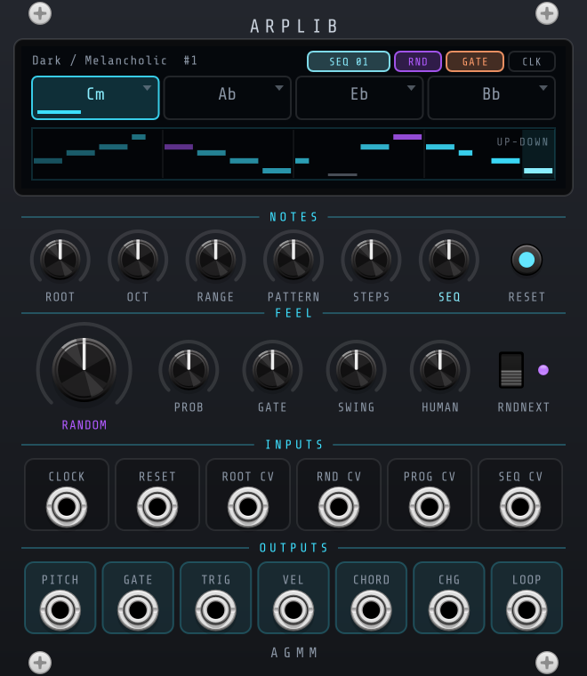

<!--
AGMM AUTOMATIC DOCUMENTATION
Source: ArpLib.cpp
-->

# ArpLib

## 1. Overview

`ArpLib` is a 22 HP chord-progression arpeggiator. It stores twenty user-editable chord sequences (slots), each backed by a style group drawn from a built-in library of 20 groups (10 minor, 10 major) with 50 progressions apiece. Against the currently active slot it plays a note pattern chosen from nine shapes, adds a musical-feel section (randomness, probability, gate length, swing, velocity humanize, and a RNDNEXT switch that turns the chord advance into a random walk), and streams eight performance signals to downstream modules. Every chord can be individually overridden per slot from the on-screen chord strip, which offers a circle-of-fifths drop-down with fourteen chord qualities.

The progression library is built from a small set of handwritten "base" 50-entry lists (MIN_DARK, MIN_GOTHIC, MIN_PSY, MIN_CLASSICAL, MIN_JAZZ, MIN_EXP, MAJ_HAPPY, MAJ_CINEMA, MAJ_JAZZ, MAJ_CLASSICAL). Derivative "family" groups are generated on first use by a token-for-token chord substitution (e.g. every `G` becomes `G7`), so the rhythms of the base list are preserved while the harmonic colour changes.

Key features:
- 20 stored chord sequences, each with independent per-chord overrides
- 20 style groups: 10 minor (dark, cinematic, gothic, psy, jazz, experimental …) and 10 major
- 9 arpeggio patterns: up, down, up-down, down-up, converge, diverge, random, random walk, thumb
- 10 step options per chord (1, 2, 3, 4, 6, 8, 12, 16, 24, 32 clock ticks)
- Swing (odd-step deferral), probability (rests), gate-length randomisation (÷2/÷4/÷8/÷16), velocity humanize
- **RNDNEXT switch** on the FEEL row: replaces the fixed-order chord advance with a uniform random pick, with an optional "may repeat the same chord" mode
- Two-way SEQ control: the SEQ knob follows the `SEQ_CV` input when patched, but a manual knob turn still wins until the CV moves again
- Polyphonic chord output (one channel per chord tone)
- Change and loop triggers derived directly from chord/pattern state
- Live display: chord strip with progress bar, sixteen-step piano roll with note-length and random flags
- Circle-of-fifths chord editor with thirteen chord qualities per root
- CV selection of root, randomness, progression index, and sequence slot

## Module Screenshot

## 2. Architecture

### Main Classes

- `ArpLib` — Rack module class inheriting from `rack::Module`
- `arplib::Group` — one style group (name + 50 progressions)
- `arplib::ChordTones` — parsed chord (up to 8 semitone offsets)
- `ArpLib::Pool` — sorted, deduplicated pitch pool for a chord
- `ArpLib::Progression` — staged chord names + tones, used for audio/UI hand-off
- `ArpLib::SeqSlot` — one of the 20 stored sequences
- `ArpBackdrop` — static panel artwork
- `ProgDisplay` — live chord strip + piano roll (306 × 80)
- `ArpKnobArcs` — circular value arcs drawn under every knob

### Inheritance

- `ArpLib` inherits from `rack::Module`
- `ProgDisplay` inherits from `rack::Widget`
- `ArpBackdrop` and `ArpKnobArcs` inherit from `rack::TransparentWidget`

### Structures

- `arplib::ChordTones` — up to 8 semitone offsets plus a count
- `arplib::IntervalDef` — chord-suffix definition (`name`, `count`, `iv[7]`)
- `arplib::QualityDef` — drop-down chord quality (suffix + description)
- `ArpLib::Pool` — up to 32 sorted unique note numbers per chord, 256 for the union pool
- `ArpLib::Progression` — up to 8 chord names and their parsed tones
- `ArpLib::SeqSlot` — group index + progression index + up to 8 user-chord overrides (C-frame names, empty = preset)
- `ArpLib::StepRec` — one step for the piano-roll history: `valid`, `rest`, `rnd`, `note`, `len`

### State (grouped)

| Group | Storage |
|-------|---------|
| Selection | `groupIdx`, `progIdx`, `rndNextRepeat`, `randomFromChordOnly` |
| Staging | `mtx`, `staged`, `hasStaged` (atomic) |
| 20 stored sequences | `slots[20]`, `activeSlot` |
| Active chord data | `numChords`, `chords[8]`, `pools[8]`, `allPool`, `poolsDirty`, `poolRange` |
| Display | `dispChord`, `dispTranspose`, `dispTick`, `dispSeq`, `dispSteps`, `dispRandom` (all atomic) |
| Sequencer | `clockTrig`, `resetTrig`, `resetBtn`, `trigPulse`, `changePulse`, `loopPulse`, `clockSeen`, `timeSinceClock`, `period`, `tickCounter`, `chordIdx`, `tickInChord`, `patternStep`, `walkIdx`, `chordsSinceLoop`, `pending`, `pendingDelay`, `pendingStartDelay`, `gateRemain`, `currentNote`, `velocity`, `lastProgCv`, `lastCvSlot`, `lastKnobSlot` |
| History | `hist[16]`, `histHead` (atomic) |

## 3. DSP Theory

### Transport

The arpeggiator is **clock-driven**: it advances only on rising edges at `CLOCK_IN`. Between edges it measures the elapsed period with a `SchmittTrigger` (thresholds 0.1 V / 2 V) and clamps it to `[1 ms, 10 s]`. That period is used to compute gate lengths and the swing delay; there is no internal tempo oscillator and no external phase lock.

### Chord advance

`tickInChord` counts clock ticks within the current chord. When it reaches `STEPS` (from the `stepOptions` table: 1, 2, 3, 4, 6, 8, 12, 16, 24, 32), the arpeggiator moves to the next chord, resets `patternStep` and `walkIdx`, and fires `changePulse`. `tickInChord` starts at `1 << 30` on reset so the very first tick lands on chord 0.

**Ordered mode (RNDNEXT off):**

$$
\text{chordIdx} \leftarrow (\text{chordIdx} + 1) \bmod n
$$

and `LOOP` fires whenever the new index is 0 (progression wrap).

**RNDNEXT mode (RNDNEXT on, `n > 1`, not the first step after a reset):**

If `rndNextRepeat` is off, the next chord is uniformly picked from the `n − 1` other chords:

$$
j \leftarrow \text{uniform32} \bmod (n - 1), \quad \text{chordIdx} \leftarrow \begin{cases} j + 1 & j \ge \text{chordIdx} \\ j & \text{otherwise} \end{cases}
$$

If `rndNextRepeat` is on, the full `n` chords are candidates:

$$
\text{chordIdx} \leftarrow \text{uniform32} \bmod n
$$

In either case, `chordsSinceLoop` is incremented on every random advance and `LOOP` fires (and the counter resets) when it reaches `n`, so the downstream loop interval matches the ordered mode's wrap interval. `doReset` clears `chordsSinceLoop`.

The "fresh" guard (`tickInChord >= (1 << 29)`) forces the very first chord after a reset to be chord 0 even when RNDNEXT is on.

### Swing

Odd-numbered ticks (bit 0 of `tickCounter`) are deferred by `SWING × period`. The deferral is a `pending` state with a per-sample countdown; when the countdown reaches zero `fireStep` is called with a `startDelay` equal to the full swing offset, so gate lengths are truncated to avoid overlapping the next tick.

$$
t_\text{delay} = \text{SWING} \cdot T_\text{period}
$$

### Patterns

For a chord with pool size `n` at step index `s`:

| Pattern | Index |
|---------|-------|
| UP | `s mod n` |
| DOWN | `n - 1 - (s mod n)` |
| UP-DOWN | `i < n ? i : 2n - 2 - i` with `i = s mod (2n-2)` |
| DOWN-UP | `n - 1 - (i < n ? i : 2n - 2 - i)` |
| CONVERGE | alternating low/high inward: `k mod 2 == 0 ? k/2 : n - 1 - k/2`, `k = s mod n` |
| DIVERGE | same formula with `k = n - 1 - (s mod n)` |
| RANDOM | `uniform32 mod n` |
| WALK | biased random step, clamped so `walkIdx ∈ [1, n-2]` |
| THUMB | even steps → index 0, odd steps → `1 + (s/2 mod (n-1))` |

### Note pool

For every chord, the tones are stacked across `RANGE` octaves (1–4), then sorted and deduplicated. `allPool` is the union across all chords and is used when `randomFromChordOnly = false`. Per-chord pools are capped at 32 entries; the union pool is capped at 256.

### Randomness and note selection

`rnd` is the RANDOM knob plus `RND_CV × 0.1` (i.e. 0–10 V maps to 0–100 % extra) clamped to `[0, 1]`. On each step:

1. If `uniform() > PROB`, rest (push a rest step into the history, zero the gate).
2. Otherwise, with probability `rnd`, pick a uniformly random note from `allPool` (or from the chord pool if `randomFromChordOnly`), marking the step as random.
3. Else choose `pool[patternIndex(PATTERN, patternStep, pool.n)]`.

### Gate length

Base gate length is the tick period, optionally subdivided by 2, 4, 8 or 16 when a second independent random decision succeeds (probability `rnd`):

$$
k = \begin{cases} \text{uniform32} \bmod 5 & \text{with prob } rnd \\ 0 & \text{otherwise} \end{cases}
$$
$$
L = \min\!\left(\frac{T_\text{period}}{2^k} \cdot \text{GATE},\; T_\text{period} - t_\text{delay} - 1\text{ ms}\right)
$$

The clamp guarantees a re-trigger gap and a minimum of 0.5 ms.

### Velocity

$$
v = \begin{cases} 10 & \text{step 0 of chord} \\ 8 & \text{otherwise} \end{cases} - \text{HUMAN} \cdot \text{uniform} \cdot 6
$$

clamped to `[0, 10]`. Step 0 of each chord is the accent; humanise applies a random reduction up to 60 % of the base value.

### Root transposition

The output pitch is computed as:

$$
V_\text{pitch} = \frac{n_\text{pool} + r_\text{semis} + 12 \cdot \text{OCT}}{12}
$$

with `r_semis = ROOT + round(ROOT_CV × 12)`, and `dispTranspose = (r_semis mod 12 + 12) mod 12`.

### Sequence slots (two-way SEQ knob / SEQ CV)

Without `SEQ_CV` patched, the SEQ knob directly selects the active slot (`round(knob) − 1`, clamped to `[0, 19]`).

With `SEQ_CV` patched, the CV selects the slot:

$$
\text{cvSlot} = \left\lfloor \text{CV} \cdot 2 + 10^{-3} \right\rfloor \bmod 20
$$

and the SEQ knob follows the CV (the param is written to `cvSlot + 1`). A manual knob turn still works: the audio thread compares `knob` and `cvSlot` against `lastKnobSlot` / `lastCvSlot` and picks whichever changed most recently, so hand-turning the knob temporarily overrides the CV until the CV moves to a different slot. Slot switches require the mutex; the audio thread retries on the next sample if the UI holds it.

### Progression CV

A `PROG_CV` of 0–10 V maps linearly to the 50 progressions of the active group's style:

$$
\text{prog} = \left\lfloor \frac{\text{CV}}{10} \cdot 50 \right\rfloor \in [0, 49]
$$

Changing this value rewrites the active slot (and drops its custom chord overrides, so the CV is effectively an arranger input).

## 4. Parameters and Controls

### NOTES row

| Parameter | Min | Max | Default | Description |
|-----------|-----|-----|---------|-------------|
| `ROOT_PARAM` | 0 | 11 | 0 | Root note (C, C#, D, … B), snapped |
| `OCTAVE_PARAM` | -2 | 2 | 0 | Octave transposition (bipolar, snapped) |
| `RANGE_PARAM` | 1 | 4 | 1 | Octave range of the note pool |
| `PATTERN_PARAM` | 0 | 8 | 0 | Arpeggio pattern (see §3) |
| `STEPS_PARAM` | 0 | 9 | 5 | Clock steps per chord, snapped to the `stepOptions` table (1, 2, 3, 4, 6, 8, 12, 16, 24, 32) |
| `SEQ_PARAM` | 1 | 20 | 1 | Active stored sequence (slot); the knob follows `SEQ_CV` when patched |
| `RESET_PARAM` | 0 / 1 | — | — | Momentary reset button (lit by `RESET_LIGHT`) |

### FEEL row

| Parameter | Min | Max | Default | Description |
|-----------|-----|-----|---------|-------------|
| `RANDOM_PARAM` | 0 | 1 | 0 | Randomness (probability of random note / random gate) |
| `PROB_PARAM` | 0 | 1 | 1 | Note probability (1 = always play, 0 = always rest) |
| `GATE_PARAM` | 0.05 | 1 | 1 | Gate length as a fraction of the tick period |
| `SWING_PARAM` | 0 | 0.5 | 0 | Odd-step deferral, as a fraction of `period` |
| `HUMAN_PARAM` | 0 | 1 | 0 | Velocity humanize |
| `RNDNEXT_PARAM` | 0 | 1 | 0 | Off = chords play in order. On = the next chord is chosen uniformly at random from the progression (see §3) |

The FEEL row packs a large RANDOM knob (1.5 units wide) followed by four small knobs (1 unit each) and the RNDNEXT switch cell (1 unit), with the switch's state shown by a small violet light beside it.

### Display

The 306 × 80 display is split into two areas:

- **Chord strip** (top): one rounded rectangle per chord, showing the transposed chord name. The active chord is highlighted with a progress bar showing `tick / steps`. A violet dot in the top-left corner indicates a user override; a small caret in the top-right corner is the drop-down affordance. Clicking any slot opens the chord menu.
- **Piano roll** (bottom): the last sixteen steps, oldest on the left, newest on the right (that column is lightly highlighted). Each step is drawn as a horizontal bar whose length is proportional to the gate length. Rest steps are a thin dash along the baseline; random notes are tinted violet; the newest non-random note is drawn in the brightest accent. The vertical range is computed from the visible notes and padded to at least one octave.

The header carries the group name and progression index, plus four status chips: `SEQ 01`, `RND` (randomness active), `GATE`, `CLK`.

### Context menu

- **Chord progression** (Minor / Major categories, 10 groups each): pick any of the 50 progressions within a group. Shows the chords in the current key.
- **Sequence slots (1-20)**: pick a slot; shows its chords and its style name.
- **Reset edited chords to preset**: drops all per-chord overrides in the active slot.
- **Random notes from current chord only**: selects between the per-chord pool and the union pool for random notes.
- **RNDNEXT may repeat the same chord**: when RNDNEXT is on, this allows the random pick to return the currently playing chord. Off by default (the next chord is guaranteed to be different when `n > 1`).

## 5. Inputs and Outputs

### Inputs

| Name | Type | Range | Description |
|------|------|-------|-------------|
| `CLOCK_INPUT` | Clock | 0..10 V | Rising edges drive the arpeggiator; period is measured for gate/swing timing |
| `RESET_INPUT` | Trigger | 0..10 V | Rising edge resets chord, step, pattern, swing counters and the RNDNEXT loop counter |
| `ROOT_CV_INPUT` | CV | −10..+10 V | 1 V/oct root transposition, quantized to semitones |
| `RANDOM_CV_INPUT` | CV | 0..10 V | Adds up to +100 % to the RANDOM knob |
| `PROG_CV_INPUT` | CV | 0..10 V | Selects progression #1..#50 within the active group (edits the active slot) |
| `SEQ_CV_INPUT` | CV | 0..10 V | Selects sequence slot 1..20 (the SEQ knob follows); a manual knob turn still wins until the CV moves |

### Outputs

| Name | Type | Range | Description |
|------|------|-------|-------------|
| `PITCH_OUTPUT` | CV | 1 V/oct | Arpeggio note |
| `GATE_OUTPUT` | Gate | 0 / 10 V | Gate for the current note |
| `TRIG_OUTPUT` | Trigger | 0 / 10 V | 1 ms pulse on every step |
| `VEL_OUTPUT` | CV | 0..10 V | Velocity of the last note |
| `CHORD_OUTPUT` | Poly CV | 1 V/oct, up to 8 channels | All tones of the current chord |
| `CHANGE_OUTPUT` | Trigger | 0 / 10 V | 1 ms pulse on every chord change |
| `LOOP_OUTPUT` | Trigger | 0 / 10 V | 1 ms pulse on ordered wrap-to-0, or every `numChords` random advances when RNDNEXT is on |

### Lights

- `CLOCK_LIGHT` — flashes on every clock edge
- `GATE_LIGHT` — illuminated while the gate is open
- `RESET_LIGHT` — flashes on reset (button or input)
- `RNDNEXT_LIGHT` — illuminated while the RNDNEXT switch is on

## 6. Signal Processing Pipeline

Per sample, `ArpLib::process(args)` runs:

1. **Pick up a staged progression** — if `hasStaged`, try to acquire `mtx`; on success, copy `staged.tones` into `chords[]`, set `poolsDirty`, clamp `chordIdx` if the new progression is shorter.
2. **Rebuild pools** — if `poolsDirty` or the octave range changed, rebuild per-chord pools and the union pool.
3. **Sequence slot (two-way SEQ)** — read `SEQ` knob and `SEQ_CV`; if CV is patched, follow CV unless the knob was just hand-turned; otherwise use the knob. If the resolved slot differs from `activeSlot`, call `trySelectSlot` (non-blocking; retried next sample). On success, if CV is on, write the resolved slot back to `SEQ_PARAM`.
4. **Progression CV** — if connected, map 0–10 V to 0–49 and call `setProgression` when the value changes.
5. **Reset** — `resetTrig` on `RESET_INPUT` OR `resetBtn` on `RESET_PARAM`; on reset call `doReset()` (which also clears `chordsSinceLoop`) and flash `RESET_LIGHT`.
6. **Clock** — measure `timeSinceClock`; on a rising edge:
   - update `period` from the previous measurement
   - advance `tickCounter`; if odd and `SWING > 0`, arm `pending` with `pendingDelay = SWING × period`
   - otherwise call `fireStep(0)` immediately
   - flash `CLOCK_LIGHT`
7. **Pending step** — decrement `pendingDelay` and call `fireStep(pendingStartDelay)` when it reaches zero.
8. **Transposition** — compute `rootSemis = ROOT + round(ROOT_CV × 12)`, `octSemis = 12 × OCTAVE`, `dispTranspose = (rootSemis mod 12 + 12) mod 12`, and `dispRandom = clamp(RANDOM + RND_CV × 0.1)`.
9. **Gate** — `gate = gateRemain > 0`; decrement.
10. **Outputs** — pitch, gate, trig, velocity, chord (poly), change, loop.
11. **Lights** — `GATE_LIGHT` and `RNDNEXT_LIGHT` smoothed at ≈ 40 Hz.

`fireStep(startDelay)`:

1. If `tickInChord >= STEPS`, advance to the next chord:
   - RNDNEXT mode: pick the next chord with the modulo-arithmetic above; `LOOP` fires when `chordsSinceLoop` reaches `n`
   - ordered mode: `chordIdx = (chordIdx + 1) % n`; `LOOP` fires on wrap to 0
   - reset `patternStep` and `walkIdx`, fire `changePulse`, publish `dispChord`
2. Increment `tickInChord`, publish `dispTick` and `dispSteps`.
3. Compute `rnd`; early out if the chord pool is empty.
4. Probability roll for a rest (write rest to history, zero gate).
5. Choose the note (random or pattern; see §3).
6. Roll for a gate subdivision `k`; compute `len` and clamp; trigger `trigPulse`; publish into history.
7. Compute velocity (accent first step of chord, then apply humanize).

## 7. Important Functions

### `void ArpLib::rebuildStagedLocked()`

Reads the active slot's group/progression, replaces every empty `custom[i]` with the preset chord, parses each chord into `staged.tones[]`, stores the result in `staged`, sets `hasStaged = true`, and updates `dispSeq`. Called under `mtx` by `initSlots`, `setProgression`, `setChord`, `resetChord`, `trySelectSlot`, and `dataFromJson`.

### `void ArpLib::trySelectSlot(int idx)`

Non-blocking slot switch used by the audio thread. Acquires `mtx` with `std::try_to_lock`; on failure returns `false` so the caller retries next sample. On success calls `rebuildStagedLocked()`.

### `void ArpLib::fireStep(float startDelay)`

The heart of the arpeggiator. Handles the chord advance (ordered or RNDNEXT-random with `chordsSinceLoop` loop accounting), rest probability, note choice, gate length, and velocity. See §6 for the full sequence.

### `int ArpLib::patternIndex(int mode, int step, int n)`

Pure function mapping `(pattern, step, pool size)` to a pool index. Handles all nine patterns; `walkIdx` is mutated as a side effect for `PAT_WALK`.

### `void ArpLib::rebuildPools(int range)`

Stacks every chord tone over `range` octaves, deduplicates and sorts each chord pool, then builds the union `allPool`. Sizes are capped at `POOL_MAX` (32) and `ALLPOOL_MAX` (256).

### `arplib::ChordTones arplib::parseChord(const std::string &)`

Splits the chord name (root + accidental + optional `/bass`), looks up the suffix in the `INTERVALS` table, generates `root + interval` semitone offsets (folding roots 6..11 down one octave for a consistent pitch band), and prepends the slash bass as the lowest tone. Unknown suffixes fall back to a major triad. The default return value for an unparseable chord is a C major triad.

### `std::string arplib::transposeName(const std::string &, int semis)`

Display helper. Splits the chord, adds `semis` to root and bass pitch classes, and reassembles using the flat-name table. Used for the on-screen chord strip, the drop-down menu, and the context-menu slot list.

### `std::vector<std::string> arplib::derive(const std::vector<std::string> &base, const SubMap &)`

Single-pass token substitution. Each token is looked up in the map and replaced at most once, so mutual swaps (e.g. `Dm7 ↔ Em7`) do not ping-pong.

### `json_t *ArpLib::dataToJson()` / `void ArpLib::dataFromJson(json_t *)`

Persist all twenty slots (group, progression, custom chords), `randomFromChordOnly`, and `rndNextRepeat`. Backwards-compatible with single-progression patches: their `group`/`prog`/`custom` fields become slot 0.

### `void ArpLibWidget::appendContextMenu(Menu *)`

Adds the "Minor / Major" progression pickers (each a category of 10 groups × 50 progressions), the "Sequence slots" picker, the "Reset edited chords to preset" action, and the "Random notes from current chord only" and "RNDNEXT may repeat the same chord" toggles.

## 8. Mathematical Implementation

### Scale degree (implicit in the library)

The library stores absolute chord names, so no scale degree function is exposed. The transposition used by the display is:

$$
\text{transpose}(c, k) = \text{FLAT\_NAMES}\!\left[(\text{rootPC}(c) + k) \bmod 12\right] + \text{suffix}(c)
$$

with the same operation applied to the slash bass when present.

### Pattern indices

See the table in §3. The four wrap-around patterns all use the period `2n - 2` for a pool of size `n`:

$$
i = s \bmod (2n - 2)
$$
$$
\text{updown}(s) = \begin{cases} i & i < n \\ 2n - 2 - i & i \ge n \end{cases}
$$

### Chord advance — ordered vs RNDNEXT

Ordered:

$$
\text{chordIdx} \leftarrow (\text{chordIdx} + 1) \bmod n, \quad \text{loop} = [\text{chordIdx} = 0]
$$

RNDNEXT, `rndNextRepeat = false`:

$$
j \leftarrow \text{uniform32} \bmod (n - 1)
$$
$$
\text{chordIdx} \leftarrow \begin{cases} j + 1 & j \ge \text{chordIdx} \\ j & \text{otherwise} \end{cases}
$$
$$
\text{loop} = [(\text{chordsSinceLoop} \leftarrow \text{chordsSinceLoop} + 1) \ge n]
$$

RNDNEXT, `rndNextRepeat = true`:

$$
\text{chordIdx} \leftarrow \text{uniform32} \bmod n, \quad \text{loop same as above}
$$

### Gate length

$$
L = \frac{T_\text{period}}{2^k} \cdot \text{GATE}, \quad k = \begin{cases} \text{uniform32} \bmod 5 & \text{with prob } \text{rnd} \\ 0 & \text{otherwise} \end{cases}
$$
$$
L \leftarrow \min(L,\, T_\text{period} - t_\text{delay} - 1\text{ ms})
$$
$$
L \leftarrow \max(L,\, 0.5\text{ ms})
$$

### Swing

Odd ticks are deferred:

$$
t_\text{delay} = \text{SWING} \cdot T_\text{period}
$$

### Velocity

$$
v = \text{base} - \text{HUMAN} \cdot U(0, 1) \cdot 6, \quad \text{base} = \begin{cases} 10 & \text{step 0} \\ 8 & \text{otherwise} \end{cases}
$$

clamped to `[0, 10]`.

### Transposition

$$
r_\text{semis} = \text{ROOT} + \text{round}(\text{ROOT\_CV} \cdot 12)
$$
$$
V_\text{out} = \frac{n_\text{pool} + r_\text{semis} + 12 \cdot \text{OCT}}{12}
$$
$$
\text{dispTranspose} = (r_\text{semis} \bmod 12 + 12) \bmod 12
$$

### Sequence selection

Knob-only:

$$
\text{slot} = \text{round}(\text{SEQ}) - 1, \quad \text{clamped to } [0, 19]
$$

CV patched (0–10 V maps to slots 1–20):

$$
\text{cvSlot} = \left\lfloor \text{CV} \cdot 2 + 10^{-3} \right\rfloor \bmod 20
$$

The audio thread uses `cvSlot` if it changed since the last sample, else the knob if it changed, else the current `activeSlot`. On a successful switch, the SEQ param is written back to `cvSlot + 1` so the knob follows the CV.

### Progression selection

$$
\text{prog} = \left\lfloor \frac{\text{PROG\_CV}}{10} \cdot 50 \right\rfloor, \quad \text{clamped to } [0, 49]
$$

### Randomness

$$
\text{rnd} = \text{clamp}\!\left(\text{RANDOM} + 0.1 \cdot \text{RND\_CV},\; 0,\; 1\right)
$$

### Pool construction

$$
\text{pool}_c = \text{unique}\!\left(\text{sort}\left\{ t_i + 12 o \,\middle|\, t_i \in \text{tones}_c,\; o \in [0, \text{RANGE}) \right\}\right)
$$
$$
\text{allPool} = \text{unique}\!\left(\text{sort}\bigcup_{c} \text{pool}_c\right)
$$

## 9. Performance and Optimization

### CPU Usage

- Chord parsing on rebuild only — `parseChord` is called once per chord per rebuild
- Pool rebuild is amortised over the whole block (a few `memcpy` + `sort` calls per changed progression)
- Per-step work is a handful of branches, one `random::u32` call, and one `random::uniform` call (two when `rnd > 0`); RNDNEXT adds one more `random::u32` per chord change
- Per-sample work outside the clock path is bounded: one `SchmittTrigger`, one gate decrement, a few `setVoltage` calls
- Step history is a 16-entry ring buffer with a single atomic store per push

Rough estimate: < 100 flops/sample between clock edges, plus one `setVoltage` per output per sample.

### Memory Allocation

- All buffers are statically sized; no allocation in `process()`
- `slots[20]` holds 20 × 8 chord-name strings, each at most ~12 characters — trivial
- `chords[8]` and `pools[8]` hold the parsed data for the active slot; sizes are fixed
- `hist[16]` is 16 × ~20 B
- `staged` is a single `Progression`, rewritten only on UI events

### Real-time Processing

- The only blocking construct in `process()` is `std::unique_lock(mtx, try_to_lock)`; on failure the code simply skips the update for one sample
- No allocation, no syscalls, no I/O in the audio path
- All inner loops are bounded by the fixed `POOL_MAX` and `MAX_TONES` sizes

### Thread Safety

- `slots[]`, `activeSlot`, `staged`, `groupIdx`, `progIdx` are all guarded by `mtx`
- `hasStaged` is an atomic flag; the audio thread checks it before touching `staged`
- `dispChord`, `dispTranspose`, `dispTick`, `dispSeq`, `dispSteps`, `dispRandom`, `histHead` are all `std::atomic`
- History is written by the audio thread only, read by the UI; no lock is needed because each entry is a small struct and torn reads are cosmetic

### Numerical Stability

- The chord parser falls back to a C major triad on any parse error
- The pool builder deduplicates and sorts, so random/pool indexing can never go out of range
- `patternIndex` returns `0` for pools of size 1 (avoids division by zero in WALK and THUMB)
- `len` is clamped to `[0.5 ms, period − startDelay − 1 ms]` so a gate can never exceed its tick
- `walkIdx` is clamped to `[1, n-2]` (with `n ≥ 2` guaranteed by the early return)
- `tickInChord` starts at `1 << 30` after reset so the very first step lands on chord 0 (and the `fresh` guard also forces this in RNDNEXT mode)
- `lastProgCv` prevents repeated `setProgression` calls when the CV is steady
- `lastCvSlot` / `lastKnobSlot` prevent SEQ feedback loops when CV and knob both point at the current slot
- `chordsSinceLoop` is reset whenever the ordered mode runs, so switching RNDNEXT off and on again starts the RNDNEXT loop counter from zero
- `rndNextRepeat = false` guarantees a different chord when `n > 1`, avoiding the "same chord twice in a row" case unless the user enables it

## 10. Dependencies

### Libraries/Headers

- `plugin.hpp` — VCV Rack core
- `agmm_ui.hpp` — shared AGMM UI helpers
- `<algorithm>`, `<atomic>`, `<mutex>`, `<string>`, `<utility>`, `<vector>`

### External Classes

- `rack::Module`, `rack::ModuleWidget`, `rack::Widget`, `rack::TransparentWidget`
- `rack::ParamQuantity` (for the snapped SEQ knob)
- `dsp::SchmittTrigger`, `dsp::BooleanTrigger`, `dsp::PulseGenerator`
- `rack::random` (`u32`, `uniform`)
- `rack::ui::Menu`, `rack::ui::MenuSeparator`, `rack::createMenuLabel`, `rack::createMenuItem`, `rack::createSubmenuItem`, `rack::createCheckMenuItem`, `rack::createBoolPtrMenuItem`
- `agmm::panelBase`, `agmm::bezel`, `agmm::cell`, `agmm::sectionHeader`, `agmm::screen`, `agmm::plotFrame`, `agmm::chip`, `agmm::text`, `agmm::accent`, `agmm::violet`, `agmm::warm`, `agmm::bright`, `agmm::dim`, `agmm::withA`, `agmm::ALIGN_L/C/R`

### Parameter quantity subclasses

- `RoundSmallBlackKnob` with `snap = true` (custom `SmallSnapKnob`)
- `RoundLargeBlackKnob` (the large RANDOM knob)
- `VCVLightButton<MediumSimpleLight<agmm::CyanLight>>` (the RESET button)
- `CKSS` (the RNDNEXT switch) with `SmallLight<agmm::VioletLight>` beside it

## 11. Summary

`ArpLib` is a self-contained chord-progression arpeggiator. It ships with twenty stored sequences and a 20-group library of 50 progressions each, so there is plenty of material to explore out of the box; the circle-of-fifths chord editor lets you replace any chord in any slot with any of fourteen qualities, and the whole thing is persisted with the patch.

The nine patterns cover the usual melodic shapes (up, down, up-down, down-up, thumb) plus three more generative ones (converge, diverge, random walk). The FEEL section is deliberately wide, so you can lean on it to humanise a static pattern: swing pushes odd steps late, probability drops notes, gate randomisation shortens some gates to 1/2, 1/4, 1/8 or 1/16 of the tick, humanise randomises velocity per note, and the RNDNEXT switch replaces the fixed-order chord advance with a uniform random pick. By default RNDNEXT guarantees the next chord is different; the context menu option "RNDNEXT may repeat the same chord" removes that guarantee if you want a static harmonic field.

Sequence slots can be selected by the SEQ knob, by `SEQ_CV` (0–10 V = slots 1–20), or from the context menu. With `SEQ_CV` patched, the CV drives the slot and the knob follows, but a manual knob turn still wins until the CV moves to a different slot — so both hands can drive the sequence from the same source. The `PROG_CV` input lets a sequencer scan through progressions within the active style without touching the UI, which is useful for modular "turning the harmony into a modulation source" patches. A `randomFromChordOnly` toggle in the context menu chooses whether random notes come from the current chord's pool or from the whole progression.

The 306 × 80 display is the primary interface: chord strip on top with click targets and the active-chord progress bar, and a sixteen-step piano roll with per-step note length, rests, and randomness flags on the bottom. The knob arcs follow the pattern used across the AGMM collection, so the module reads correctly in both bright and dimmed rooms.

The main trade-offs are storage (twenty slots × eight chords × two bytes of override, plus the library itself) and per-step randomness (every step can consume up to four `rack::random` values, though the common case uses one), plus one extra `random::u32` per chord change when RNDNEXT is on. The audio path itself is one `SchmittTrigger`, one optional `unique_lock(try_to_lock)`, and a handful of `setVoltage` calls per sample, so it is cheap next to the surrounding patch.