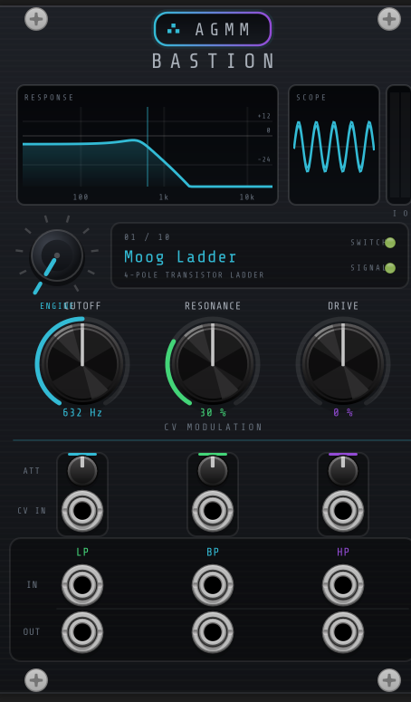

<!--
AGMM AUTOMATIC DOCUMENTATION
Source: Bastion.cpp
Generated: 2026-11-04 06:12
-->

This code defines a VCV Rack module called **Bastion**, which is a multi-engine filter with various visualization features. Here's a breakdown of its key components:

## Module Screenshot

### 1. **Module Structure**
- **`Bastion`**: The main module class that handles parameters, processing, and state.
- **`BastionWidget`**: The UI widget for the module, including panel drawing and controls.
- **`BastionPanel`**: A custom panel widget responsible for static artwork and live displays (response curves, scope, meters).
- **`BastionEngineKnob`**: A custom knob for selecting the filter engine.

### 2. **Key Features**
#### Filter Engines
The module supports multiple filter algorithms:
- Moog
- TB303
- CEM3320
- Roland OTA
- EMS Diode
- WASP
- MS20
- SEM
- Steiner
- Buchla LPG

Each engine has a distinct frequency response and resonance behavior.

#### Visualizations
1. **Response Curve Display**:
   - Shows the magnitude response (dB) of the selected filter engine.
   - Includes grid lines for frequency (100Hz, 1kHz, 10kHz) and dB levels (+12dB, 0dB, -24dB).
   - Highlights the cutoff frequency with a vertical line.

2. **Scope Display**:
   - Visualizes input/output waveforms.
   - Shows min/max values over time for real-time monitoring.

3. **Meters**:
   - Displays input and output signal levels (in dB).

4. **Engine Selector**:
   - A rotary knob with visual feedback showing the current engine.
   - Indicator lights show which engine is active.

#### Controls
1. **Main Knobs**:
   - Cutoff Frequency
   - Resonance
   - Drive (for non-linear effects)

2. **CV Modulation**:
   - Trimpots for attenuating CV signals.
   - Input jacks for CV modulation of each parameter.

3. **Signal Routing**:
   - Three input jacks (LP, BP, HP) for different filter types.
   - Three output jacks corresponding to the same filter types.

#### Context Menu
- Allows switching between filter engines.
- Resets module state.

### 3. **Technical Details**
- Uses NVG (NanoVG) for drawing graphics.
- Implements custom drawing functions (`drawPanelBase`, `screen`, `label`, etc.) for UI elements.
- Includes mathematical models for each filter engine using complex numbers and transfer functions.
- Handles real-time visualization updates in the `drawLive` function.

### 4. **Usage**
1. **Installation**: Place the module in your VCV Rack plugins folder.
2. **Configuration**:
   - Select a filter engine using the rotary knob.
   - Adjust cutoff, resonance, and drive parameters.
   - Use CV inputs to modulate these parameters.
3. **Monitoring**:
   - Observe response curves, scope displays, and meters for real-time feedback.

### 5. **Dependencies**
- Requires VCV Rack SDK.
- Uses NanoVG for rendering graphics.
- Depends on standard C++ libraries (`<complex>`, `<cmath>`, etc.).

This module provides a rich set of filtering options with visual feedback, making it suitable for experimental sound design and modular synthesis applications.