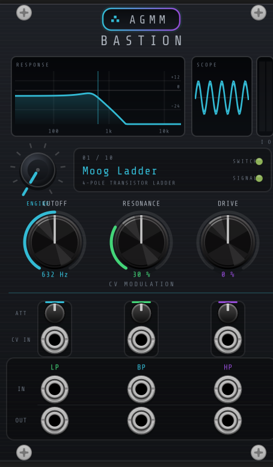

<!--
AGMM AUTOMATIC DOCUMENTATION
Source: BouncingBalls.cpp
Generated: 2026-11-04 06:13
-->

The provided code defines a VCV Rack module named `BouncingBalls`, which simulates physics-based bouncing balls within a confined playfield. It includes both the core logic in the `BouncingBalls` class and its visual representation in the `BouncingBallsWidget`.

## Module Screenshot

Here's a breakdown of the key components:

1.  **Module Logic (`BouncingBalls` class):**
    *   **Parameters:** Defines parameters for controlling the simulation:
        *   `SPEED_PARAM`: Controls the base speed of the balls.
        *   `ANGLE_PARAM`: Sets the base angle of ball movement.
        *   `ANGLE_ATTENUATOR_PARAM`: Adjusts how much CV input affects the angle.
        *   `NUM_BALLS_PARAM`: Sets the number of balls in the simulation.
        *   `COLLISIONS_SWITCH_PARAM`: Toggles collisions between balls on/off.
        *   `RESET_BUTTON`: Triggers a manual reset of the simulation.
    *   **Inputs:** Accepts CV signals for speed, angle, and ball count, as well as a reset trigger.
    *   **Outputs:**
        *   `X_OUTPUT`, `Y_OUTPUT`: Polyphonic outputs representing the current X and Y positions of each ball (in volts).
        *   `GATE_X_OUTPUT`, `GATE_Y_OUTPUT`: Polyphonic gate outputs triggered when a ball crosses the center X or Y axis.
        *   `VOCT_X_OUTPUT`, `VOCT_Y_OUTPUT`: Polyphonic outputs representing the velocity of balls in volts/octave (based on `voctRange`).
        *   `COLLISION_GATE_OUTPUT`: A single gate output triggered whenever any collision occurs.
        *   `WALL_HIT_GATE_OUTPUT`: A single gate output triggered whenever any ball hits a wall.
    *   **LEDs:** 16 LEDs for each of the collision and wall hit outputs, indicating which ball caused the event.
    *   **State Variables:**
        *   `numBalls`: Current number of active balls.
        *   `speedBase`, `angleBase`: Base values for speed and angle (in radians).
        *   `posX`, `posY`, `velX`, `velY`: Arrays storing the position and velocity of each ball.
        *   `flashCol`, `flashWall`: Arrays storing temporary visual "flash" states for collisions and wall hits.
        *   `wallSide`, `wallPos`: Arrays storing information about which side of the playfield a ball hit and where.
        *   `xcPos`, `ycPos`: Arrays storing the X and Y coordinates of the center of mass of the balls (used for gate triggering).
        *   `trailX`, `trailY`, `trailHead`, `trailCount`: Arrays storing the historical positions of balls for drawing trails.
        *   `voctRange`, `gateDuration`: Configuration settings for output scaling and gate length.
    *   **Methods:**
        *   `process(const ProcessArgs& args)`: Main simulation loop. Updates ball positions, handles collisions, triggers gates, updates LEDs, and calculates outputs.
        *   `reset()`: Initializes the simulation state (positions, velocities).
        *   `onSampleRateChange()`: Called when the sample rate changes, potentially affecting timing.
        *   `dataToJson()`, `dataFromJson()`: Serialize/deserialize module state for saving/loading presets.

2.  **Visual Components (`BouncingBallsWidget` and related classes):**
    *   **`BBPanelBackground`**: Draws the main panel background with a dark theme, rounded corners, and a grid pattern.
    *   **`BBDisplayWidget`**: The core visual representation of the simulation playfield:
        *   Draws the metal rail, glass playfield, grid lines, and axis markers.
        *   In `drawLayer`, it renders the balls, their trails, collision flashes, wall hit flashes, axis crossing flashes, and readouts (ball count, speed, angle, collision status).
        *   Uses a `module` pointer to get live simulation data or falls back to a static demo scene if no module is connected.
    *   **`BBBarsWidget`**: Displays a set of vertical bars representing the speed of each ball in the simulation.
    *   **`BouncingBallsWidget` (Main Widget):**
        *   Sets up the panel size and adds the background, display, and bar widgets.
        *   Adds all the physical controls (`Knobs`, `Jacks`, `Switches`, `Buttons`, `Lights`) to the panel at their specified positions.
        *   Implements a context menu (`appendContextMenu`) allowing users to select the voltage range for `VOCT` outputs and the duration of gate triggers.

3.  **Key Features:**
    *   **Physics Simulation:** Simulates balls bouncing within a rectangular playfield, including collisions between balls and walls.
    *   **Polyphonic Outputs:** Each ball's position, velocity, and collision/wall hit events are output as polyphonic signals.
    *   **Visual Feedback:** The display shows the balls, trails, flashes for collisions and wall hits, and real-time readouts. LEDs indicate which ball caused a specific event.
    *   **Configurable Parameters:** Users can adjust speed, angle, number of balls, enable/disable collisions, and choose output voltage ranges and gate durations.
    *   **Reset Functionality:** A button allows resetting the simulation to its initial state.

This module provides a visually engaging and interactive way to explore physics-based motion and generate polyphonic control signals in VCV Rack.