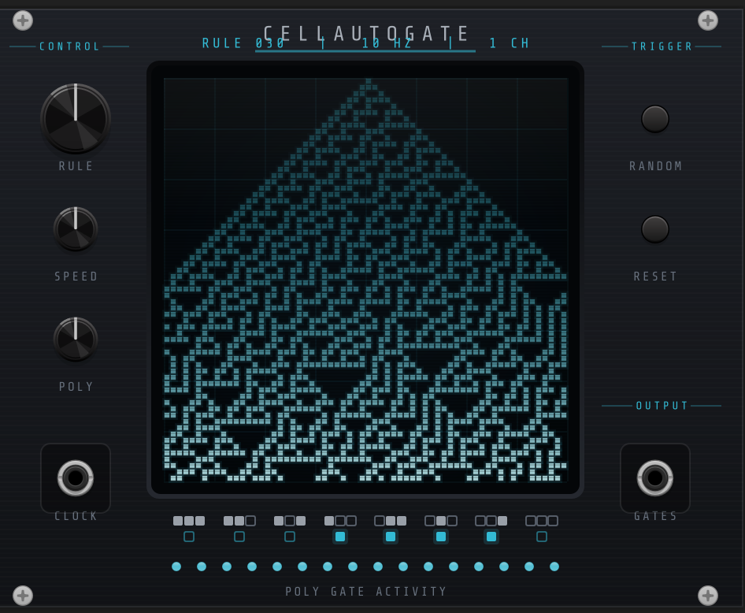

<!--
AGMM AUTOMATIC DOCUMENTATION
Source: CellAutoGate.cpp
-->

# CellAutoGate

## 1. Overview

`CellAutoGate` runs a one-dimensional elementary cellular automaton (Wolfram rules 0–255) on a 64-cell row and turns the cells into a 1–16 channel polyphonic gate signal. Each channel samples the automaton at an evenly spaced position along the row, so different channels fire different rhythms from the same rule.

Key features:
- Configurable rule set (0–255) using a 3-bit neighborhood lookup
- Adjustable speed (1–160 Hz) or external clock
- Polyphonic gate outputs (1–16 channels)
- Randomize and Reset controls
- Visual display of automaton history with a rule truth-table glyph row
- Status row showing rule, clock source and poly channel count

## Module Screenshot



## 2. Architecture

### Main Classes

- `CellAutoGate`: Core module class inheriting from `rack::Module`
- `CAPanelBackground`: Static panel artwork
- `CellularDisplayWidget`: Dynamic visualization of automaton history
- `CAStatusWidget`: Status text row above the display
- `CARuleTableWidget`: Rule truth-table glyphs under the display
- `TCaCyanLight<TBase>`: Custom cyan LED widget
- `CellAutoGateWidget`: Module UI widget

### Inheritance

- `CellAutoGate` inherits from `rack::Module`
- `CellularDisplayWidget`, `CAPanelBackground`, `CAStatusWidget`, `CARuleTableWidget` inherit from `rack::TransparentWidget`
- `TCaCyanLight<TBase>` is a template specialization of `GrayModuleLightWidget`

### Structures

- `std::array<uint64_t, ROWS>`: Ring buffer for storing automaton history
- `uint64_t currentRow`: Current state of the automaton (bitfield, 64 cells)
- `int ruleset[8]`: Lookup table for rule interpretation (8 entries)

### Relationships

- `CellAutoGateWidget` owns and manages: `CAPanelBackground`, `CellularDisplayWidget`, `CAStatusWidget`, `CARuleTableWidget`, and all controls
- `CellularDisplayWidget` accesses `CellAutoGate` state for rendering
- `CellAutoGate` maintains internal state and processes audio samples

## 3. DSP Theory

The module implements a 1D binary cellular automaton with a von Neumann neighborhood (3-cell window: left, center, right).

### Mathematical Foundation

Let $N_i(t)$ be the state of cell $i$ at time $t$, where $N_i \in \{0,1\}$. The next state is:

$$
N_i(t+1) = R\left(N_{i-1}(t), N_i(t), N_{i+1}(t)\right)
$$

Where $R$ is a lookup function defined by the rule number.

### Rule encoding

The rule number $r$ defines the transition function:

$$
R(l,c,r) = \text{ruleset}[l \cdot 4 + c \cdot 2 + r]
$$

Where $l, c, r$ are the left, center, right neighbor states.

### Signal processing

No analog signal processing occurs. The module operates purely in the digital domain, updating its internal state on each sample tick or clock event.

## 4. Parameters and Controls

### Knobs

| Parameter | Min | Max | Default | Description |
|-----------|-----|-----|---------|-------------|
| `RULE_PARAM` | 0 | 255 | 30 | Automaton rule number |
| `SPEED_PARAM` | 1 | 160 | 10 | Clock rate in Hz (no external clock) |
| `POLY_PARAM` | 1 | 16 | 1 | Number of polyphonic output channels |

### Buttons

| Button | Description |
|--------|-------------|
| `RANDOM_PARAM` | Randomizes the initial state |
| `RESET_PARAM` | Resets to initial state (center cell on) |

### Inputs

| Input | Description |
|-------|-------------|
| `CLOCK_INPUT` | External clock signal; triggers step when connected |

### Outputs

| Output | Description |
|--------|-------------|
| `GATE_OUTPUT` | Polyphonic gate (10V = on, 0V = off) |

### Enumerations

- `ParamId`: Rule, Speed, Polyphony, Random, Reset
- `InputId`: Clock input
- `OutputId`: Gate output
- `LightId`: Gate lights (16 total)

## 5. Inputs and Outputs

### Input

| Name | Type | Range | Description |
|------|------|-------|-------------|
| `CLOCK_INPUT` | Gate | 0–10 V | External clock; triggers step when connected |

### Output

| Name | Type | Range | Description |
|------|------|-------|-------------|
| `GATE_OUTPUT` | Poly Gate | 0–10 V | One gate per channel |

## 6. Signal Processing Pipeline

1. Initialization — Module initializes with rule 30 and center cell on; history buffer cleared.
2. Parameter Updates — Rule parameter updates ruleset; Polyphony adjusts output channel count.
3. Event Handling — `RANDOM_PARAM` randomizes state; `RESET_PARAM` resets to initial; `CLOCK_INPUT` triggers step if connected.
4. Timing Control — If external clock: step on rising edge; else: step at fixed interval from `SPEED_PARAM`.
5. Automaton Step — For each cell: extract neighbors, compute index, lookup next state, build new row, push to history.
6. Output Generation — Distribute gate outputs across polyphonic channels; each channel's output is a specific cell position in the current row.

## 7. Important Functions

### `updateRuleset(int rule)`

Converts rule number into lookup table:

```cpp
for (int i = 0; i < 8; ++i)
    ruleset[i] = (rule >> i) & 1;
```

### `stepAutomaton()`

Performs one step of cellular automaton evolution:

```cpp
uint64_t next = 0;
for (int i = 0; i < COLS; ++i) {
    int left   = (currentRow >> ((i + COLS - 1) % COLS)) & 1;
    int center = (currentRow >> i) & 1;
    int right  = (currentRow >> ((i + 1) % COLS)) & 1;
    int index  = (left << 2) | (center << 1) | right;
    next |= (uint64_t)ruleset[index] << i;
}
currentRow = next;
pushHistory(currentRow);
```

### `process(const ProcessArgs &args)`

Main processing function: handles parameter changes, timing, output gates, light indicators.

### `randomize()`

Generates random initial state:

```cpp
uint64_t r = 0;
for (int i = 0; i < COLS; ++i)
    if (random::uniform() > 0.5f)
        r |= (1ULL << i);
currentRow = r;
```

### `restart()`

Resets automaton to initial state:

```cpp
currentRow = 1ULL << (COLS / 2);
histHead = histCount = 0;
pushHistory(currentRow);
```

## 8. Mathematical Implementation

### Cellular automaton transition function

$$
\text{next}[i] = \text{ruleset}\left[\left(\text{current}[i-1] \cdot 4\right) + \left(\text{current}[i] \cdot 2\right) + \text{current}[i+1]\right]
$$

Indexing wraps around using modulo arithmetic. `ruleset` is a lookup table of 8 bits derived from the rule number.

### Bit manipulation

```cpp
int left   = (currentRow >> ((i + COLS - 1) % COLS)) & 1;
int center = (currentRow >> i) & 1;
int right  = (currentRow >> ((i + 1) % COLS)) & 1;
int index  = (left << 2) | (center << 1) | right;
next |= (uint64_t) ruleset[index] << i;
```

### History buffer

A ring buffer stores the last `ROWS` automaton states:

```cpp
std::array<uint64_t, ROWS> history{};
int histHead = 0;
int histCount = 0;
```

### Channel position distribution

Each poly channel samples a specific cell:

$$
\text{pos}_c = \left\lfloor \frac{(c+1) \cdot \text{COLS}}{N+1} \right\rfloor, \quad c = 0,\ldots,N-1
$$

## 9. Performance and Optimization

### CPU Usage Considerations

- Fixed number of operations per sample (COLS × 8)
- Bit manipulation is efficient
- No floating-point arithmetic in core loop

### Memory Allocation

- Fixed-size arrays: `ruleset[8]`, `history[ROWS]`
- No dynamic allocation during processing
- Stack-based variables for temporary calculations

### Buffers

- History buffer (`std::array<uint64_t, ROWS>`) is preallocated
- Ring buffer management with head/tail indices

### Real-time Processing

- All operations are deterministic and bounded
- No blocking or time-consuming operations
- Uses `dsp::SchmittTrigger` for reliable clock detection

### Thread Safety

- History buffer access is read-only from UI thread (torn reads are cosmetic)
- No shared mutable state between audio and UI threads during rendering

### Numerical Stability

- Integer bit operations ensure deterministic behavior
- No floating-point accumulation or iteration errors

## 10. Dependencies

### Libraries/Headers

- `rack.hpp`: VCV Rack core API
- `<array>`: Standard C++ containers
- `<cmath>`, `<cstdint>`, `<cstdio>`, `<algorithm>`, `<cstring>`: Standard C++ utilities
- `dsp::SchmittTrigger`: Rack DSP utility for reliable trigger detection

### External Classes

- `Module`: Base VCV Rack module class
- `TransparentWidget`: Base widget for overlay rendering
- `Vec`, `NVGcontext`, `DrawArgs`: VCV Rack graphics and geometry classes
- `random::uniform()`: Random number generator from Rack

## 11. Summary

`CellAutoGate` is a VCV Rack module implementing a one-dimensional binary cellular automaton with gate output functionality. It simulates the evolution of a 64-column, 64-row automaton using standard Wolfram rules (0–255). The module supports external clock triggering, adjustable speed, polyphonic outputs, and visual feedback through an animated display showing the automaton's history.

The implementation uses bit manipulation for efficient state transitions, a ring buffer for history storage, and deterministic timing control. It provides both manual controls (randomize, reset) and automatic operation modes (clocked or timed). The visual representation includes a CRT-style display with scanlines and rule lookup glyphs for educational purposes.
