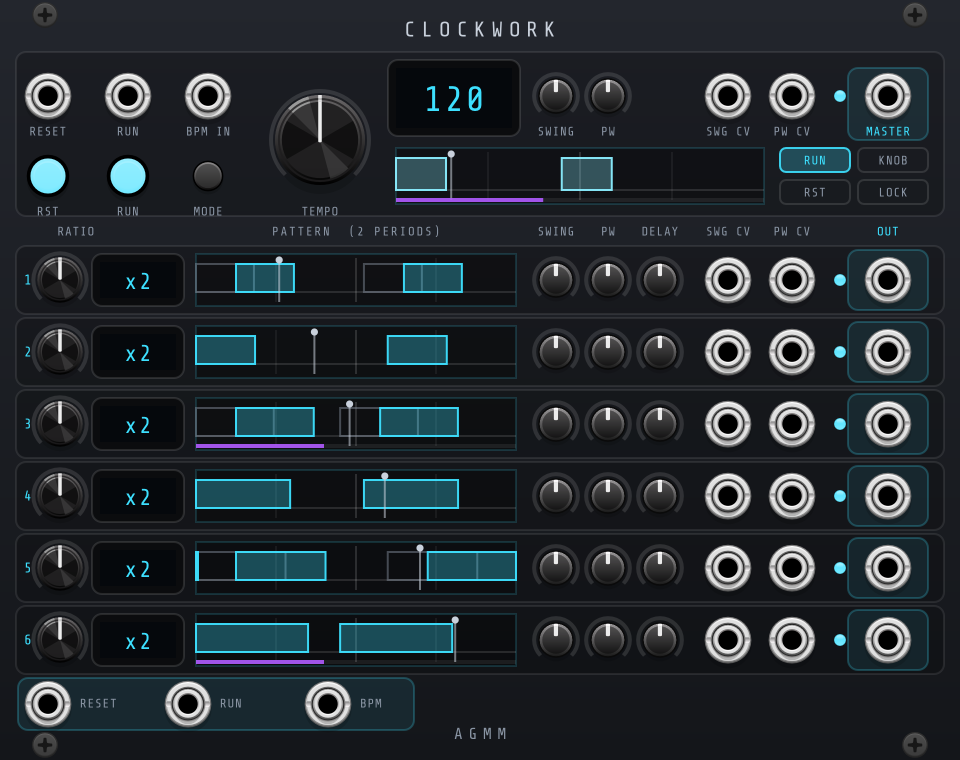

<!--
AGMM AUTOMATIC DOCUMENTATION
Source: Clockwork.cpp
-->

# Clockwork

## 1. Overview

`Clockwork` is a 32 HP chainable master clock with six independent sub-clocks. It was inspired by Impromptu's Clocked but is a completely fresh implementation: phase-based engine, no legacy code, no shared headers with the original. It can run on its own internal tempo (30 – 300 BPM, snap knob) or be driven by an external BPM signal, either as a 1 V/oct CV (0 V = 120 BPM) or as an incoming clock at 4 / 8 / 12 / 24 PPQN with automatic tempo and phase locking.

For each of the six sub-clocks you get:
- a multiply / divide ratio from x1 up to x64 and /1 down to /64, including the musical x1.5 and x2.5 values,
- a swing amount (–100 % … +100 %),
- a pulse width (0 % … 100 %, never shorter than 1 ms),
- a discrete delay from none up to 3/4 of a sub-period,
- a swing CV input, a pulse-width CV input,
- a clock gate output and an LED.

Ratio changes are deferred to the next master bar so that rhythmic material stays in sync when you twist the ratio knob. The engine is entirely phase-based: every sub-clock is derived from `masterPhase` plus a per-sub bar counter, so tempo changes stretch all clocks smoothly and never accumulate drift.

The module also provides Run / Reset buttons plus inputs, and Reset / Run / BPM chain outputs for daisy-chaining several Clockwork instances. An optional menu item emits a reset pulse whenever the transport is stopped.

Key features:
- Master tempo 30 – 300 BPM (snap knob) or external CV / clock
- External clock detection at 4, 8, 12, 24 PPQN with PLL-style smoothing
- Six sub-clocks with multiply / divide ratios, swing, PW, delay, CVs
- Ratio changes applied at the next master bar (SYNC flag on scope)
- Phase-based engine: tempo changes stretch all clocks, no drift
- Per-row pattern scope with ghost outline, playhead and frame progress
- Master scope plus status chips (RUN / source / RST / LOCK)
- Daisy-chainable RESET / RUN / BPM outputs
- Optional "emit reset when run stops"

## Module Screenshot

## 2. Architecture

### Main Classes

- `Clockwork` — Rack module class inheriting from `rack::Module`
- `RatioQuantity` — `ParamQuantity` subclass that shows the ratio in tooltips
- `ClockworkPanel` — static panel artwork (flat agmm style, drawn in code, no SVG)
- `ClockworkDisplay` — BPM / ratio display with touched-knob overlay
- `ClockworkScope` — per-row pattern scope with swing / PW / delay shape and live playhead
- `ClockworkChips` — 2 × 2 status chips (RUN / mode / RST / LOCK) next to the master scope
- `ClockworkWidget` — `ModuleWidget` that assembles the panel

### Inheritance

- `Clockwork` inherits from `rack::Module`
- `RatioQuantity` inherits from `rack::ParamQuantity`
- `ClockworkPanel`, `ClockworkDisplay`, `ClockworkScope`, `ClockworkChips` inherit from `rack::TransparentWidget`
- `ClockworkWidget` inherits from `rack::ModuleWidget`

### Structures

- `Ratio { int p, q; }` — one sub double-period per `p/q` master double-periods
- `PulseGeom { double start2, width; }` — pulse geometry for one double period

### Linkage and isolation

Everything sits inside the file-scoped anonymous namespace used by the engine — the `Clockwork` module class itself is the only exported symbol through `modelClockwork`. Constants, helper structs and the small anonymous-namespace helper functions (`gcdInt`, `fracPart`, `clampD`, `ratioFromKnob`, `ratioLabel`, `pulseGeom`, `gateHigh`) are file-local and cannot collide with another module in the same plugin.

### State (grouped)

| Group | Storage |
|-------|---------|
| Saved state | `bool running`, `int bpmMode`, `bool resetOnStop` |
| Master transport | `double masterPhase`, `double masterLen`, `bool firstProcess`, `int extIndex` |
| Sub-clocks | `int bars[6]`, `Ratio cur[6]`, `Ratio pending[6]`, `bool pendingFlag[6]` |
| Per-channel DSP cache | `float swing[7]`, `float pw[7]`, `float delayFrac[6]`, `double subPhase[7]`, `double subLen[7]`, `bool gateOut[7]` |
| External clock detect | `bool haveEdge`, `bool firstInterval`, `double edgeTimer`, `double lastInterval` |
| Visuals | `float resetFlash` |
| Utility objects | `dsp::SchmittTrigger runTrig / resetTrig / bpmTrig / modeTrig`, `dsp::PulseGenerator resetPulse / runPulse`, `dsp::ClockDivider ctrlDiv` |

## 3. DSP Theory

### Master phase

The engine works in *double periods*, i.e. the length of one full up‑down cycle of the master LFO at `BPM`:

$$
\text{masterLen} = \frac{120}{\text{BPM}} \ \text{seconds}
$$

`masterPhase` advances by `dt / masterLen` each sample and wraps at 1.0. Wrapping is the "master bar" boundary: `advanceBars()` is called, all sub-clock bar counters advance, and any pending ratio change is committed.

In CV mode the tempo is `1 / 2^{V}` (so 0 V = 120 BPM, +1 V = 240 BPM, –1 V = 60 BPM), clamped to 30 – 300 BPM. In clock mode the interval between incoming rising edges is measured and the master length is smoothed toward `interval × (2·PPQN)` with a 0.4 one-pole, so the PLL settles within a few edges.

### Sub-clock phase

Every sub-clock `i` keeps a bar counter `bars[i]` and a ratio `cur[i] = p/q` (in lowest terms). At any instant:

$$
\text{subPhase}_i = \left\{ \frac{(bars_i + \text{masterPhase}) \cdot p}{q} \right\}, \qquad
\text{subLen}_i = \text{masterLen} \cdot \frac{q}{p}
$$

where `{ }` is the fractional part. The sub double-period is therefore `q/p` master double-periods long. Because everything derives from the same monotonically increasing phase, a tempo change stretches *all* clocks together — no drift is possible.

### Pulse geometry (per sub double-period)

Pulses and gaps are never allowed to fall below 1 ms so downstream modules always see a clean edge. For a sub double-period of length `len` (seconds), with swing `s` in [–1, 1] and PW `w` in [0, 1]:

$$
T = \frac{len}{2}, \quad
sw = \max(0, T - 2\,\text{ms}) \cdot s, \quad
w_{\max} = \max(\text{ms},\ T - \text{ms} - |sw|)
$$

$$
\text{width} = \text{ms} + (w_{\max} - \text{ms}) \cdot w, \qquad
\text{start}_2 = T + sw
$$

Two pulses per double period:
- pulse 1 starts at time 0, width `width`;
- pulse 2 starts at `start2`, width `width`.

For a sub-period the gate is high when the phase (after delay) falls into either pulse window.

### Delay

Delay is stored as a fraction of the *sub double-period* (`{0, 1/16, 1/8, 1/4, 1/3, 1/2, 2/3, 3/4}`) and applied to the phase:

$$
\varphi_\text{eff} = (\varphi_\text{sub} - d_\text{delay}) \bmod 1
$$

The actual time offset is therefore `d × subLen / 2` seconds for the second pulse and `d × subLen / 2` for the first too, matching the "delay fractions of a period" label. The scope draws a ghost outline of the undelayed pattern whenever `d > 0`.

### Ratio mapping

`ratioFromKnob(idx)` maps an integer knob index `idx ∈ [–33, 33]` to a `p/q` ratio:

$$
r_2 = \text{round}\!\left(\text{RATIOS}[\,|idx|\,] \cdot 2\right)
$$

$$
(p, q) = \begin{cases} (r_2, 2) & idx \ge 0 \\ (2, r_2) & idx < 0 \end{cases}
$$

then reduced by `gcd`. The table `RATIOS` contains `{1, 1.5, 2, 2.5, 3, 4, 5, 6, 7, 8, 9, 10, …, 64}` (34 entries), so `x1.5` becomes `(3, 2)` and `/2.5` becomes `(2, 5)`, etc.

## 4. Parameters and Controls

### Master (row at `y = 48`)

| Parameter | Min | Max | Default | Description |
|-----------|-----|-----|---------|-------------|
| `BPM_PARAM` | 30 | 300 | 120 | Internal tempo, snap-enabled |
| `RUN_PARAM` | 0 / 1 | — | — | Run / pause toggle (button) |
| `RESET_PARAM` | 0 / 1 | — | — | Reset button, emits reset pulse |
| `MODE_PARAM` | 0 / 1 | — | — | Cycles CV → 4 → 8 → 12 → 24 PPQN → CV |
| `SWING_PARAMS[0]` | –1 | 1 | 0 | Master swing, ±100 % |
| `PW_PARAMS[0]` | 0 | 1 | 0.5 | Master pulse width, 0 – 100 % |

### Sub-clock rows (`i = 0..5`, `y = 140 + 36·i`)

| Parameter | Min | Max | Default | Description |
|-----------|-----|-----|---------|-------------|
| `RATIO_PARAMS[i]` | –33 | 33 | 0 (x1) | Multiply (> 0) or divide (< 0) ratio, snap |
| `SWING_PARAMS[i+1]` | –1 | 1 | 0 | Swing, ±100 % |
| `PW_PARAMS[i+1]` | 0 | 1 | 0.5 | Pulse width, 0 – 100 % |
| `DELAY_PARAMS[i]` | 0 | 7 | 0 (none) | Delay: none / 1/16 / 1/8 / 1/4 / 1/3 / 1/2 / 2/3 / 3/4 |

### Context menu

| Item | Description |
|------|-------------|
| "Emit reset when run stops" | Toggles `resetOnStop` |
| "BPM input mode" | Radio submenu: CV, or 4 / 8 / 12 / 24 PPQN |

## 5. Inputs and Outputs

### Inputs

| Name | Type | Range | Description |
|------|------|-------|-------------|
| `RESET_INPUT` | Trigger | 0 / 10 V | Schmitt trigger reset |
| `RUN_INPUT` | Trigger | 0 / 10 V | Run toggle (edge) |
| `BPM_INPUT` | CV or clock | –10…+10 V | 1 V/oct tempo CV, or external clock (mode-dependent) |
| `SWING_INPUTS[c]` | CV | ±5 V | Added to the swing knob (×1/5) for channel `c` |
| `PW_INPUTS[c]` | CV | 0…10 V | Added to the PW knob (×1/10) for channel `c` |

### Outputs

| Name | Type | Range | Description |
|------|------|-------|-------------|
| `CLK_OUTPUTS[0]` | Gate | 0 / 10 V | Master clock (double-period gate) |
| `CLK_OUTPUTS[c]` | Gate | 0 / 10 V | Sub-clock 1…6 |
| `RESET_OUTPUT` | Trigger | 0 / 10 V | 1 ms reset pulse |
| `RUN_OUTPUT` | Trigger | 0 / 10 V | 1 ms pulse on run start / stop |
| `BPM_OUTPUT` | CV | 1 V/oct | Echoed input if connected, else `–log2(masterLen)` |

### Lights

- `RESET_LIGHT` — flashes on reset (decays over ~165 ms)
- `RUN_LIGHT` — solid while running
- `CLK_LIGHTS[c]` — smoothed brightness of each channel's gate

### Menu

Context menu adds:
- "Emit reset when run stops" (bool)
- "BPM input mode" (CV / 4 / 8 / 12 / 24 PPQN)

## 6. Signal Processing Pipeline

Per sample, `Clockwork::process(args)` runs:

1. **Control-rate update** (`ctrlDiv` at 1/16) — read swing / PW knobs and CVs, clamp, snap ratio knobs to integers, compute `p/q` and pending flag, delay fraction from the switch, and pick master tempo from knob / CV (clock mode is handled in step 5).
2. **Run toggle** — `runTrig` watches `RUN_PARAM + RUN_INPUT` and calls `setRunning()` on a rising edge. In clock mode only stopping is allowed manually.
3. **Reset** — `resetTrig` on `RESET_PARAM + RESET_INPUT` calls `doReset(true)`.
4. **Mode button** — `modeTrig` cycles `bpmMode` and clears the external-clock state.
5. **External clock detection** — while `bpmMode > 0` and `BPM_INPUT` is patched, `bpmTrig` catches every rising edge; `onExtEdge()` measures the interval, smooths `masterLen`, nudges `masterPhase` toward the expected grid, and re-syncs `extIndex`. If no edge is seen for `lastInterval × 2.5 + 0.1 s`, the transport is stopped.
6. **Master phase** — `masterPhase += dt / masterLen`; wrapping calls `advanceBars()`, which advances every bar counter and commits any pending ratio change.
7. **Sub-clock phase** — for each sub, `subPhase = frac((bars + masterPhase) · p / q)` and `subLen = masterLen · q / p`.
8. **Gate outputs** — for every channel, `gateHigh()` with optional delay; write 10 V or 0 V to `CLK_OUTPUTS[c]` and update `CLK_LIGHTS[c]`.
9. **Chain outputs** — `resetPulse`, `runPulse`, and either the tapped input or `–log2(masterLen)` on `BPM_OUTPUT`.
10. **Visuals** — update `RUN_LIGHT`, decay `resetFlash`.

## 7. Important Functions

### `void Clockwork::doReset(bool emit)`

Snaps `masterPhase` to 0, clears every bar counter, commits any pending ratio change, clears `extIndex`, sets `resetFlash = 1`, and (optionally) fires `resetPulse`.

### `void Clockwork::setRunning(bool r)`

Sets `running`, fires `runPulse`, and — if `resetOnStop` is set — calls `doReset(true)` when stopping.

### `void Clockwork::advanceBars()`

Called at every master bar boundary. For each sub:
- if a ratio change is pending, replace `cur[i]` with `pending[i]` and reset `bars[i] = 0`;
- otherwise increment `bars[i]` and wrap at `cur[i].q`.

### `void Clockwork::updateControls(bool bpmConn)`

Runs at control rate. Reads swing / PW knob and CV (with the correct scaling), clamps, computes `delayFrac[i]` from the delay switch, maps the ratio knob to a `Ratio` via `ratioFromKnob()`, and — if `running` — either commits or queues a pending ratio change. Master tempo is set from the knob or, in CV mode, from the 1 V/oct input.

### `void Clockwork::onExtEdge()`

Called on each rising edge of the external clock. When the transport is stopped, the first edge starts it. Measured interval is used to update `masterLen` (0.4 one-pole smoothing), the phase is nudged toward `extIndex / n` (max ±25 % correction), and `advanceBars()` is fired at `extIndex == 0`. `lastInterval` is remembered for the "external clock went away" timeout.

### `PulseGeom pulseGeom(double lenSec, double swing, double pw)`

Helper that computes the two-pulse geometry described in §3. Used both by `gateHigh()` and by every `ClockworkScope` so what you see matches what you hear.

### `bool gateHigh(double phase, double lenSec, double swing, double pw, double delayPhase)`

Returns whether the gate is high given the current phase and the delay offset. Pulses and gaps are always ≥ 1 ms.

### `Ratio ratioFromKnob(int idx)` / `void ratioLabel(int idx, char*, size_t)`

Convert the integer knob index to a `p/q` ratio and produce a display string like `x1.5`, `/3`, `x64`.

### `void Clockwork::process(const ProcessArgs& args)`

Main callback described in §6.

### `json_t* Clockwork::dataToJson()` / `void Clockwork::dataFromJson(json_t*)`

Persist `running`, `bpmMode`, `resetOnStop`. Also resets `firstProcess` on load.

## 8. Mathematical Implementation

### Master double-period

$$
L = \frac{120}{\text{BPM}}, \qquad
L_\text{CV} = \operatorname{clamp}\!\left(2^{-V}, \tfrac{120}{300}, \tfrac{120}{30}\right), \qquad
L_\text{clock} \approx n \cdot \bar{\Delta}
$$

where `n = 2 · PPQN` edges per master double-period and `\bar{\Delta}` is the smoothed external edge interval (0.4 one-pole), clamped to `[120/450, 120/20]` s.

### Sub-clock phase and length

$$
\varphi_i = \left\{ \frac{(bars_i + \varphi) \, p_i}{q_i} \right\}, \qquad
L_i = L \cdot \frac{q_i}{p_i}
$$

### Pulse geometry

$$
T = L_i / 2, \quad
sw = \max(0,\, T - 2\,\text{ms}) \cdot \text{swing}, \quad
w_{\max} = \max(\text{ms},\, T - \text{ms} - |sw|)
$$

$$
w = \text{ms} + (w_{\max} - \text{ms}) \cdot \text{pw}, \qquad
t_2 = T + sw
$$

### Gate decision

With `t = ((\varphi_i - d) \bmod 1) · L_i`:

$$
\text{gate} = [t < w] \ \lor \ [t_2 \le t < t_2 + w]
$$

### Ratio table reduction

`RATIOS` is doubled to integer, then reduced:

$$
(p, q) = \operatorname{reduce}\!\left(\frac{r_2}{2}\ \text{or}\ \frac{2}{r_2}\right)
$$

so that musical values like `x1.5 → (3, 2)` and `/2.5 → (2, 5)` work exactly.

### CV / clock tempo lock

CV mode (`bpmMode == 0`):

$$
L = \operatorname{clamp}\!\left(2^{-V},\, L_{\min},\, L_{\max}\right)
$$

Clock mode (`bpmMode > 0`):

$$
L \leftarrow (1 - \alpha) L + \alpha \cdot n \bar{\Delta}, \qquad \alpha = 0.4
$$

$$
\varphi \leftarrow \varphi + 0.5 \cdot (\varphi_\text{target} - \varphi), \quad \text{only if} \ |\varphi_\text{target} - \varphi| < 0.25
$$

with `\varphi_\text{target} = extIndex / n`.

### Pending ratio change

`advanceBars()` runs at every wrap of `masterPhase` and applies any queued `pending[i]` to `cur[i]`, resetting `bars[i]` to 0 so the new ratio starts on a clean bar boundary.

## 9. Performance and Optimization

### CPU Usage

- 7 sub-clock gate evaluations per sample (each a handful of `fmod` / comparisons)
- A master phase advance plus one `dt / masterLen` division per sample
- Control-rate work (one every 16 samples): 7 swing reads, 7 PW reads, 6 delay switch reads, 6 ratio knob reads, `gcd` on any changed ratio
- External clock detection: one Schmitt trigger per sample in clock mode
- DSP-only, no filters, no oscillators, no reverb — trivial CPU (< 1 % of one core)

### Memory Allocation

- No dynamic allocation anywhere; all state is fixed-size member arrays
- `ctrlDiv` at 1/16 limits `updateControls()` to ≈ 2.75 kHz at 44.1 kHz
- Widgets allocate once at construction only

### Real-time Processing

- One `clamp` on `masterLen` per sample; ratio and CV reads are skipped between control ticks
- No locks, no `malloc`, no `printf` in `process()`

### Thread Safety

- All state written by the audio thread; widgets read torn values (purely cosmetic)

### Numerical Stability

- `masterPhase` is clamped to `[0, 1)` in `onExtEdge()` to avoid `frac()` surprises
- `dt / masterLen` is bounded because `masterLen ≥ LEN_MIN ≈ 0.2 s`
- `pulseGeom()` clamps `width` and `start2` so pulses and gaps always stay ≥ 1 ms
- Delays are stored as fractions and clamped to the 8-entry table
- External-clock intervals are clamped to `[LEN_MIN_EXT, LEN_MAX_EXT]`
- `BPM_OUTPUT` uses `–log2(masterLen)` and is mathematically bounded for a running engine
- Ratios are integers reduced by `gcd`, so `p` and `q` stay small and exact

## 10. Dependencies

### Libraries/Headers

- `plugin.hpp` — VCV Rack core
- `agmm_ui.hpp` — shared AGMM UI helpers
- `<cmath>`, `<cstdio>`, `<algorithm>` (transitively via Rack)

### External Classes

- `rack::Module`, `rack::ModuleWidget`, `rack::TransparentWidget`
- `rack::ParamQuantity`
- `rack::dsp::SchmittTrigger`, `rack::dsp::PulseGenerator`, `rack::dsp::ClockDivider`
- `rack::app::ParamWidget` (via `APP->scene->rack->getTouchedParam()`)
- Widget helpers: `ScrewBlack`, `PJ301MPort`, `RoundBigBlackKnob`, `RoundSmallBlackKnob`, `Trimpot`, `TL1105`, `VCVLightBezel`, `SmallLight`
- `agmm::panelBase`, `agmm::plate`, `agmm::bezel`, `agmm::screen`, `agmm::plotFrame`, `agmm::chip`, `agmm::text`, `agmm::accent`, `agmm::violet`, `agmm::warm`, `agmm::bright`, `agmm::dim`, `agmm::textCol`, `agmm::withA`, `agmm::ALIGN_L/C/R`
- `agmm::CyanLight`

### Symbol Isolation

Only `modelClockwork` has external linkage. All constants (`PANEL_W`, `PANEL_H`, column coordinates, `RATIOS`, `DELAY_FRACS`, `PPQN_TABLE`, `LEN_MIN`/`LEN_MAX`) and helpers live in the file's anonymous namespace, so `Clockwork` can be loaded alongside any other AGMM module without symbol collision.

## 11. Summary

`Clockwork` is a compact, chainable master clock whose whole timing engine is built on a single phase variable. Every sub-clock is derived from `masterPhase + bars[i]` and its `p/q` ratio, so tempo changes, resets and ratio edits all stay perfectly in sync with the master bar. Six channels each get a multiply/divide ratio (including 1.5× and 2.5×), swing, pulse width, delay and a CV pair — enough to drive a whole rhythmic patch from one module. Ratio changes are deferred to the next master bar and flagged on-screen with a SYNC badge, and the pulse geometry is always kept ≥ 1 ms wide so downstream modules never miss an edge.

The engine runs on either an internal snap tempo (30 – 300 BPM) or a 1 V/oct CV input, and can also phase-lock to an external clock at 4, 8, 12 or 24 PPQN with a one-pole smoothing loop. RESET, RUN and BPM outputs make it trivial to daisy-chain several Clockworks (or to hand the same master clock to another module) while the visualisers — a per-row two-period pattern scope with ghost outline and playhead, plus a master scope with RUN / source / RST / LOCK chips — show exactly what every output is doing at a glance.