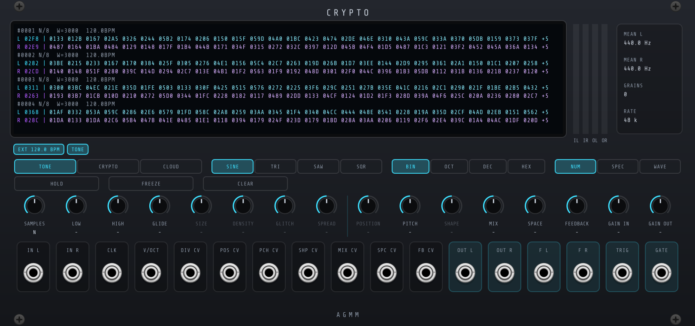

<!--
AGMM AUTOMATIC DOCUMENTATION
Source: Crypto.cpp
-->

# Crypto

## 1. Overview

`Crypto` is a 54 HP polyphonic frequency-code granular processor. Its central idea is unusual: every audio sample of `IN L` / `IN R` is turned into a 16-bit code and mapped exponentially onto a frequency between `LOW` and `HIGH`. A clock input defines a tick; the distance between two ticks is `N` samples. A captured window inside each tick is decoded back to frequencies and shown on the display as fixed-width numbers in binary, octal, decimal or hexadecimal — hence the name. The decoded material can then be played back by three different engines, or the raw input can be re-granulated Clouds-style with a Supercell-style processor chain.

`Crypto` is intentionally a *large* module with its own engine and its own panel kit. It lives in `namespace crypto` and exports only `modelCrypto`.

Key features:
- Samples are coded as 16-bit frequency codes (LOW..HIGH exponential mapping)
- Clock-driven tick capture (`CLK` in, internal clock fallback)
- Seven capture windows: N, N/2, N/3, N/4, N/8, N/16, N/32
- Three engines: TONE (mean frequency oscillator), CRYPTO (grain pool from codes), CLOUD (input audio granulator)
- Supercell-style processor: POSITION, PITCH, SHAPE, MIX, SPACE (reverb), FEEDBACK, GAIN IN, GAIN OUT
- Six of those have dedicated CV inputs; PITCH also responds to 1 V/oct
- 640×128 display with NUMBERS / SPECTROGRAM / WAVE views
- Polyphonic-friendly internal buffers (~5.4 s history), 48 grain voices
- Stereo Freeverb-style reverb, saturating feedback path
- Log of 64 ticks kept on the module for the display
- External clock or 40–200 BPM internal clock (right-click menu)

## Module Screenshot

## 2. Architecture

### Main Classes

- `crypto::Crypto` — Rack module class inheriting from `rack::Module`
- `crypto::DataScreen` — 640×128 composite display (Numbers / Spectrogram / Wave)
- `crypto::ChipRow` — segmented push-button row bound to a single param (Mode, Wave, Base, View)
- `crypto::ChipButton` — latching toggle (Hold, Freeze) or momentary button (Clear)
- `crypto::AgmmKnob` — 26×26 knob with a value arc
- `crypto::Reverb` — small stereo Freeverb-style reverb (4 combs + 2 allpasses / channel)
- `crypto::Grain` — one grain voice (oscillator or stereo buffer grain)
- `crypto::TickRec` — one captured tick as shown on the display

### Inheritance

- `Crypto` inherits from `rack::Module`
- `DataScreen` inherits from `rack::widget::Widget` (uses layered drawing)
- `ChipRow` / `ChipButton` inherit from `app::ParamWidget`
- `AgmmKnob` inherits from `app::Knob`
- `CryptoWidget` inherits from `rack::ModuleWidget`

### Structures

- `KnobDef { const char *label; float lo, hi; bool exp; const char *unit; float def; }`
- `KnobDef KNOBS[K_COUNT]` — single source of truth for mapping, tooltips and panel text
- `TickRec { uint32_t tick, window, period; uint8_t div, n; float bpm, lo, hi, mean[2]; uint16_t code[2][MAXV]; }`
- `Grain { bool on; int ch; double p; float ph, inc, pl, pr; int age, len; }`
- `Rng { uint64_t s; }` — xorshift64, seeded from `this` so each instance differs

### Linkage

The whole implementation lives in `namespace crypto`. Only `modelCrypto` has external linkage, so `Crypto` cannot collide with other modules in the same plugin library even if any helper name is reused.

### Constants

| Name | Value | Meaning |
|------|-------|---------|
| `MAXV` | 32 | codes kept per channel per tick (for display) |
| `LOG_N` | 64 | tick records kept |
| `GRAINS` | 48 | grain voices |
| `DIV_COUNT` | 7 | number of capture window options |
| `BUF_N` | 2^18 | recorded input history (~5.4 s at 48 kHz) |
| `VIZ_N` | 4096 | output history ring used by the display |

### State (grouped)

| Group | Storage |
|-------|---------|
| Params | `P_MODE`, `P_BASE`, `P_WAVE`, `P_VIEW`, `P_HOLD`, `P_FREEZE`, `P_CLEAR`, `P_DIV`, 15 knobs |
| Shared with UI | `TickRec history[64]`, `ticks`, `periodShown`, `windowShown`, `divShown`, `grainsShown`, `bpmShown`, `capProgress`, `srShown`, `meanShown[2]`, `extClock`, `clearReq`, `vuIn[2]`, `vuOut[2]`, `vizL/ vizR[4096]`, `vizPos` |
| Control | `mode`, `wave`, `divIdx`, `hold`, `freeze`, `k[K_COUNT]`, `fLo`, `fHi`, `glideCoef`, `gIn`, `gOut`, `dryG`, `wetG`, `fbAmt`, `space`, `shape`, `posN`, `pitchRatio` |
| Clock | `clkTrig`, `tickPulse`, `lastExt`, `haveEdge`, `sinceEdge`, `period`, `intCount` |
| Capture | `capOn`, `capIdx`, `capLen`, `capStride`, `capN`, `capDiv`, `sum[2]`, `capLo/Hi/Ln`, `cur` |
| Synth | `hasData`, `fTarget[2]`, `fCur[2]`, `phase[2]`, `pool[2][32]`, `poolN/Lo/Hi` |
| Granular | `bufL/bufR[BUF_N]`, `wpos`, `grains[48]`, `spawnAcc`, `nextSpawn`, `rng`, `rev` |
| Meters | `pkIn/Out[2]`, `vuCount` |
| Persistence | `intBpm` (menu) |

## 3. DSP Theory

### Clock and tick

The tick period is either measured from the `CLK` input (samples between rising edges) or taken from the internal clock at `BPM = intBpm`. In both cases `N = period` samples, and `BPM = 60·sr / N`.

### Frequency code

Every audio sample `v ∈ [−5, +5] V` is mapped to `x ∈ [0, 1]` by

$$
x = \operatorname{clamp}\!\left(\frac{v + 5}{10}, 0, 1\right)
$$

and stored as a 16-bit integer `c = round(x · 65535)`. The reverse map is exponential:

$$
f(c) = \text{LOW} \cdot \left(\frac{\text{HIGH}}{\text{LOW}}\right)^{c/65535}
$$

The `LOW`/`HIGH` used during a tick are latched at capture start (`capLo`, `capHi`, `capLn = ln(HIGH/LOW)`).

### Capture window

Each tick captures `W = N / DIVS[divIdx]` samples starting at the tick. Every captured sample updates `sum[ch] += f(code)` and, whenever `capIdx % stride == 0`, appends the code to `cur.code[ch]`, with `stride = ceil(W / MAXV)`. When the window closes, `mean[ch] = sum[ch] / capIdx`.

The current capture window is exposed to the UI via `windowShown` and a progress bar via `capProgress`.

### Engines

**TONE**: for each channel, the current oscillator frequency `fCur[ch]` glides (Glide knob in ms) towards `fTarget[ch]` (the captured mean of the last tick), then plays at `fCur[ch] · pitchRatio`.

**CRYPTO**: an oscillator grain engine. At each spawn the grain picks a code from `pool[ch]`, transforms it (glitch bit-flips, spread detune), converts to Hz, then plays a band-limited oscillator of `K_SIZE` samples with a grain window.

**CLOUD**: a buffer granulator. At each spawn it opens a stereo grain into `bufL/bufR` at some position (based on `POSITION` and `SPREAD`), reads it forward or (with glitch probability) backward, applies pan and grain window, and accumulates.

Both granulators share a grain window (`grainEnv`) and are normalised by `1/sqrt(n)` where `n` is the currently active grain count.

### Oscillator

Waveform selection is 0 sine, 1 triangle, 2 saw, 3 square. Saw and square use PolyBLEP anti-aliasing with per-sample phase increment `dt`.

### Reverb

A small stereo Freeverb-style reverb: 4 combs + 2 allpasses per channel, damping and feedback derived from `SPACE`:

$$
\text{fb} = 0.70 + 0.28 \cdot \text{SPACE}, \quad \text{damp} = 0.40 - 0.25 \cdot \text{SPACE}
$$

`SPACE` crossfades the dry/wet mix of the reverb *inside the engine path* (not the final output mix, which is `MIX`).

### Feedback

`FEEDBACK` writes `tanh(wet · fb) · fb` back into the recorded buffer (`bufL/bufR`), so it persists into future grains when the buffer is unfrozen. If `FREEZE` is active, the write is skipped.

### Final mix

$$
o_L = \text{clamp}\!\left[(d_L \cdot \cos(\tfrac{\pi}{2}m) + y_L \cdot \sin(\tfrac{\pi}{2}m)) \cdot g_{\text{out}} \cdot 5,\ -10, 10\right]
$$

(and similarly for `oR`), with `m` the normalised `MIX` and `y = e · (1 − 0.5·SPACE) + reverb(e) · SPACE · 2`.

## 4. Parameters and Controls

### Switches / buttons

| Parameter | Values | Default | Description |
|-----------|--------|---------|-------------|
| `P_MODE` | 0..2 | 0 | TONE / CRYPTO / CLOUD |
| `P_WAVE` | 0..3 | 0 | Sine / Triangle / Saw / Square |
| `P_BASE` | 0..3 | 3 | Binary / Octal / Decimal / Hexadecimal |
| `P_VIEW` | 0..2 | 0 | Numbers / Spectrogram / Wave |
| `P_HOLD` | 0/1 | 0 | Stop starting new captures |
| `P_FREEZE` | 0/1 | 0 | Freeze the input buffer |
| `P_CLEAR` | press | — | Clears the tick log |
| `P_DIV` | 0..6 | 0 | N, N/2, N/3, N/4, N/8, N/16, N/32 |

### Knobs

| Knob | Min | Max | Exp | Default | Unit |
|------|-----|-----|-----|---------|------|
| `LOW` | 20 | 2000 | yes | 0.35 | Hz |
| `HIGH` | 200 | 20000 | yes | 0.75 | Hz |
| `GLIDE` | 0 | 500 | no | 0.10 | ms |
| `SIZE` | 5 | 500 | yes | 0.45 | ms |
| `DENSITY` | 1 | 120 | yes | 0.55 | /s |
| `GLITCH` | 0 | 100 | no | 0.15 | % |
| `SPREAD` | 0 | 100 | no | 0.20 | % |
| `POSITION` | 0 | 100 | no | 0.30 | % |
| `PITCH` | −24 | 24 | no | 0.50 | st |
| `SHAPE` | 0 | 100 | no | 0.35 | % |
| `MIX` | 0 | 100 | no | 0.75 | % |
| `SPACE` | 0 | 100 | no | 0.25 | % |
| `FEEDBACK` | 0 | 100 | no | 0.00 | % |
| `GAIN IN` | 0 | 200 | no | 0.50 | % |
| `GAIN OUT` | 0 | 200 | no | 0.50 | % |

The knob table is declared once in `KNOBS[K_COUNT]` and drives mapping (`mapKnob`), tooltips (`configParam`), the panel text (`fmtKnob`) and the CV amount, so changing one place keeps everything consistent.

### CV

| CV input | Modulates | 0–10 V range |
|----------|-----------|--------------|
| `POS_CV` | POSITION | full knob |
| `PITCH_CV` | PITCH | full knob |
| `SHAPE_CV` | SHAPE | full knob |
| `MIX_CV` | MIX | full knob |
| `SPACE_CV` | SPACE | full knob |
| `FB_CV` | FEEDBACK | full knob |
| `DIV_INPUT` | capture window | full 7-option sweep |

### Menu

- **Internal clock** — 40 … 200 BPM presets (20, 40, 60, 80, 90, 100, 110, 120, 128, 140, 150, 174, 200), saved with the patch.
- **Copy last tick to clipboard** — writes the last captured tick to the OS clipboard in the current display base.
- **Clear log**.

## 5. Inputs and Outputs

### Inputs

| Name | Type | Range | Description |
|------|------|-------|-------------|
| `L_INPUT` | Audio | ±5 V | Left audio |
| `R_INPUT` | Audio | ±5 V | Right audio (normalled to left) |
| `CLK_INPUT` | Gate | 0..10 V | Tick clock (Schmitt 0.1 V / 2 V) |
| `VOCT_INPUT` | CV | 1 V/oct | Pitch transpose (0 V = no transpose) |
| `DIV_INPUT` | CV | 0..10 V | Sweep across the 7 capture windows |
| `POS_CV` | CV | 0..10 V | Position |
| `PITCH_CV` | CV | 0..10 V | Pitch |
| `SHAPE_CV` | CV | 0..10 V | Shape |
| `MIX_CV` | CV | 0..10 V | Mix |
| `SPACE_CV` | CV | 0..10 V | Space |
| `FB_CV` | CV | 0..10 V | Feedback |

### Outputs

| Name | Type | Range | Description |
|------|------|-------|-------------|
| `L_OUTPUT` | Audio | ±10 V | Left audio |
| `R_OUTPUT` | Audio | ±10 V | Right audio |
| `FL_OUTPUT` | CV | 1 V/oct | Left mean frequency, 0 V = C4 |
| `FR_OUTPUT` | CV | 1 V/oct | Right mean frequency, 0 V = C4 |
| `TRIG_OUTPUT` | Trigger | 0 / 10 V | 1 ms pulse per closed window |
| `GATE_OUTPUT` | Gate | 0 / 10 V | High while the capture window is open |

## 6. Signal Processing Pipeline

Per sample, `Crypto::process` runs:

1. **Rate change** — if `sr != revSr`, reinitialise the reverb and update `srShown`.
2. **Control** — every 16 samples, `updateControl` reads all params, applies CV to POS/PITCH/SHAPE/MIX/SPACE/FEEDBACK and DIV, and pushes shared values to the UI.
3. **Input read** — `l`, `r` from the input jacks (R normalled to L); peak tracked for VU.
4. **Clock** — external Schmitt-trigger clock or internal BPM accumulator → `onTick()`.
5. **Capture** — while `capOn`, feed `captureSample(l, r)`.
6. **Input stage** — `dL = l·0.2·gIn`, `dR = r·0.2·gIn`.
7. **Engine** — glide `fCur`, then run the selected engine (Tone / Crypto / Cloud).
8. **Space + feedback** — reverb applied, dry+wet summed, feedback written into the recording buffer (unless frozen).
9. **Mix** — equal-power dry/wet crossfade, `GAIN OUT`, soft clamp to ±10 V.
10. **Aux outputs** — `FL`, `FR`, `TRIG`, `GATE`.
11. **Visualisation + meters** — push one sample per channel into the VIZ ring; peak-track VU meters every 256 samples.

## 7. Important Functions

### `void startCapture()`

Latches `capLo/Hi/Ln` from the current knobs, resets the code arrays, computes `capLen = period / DIVS[capDiv]`, `capStride = ceil(capLen / MAXV)`, and sets `capOn = true`.

### `void finishCapture()`

Closes the window: computes `mean[ch] = sum[ch] / capIdx`, copies the codes into `pool`, updates `fTarget`, updates `meanShown`, pushes a `TickRec` into `history`, advances `ticks`, and fires `tickPulse`.

### `void onTick()`

Called on each clock edge. Closes a still-open window first (early tick), then starts a new one if `!hold` and `period >= 2`.

### `void captureSample(float l, float r)`

Per-sample: maps `l`/`r` to `[0, 1]`, accumulates `sum[ch] += f(code)`, stores the code every `stride` samples, and closes the window when `capIdx >= capLen`.

### `void spawnGrain(int ch)`

Finds a free grain, computes length from `SIZE` (with glitch doubling/halving), then:
- in **CRYPTO**: picks a code from `pool[ch]` (glitched / spread), converts it to a frequency, sets oscillator phase/inc.
- in **CLOUD**: computes a buffer position from `POSITION` and `SPREAD`, direction from glitch, sets pan and `inc`.

### `void grainEngine(float &eL, float &eR)`

Spawns new grains from `DENSITY` (Poisson-ish via `spawnAcc`), renders all active grains, applies the grain envelope, normalises by `1/sqrt(n)`. Grains belonging to the "wrong" engine for the current mode are killed on the fly.

### `float knobValue(int idx, int cvInput)`

Adds `cv_voltage · 0.1` to the knob (so 0–10 V covers the full knob) before mapping through `KNOBS[idx]`.

### `json_t *dataToJson() / void dataFromJson(json_t *)`

Persist `intBpm` (internal clock tempo) with the patch.

### `void updateSpec() / void drawSpectrogram(NVGcontext *) / void drawWave(NVGcontext *) / void drawNumbers(NVGcontext *)`

Display routines inside `DataScreen`. Numbers view is built by `buildLines()` which emits three text lines per tick (R body, L body, header) so the newest tick sits at the bottom of the screen.

## 8. Mathematical Implementation

### Frequency code

$$
x = \operatorname{clamp}\!\left(\frac{v + 5}{10}, 0, 1\right), \quad c = \operatorname{round}(x \cdot 65535)
$$

### Code → frequency

$$
f(c) = \text{LOW} \cdot \left(\frac{\text{HIGH}}{\text{LOW}}\right)^{c/65535}
$$

### Mean frequency per tick

$$
\bar f_{ch} = \frac{1}{W} \sum_{k=0}^{W-1} f(c_k)
$$

### Tone oscillator with glide

$$
f_{cur} \leftarrow f_{cur} + \alpha (f_{tgt} - f_{cur}), \quad \alpha = 1 - e^{-1000 / (\, \text{GLIDE}_{ms} \cdot sr \,)}
$$

### Pitch ratio

$$
\rho = 2^{(\text{PITCH} + 12\,V_{\text{voct}})/12}, \quad \text{clamp}(-60, 60 \text{ st})
$$

### Grain window

$$
\text{Hann-ish}: w(t) = \begin{cases}
\tfrac12 (1 - \cos(\pi t/r)), & t < r \\
1, & r \le t \le 1-r \\
\tfrac12 (1 - \cos(\pi (1-t)/r)), & t > 1-r
\end{cases}
$$

$$
\text{Percussive} (s>0.5): w(t) = \text{att}(t) \cdot e^{-14(s-0.5)t}
$$

### Grain normalisation

$$
e = \frac{1}{\sqrt{\max(1, n)}} \sum_{k=1}^{n} w_k \, s_k
$$

### Reverb per channel

Four feedback combs in parallel + two allpasses in series; `fb` and `damp` derived from `SPACE` as above.

### Final mix (equal-power)

$$
d = \cos\!\left(\tfrac{\pi}{2} m\right), \quad w = \sin\!\left(\tfrac{\pi}{2} m\right), \quad o = (d\,x + w\,y)\, g_{\text{out}} \cdot 5
$$

## 9. Performance and Optimization

### CPU Usage

- `updateControl` every 16 samples (one `pow`, several `exp2` and `cos/sin`)
- Oscillator: one `sin` for sine, PolyBLEP adds 2–4 flops for saw/square
- Grain engine: up to 48 grains, each 1–2 sine calls or 2 buffer reads
- Reverb: 4 combs + 2 allpasses per channel, ~30 flops per sample per channel
- FFT: 1024-point real FFT once per frame in Spectrogram view
- Wave: `cols · spp` min/max pairs once per frame

Rough estimate: 150 – 400 flops/sample in TONE mode, 400 – 900 in CLOUD mode with many grains.

### Memory Allocation

- All buffers allocated in the constructor; no allocation in `process()`
- `bufL/bufR`: 2 × 2^18 × 4 B ≈ 2 MB
- `vizL/vizR`: 2 × 4096 × 4 B ≈ 32 KB
- `history[64]` of `TickRec` ≈ 20 KB
- `grains[48]` ≈ 3 KB
- Reverb per instance ≈ 40 KB

### Real-time Processing

- O(1) per sample for the fixed work (clock, capture, oscillator); O(GRAINS) for the granular loop, bounded by `GRAINS = 48`
- No allocation, no locks in the audio path
- Branching limited to `isConnected`, mode, hold/freeze, and grain count

### Thread Safety

- `history[64]`, `ticks`, `*Shown`, `vuIn/Out`, `vizL/vizR`, `vizPos` are atomics or plain arrays written once and read via torn reads for display — acceptable because they only drive visuals.
- `CryptoWidget::copyLastTick` copies the tick from the same ring the audio thread writes; harmless, worst case a mid-write record.
- `clampOut`-style booleans toggled from the UI cannot tear (they are a single byte).

### Numerical Stability

- All captures clamp the voltage before quantising
- `capLen` is `max(1, period / DIVS)` so it never divides by zero
- Glide coefficient uses `exp(-1000 / (ms · sr))` guarded by `> 0.5 ms`
- Frequency clamped to `[5, 0.45 · sr]` inside grains
- Output clamped to `[−10, +10] V`
- Reverb `fb < 1`; saturating feedback path uses `tanh`

## 10. Dependencies

### Libraries/Headers

- `plugin.hpp` — VCV Rack core
- `agmm_ui.hpp` — shared AGMM UI helpers
- `<algorithm>`, `<atomic>`, `<cmath>`, `<cstdint>`, `<cstdio>`, `<string>`, `<vector>`

### External Classes

- `rack::Module`, `rack::ModuleWidget`, `rack::widget::Widget`, `rack::app::ParamWidget`, `rack::app::Knob`
- `rack::dsp::SchmittTrigger`, `rack::dsp::PulseGenerator`, `rack::dsp::RealFFT`
- `simd` (through Rack core, not directly used here)
- `agmm::panelBase`, `agmm::bezel`, `agmm::screen`, `agmm::cell`, `agmm::plate`, `agmm::meter`, `agmm::chip`, `agmm::text`
- `agmm::accent`, `agmm::violet`, `agmm::warm`, `agmm::bright`, `agmm::dim`, `agmm::textCol`, `agmm::withA`, `agmm::ALIGN_L/C/R`

## 11. Summary

`Crypto` is a frequency-code granular processor built around a single idea: *audio samples become frequency codes, and the codes become sound*. Every clock tick captures a window of the input, quantises each sample into a 16-bit code that maps exponentially onto a LOW..HIGH window, and shows the result as fixed-width numbers on the display. The captured material drives three very different engines — a mean-frequency oscillator (TONE), a code-driven grain pool (CRYPTO), and a Clouds-style audio granulator (CLOUD) — all sharing the same Supercell-style processor chain (POSITION, PITCH, SHAPE, MIX, SPACE, FEEDBACK, GAIN IN, GAIN OUT) and 1 V/oct tracking.

The 640×128 screen has three views: fixed-width numeric codes (the "crypto" view), a live log-band spectrogram built from a 1024-point FFT, and a dual-lane stereo waveform. Four slim meters next to the screen show IN L / IN R / OUT L / OUT R; a status row chips the current clock source, `N`, `W`, mode, HOLD / FREEZE state and tick counter; a readout plate shows the L/R mean frequency, grain count and sample rate.

Because the buffer history is ~5.4 s and the granular engine has 48 voices, `Crypto` is a substantial processor in both CPU and memory terms — but the code table above is the entire budget. If you want a lighter frequency-code module, the same capture pipeline can be used without the CLOUD engine; if you want the whole idea with no code at all, use `MP3_DNA`. `Crypto` sits between the two: it is the version that lets the codes themselves become the instrument.