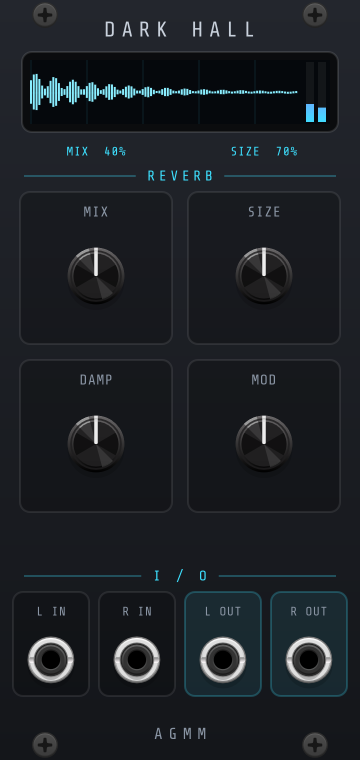

<!--
AGMM AUTOMATIC DOCUMENTATION
Source: DarkHall.cpp
-->

# DarkHall

## 1. Overview

`DarkHall` is a 12 HP stereo reverb built from eight damped comb filters feeding four series all-passes (a Schroeder/Freeverb-style structure), with a small L/R cross-feed for stereo width. Size sets the comb feedback and delay length, Damping darkens the feedback path, and Modulation gently moves the comb delays. A live display shows a scope of the mono output plus L/R level meters.

Key features:
- 8 damped comb filters + 4 series all-passes per channel
- L/R cross-feed (0.08×) for stereo width
- Size controls both comb feedback and delay length
- Modulation via sine LFO on the comb delays
- Equal-power dry/wet mix
- `tanh` soft-limit output
- Live scope + L/R meters

## Module Screenshot



## 2. Architecture

### Main Classes

- `DarkHall`: Core module class inheriting from `rack::Module`
- `DhPanelBackground`: Static panel artwork
- `DhDisplayWidget`: Live scope + meters + readouts

### Inheritance

- `DarkHall` inherits from `rack::Module`
- `DhPanelBackground` and `DhDisplayWidget` inherit from `rack::TransparentWidget`

### State (grouped)

| Group | Storage |
|-------|---------|
| Comb L | `float combL[8][MAX_DELAY]` (MAX_DELAY = 96000) |
| Comb R | `float combR[8][MAX_DELAY]` |
| Comb damping | `float combStoreL[8]`, `combStoreR[8]` |
| All-pass L | `float allpassL[4][MAX_DELAY]`, `int apIdxL[4]` |
| All-pass R | `float allpassR[4][MAX_DELAY]`, `int apIdxR[4]` |
| Modulation | `float modPhase[8]` |
| Write head | `int writeIndex` |
| Display | `float scopeMin[96]`, `scopeMax[96]`, `scopeHead`, `scopeCount`, `scopeBMin`, `scopeBMax`, `peakL`, `peakR` |

## 3. DSP Theory

### Freeverb topology

`DarkHall` follows the classic Freeverb architecture: eight parallel comb filters (each with its own damping one-pole) feed four series all-pass filters. The combs are the "body" of the reverb, and the all-passes diffuse the output into a smooth tail.

### Comb filter

Each comb is a delay line with feedback:

$$
y_i[n] = x[n] + g \cdot \text{LP}_i\left(y_i[n - D_i]\right)
$$

where $D_i$ is the (modulated) delay length, $g$ is the feedback gain (0.75 + 0.20·size), and $\text{LP}_i$ is a one-pole low-pass with coefficient `damp`.

The delay length is:

$$
D_i[n] = \left(\text{base}_i + 25 \cdot \text{modAmt} \cdot \sin(2\pi f_i t)\right) \cdot (0.5 + \text{size})
$$

with base delays `{1116, 1188, 1277, 1356, 1422, 1491, 1557, 1617}` (samples at 48 kHz) and mod rates `0.05 + 0.01 i` Hz.

### Cross-feed

To create stereo width without a full matrix, each comb's feedback is augmented with a small amount of the *other* channel's damped delay:

$$
\begin{aligned}
fbL_i &= (\text{storeL}_i + 0.08\cdot\text{delayR}_i) \cdot g \\
fbR_i &= (\text{storeR}_i + 0.08\cdot\text{delayL}_i) \cdot g
\end{aligned}
$$

### All-pass

The all-pass is a fixed-gain Schroeder design:

$$
y[n] = -x[n] + d[n], \quad \text{buf}[n] = x[n] + g \cdot d[n]
$$

with $g = 0.6$ and $d = \text{buf}[n - D]$ read at the same write index.

### Equal-power mix

The dry/wet mix uses equal-power crossfade:

$$
\text{out} = \cos(\text{mix} \cdot \pi/2) \cdot \text{dry} + \sin(\text{mix} \cdot \pi/2) \cdot \text{wet}
$$

### Output soft-limit

$$
\text{out} = \tanh(1.2 \cdot \text{out}) \cdot 5
$$

## 4. Parameters and Controls

### Knobs

| Parameter | Min | Max | Default | Description |
|-----------|-----|-----|---------|-------------|
| `MIX_PARAM` | 0 | 1 | 0.4 | Dry/wet |
| `SIZE_PARAM` | 0 | 1 | 0.7 | Room size (feedback + delay length) |
| `DAMP_PARAM` | 0 | 1 | 0.6 | Damping (squared internally) |
| `MOD_PARAM` | 0 | 1 | 0.3 | Modulation depth |

### Inputs

| Input | Description |
|-------|-------------|
| `IN_L` | Left |
| `IN_R` | Right |

### Outputs

| Output | Description |
|--------|-------------|
| `OUT_L` | Left |
| `OUT_R` | Right |

### Enumerations

- `ParamId`: Mix, Size, Damp, Mod
- `InputId`: InL, InR
- `OutputId`: OutL, OutR

## 5. Inputs and Outputs

### Inputs

| Name | Type | Range | Description |
|------|------|-------|-------------|
| `IN_L` | Audio | ±10 V | Left audio (×0.2 attenuation) |
| `IN_R` | Audio | ±10 V | Right audio (×0.2 attenuation) |

### Outputs

| Name | Type | Range | Description |
|------|------|-------|-------------|
| `OUT_L` | Audio | ±5 V | Left output (after tanh ×5) |
| `OUT_R` | Audio | ±5 V | Right output |

### Bypass

`configBypass(IN_L, OUT_L)` and `configBypass(IN_R, OUT_R)`.

## 6. Signal Processing Pipeline

1. Input attenuation — Multiply both inputs by 0.2 to keep the comb filters out of saturation.
2. Parameter read — Knobs, no CV.
3. Comb loop — For each of the 8 combs: read (with modulation), apply one-pole damping, add cross-feed, multiply by feedback, write back, accumulate into sum.
4. Sum — Average the 8 comb outputs.
5. All-pass chain — 4 series all-passes per channel.
6. Equal-power mix — Dry × cos + wet × sin.
7. Soft limit — tanh × 1.2, scaled to ±5 V.
8. Display — Scope + meters.

## 7. Important Functions

### `allpass(float input, float *buf, int &idx, float gain)`

Fixed-gain Schroeder all-pass:

```cpp
float delayed = buf[idx];
float output = -input + delayed;
buf[idx] = input + delayed * gain;
idx++;
if (idx >= MAX_DELAY) idx = 0;
return output;
```

### `process(const ProcessArgs &args)`

The main callback described in §6.

## 8. Mathematical Implementation

### Comb delay

$$
D_i[n] = \left(\text{base}_i + 25\text{modAmt}\sin(2\pi f_i t)\right)(0.5 + \text{size})
$$

### Comb feedback

$$
g = 0.75 + 0.20\cdot\text{size} \le 0.95
$$

### Damping one-pole

$$
\text{store}[n] = \text{delay}[n](1 - \text{damp}^2) + \text{store}[n-1]\text{damp}^2
$$

### Cross-feed

$$
fbL_i = (\text{storeL}_i + 0.08\text{delayR}_i) g
$$

### Equal-power mix

$$
\text{out} = \cos(\text{mix}\cdot\pi/2)\text{dry} + \sin(\text{mix}\cdot\pi/2)\text{wet}
$$

### Output

$$
\text{out} = 5\tanh(1.2\cdot\text{mix})
$$

## 9. Performance and Optimization

### CPU Usage

- 8 combs × (read + LP + cross-feed + write) ≈ 8 × 12 flops = 96 flops
- 4 all-passes × 2 channels × (read + write) ≈ 8 × 6 flops = 48 flops
- Total: ~150 flops/sample

### Memory Allocation

- All buffers allocated once in the constructor
- `combL[8][96000]`, `combR[8][96000]` ≈ 1.5 M floats ≈ 6 MB
- `allpassL[4][96000]`, `allpassR[4][96000]` ≈ 768 K floats ≈ 3 MB
- No allocation in `process()`

### Buffers

- 8 × 2 × 96000 comb floats
- 4 × 2 × 96000 all-pass floats (only 4 delays used)
- 96 × 2 scope floats

### Real-time Processing

- All loops bounded
- No allocation, no blocking
- All-pass index is hard-wrapped at MAX_DELAY (no delay-length parameter)

### Thread Safety

- All state written by audio thread, read by UI thread via torn reads

### Numerical Stability

- `clamp` on comb feedback (`fbL`, `fbR` clamped to ±5 V)
- `clamp` on damping state (±10 V)
- `tanh` soft limit on output
- `!std::isfinite` check on outputs

## 10. Dependencies

### Libraries/Headers

- `plugin.hpp` — VCV Rack core
- `agmm_ui.hpp` — shared AGMM UI helpers
- `<cmath>`, `<cstdio>`, `<cstring>`, `<algorithm>`, `<memory>`

### External Classes

- `rack::Module`, `rack::TransparentWidget`, `rack::engine::ParamQuantity`
- `agmm::panelBase`, `agmm::bezel`, `agmm::plate`, `agmm::text`, `agmm::plotFrame`, `agmm::screen`, `agmm::sectionHeader`, `agmm::meter`, `agmm::withA`, `agmm::violet`, `agmm::accent`, `agmm::bright`, `agmm::warm`, `agmm::dim`

## 11. Summary

`DarkHall` is a compact Freeverb-style stereo reverb with a handful of user knobs: Size, Damping, Modulation, and Mix. It's the simplest of the AGMM reverbs — no CV inputs, no freeze, no pre-delay — and that's intentional: it's meant to be a "set and forget" ambience that you can drop into any patch without thinking.

The DSP is the classic Freeverb topology: eight parallel damped combs, four series all-passes, cross-feed for width. The `damp^2` curve makes the damping knob feel natural. The equal-power mix, `tanh` soft limit, and `clamp` on the feedback path mean the output is always within ±5 V — safe to patch anywhere.

The main limitations are: no CV control at all, and the all-pass delay lines are fixed at MAX_DELAY (96000 samples), which uses ~3 MB of RAM per instance even though only a tiny portion is actually read.
