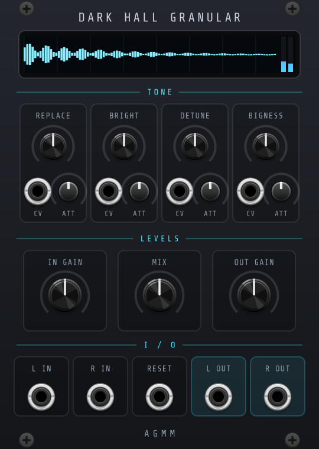

<!--
AGMM AUTOMATIC DOCUMENTATION
Source: DarkHallGranular.cpp
-->

# DarkHallGranular

## 1. Overview

`DarkHallGranular` is an 18 HP stereo "galaxy-style" reverb. A shared input diffusion chain feeds two cross-coupled feedback tanks, each containing a long delay, a one-pole damping filter and two modulated all-passes. The two tanks cross-feed each other, producing a dense, slowly evolving tail.

Key features:
- Shared 4-stage all-pass input diffusion
- Two cross-coupled feedback tanks (L and R)
- Each tank: long delay + damping + 2 modulated all-passes
- CV + attenuverter on Replace, Brightness, Detune, Bigness
- Input gain, output gain, dry/wet
- Reset input (clears tail) and reset LED via mode button
- Selectable CV range (bipolar ±5 V or unipolar 0–10 V) via menu, persisted
- Live scope + L/R meters

## Module Screenshot



## 2. Architecture

### Main Classes

- `DarkHallGranular`: Core module class inheriting from `rack::Module`
- `DelayLine`: Circular buffer with cubic (Hermite) interpolation and all-pass helper
- `DhgPanelBackground`: Static panel artwork
- `DhgDisplayWidget`: Live scope + meters

### Inheritance

- `DarkHallGranular` inherits from `rack::Module`
- Both UI widgets inherit from `rack::TransparentWidget`

### State (grouped)

| Group | Storage |
|-------|---------|
| Input diffusion | `DelayLine apIn[4]` (init to 4096 samples each) |
| Tank 1 | `DelayLine dap1a, dap1b, del1` (32768, 32768, 131072 samples) |
| Tank 2 | `DelayLine dap2a, dap2b, del2` |
| Damping | `float lp1, lp2` |
| LFOs | `float lfo1, lfo2, lfo3, lfo4` |
| Smoothing | `float bigSm` (Bigness smoother) |
| DC block | `float dcInL, dcInR, dcOutL, dcOutR` |
| Reset | `bool wasResetHigh`, `bool wasConnected` |
| CV mode | `CVRange cvRangeMode` |
| Display | `float scopeMin[96]`, `scopeMax[96]`, `scopeHead`, `scopeCount`, `scopeBMin`, `scopeBMax`, `peakL`, `peakR` |

## 3. DSP Theory

### DelayLine with cubic interpolation

The delay line reads at a fractional delay using 4-point Hermite interpolation:

$$
y(t) = ((a t + b) t + c) t + y_1
$$

with the Hermite coefficients:

$$
\begin{aligned}
a &= -\tfrac{1}{2}y_0 + \tfrac{3}{2}y_1 - \tfrac{3}{2}y_2 + \tfrac{1}{2}y_3 \\
b &= y_0 - \tfrac{5}{2}y_1 + 2y_2 - \tfrac{1}{2}y_3 \\
c &= -\tfrac{1}{2}y_0 + \tfrac{1}{2}y_2
\end{aligned}
$$

This 4-point interpolation eliminates the high-frequency aliasing that linear interpolation produces at large fractional delays.

### Input diffusion

Four series all-passes on the input smear transients:

$$
y_i = d_i + g(x_i - g d_i), \quad \text{buf} = x_i - g d_i
$$

with $g = 0.75$ (high diffusion).

### Two cross-coupled tanks

Tank 1 (left):

$$
\begin{aligned}
\text{read1} &= \text{read}(\text{del2}, D_2 + m_3\cdot\text{modDepth}) \\
\text{wet1} &= \text{apOut} + \text{read1} \cdot g_{\text{rt}} \\
\text{wet1} &= \text{LP}(\text{wet1}) \\
\text{wet1} &= \text{AP}_a(\text{wet1}, D_{a1} + m_1\cdot\text{apMod}) \\
\text{wet1} &= \text{AP}_b(\text{wet1}, D_{b1}) \\
\text{write}(\text{del1}, \text{wet1})
\end{aligned}
$$

Tank 2 (right) mirrors tank 1 with `del1` and `del2` swapped.

The key insight is that the two tanks **read each other's delay lines**, which creates a cross-coupled feedback network that produces a denser, more decorrelated stereo tail than two independent tanks would.

### Parameters

- **Replace** — Sets `krt = 0.40 + 0.585*(1 - replace)`. This is the feedback gain; lower replace = more feedback = longer tail.
- **Brightness** — Sets `lpCoef = 0.08 + 0.90 * bright^2`. This is the one-pole damping coefficient; higher brightness = brighter tail.
- **Detune** — Sets modulation depth: `modDepth = detune^2 * 55 * srScale` and `apModDepth = detune * 14 * srScale`. Higher detune = more chorus/glide.
- **Bigness** — Smoothly tracked as `bigSm += (bigTgt - bigSm) * 0.00015` with `bigTgt = 0.4 + bigness * 1.2`. This scales all delay lengths, so changing bigness glides the reverb size smoothly.

### DC blocking

After the wet path, a DC blocker removes any DC offset introduced by the feedback:

$$
y[n] = x[n] - x[n-1] + 0.995 y[n-1]
$$

### Safety

The wet path is soft-limited at ±8 V via `softClip`. The output is clamped to ±10 V.

## 4. Parameters and Controls

### Knobs (TONE section)

| Parameter | Min | Max | Default | Description |
|-----------|-----|-----|---------|-------------|
| `REPLACE_PARAM` | 0 | 1 | 0.20 | Shortens the tail |
| `BRIGHTNESS_PARAM` | 0 | 1 | 0.45 | Damping cutoff |
| `DETUNE_PARAM` | 0 | 1 | 0.50 | Modulation depth |
| `BIGNESS_PARAM` | 0 | 1 | 0.70 | Room size + decay |
| `REPLACE_ATTEN` | −1 | 1 | 0 | CV attenuverter |
| `BRIGHTNESS_ATTEN` | −1 | 1 | 0 | CV attenuverter |
| `DETUNE_ATTEN` | −1 | 1 | 0 | CV attenuverter |
| `BIGNESS_ATTEN` | −1 | 1 | 0 | CV attenuverter |

### LEVELS knobs

| Parameter | Min | Max | Default | Description |
|-----------|-----|-----|---------|-------------|
| `DRYWET_PARAM` | 0 | 1 | 0.50 | Dry/wet |
| `INPUT_GAIN_PARAM` | 0 | 2 | 1 | Input gain |
| `OUTPUT_GAIN_PARAM` | 0 | 2 | 1 | Output gain |

### Inputs

| Input | Description |
|-------|-------------|
| `IN_L` | Left |
| `IN_R` | Right |
| `REPLACE_CV` | Replace CV |
| `BRIGHTNESS_CV` | Brightness CV |
| `DETUNE_CV` | Detune CV |
| `BIGNESS_CV` | Bigness CV |
| `RESET_IN` | Reset (clears reverb tail) |

### Outputs

| Output | Description |
|--------|-------------|
| `OUT_L` | Left |
| `OUT_R` | Right |

### Enumerations

- `CVRange`: BIPOLAR_M5_5, UNIPOLAR_0_10
- `ParamId`: Replace, Brightness, Detune, Bigness, DryWet, InputGain, OutputGain, ReplaceAtten, BrightnessAtten, DetuneAtten, BignessAtten
- `InputId`: InL, InR, ReplaceCV, BrightnessCV, DetuneCV, BignessCV, Reset
- `OutputId`: OutL, OutR

## 5. Inputs and Outputs

### Inputs

| Name | Type | Range | Description |
|------|------|-------|-------------|
| `IN_L` | Audio | ±8 V | Left audio |
| `IN_R` | Audio | ±8 V | Right audio |
| `REPLACE_CV` | CV | ±10 V | Replace modulation |
| `BRIGHTNESS_CV` | CV | ±10 V | Brightness modulation |
| `DETUNE_CV` | CV | ±10 V | Detune modulation |
| `BIGNESS_CV` | CV | ±10 V | Bigness modulation |
| `RESET_IN` | Gate | > 1 V | Clears tail |

### Outputs

| Name | Type | Range | Description |
|------|------|-------|-------------|
| `OUT_L` | Audio | ±10 V | Left output |
| `OUT_R` | Audio | ±10 V | Right output |

### Bypass

`configBypass(IN_L, OUT_L)` and `configBypass(IN_R, OUT_R)`.

## 6. Signal Processing Pipeline

1. **Reset check** — If RESET_IN goes high, reset all state.
2. **Connection check** — If no outputs connected, emit 0; if no inputs connected, reset state and emit 0.
3. **Parameter read** — Replace, brightness, detune, bigness (with CV), dry/wet, in/out gain.
4. **Derived values** — `srScale = sr / 32000`, `bigSm` smoothing, `k = srScale * bigSm`, feedback `krt`, damping `lpCoef`, modulation depths.
5. **Input diffusion** — 4 series all-passes on the mono-summed input.
6. **Tank 1** — Read from `del2`, damp, 2 modulated all-passes, soft clip, write to `del1`.
7. **Tank 2** — Read from `del1`, damp, 2 modulated all-passes, soft clip, write to `del2`.
8. **DC block** — Standard one-pole high-pass.
9. **Wet boost** — ×1.6.
10. **Equal-power mix** — Dry × cos + wet × sin.
11. **Output gain + soft limit** — Clamp to ±10 V.
12. **Display** — Peaks + scope.

## 7. Important Functions

### `DelayLine::read(float delay)`

4-point Hermite interpolation for fractional delays.

```cpp
delay = clampT(delay, 2.f, (float)(size - 4));
float pos = (float)write - 1.f - delay + 1.f;
pos -= 1.f;
while (pos < 0.f) pos += (float)size;
int i1 = (int)pos;
float t = pos - (float)i1;
// ...
float a = -0.5f*y0 + 1.5f*y1 - 1.5f*y2 + 0.5f*y3;
float b =      y0 - 2.5f*y1 + 2.0f*y2 - 0.5f*y3;
float c = -0.5f*y0             + 0.5f*y2;
return ((a*t + b)*t + c)*t + y1;
```

### `DelayLine::allpass(float in, float delay, float g)`

```cpp
float d = read(delay);
float w = in - g * d;
push(sanitize(w));
return d + g * w;
```

### `resetState()`

Clears all delay lines, filter states, DC blockers and LFOs.

### `process(const ProcessArgs &args)`

The main callback described in §6.

## 8. Mathematical Implementation

### Hermite coefficients

$$
a = -\tfrac{1}{2}y_0 + \tfrac{3}{2}y_1 - \tfrac{3}{2}y_2 + \tfrac{1}{2}y_3
$$

$$
b = y_0 - \tfrac{5}{2}y_1 + 2y_2 - \tfrac{1}{2}y_3
$$

$$
c = -\tfrac{1}{2}y_0 + \tfrac{1}{2}y_2
$$

### Feedback gain

$$
k_{rt} = 0.40 + 0.585(1 - \text{replace})
$$

### Damping coefficient

$$
\text{lpCoef} = 0.08 + 0.90\cdot\text{bright}^2
$$

### Modulation depth

$$
\text{modDepth} = \text{detune}^2 \cdot 55 \cdot \text{srScale}, \quad \text{apModDepth} = \text{detune} \cdot 14 \cdot \text{srScale}
$$

### Bigness smoothing

$$
\text{bigSm} \leftarrow \text{bigSm} + (\text{bigTgt} - \text{bigSm}) \cdot 0.00015
$$

### DC blocker

$$
y[n] = x[n] - x[n-1] + 0.995 y[n-1]
$$

### Wet boost

$$
w \leftarrow 1.6 w
$$

### Equal-power mix

$$
\text{out} = \cos(\text{mix}\cdot\pi/2)\text{dry} + \sin(\text{mix}\cdot\pi/2)\text{wet}
$$

## 9. Performance and Optimization

### CPU Usage

- **Input diffusion**: 4 all-passes × (cubic read + write) ≈ 4 × 20 flops
- **Tank 1**: 1 long read + 1 LP + 2 all-passes + soft clip + 1 write ≈ 60 flops
- **Tank 2**: same ≈ 60 flops
- **DC block**: 2 × 4 flops
- **Total**: ~250 flops/sample

### Memory Allocation

- All delay lines allocated in the constructor:
  - `apIn[4]`: 4 × 4096 floats ≈ 64 KB
  - `dap1a`, `dap1b`, `dap2a`, `dap2b`: 4 × 32768 floats ≈ 512 KB
  - `del1`, `del2`: 2 × 131072 floats ≈ 1 MB
  - Total ≈ 1.6 MB

### Buffers

- 4 × 4096 input diffusers
- 4 × 32768 tank all-pass
- 2 × 131072 tank delays
- 96 × 2 scope floats

### Real-time Processing

- All loops bounded
- No allocation, no blocking
- Sample-rate changes handled by `srScale`

### Thread Safety

- All state written by audio thread, read by UI thread via torn reads

### Numerical Stability

- `sanitize()` on every push (NaN/Inf → 0)
- `softClip` on wet path (±8 V)
- Output clamped to ±10 V
- `!std::isfinite` check on outputs

## 10. Dependencies

### Libraries/Headers

- `plugin.hpp` — VCV Rack core
- `agmm_ui.hpp` — shared AGMM UI helpers
- `<cmath>`, `<algorithm>`, `<cstring>`, `<vector>`, `<memory>`, `<cstdio>`

### External Classes

- `rack::Module`, `rack::TransparentWidget`, `rack::engine::ParamQuantity`
- `agmm::panelBase`, `agmm::bezel`, `agmm::plate`, `agmm::text`, `agmm::plotFrame`, `agmm::screen`, `agmm::sectionHeader`, `agmm::meter`, `agmm::withA`, `agmm::violet`, `agmm::accent`, `agmm::bright`, `agmm::warm`, `agmm::dim`

## 11. Summary

`DarkHallGranular` is a galaxy-style stereo reverb built from two cross-coupled feedback tanks. Each tank is a long delay with a one-pole damper and two modulated all-passes, and the tanks read each other's delay lines — which produces a much denser, more decorrelated tail than two independent reverbs would.

The design is focused on **slow, evolving textures**: the Bigness knob smoothly glides the delay lengths (via `bigSm`), the Detune knob modulates both the tank delays and the all-pass delays, and the four free-running LFOs (0.23–0.50 Hz) keep everything in constant slow motion. The result is a reverb that sounds like a room made of glass — present, detailed, and always shifting.

The main limitations are: no freeze, no pre-delay, and the fixed delay lengths mean you can't do "long hall" or "small room" extremes. But for "galactic" ambient work, this is exactly the right trade-off.
