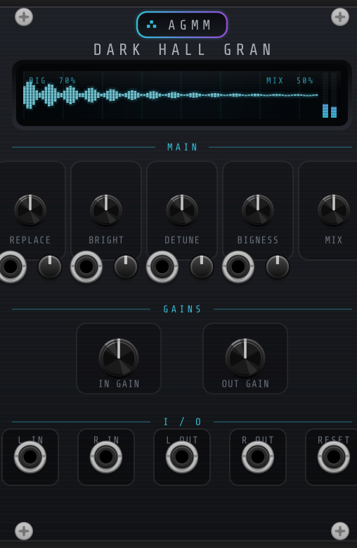

<!--
AGMM AUTOMATIC DOCUMENTATION
Source: DarkHallGranular.cpp
Generated: 2026-11-04 06:16
-->

# DarkHallGranular

## 1. Overview

The `DarkHallGranular` module is a stereo reverb effect designed for the VCV Rack platform, implementing a granular-based reverberation system inspired by "galaxy-style" stereo reverb techniques. It processes stereo audio input through a complex delay-line network with modulation and filtering to create rich, evolving spatial effects.

Key features include:
- Stereo input/output processing
- Modulatable parameters for replace, brightness, detune, bigness, and dry/wet mix
- CV inputs with attenuverters for real-time parameter control
- Reset input for state clearing
- Input/output gain controls
- Visual display showing audio scope and level meters
- Configurable CV range (bipolar/unipolar)

## Module Screenshot



## 2. Architecture

### Main Classes

The module is implemented as a single class `DarkHallGranular` inheriting from `rack::Module`.

### Inheritance

```
DarkHallGranular : Module
```

### Structures

#### DelayLine
A custom delay line implementation with:
- Circular buffer (`std::vector<float> buf`)
- Size tracking (`int size`)
- Write pointer (`int write`)
- Linear interpolation for fractional delays
- Allpass filtering capability

#### DarkHallGranular
Main module class containing:
- Multiple `DelayLine` instances for various delay paths
- State variables for low-pass filters, LFOs, DC blocking
- Parameter and input/output enumerations
- Scope display buffers for visualization
- CV range mode configuration

### Relationships

The module uses multiple `DelayLine` objects to create a complex feedback network:
- 4 allpass delay lines (`apIn[4]`) for input diffusion
- 2 delay lines (`del1`, `del2`) for main reverberation paths
- 2 allpass delay lines (`dap1a`, `dap1b`) for first tank
- 2 allpass delay lines (`dap2a`, `dap2b`) for second tank

## 3. DSP Theory

### Mathematical Equations

#### Delay Line Interpolation (Cubic Spline)
For fractional delay read:
$$
y(t) = a t^3 + b t^2 + c t + y_1
$$
Where:
- $a = -0.5 y_0 + 1.5 y_1 - 1.5 y_2 + 0.5 y_3$
- $b = y_0 - 2.5 y_1 + 2.0 y_2 - 0.5 y_3$
- $c = -0.5 y_0 + 0.5 y_2$

#### Allpass Filter
$$
y[n] = d[n] + g (x[n] - d[n-1])
$$

Where:
- $d[n]$ is the delayed input
- $g$ is the allpass coefficient (-0.625)

#### Low-pass Filter
$$
y[n] = y[n-1] + \alpha (x[n] - y[n-1])
$$

Where $\alpha$ is a time-varying coefficient.

#### Soft Clipping
$$
\text{softclip}(x, \text{limit}) = \text{limit} \cdot \tanh\left(\frac{x}{\text{limit}}\right)
$$

### Algorithms

1. **Input Diffusion**: 4-stage allpass filtering with fixed delays
2. **Reverberation Tanks**: Two parallel reverberation paths with feedback
3. **Modulation**: LFOs modulating delay times and allpass coefficients
4. **DC Blocking**: Simple DC blocking using feedback with 0.995 coefficient

### Filters

- Low-pass filters for smoothing wet signal
- Allpass filters for phase manipulation
- DC blocking filters

### Oscillators

- Four LFOs generating sine wave modulation signals at different rates:
  - Rate 0.5 Hz (lfo1)
  - Rate 0.31 Hz (lfo2)
  - Rate 0.23 Hz (lfo3)
  - Rate 0.37 Hz (lfo4)

### Delay Lines

- 4 allpass delay lines with fixed delays: 150, 214, 319, 527 samples
- 2 main delay lines with fixed delays: 4501, 6312 samples
- 2 allpass delay lines for each tank with fixed delays: 2182, 2690, 2525, 2197 samples

### Feedback Systems

- Two reverberation tanks with feedback paths
- DC blocking using feedback with coefficient 0.995
- Low-pass filtering of wet signal before output

### Modulation

- LFO modulation of delay times (±55 samples for main delays, ±14 samples for allpass)
- LFO modulation of allpass coefficients (-0.625)

### Random Processes

- No explicit random processes; uses LFOs for time-varying modulation

## 4. Parameters and Controls

### Knobs

| Parameter | Default | Range | Description |
|-----------|---------|-------|-------------|
| REPLACE | 0.20 | 0.0 - 1.0 | Replace ratio (0 = all wet, 1 = all dry) |
| BRIGHTNESS | 0.45 | 0.0 - 1.0 | Brightness control for low-pass filter |
| DETUNE | 0.50 | 0.0 - 1.0 | Detune amount for modulation |
| BIGNESS | 0.70 | 0.0 - 1.0 | Size of reverberation effect |
| DRYWET | 0.50 | 0.0 - 1.0 | Mix between dry and wet signals |
| INPUT_GAIN | 1.0 | 0.0 - 2.0 | Input gain control |
| OUTPUT_GAIN | 1.0 | 0.0 - 2.0 | Output gain control |

### Switches

None explicitly defined in code.

### Buttons

None explicitly defined in code.

### CV Inputs

| Input | Description |
|-------|-------------|
| REPLACE_CV | Replace parameter CV input |
| BRIGHTNESS_CV | Brightness parameter CV input |
| DETUNE_CV | Detune parameter CV input |
| BIGNESS_CV | Bigness parameter CV input |
| RESET_IN | Reset input |

### Gates

None explicitly defined in code.

### Enumerations

```cpp
enum CVRange { BIPOLAR_M5_5, UNIPOLAR_0_10 };
```

### Parameter Ranges

- All parameters: 0.0 to 1.0 (except gain which is 0.0 to 2.0)
- CV inputs: -1.0 to +1.0 for attenuverters
- Reset input: > 1.0V triggers reset

### Default Values

| Parameter | Default |
|-----------|---------|
| REPLACE_PARAM | 0.20 |
| BRIGHTNESS_PARAM | 0.45 |
| DETUNE_PARAM | 0.50 |
| BIGNESS_PARAM | 0.70 |
| DRYWET_PARAM | 0.50 |
| INPUT_GAIN_PARAM | 1.0 |
| OUTPUT_GAIN_PARAM | 1.0 |

## 5. Inputs and Outputs

### Inputs

| Input | Voltage Range | Description |
|-------|---------------|-------------|
| IN_L | -10V to +10V | Left input |
| IN_R | -10V to +10V | Right input |
| REPLACE_CV | -5V to +5V (bipolar) or 0V to +10V (unipolar) | Replace parameter CV |
| BRIGHTNESS_CV | -5V to +5V (bipolar) or 0V to +10V (unipolar) | Brightness parameter CV |
| DETUNE_CV | -5V to +5V (bipolar) or 0V to +10V (unipolar) | Detune parameter CV |
| BIGNESS_CV | -5V to +5V (bipolar) or 0V to +10V (unipolar) | Bigness parameter CV |
| RESET_IN | Any voltage | Reset input |

### Outputs

| Output | Voltage Range | Description |
|--------|---------------|-------------|
| OUT_L | -10V to +10V | Left output |
| OUT_R | -10V to +10V | Right output |

## 6. Signal Processing Pipeline

1. **Input Processing**
   - Input voltage is soft-clipped to prevent clipping
   - Input gain applied
   - Stereo input handling (if only left connected, right mirrors left)

2. **Parameter Processing**
   - CV inputs processed with attenuverters and scaled appropriately
   - Parameters clamped to valid ranges

3. **Input Diffusion**
   - Input signal passed through 4 allpass delay lines with fixed delays

4. **Reverberation Tanks**
   - Two parallel reverberation tanks:
     - Tank 1 (left output): Uses delay line `del2` and allpass filters
     - Tank 2 (right output): Uses delay line `del1` and allpass filters
   - Modulation applied to delay times via LFOs

5. **Low-pass Filtering**
   - Wet signals filtered with time-varying low-pass coefficients

6. **DC Blocking**
   - DC blocking applied using feedback with coefficient 0.995

7. **Mixing**
   - Dry and wet signals mixed using cosine/sine interpolation
   - Output gain applied

8. **Output Processing**
   - Soft clipping applied to prevent output clipping
   - Final voltage clamped to ±10V range

## 7. Important Functions

### `resetState()`
Clears all delay lines, resets filter states, and initializes LFO phases.

### `onReset()`
Calls `resetState()` when module is reset.

### `dataToJson() / dataFromJson()`
Handles saving/loading of CV range mode configuration.

### `cvParam()`
Processes CV inputs with attenuverters and scales appropriately based on current CV range mode.

### `process()`
Main DSP processing function:
- Handles reset input
- Processes input signals
- Updates LFOs
- Implements reverberation algorithm
- Applies mixing and output processing

## 8. Mathematical Implementation

### Delay Line Interpolation
Uses cubic spline interpolation for fractional delay reads:
```cpp
float a = -0.5f*y0 + 1.5f*y1 - 1.5f*y2 + 0.5f*y3;
float b =      y0 - 2.5f*y1 + 2.0f*y2 - 0.5f*y3;
float c = -0.5f*y0             + 0.5f*y2;
return ((a*t + b)*t + c)*t + y1;
```

### Allpass Filter
```cpp
float d = read(delay);
float w = in - g * d;
push(sanitize(w));
return d + g * w;
```

### Low-pass Filter
```cpp
lp1 += lpCoef * (wet - lp1);
```

### Soft Clipping
```cpp
return limit * std::tanh(x / limit);
```

### LFO Generation
```cpp
lfo1 += args.sampleTime * 0.50f;
// ... other LFOs
float m1 = std::sin(twoPi * lfo1);
```

## 9. Performance and Optimization

### CPU Usage Considerations

- Uses fixed-size delay lines with circular buffers for efficient memory access
- Allpass filters implemented with minimal operations
- LFOs updated at sample rate with simple increment operations
- No floating-point division in main processing loop

### Memory Allocation

- Pre-allocated delay line buffers during initialization
- No dynamic allocation during processing
- Stack-based scope buffers (96 elements)

### Buffers

- 4 allpass delay lines: 4096 samples each
- 2 main delay lines: 131072 samples each
- 2 allpass delay lines for each tank: 32768 samples each
- Scope buffers: 96 elements for display visualization

### Real-time Processing

- All processing done in `process()` function called at sample rate
- No blocking operations or complex algorithms
- Efficient use of standard library functions

### Thread Safety

- Module assumes single-threaded processing by Rack engine
- No explicit thread synchronization required

### Numerical Stability

- Input sanitization using `sanitize()` function to handle NaN/inf values
- Clamping of all parameters to valid ranges
- Proper handling of delay line indices with modulo operations
- Soft clipping prevents extreme signal peaks

## 10. Dependencies

### Libraries

- VCV Rack SDK (`rack.hpp`)
- Standard C++ libraries: `<cmath>`, `<algorithm>`, `<cstring>`, `<vector>`, `<memory>`, `<cstdio>`

### Classes and Headers

- `rack::Module` (base class)
- `rack::ParamId`, `rack::InputId`, `rack::OutputId` (enumerations)
- `rack::ProcessArgs` (processing arguments)
- `json_t` (for configuration serialization)

## 11. Summary

The `DarkHallGranular` module implements a sophisticated stereo reverb effect using a combination of delay lines, allpass filters, and modulation to create rich spatial audio effects. It features:

- Two parallel reverberation tanks with feedback paths
- Input diffusion through multiple allpass stages
- LFO-modulated delay times for evolving textures
- Time-varying low-pass filtering of wet signals
- DC blocking for clean output
- Comprehensive parameter control via knobs and CV inputs
- Visual display showing audio scope and level meters
- Configurable CV range modes (bipolar/unipolar)
- Efficient real-time processing with minimal CPU overhead

The implementation follows established reverb design principles while incorporating unique modulation techniques to create distinctive spatial effects suitable for ambient and experimental audio applications.