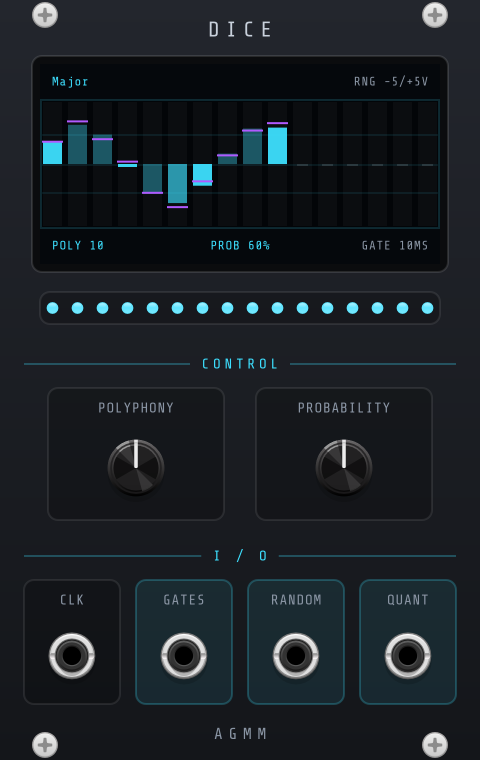

<!--
AGMM AUTOMATIC DOCUMENTATION
Source: Dice.cpp
-->

# Dice

## 1. Overview

`Dice` is a 16 HP polyphonic random-gate / random-V/Oct generator. On every rising clock edge it rolls a die per voice: with the PROBABILITY setting a voice fires, opening its gate for the configured gate time and latching a new random voltage. That voltage is emitted both raw (RANDOM output) and quantized to a selectable scale (QUANT output), making the module usable as a random sequencer, a probabilistic trigger source, or a quantized random melody generator.

Key features:
- Up to 16 polyphonic voices
- Per-voice dice roll on each clock edge
- Configurable probability (0–100%)
- Raw random V/Oct and quantized V/Oct outputs
- 60+ built-in scales
- Gate time selectable via menu (5 ms .. 500 ms)
- Random range selectable via menu (0..1, -1..1, -2..2, -5..5)
- 16 gate LEDs
- Live bar display of the current random voltages

## Module Screenshot



## 2. Architecture

### Main Classes

- `Dice`: Core module class inheriting from `rack::Module`
- `DiceScale`: Struct for a named quantization scale
- `diceScales()`: Static function returning the 60+ scale list
- `DCPanel`: Static panel artwork
- `DCDisplay`: Live 16-channel bar display

### Inheritance

- `Dice` inherits from `rack::Module`
- Both UI widgets inherit from `rack::TransparentWidget`

### Structures

- `DiceScale { std::string name; std::vector<float> intervals; }` — one named scale with its semitone intervals
- Static table via `diceScales()`

### State (grouped)

| Group | Storage |
|-------|---------|
| Per-voice gates | `float gateVoltages[16]` |
| Per-voice V/Oct | `float voctVoltages[16]` |
| Per-voice quantized | `float quantizedVoltages[16]` |
| Gate timers | `float gateTimers[16]` |
| Edge detect | `bool lastClockState` |
| Settings | `float gateTime`, `int randomRange`, `int selectedScale` |
| Display | `int activePoly`, `float flash[16]` |

## 3. DSP Theory

### Clock edge detection

On every rising edge of `INPUT_CLOCK`:

$$
\text{edge}[n] = \text{clockHigh}[n] \land \lnot\text{clockHigh}[n-1]
$$

### Per-voice dice roll

For each voice $c$, if the roll succeeds:

$$
u_c \sim \text{Uniform}[0, 1], \quad u_c < \text{prob} \implies \text{fire}
$$

On fire:
- `gateVoltages[c] = 10 V`
- `gateTimers[c] = gateTime`
- A new random V/Oct is generated.

On fail:
- `gateVoltages[c] = 0 V`
- `gateTimers[c] = 0`

### Random V/Oct generation

Depends on the selected random range:

| Range | Formula |
|-------|---------|
| 0..1 | `random::uniform()` |
| −1..1 | `random::uniform() * 2 - 1` |
| −2..2 | `random::uniform() * 4 - 2` |
| −5..5 | `random::uniform() * 10 - 5` |

### Scale quantization

For the quantized output:

$$
\text{quantized} = \text{quantizeToScale}(\text{raw}, \text{scale})
$$

The quantizer works in semitone space:
1. Compute `semitones = voltage * 12`.
2. Split into an octave and a fractional part.
3. Find the closest scale degree (also considering the wrap to the next octave).
4. Return the quantized voltage.

### Gate timing

Each gate stays high for `gateTime` seconds, then falls:

$$
\text{gateTimers}[c] \leftarrow \text{gateTimers}[c] - \Delta t
$$

When it reaches 0, `gateVoltages[c] = 0`.

## 4. Parameters and Controls

### Knobs

| Parameter | Min | Max | Default | Description |
|-----------|-----|-----|---------|-------------|
| `PARAM_POLYPHONY` | 1 | 16 | 1 | Number of voices |
| `PARAM_PROBABILITY` | 0 | 1 | 0.5 | Gate probability |

### Inputs

| Input | Description |
|-------|-------------|
| `INPUT_CLOCK` | Clock (rising edge triggers a roll) |

### Outputs

| Output | Description |
|--------|-------------|
| `OUTPUT_GATES` | Polyphonic gates |
| `OUTPUT_VOCT` | Polyphonic random V/Oct (raw) |
| `OUTPUT_QUANTIZED` | Polyphonic random V/Oct (quantized) |

### Lights

- `LIGHT_GATES + i` (16 total) — per-channel gate activity

### Enumerations

- `ParamId`: Polyphony, Probability
- `InputId`: Clock
- `OutputId`: Gates, V/Oct, Quantized
- `LightId`: Gates (16)

## 5. Inputs and Outputs

### Input

| Name | Type | Range | Description |
|------|------|-------|-------------|
| `INPUT_CLOCK` | Gate | > 1 V | Clock (rising edge) |

### Outputs

| Name | Type | Range | Description |
|------|------|-------|-------------|
| `OUTPUT_GATES` | Poly Gate | 0/10 V | Per-voice gate |
| `OUTPUT_VOCT` | Poly CV | see range | Per-voice raw random V/Oct |
| `OUTPUT_QUANTIZED` | Poly CV | see range | Per-voice quantized V/Oct |

## 6. Signal Processing Pipeline

1. **Clock edge detect** — `risingEdge = clockHigh && !lastClockState`.
2. **Parameter read** — Polyphony, probability.
3. **Per-voice roll** — For each voice: roll the die; on success set gate high, gate timer, generate new random voltage; on fail set gate low.
4. **Gate timer decrement** — For each voice: decrement the gate timer; when zero, gate falls.
5. **Unused channels clear** — For channels above `polyphony`, clear gates, V/Oct, quantized, timers.
6. **Set output channels** — Set the poly channel count to `polyphony`.
7. **Write outputs** — Per-voice gate, raw V/Oct, quantized V/Oct.
8. **LEDs** — Flash each channel's LED based on its current gate.
9. **Display** — Update the flash envelope and the quantized/raw bar display.

## 7. Important Functions

### `quantizeToScale(float voltage, const DiceScale &scale)`

Quantizes a voltage to the nearest note of a scale.

```cpp
float semitones = voltage * 12.0f;
int octave = (int)std::floor(semitones);
float fractional = semitones - octave;
float bestMatch = 0.0f;
float minDiff = 100.0f;
for (float interval : scale.intervals) {
    float degree = interval / 12.0f;
    float diff = std::abs(fractional - degree);
    if (diff < minDiff) { minDiff = diff; bestMatch = degree; }
    diff = std::abs((fractional + 1.0f) - degree);
    if (diff < minDiff) { minDiff = diff; bestMatch = degree - 1.0f; }
}
return (float)(octave + (int)std::floor(bestMatch + 0.5f)) + bestMatch;
```

### `generateRandomVoltage(int channel)`

Generates a fresh random voltage according to the selected range, and quantizes it.

```cpp
float voltage = 0.0f;
switch (randomRange) {
    case 0: voltage = random::uniform(); break;
    case 1: voltage = (random::uniform() * 2.0f) - 1.0f; break;
    case 2: voltage = (random::uniform() * 4.0f) - 2.0f; break;
    case 3: voltage = (random::uniform() * 10.0f) - 5.0f; break;
}
voctVoltages[channel] = voltage;
quantizedVoltages[channel] = quantizeToScale(voltage, scale);
```

### `process(const ProcessArgs &args)`

Main callback described in §6.

## 8. Mathematical Implementation

### Rising edge

$$
\text{edge} = \text{clockHigh} \land \lnot\text{lastClockState}
$$

### Dice roll

$$
u \sim \text{Uniform}[0, 1], \quad u < \text{prob}
$$

### Random ranges

| Range | $u$ | Output |
|-------|-----|--------|
| 0..1 | $u$ | $u$ |
| −1..1 | $u$ | $2u - 1$ |
| −2..2 | $u$ | $4u - 2$ |
| −5..5 | $u$ | $10u - 5$ |

### Gate timing

$$
\text{gateTimers}[c] \leftarrow \text{gateTimers}[c] - \Delta t
$$

### Quantization

$$
\text{out} = (o + \lfloor b + 0.5 \rfloor) + b, \quad b = \text{bestMatch}
$$

## 9. Performance and Optimization

### CPU Usage

- Per edge: 16 rolls × (1 compare + maybe 1 RNG + 1 quantize) ≈ 16 × 20 flops
- Per sample: 16 decrements + 16 output writes ≈ 100 flops
- Total: ~150 flops/sample + 16 RNG calls per edge

### Memory Allocation

- All state is fixed-size
- No allocation in `process()`
- The scale table is a static `std::vector`

### Buffers

- `gateVoltages[16]`, `voctVoltages[16]`, `quantizedVoltages[16]`, `gateTimers[16]`: 64 floats
- `flash[16]`: 16 floats

### Real-time Processing

- All loops bounded by 16
- No allocation, no blocking
- RNG is `random::uniform()` which is fast

### Thread Safety

- All state written by audio thread, read by UI thread via torn reads

### Numerical Stability

- All values are clamped to safe ranges
- Quantization is deterministic

## 10. Dependencies

### Libraries/Headers

- `plugin.hpp` — VCV Rack core
- `agmm_ui.hpp` — shared AGMM UI helpers
- `<vector>`, `<string>`, `<cmath>`, `<cstdio>`, `<cstring>`, `<algorithm>`

### External Classes

- `rack::Module`, `rack::TransparentWidget`, `rack::engine::ParamQuantity`
- `agmm::panelBase`, `agmm::bezel`, `agmm::cell`, `agmm::text`, `agmm::screen`, `agmm::plotFrame`, `agmm::sectionHeader`, `agmm::meter`, `agmm::withA`, `agmm::violet`, `agmm::accent`, `agmm::dim`, `agmm::bright`, `agmm::warm`, `agmm::ALIGN_L/C/R`, `agmm::CyanLight`, `agmm::VioletLight`

## 11. Summary

`Dice` is a polyphonic random-gate generator that rolls a die for each voice on every clock edge. It's the simplest of the "random melody" modules in this collection — no random-walk modes, no Euclidean patterns, no pattern recorder — and that's its strength: it does one thing (probabilistic gates + random voltages) and does it well.

The quantization to 60+ scales makes it usable as a random melody generator, while the raw RANDOM output makes it usable as a modulation source. The probability knob is the key creative control: at 50% you get a half-time feel, at 100% every step fires, at 10% you get sparse bursts.

The main limitations are: the dice roll is per-voice independent (not a shared roll), and the gate time is only changeable via the menu. For a more featured version, see `DiceOnSteroids`.
