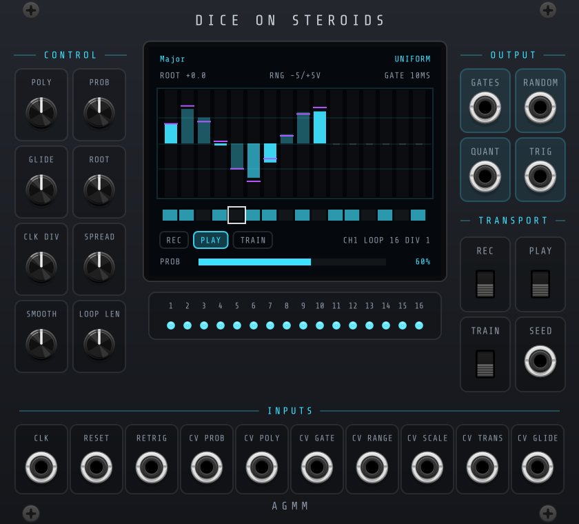

<!--
AGMM AUTOMATIC DOCUMENTATION
Source: DiceOnSteroids.cpp
-->

# DiceOnSteroids

## 1. Overview

`DiceOnSteroids` is a 28 HP expanded version of the Dice module: a 16-voice probabilistic gate / random V/Oct generator with a large feature set. On each (optionally divided) clock edge it rolls per-channel dice, and voices that "win" open a gate and latch a new random voltage. The random voltage can be uniform, a random walk, a drunk walk, or Gaussian, and it can be quantized to any of 60+ scales.

Key features:
- 16-voice polyphony with per-voice independent dice rolls
- 4 random modes: uniform, random walk, drunk walk, Gaussian
- 4 random ranges: 0..1, −1..1, −2..2, −5..5
- 60+ quantization scales
- Glide (portamento) between successive pitches
- Per-channel 64-step pattern recorder / playback loop
- Train mode (one random value shifts down the voices each clock)
- CV over probability, polyphony, gate time, range, scale, transpose and glide
- Configurable clock division (1–16)
- Probability spread (per-channel bias) and smoothing
- Random seed input for repeatable randomness
- New-note trigger output
- Live display with 16-channel pitch plot, CH1 pattern strip, and probability meter

## Module Screenshot



## 2. Architecture

### Main Classes

- `DiceOnSteroids`: Core module class inheriting from `rack::Module`
- `Scale`: Struct for a named quantization scale
- `DSPanelBackground`: Static panel artwork
- `DSDisplayWidget`: Live display with plot, chips, meter
- Static `DiceOnSteroids::scales` vector (60+ scales)

### Inheritance

- `DiceOnSteroids` inherits from `rack::Module`
- Both UI widgets inherit from `rack::TransparentWidget`

### Structures

- `Scale { std::string name; std::vector<float> intervals; }`
- `PatternStep { float gate; float pitch; float quantized; }` — one recorded step

### State (grouped)

| Group | Storage |
|-------|---------|
| Per-voice gates | `float gateVoltages[16]` |
| Per-voice V/Oct | `float voctVoltages[16]` |
| Per-voice quantized | `float quantizedVoltages[16]` |
| Target / current V/Oct | `float targetVoct[16]`, `currentVoct[16]` |
| Gate timers | `float gateTimers[16]` |
| Glide | `float glideStep[16]`, `glideRemaining[16]`, `lastVoct[16]` |
| Train mode | `float shiftRegisterPitch[16]`, `shiftRegisterGate[16]` |
| Pattern | `PatternStep pattern[16][64]`, `patternWritePos[16]`, `patternReadPos[16]`, `loopLength` |
| Transport | `bool lastClockState`, `int clockCounter` |
| Settings | `gateTime`, `randomRange`, `selectedScale`, `glideTime`, `rootShift`, `clockDiv`, `probSpread`, `probSmooth`, `randomMode`, `trainMode` |
| Filtered probability | `float filteredProbability` |
| Transpose | `float transposeOffset` |
| RNG | `uint32_t randomSeed`, `std::mt19937 rng`, `bool useFixedSeed` |
| Display | `int activePoly`, `float flash[16]`, `bool prevGate[16]` |

## 3. DSP Theory

### Clock division

The clock counter increments on each rising edge and resets every `clockDiv` edges:

$$
\text{clockFire} = ((\text{clockCounter} + 1) \bmod \text{clockDiv} == 0)
$$

This means the effective clock rate is `clockRate / clockDiv`.

### Dice roll (normal mode)

For each voice $c$, roll a die:

$$
u_c \sim \text{Uniform}[0, 1], \quad \text{channelProb}_c = \text{clamp}(\text{probability} \cdot \text{spreadFactor}_c, 0, 1)
$$

where the spread factor varies per channel:

$$
\text{spreadFactor}_c = 1 + \text{spread} \cdot \left(\frac{2c}{N} - 1\right)
$$

At spread = 1, voice 0 has probability 0 and voice N−1 has probability 2× (before clamping).

On success: gate high, gate timer set, new random voltage generated.
On fail: gate low.

### Random modes

**Uniform** — $v = u$ scaled to range.

**Random walk** — $v = v_{\text{prev}} + (u - 0.5) \cdot 0.2$, clamped to range.

**Drunk walk** — 10% chance of a fresh uniform value, otherwise a small step $\pm 0.025$.

**Gaussian** — Box-Muller: $v = \text{center} + r\cos(2\pi\theta) \cdot \sigma$, clamped to range.

### Probability smoothing

The probability CV can be smoothed:

$$
p_{\text{filtered}} \leftarrow p_{\text{filtered}} + \alpha (p_{\text{target}} - p_{\text{filtered}})
$$

where $\alpha = \min(1, \Delta t / (\text{smooth} \cdot 0.1 + 0.001))$.

### Glide

When a new target voltage is set:

$$
\text{steps} = f_s \cdot \text{glideTime}, \quad \text{glideStep} = (\text{target} - \text{current}) / \text{steps}
$$

Each sample decrements `glideRemaining` and adds `glideStep` to `currentVoct`.

### Train mode

Each clock, the shift register moves values one voice down:

$$
\text{shiftRegisterPitch}[c] = \text{shiftRegisterPitch}[c-1], \quad c > 0
$$

Voice 0 gets a fresh random pitch, and each voice's gate follows the shift register's gate value.

### Quantization

The quantizer is the same as `Dice`'s — finds the closest scale degree in semitone space, considering octave wrap.

### Pattern recorder

When recording is enabled, each clock writes the current per-channel state to the pattern buffer:

$$
\text{pattern}[c][\text{writePos}_c] = \{\text{gate}, \text{pitch}, \text{quantized}\}
$$

$$
\text{writePos}_c = (\text{writePos}_c + 1) \bmod \text{loopLength}
$$

When playback is enabled, each clock reads the next step:

$$
\text{step} = \text{pattern}[c][\text{readPos}_c], \quad \text{readPos}_c = (\text{readPos}_c + 1) \bmod \text{loopLength}
$$

## 4. Parameters and Controls

### Knobs

| Parameter | Min | Max | Default | Description |
|-----------|-----|-----|---------|-------------|
| `PARAM_POLYPHONY` | 1 | 16 | 1 | Number of voices |
| `PARAM_PROBABILITY` | 0 | 1 | 0.5 | Gate probability |
| `PARAM_GLIDE_TIME` | 0 | 1 | 0 | Glide time (s) |
| `PARAM_ROOT_SHIFT` | −12 | 12 | 0 | Root shift (semitones) |
| `PARAM_CLOCK_DIV` | 1 | 16 | 1 | Clock division |
| `PARAM_PROB_SPREAD` | 0 | 1 | 0 | Probability spread |
| `PARAM_PROB_SMOOTH` | 0 | 1 | 0 | Probability smoothing |
| `PARAM_LOOP_LENGTH` | 1 | 64 | 16 | Pattern loop length |

### Switches

| Parameter | Description |
|-----------|-------------|
| `PARAM_RECORD_ENABLE` | Record pattern (Off/On) |
| `PARAM_PLAYBACK_ENABLE` | Playback pattern (Off/On) |
| `PARAM_TRAIN_MODE` | Train mode (Off/On) |

### Inputs

| Input | Description |
|-------|-------------|
| `INPUT_CLOCK` | Clock |
| `INPUT_CV_PROB` | CV Probability |
| `INPUT_CV_POLY` | CV Polyphony |
| `INPUT_CV_GATE_TIME` | CV Gate Time |
| `INPUT_CV_RANGE` | CV Random Range |
| `INPUT_CV_SCALE` | CV Scale Select |
| `INPUT_CV_TRANSPOSE` | CV Transpose |
| `INPUT_CV_GLIDE` | CV Glide Time |
| `INPUT_RETRIGGER` | Retrigger |
| `INPUT_RESET` | Reset |
| `INPUT_RANDOM_SEED` | Seed Trigger |

### Outputs

| Output | Description |
|--------|-------------|
| `OUTPUT_GATES` | Polyphonic gates |
| `OUTPUT_VOCT` | Random V/Oct |
| `OUTPUT_QUANTIZED` | Quantized V/Oct |
| `OUTPUT_TRIGGER_NEW` | New note triggers |

### Lights

- `LIGHT_GATES + i` (16 total) — per-channel gate activity

### Enumerations

- `ParamId`: Polyphony, Probability, GlideTime, RootShift, ClockDiv, ProbSpread, ProbSmooth, RecordEnable, PlaybackEnable, LoopLength, TrainMode
- `InputId`: Clock, CVProb, CVPoly, CVGateTime, CVRange, CVScale, CVTranspose, CVGlide, Retrigger, Reset, RandomSeed
- `OutputId`: Gates, VOct, Quantized, TriggerNew
- `LightId`: Gates (16)

## 5. Inputs and Outputs

### Inputs

| Name | Type | Range | Description |
|------|------|-------|-------------|
| `INPUT_CLOCK` | Gate | > 1 V | Rising edge fires a step |
| `INPUT_CV_PROB` | CV | ±5 V | Probability offset (scaled 1:1) |
| `INPUT_CV_POLY` | CV | ±5 V | Polyphony offset (scaled to 15) |
| `INPUT_CV_GATE_TIME` | CV | ±5 V | Gate time offset |
| `INPUT_CV_RANGE` | CV | ±5 V | Range selection (0..3) |
| `INPUT_CV_SCALE` | CV | ±5 V | Scale selection (0..N−1) |
| `INPUT_CV_TRANSPOSE` | CV | ±5 V | Transpose in semitones |
| `INPUT_CV_GLIDE` | CV | ±5 V | Glide offset |
| `INPUT_RETRIGGER` | Gate | > 1 V | Immediate dice roll, ignoring clock division |
| `INPUT_RESET` | Gate | > 1 V | Clears all state |
| `INPUT_RANDOM_SEED` | Gate | > 1 V | Re-seeds the RNG |

### Outputs

| Name | Type | Range | Description |
|------|------|-------|-------------|
| `OUTPUT_GATES` | Poly Gate | 0/10 V | Per-voice gate |
| `OUTPUT_VOCT` | Poly CV | see range | Per-voice raw V/Oct |
| `OUTPUT_QUANTIZED` | Poly CV | see range | Per-voice quantized V/Oct |
| `OUTPUT_TRIGGER_NEW` | Poly Gate | 0/10 V | 5 ms pulse on new note |

## 6. Signal Processing Pipeline

1. Read parameters and CVs (probability, polyphony, gate time, range, scale, transpose, glide, spread, smoothing).
2. Detect reset, retrigger, and seed triggers.
3. **Reset** clears all state.
4. **Seed trigger** re-seeds the RNG (if not fixed).
5. **Retrigger** — for each voice, roll the die and update state (ignores clock division).
6. **Clock edge** — if `risingEdge` and `clockFire`:
   - If train mode: shift registers, generate new voice 0, apply to all voices.
   - Else: per-voice dice roll in normal mode.
7. **Glide** — advance `currentVoct` toward `targetVoct`.
8. **Gate timers** — decrement and clear gates when they expire.
9. **Unused channels clear** — clear channels above `polyphony`.
10. **Outputs** — set poly gates, raw V/Oct, quantized V/Oct, trigger-new.
11. **LEDs and display** — update flash envelopes.

## 7. Important Functions

### `generateRandomVoltage(float currentVoltage)`

Generates a fresh random voltage according to the current random mode and range.

```cpp
switch (randomMode) {
case 0: // uniform
    switch (randomRange) {
    case 0: voltage = randFloat(); break;
    case 1: voltage = randFloat() * 2.f - 1.f; break;
    case 2: voltage = randFloat() * 4.f - 2.f; break;
    case 3: voltage = randFloat() * 10.f - 5.f; break;
    }
    break;
case 1: // walk
    voltage = clamp(currentVoltage + (randFloat() - 0.5f) * 0.2f, minV, maxV);
    break;
case 2: // drunk
    if (randFloat() < 0.1f) voltage = randFloat() * rangeWidth;
    else voltage = clamp(currentVoltage + (randFloat() - 0.5f) * 0.05f, minV, maxV);
    break;
case 3: // gaussian
    // Box-Muller
    break;
}
return voltage;
```

### `quantizeToScale(float voltage, const Scale &scale, float rootSemitone)`

Same as `Dice` but with a root offset.

### `recordStep(int channel, float gate, float pitch, float quant)`

Writes the current state to the pattern buffer.

### `playStep(int channel, float &gate, float &pitch, float &quant)`

Reads the next pattern step.

### `resetAll()`

Clears all per-channel state, pattern buffers and clock/edge tracking.

### `process(const ProcessArgs &args)`

The main callback described in §6.

## 8. Mathematical Implementation

### Probability spread

$$
\text{spreadFactor}_c = 1 + \text{spread} \cdot \left(\frac{2c}{N} - 1\right)
$$

### Probability smoothing

$$
\alpha = \min(1, \Delta t / (\text{smooth} \cdot 0.1 + 0.001))
$$

$$
p_{\text{filtered}} \leftarrow p_{\text{filtered}} + \alpha(p_{\text{target}} - p_{\text{filtered}})
$$

### Random walk step

$$
v \leftarrow v_{\text{prev}} + (u - 0.5) \cdot 0.2
$$

### Drunk walk step

$$
v \leftarrow v_{\text{prev}} + (u - 0.5) \cdot 0.05, \quad \text{10\% chance of fresh uniform}
$$

### Gaussian

$$
r = \sqrt{-2 \ln u_1}, \quad \theta = 2\pi u_2, \quad v = \text{center} + r \cos\theta \cdot \sigma
$$

### Glide

$$
\text{steps} = f_s \cdot \text{glideTime}, \quad \text{glideStep} = (\text{target} - \text{current})/\text{steps}
$$

## 9. Performance and Optimization

### CPU Usage

- Per clock edge: 16 voices × (1 roll + maybe 1 random + 1 quantize) ≈ 16 × 25 flops
- Per sample: 16 glide steps + 16 gate timer decrements + 16 output writes ≈ 200 flops
- Display: 16 flashes, 1 probability meter

### Memory Allocation

- All state is fixed-size
- `pattern[16][64]` = 1024 × 12 bytes = ~12 KB
- Scale table is static

### Buffers

- `pattern[16][64]`: 1024 PatternStep records

### Real-time Processing

- All loops bounded by 16 (voices) or 64 (pattern length)
- No allocation, no blocking
- RNG is `std::mt19937` (deterministic, fast)

### Thread Safety

- All state written by audio thread, read by UI thread via torn reads

### Numerical Stability

- All voltages clamped to ranges
- Quantization deterministic
- RNG seed persisted for repeatable randomness

## 10. Dependencies

### Libraries/Headers

- `plugin.hpp` — VCV Rack core
- `agmm_ui.hpp` — shared AGMM UI helpers
- `<vector>`, `<string>`, `<cmath>`, `<cstdio>`, `<cstring>`, `<algorithm>`, `<random>`, `<chrono>`

### External Classes

- `rack::Module`, `rack::TransparentWidget`, `rack::engine::ParamQuantity`
- `agmm::panelBase`, `agmm::bezel`, `agmm::plate`, `agmm::text`, `agmm::plotFrame`, `agmm::screen`, `agmm::sectionHeader`, `agmm::meter`, `agmm::chip`, `agmm::withA`, `agmm::violet`, `agmm::accent`, `agmm::bright`, `agmm::warm`, `agmm::dim`, `agmm::CyanLight`

## 11. Summary

`DiceOnSteroids` is the "kitchen sink" version of the Dice random-gate generator. It adds random modes (walk/drunk/Gaussian), a full pattern recorder/player, train mode, glide, probability spread and smoothing, clock division, and CV over every major parameter.

The most powerful feature is the **pattern recorder**: a 16 × 64 memory of gates and pitches that can be recorded live and replayed as a looping sequence. Combined with train mode (where one random value cascades down the voices), it becomes a generative sequencer that can be shaped like a traditional step sequencer while still retaining its probabilistic character.

The main limitations are: 64 steps per voice is a small pattern buffer, and the CV ranges are fixed (no attenuverters on the CV inputs). For a simpler module, see `Dice`; for a sequencer with more direct control, see `PsySeq` or `ExpressArpeggiator`.
