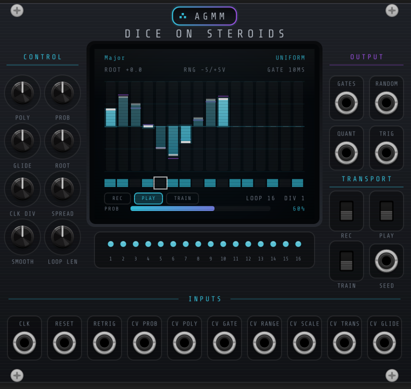

<!--
AGMM AUTOMATIC DOCUMENTATION
Source: DiceOnSteroids.cpp
Generated: 2026-11-04 06:17
-->

The provided code is a complete implementation of the `DiceOnSteroids` module for the VCV Rack modular synthesizer framework. It defines both the core logic (`DiceOnSteroids` class) and its visual representation (`DiceOnSteroidsWidget`, `DSDisplayWidget`, etc.).

## Module Screenshot

Here's a breakdown of what this code does:

### 1. **Module Logic (`DiceOnSteroids` Class)**

This part handles all the internal behavior:
- **Parameters**: Defines various parameters for controlling the module's behavior (e.g., polyphony, probability, clock division).
- **Inputs/Outputs**: Specifies input and output ports.
- **Lights**: Defines lights that indicate state (e.g., recording, playback).
- **State Management**:
  - Tracks current pattern data (`pattern`, `patternReadPos`, `patternWritePos`)
  - Manages random number generation (`rng`, `randomSeed`)
  - Handles quantization (`selectedScale`, `quantizedVoltages`, `voctVoltages`)
  - Controls playback/recording states (`recordEnabled`, `playbackEnabled`, `trainMode`)
- **Core Functions**:
  - `process()`: Main loop that processes inputs and updates outputs.
  - `step()`: Updates internal state each step.
  - `randomValue()`: Generates random values based on selected mode and range.
  - `quantize()`: Converts a voltage to a quantized note using the selected scale.
  - `getScale()`: Returns the current scale data.
  - `getScaleName()`: Gets the name of the current scale.
  - `getScaleSize()`: Returns the number of notes in the current scale.

### 2. **Visual Representation (`DiceOnSteroidsWidget` Class)**

This part defines how the module appears in the Rack UI:
- **Panel Background**: Draws a custom panel with gradient background and screw decorations.
- **Display Widget (`DSDisplayWidget`)**:
  - Shows visualizations of:
    - Channel tracks (with quantized and unquantized pitch bars)
    - Pattern strip showing gate states
    - Status indicators (REC, PLAY, TRAIN)
    - Probability meter
    - Readouts for scale, mode, root shift, etc.
- **Knobs and Switches**:
  - Adds knobs for controlling parameters like polyphony, probability, clock division, etc.
  - Adds switches for enabling recording, playback, and training modes.
  - Adds input jacks for various control signals.
  - Adds 16 gate LEDs aligned with the display columns.

### 3. **Context Menu (`appendContextMenu`)**

Adds a context menu to the module in Rack:
- Allows setting gate time
- Selects random mode (Uniform, Walk, Drunk, Gaussian)
- Sets V/Oct random range
- Chooses clock division
- Selects quantization scale
- Randomizes the seed for reproducible randomness

### Key Features Implemented:

1. **Polyphonic Random Generation**: Generates multiple simultaneous notes with various modes.
2. **Pattern Recording/Playback**: Records and plays back patterns of gate states.
3. **Quantization**: Supports multiple scales for pitch quantization.
4. **Control Over Parameters**: Fine-grained control over probability, spread, smoothing, clock division, etc.
5. **Visual Feedback**: Comprehensive visual representation of internal state.
6. **Modular Design**: Follows VCV Rack conventions for module structure and UI.

### Code Structure:

- The code is organized into logical sections:
  - Module logic
  - Panel drawing
  - Display widget with layered drawing
  - Widget construction (knobs, switches, inputs, outputs)
  - Context menu items

This implementation provides a rich, interactive tool for generating polyphonic random sequences with extensive control over the output characteristics. The visual representation gives immediate feedback on the current state and parameters, making it easy to use in a modular environment.

The code is well-structured and follows VCV Rack's conventions, making it suitable for inclusion in a plugin. It demonstrates advanced features like layered drawing, context menus, and complex parameter handling within a single module.