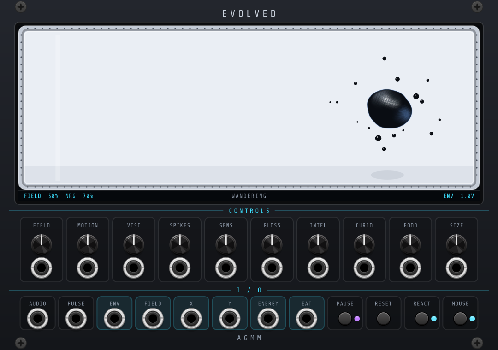

<!--
AGMM AUTOMATIC DOCUMENTATION
Source: Evolved.cpp
-->

# Evolved

## 1. Overview

`Evolved` is a 36 HP (540 × 380 px) audio-reactive visual module that renders a glossy black ferrofluid "lifeform" swimming inside a wide rectangular glass tank, set into a perforated white bezel. It is the big brother of *Lifeform*: same 3D ferrofluid core (lobed blob, ~160 Rosensweig spikes, ~16 orbiting droplets, perspective projection, depth sorting, normal-based gloss) — but inside a wider tank, at higher surface resolution, and driven by a small autonomous brain.

Key features:

- Real 3D ferrofluid visualisation (not just a scope) in a rectangular glass tank
- ~160 Rosensweig spikes + 16 orbiting droplets + a 4608-point surface grid
- Low/mid/high band analysis + onset detection + silence detection
- A **brain** with energy, hunger, food hunting, wander, rest and memory
- **Tempo tracking**: onset intervals → beat period + phase, with anticipation of the next beat
- **Mouse sensing**: leans spikes toward the cursor, reaches out with droplets, swims after it
- **Trust** system: gentle cursor movement earns trust, aggressive movement makes it wary / startled
- Six moods: RESTING, WANDERING, HUNTING, CURIOUS, DANCING, STARTLED
- Ten knobs (all with CV), four buttons, six outputs
- Brain runs at control rate in the **module** (not the display), so outputs work when the display is not visible
- Purple bioluminescence in dark rooms, cyan-glowing food pellets

## Module Screenshot



## 2. Architecture

### Main Classes

- `Evolved` — core module class inheriting from `rack::Module` (audio analysis + brain + outputs)
- `EvolvedDisplay` — the 3D ferrofluid renderer, body physics and mouse sensing
- `EvPanelBackground` — static panel artwork
- `EvolvedWidget` — `ModuleWidget` that assembles the panel, display, knobs, ports, buttons and lights
- 3D math helpers: `V3`, `M3`, `v3`, `dot3`, `cross3`, `len3`, `norm3`, `m3mul`
- Utility helpers: `clampT`, `hash1`, `smooth01`, `lerpf`

### Inheritance

- `Evolved` inherits from `rack::Module`
- `EvolvedDisplay` and `EvPanelBackground` inherit from `rack::TransparentWidget`
- `EvolvedWidget` inherits from `rack::ModuleWidget`

### Structures

- `V3 { float x, y, z; }` — minimal 3D vector
- `M3 { float m[9]; }` — row-major 3×3 matrix
- `EvKnobDef { const char *name; int param; int cv; }` — knob table entry
- `EvolvedDisplay::Spike { V3 d; float rnd, phase; float h, v; float bx, by, tx, ty, hw, spec, lit; bool front, vis; }`
- `EvolvedDisplay::Drop { V3 e1, e2; float ang, dist, rest, r; float dv, w, phase; float x, y, sc, z, vis; }`
- `EvolvedDisplay::ldir[GN]`, `wpos[GN]`, `wnorm[GN]` — surface grid (LAT × LON)
- `EvolvedDisplay::psx[GN]`, `psy[GN]`, `psc[GN]` — projected surface
- `EvolvedDisplay::sil[NB]` — silhouette radius per angular bin

### Layout constants (36 HP = 540 × 380)

| Constant | Value | Meaning |
|----------|-------|---------|
| `EV_PANEL_W` | 540 | Panel width |
| `EV_PANEL_H` | 380 | Panel height |
| `EV_DISP_X`, `EV_DISP_Y` | 20, 28 | Display top-left |
| `EV_DISP_W` | 500 | Display width |
| `EV_AREA_H` | 178 | Tank area height |
| `EV_DISP_H` | 190 | Display height (tank + readout row) |
| `EV_TANK_PAD` | 6 | Bezel padding inside the display |
| `EV_TANK_W`, `EV_TANK_H` | 488, 166 | Glass tank size |
| `EV_REF_R` | 62 | Creature scale unit (px) |
| `EV_CAM` | 320 | Camera distance for perspective |
| `EV_BX` | 204 | Roamable half-width from tank centre |
| `EV_BY` | 45 | Roamable half-height from tank centre |
| `EV_FOODS` | 5 | Max food pellets alive |
| `EV_TICK` | 64 | Brain runs every N samples |
| `EV_CTRL_STEP` | 50 | Knob plate pitch |
| `EV_IO_STEP` | 500/12 ≈ 41.67 | I/O plate pitch |

### State (grouped)

| Group | Storage |
|-------|---------|
| Audio analysis | `float env`, `peakHold`, `field`, `lp1`, `lp2`, `eLow`, `eMid`, `eHigh`, `pulseFlash`, `prevPulse` |
| Cached coefficients | `float cachedSr`, `cAtk`, `cRel`, `cPeak`, `cLP1`, `cLP2`, `cField`, `aLow`, `rLow`, `aMid`, `rMid`, `aHigh`, `rHigh` |
| Buttons / modes | `bool paused`, `audioReactive`, `mouseEnabled`, `prevPauseButton`, `prevAudioButton`, `prevMouseButton`, `prevResetButton`, `pendingKick` |
| Knobs (knob + CV) | `float kField`, `kMotion`, `kVisc`, `kSpikes`, `kSens`, `kGloss`, `kIntel`, `kCurio`, `kFood`, `kSize` |
| Brain | `float t`, `posX`, `posY`, `velX`, `velY`, `energy`, `trust`, `lifeAct`, `audioAct`, `punch`, `onsetRef`, `onsetCool`, `phase` |
| Brain — mood | `Mood mood`, `float moodTimer`, `startleTimer`, `startleCool`, `threatX`, `threatY` |
| Brain — steering | `float tgtX`, `tgtY`, `retarget`, `eatFlash` |
| Brain — tempo | `float beatPeriod`, `beatPhase`, `beatConf`, `beatSince`, `beatFlash` |
| Brain — memory | `float spotX[3]`, `spotY[3]`, `int spotN`, `spotHead` |
| Brain — food | `bool falive[5]`, `float fx[5]`, `fy[5]`, `fty[5]`, `fage[5]`, `foodTimer`, `foodCool`, `dsp::PulseGenerator eatPulse` |
| Shared atomics | `envSmoothed`, `fieldSmoothed`, `pulseSmoothed`, `lowSmoothed`, `midSmoothed`, `highSmoothed`, `posXA`, `posYA`, `velXA`, `velYA`, `attrXA`, `attrYA`, `attrKA`, `energyA`, `trustA`, `lifeActA`, `audioActA`, `eatFlashA`, `beatFlashA`, `beatConfA`, `viscA`, `spikesA`, `glossA`, `sensA`, `motionA`, `sizeA`, `curioA`, `intelA`, `moodA`, `hitSeq`, `kickSeq`, `eatSeq`, `resetSeq`, `hitStr`, `foodXA[5]`, `foodYA[5]`, `foodShowA[5]` |
| Mouse (written by UI) | `mouseHover`, `mouseX`, `mouseY`, `mouseSpeed` |
| Display — 3D | `Spike spikes[160]`, `Drop drops[16]`, `V3 ldir[4608]`, `wpos[4608]`, `wnorm[4608]`, `float psx[4608]`, `psy[4608]`, `psc[4608]`, `lw[4608]`, `sil[256]` |
| Display — state | `M3 Rm`, `V3 om`, `V3 Lv`, `Hv`, `H2v`, `magD`, `velD`, `float bodyBase`, `wobAmt`, `stretch`, `vStr`, `magA`, `magLen`, `offX`, `offY`, `bx`, `by`, `bvx`, `bvy`, `slX`, `slY`, `slVX`, `slVY`, `act`, `calmK`, `wt`, `spinVel`, `ripAmt`, `ell`, `punch`, `eatF`, `glowK`, `mood`, `trust`, `energy`, `mouseSense`, `mxL`, `myL`, `pmx`, `pmy`, `mouseSpd`, `mouseHad`, `mouseInTank` |

## 3. DSP Theory

### Audio analysis

Input is normalised to ±1 (`/ 5`) and processed in `process()` (sample rate):

- **Envelope follower** — fast attack (4 ms), slow release (180 ms)
- **Low band** — 1-pole LP at 180 Hz (`lp1`)
- **Mid band** — 1-pole LP at 2200 Hz (`lp2`) − `lp1`
- **High band** — input − `lp2`
- Each band has its own asymmetric envelope follower:
  - low: attack 3 ms, release 140 ms
  - mid: attack 2 ms, release 90 ms
  - high: attack 1 ms, release 60 ms
- **Pulse flash** — set to 1 on a rising edge of `PULSE_INPUT` (`≥ 1 V`), decays at 3.5/s

### Onset detection (control rate)
onsetCool -= dt
onsetRef += (env − onsetRef) · (1 − e^{−dt/0.12})
if audioReactive
and onsetCool ≤ 0
and env > 0.03
and (env − onsetRef) > 0.05 + 0.25 · onsetRef:
onsetCool = 0.07
onsetRef = env
registerHit(clamp(peakHold · (0.6 + kSens), 0, 1), false)

`registerHit(str, fromPulse)`:

- `punch ← min(punch + 0.9·str, 1.2)`
- hop: `velY −= 55·str·(0.4 + 0.6·kIntel)`, `velX += (rand−0.5)·40·str`
- tempo tracking (see below)
- if `str > 0.75` and `mood == REST` and `startleCool ≤ 0` and `rand < 0.6` → `startle()` at a random nearby point
- if `str > 0.6` and `kFood > 0.05` and `foodCool ≤ 0` and `rand < 0.5·kFood` → `spawnFood()`, `foodCool = 1.5`
- increments `hitSeq` (and `kickSeq` if from pulse), stores `hitStr`

### Tempo tracking

On each onset with `str > 0.25`, with `interval = beatSince`:
if interval ∈ (0.2, 1.6):
ratio = interval / beatPeriod
if |ratio − 1| < 0.2: # on grid
beatPeriod += (interval − beatPeriod) · 0.25
beatConf = min(1, beatConf + 0.18)
onGrid = true
else if |ratio − 0.5| < 0.1 or |ratio − 2| < 0.2:

subdivision or half-time — keep grid, no change
else:
beatConf −= 0.25
if beatConf < 0.1:
beatPeriod = interval
beatConf = 0.1

beatPeriod = clamp(beatPeriod, 0.2, 1.6)

if beatConf < 0.3:
beatPhase = 0
beatSince = 0
elif onGrid:
err = beatPhase
if err > 0.5: err −= 1
beatPhase = wrap(beatPhase − 0.5·err)
beatSince = 0

The **beat clock** runs every brain step even without onsets:
beatSince += dt
beatConf −= dt · (audioAct > 0.1 ? 0.05 : 0.4)
beatConf = clamp(beatConf, 0, 1)
beatPhase += dt / beatPeriod
if beatPhase ≥ 1:
beatPhase −= 1
if audioReactive and beatConf > 0.5 and beatSince > 0.6·beatPeriod:
beatFlash = max(beatFlash, 0.7·beatConf)
velY −= 25·beatConf·(0.3 + 0.7·kIntel) # anticipation hop

### Activity / calm
level = env · (0.4 + kSens) + 0.2·punch
actT = audioReactive ? max(smooth01(0.008, 0.09, level), pulseFlash) : 0
audioAct ← audioAct + (actT − audioAct)·(1 − e^{−rate·dt})
rate = 30/s rising, 1/s falling

On the display side, an independent `act` blends `audioAct` with the brain's own `lifeAct`, so the creature remains alive in silence:
actT = max(audioAct, lifeAct)
act ← act + (actT − act)·(1 − e^{−rate·dt}) # 14/s rising, 2/s falling
calmK = smooth01(0.15, 0.85, 1 − act)

`calmK = 1` when fully calm (silent + resting) and `0` when active.

### Metabolism / hunger
speedN = min(1, |vel| / 120)
dE = −0.012·(0.4 + speedN)·(0.4 + kIntel) # cost to move
dE += audioAct · 0.030 · (0.3 + kSens) # sound feeds
if mood == REST: dE += 0.030 # resting recovers
energy = clamp(energy + dE·dt, 0, 1)
hunger = 1 − energy

Food pellets: `energy += 0.30` per pellet eaten (cap 1), `trust += 0.03` (cap 1).

### Mood selection
want = STARTLE if startleTimer > 0
= CURIOUS if mouseOn
= DANCE if audioAct > (mood == DANCE ? 0.2 : 0.35)
= SEEK if hasFood and hunger > 0.2
= REST if energy < 0.12 or (mood == REST and energy < 0.55)
= WANDER otherwise

A new mood is taken only when `moodTimer > 0.8`, or when the transition involves `STARTLE`. On mood change, `moodTimer = 0` and `retarget = 0`.

### Steering

Each mood sets a target `(tx, ty)` with a blend weight `w`, a maximum speed `maxSp` and an arrival gain `arrive`. The steering step is:
gx = clamp(tx·w, −EV_BX, EV_BX)
gy = clamp(ty·w, −EV_BY, EV_BY)
dx = gx − posX, dy = gy − posY
dist = sqrt(dx² + dy²)
sp = min(maxSp, dist·arrive)
dvx = dx/dist·sp, dvy = dy/dist·sp

drift = 3·(0.3 + lifeAct) # never perfectly still
dvx += sin(t·0.61 + 1.3)·drift
dvy += sin(t·0.83)·drift·0.6

accK = 1 − e^{−dt·(5 − 3·kVisc)}
velX += (dvx − velX)·accK
velY += (dvy − velY)·accK

posX += velX·dt
posY += velY·dt

if posX > EV_BX { posX = EV_BX; if velX > 0: velX *= −0.3 }
if posX < −EV_BX { posX = −EV_BX; if velX < 0: velX *= −0.3 }
if posY > EV_BY { posY = EV_BY; if velY > 0: velY *= −0.3 }
if posY < −EV_BY { posY = −EV_BY; if velY < 0: velY *= −0.3 }

Per-mood `maxSp` and `arrive`:

| Mood | maxSp | arrive |
|------|-------|--------|
| REST | 25 | 1.5 |
| WANDER | (20 + 80·kMotion)·(0.5 + 0.5·energy) | default (2) |
| SEEK | (45 + 110·kMotion)·(0.8 + 0.5·hunger) | 2.5 |
| CURIOUS | (60 + 140·kMotion)·(0.6 + 0.4·energy) | 3 |
| DANCE | (40 + 120·kMotion)·(0.5 + audioAct) | 2.5 |
| STARTLE | 240 | 4 |

### Mouse sensing and trust

The UI thread polls the rack mouse position relative to the module widget and writes `mouseHover`, `mouseX`, `mouseY`, `mouseSpeed` into the module. The brain reads them once per control tick:
mouseOn = mouseEnabled && mouseHover && kCurio > 0.03
mdx, mdy = mouse − pos # in tank px
mDist = sqrt(mdx² + mdy²)

if mouseOn:
if mSpd < 220: trust += 0.05·dt
elif mSpd > 520 and mDist < 140: trust −= 0.30·dt
if mSpd > 800 and mDist < 80
and trust < 0.55
and startleTimer ≤ 0 and startleCool ≤ 0:
startle(mouse, 1.0)
else:
trust += (0.6 − trust)·dt·0.01

trust = clamp(trust, 0, 1)
effC = kCurio·(0.25 + 0.75·trust)

`effC` is the effective curiosity used to weight the `CURIOUS` mood and the droplet reach on the display side.

### Startle
startleTimer = 0.65
startleCool = 2.5
(dx, dy) = unit(pos − from) # push away from threat
if |pos − from| < 1: random unit
velX += dx·220·power·(0.4 + 0.6·kIntel)
velY += dy·220·power·(0.4 + 0.6·kIntel)

The threat is stored at 40 px behind the creature so it runs away from the cursor.

### Display-side physics (`EvolvedDisplay::stepPhysics`)

The display reads the atomics and integrates its own physical model at display-frame rate (≈ 60 fps):

- **Punch**: `punch *= e^{−6·dt}`, `punch = min(punch + 1.3·onset, 1.2)` on a hit
- **Activity**: `act` blends `max(audioAct, lifeAct)`, `calmK = smooth01(0.15, 0.85, 1 − act)`
- **Wobble clock**: `wt += dt·(0.7 + 0.8·act + 1.5·audioEnv + 1.0·midA)`
- **3D tumble**: `om` tracks `axis·spinMag + (−bvy·0.012, bvx·0.012, 0)` with 1.5/s smoothing, adds random impulses on hit/kick, capped at 5 rad/s
- **Body size**:
sizeScale = 0.72 + 0.55·sizeK
bodyBase = R·sizeScale·(0.26 + 0.09·field·(0.4 + 0.6·act)

0.10·lowA + 0.04·audioEnv + 0.02·pulse

0.05·punch + 0.025·beatF·beatC + 0.04·eatF)
·(1 + 0.20·calmK + 0.03·sin(wt·1.7))
- **Soft-body slosh**: `slX, slY` follow `−vel·0.045·cAmt` with a spring-damper (`ck = 14`, `cd = 2.5 + visc·4`), clamped to ±R·0.22
- **Body offset**: `offX = bx + slX`, `offY = by + slY`
- **Attractor**: `magD`, `magLen`, `magA` derived from `attrX/attrY/attrK`

### Body surface radius (`surfaceR`)

For a local unit direction `d` and its world direction `wd`:
n = sin(2.1dx + 1.7dy + wt·0.90)·0.50

sin(3.2dy − 2.4dz − wt·1.30 + 1.7)·0.30

sin(1.6dz + 2.2dx + wt·0.55)·0.40

sin(5.0dx + 4.1dy + 3.7dz + wt·2.10)·0.12
al = max(0, dot(wd, magD))
av = dot(wd, velD)
r = bodyBase·(1 + wobAmt·n

ripAmt·sin(7·dy − wt·7 + 2·dx)

ell·(1.5·dx² − 0.5)

stretch·al³

vStr·(av² − 0.3))
r = min(r, EV_TANK_H·0.30)

### Spikes

For each of the 160 spikes:
wd = Rm · s.d
align = 0.5 + 0.5·dot(wd, magD)
gate = 0.25 + 0.75·act
localField= (field·(0.80 + 0.35·align·magLen)

audioEnv·(0.45 + 0.70·align)

highA·(0.15 + 0.55·s.rnd)

pulse·0.20 + punch·0.30 + 0.15·life)·gate

threshold = (s.h > 0.05) ? 0.85·criticalField : criticalField # criticalField = 0.28

if localField > threshold:
drive = localField − threshold
clump = 0.65 + 0.35·sin(s.d.x·5 + s.d.z·3 + wt·0.8)
wave = 1 + 0.28·act·sin(wd.x·3 − wd.y·2 − wt·2.4)
fizz = 1 + 0.5·highA·sin(wt·14 + s.phase·7)
target = sqrt(drive)·2.0·spikeAmt·(0.45 + 0.55·s.rnd)
· clump · wave · fizz · (1 + 0.5·punch)
· (0.90 + 0.10·sin(wt·3 + s.phase))
target = min(target, 1.2)

k = 60·(1.1 − visc·0.4)·(1 + 1.2·audioEnv)
damp = (8 + visc·8)·(1 + 0.6·audioEnv)
s.v += (k·(target − s.h) − damp·s.v)·dt
s.h += s.v·dt
s.h = clamp(s.h, 0, 1.3)

### Droplets

For each of the 16 droplets:
pull = max(smooth01(0.30, 0.85, field·(0.5 + 0.5·act)), calmK)
tgt = d.rest·sizeScale·(1 − pull) + bodyBase·0.45·pull
tgt += audioEnv·3·sin(wt·8 + d.phase)
tgt += highA ·4·sin(wt·17 + d.phase·2)·(1 − pull)
tgt += 2.5·(1 − pull)·sin(wt·1.3 + d.phase)

k = 26
damp = 5 + visc·7
d.dv += (k·(tgt − d.dist) − damp·d.dv)·dt
d.dist += d.dv·dt
d.dist = clamp(d.dist, 0, EV_REF_R·0.9·sizeScale)

d.ang += (d.w·2 + spinVel·(0.3 + 0.4·d.phase/2π))·(1 − pull)·dt

P = Rm · (d.e1·cos(d.ang)·d.dist + d.e2·sin(d.ang)·d.dist)
P.x *= 1.45 # horizontal stretch
P += off3 + magD·(field·magLen·act·R·0.10·(1 − pull))

if mouseSense > 0.02:
P += toMouseN · (reach·mouseSense·0.45
· (0.3 + 0.7·d.phase/2π)
· (1 − 0.5·pull))

project(P, d.x, d.y, d.sc)
d.z = P.z
clamp d.x/d.y to tank bounds minus droplet radius
d.vis = smooth01(0.85·bodyBase, 1.15·bodyBase, d.dist)

### Projection

Perspective with camera at `z = EV_CAM = 320`:
s = EV_CAM / (EV_CAM − z)
x' = x·s
y' = y·s

## 4. Parameters and Controls

### Knobs

| Parameter | Min | Max | Default | Description |
|-----------|-----|-----|---------|-------------|
| `FIELD_PARAM` | 0 | 1 | 0.55 | Magnetic field |
| `MOTION_PARAM` | 0 | 1 | 0.45 | Swim speed / motion |
| `VISC_PARAM` | 0 | 1 | 0.50 | Fluid viscosity |
| `SPIKES_PARAM` | 0 | 1 | 0.65 | Spike amplitude |
| `SENS_PARAM` | 0 | 1 | 0.65 | Audio sensitivity |
| `GLOSS_PARAM` | 0 | 1 | 0.75 | Gloss |
| `INTEL_PARAM` | 0 | 1 | 0.70 | Intelligence (autonomy) |
| `CURIO_PARAM` | 0 | 1 | 0.70 | Curiosity (mouse attraction) |
| `FOOD_PARAM` | 0 | 1 | 0.40 | Food supply |
| `SIZE_PARAM` | 0 | 1 | 0.50 | Body size |

### Buttons

| Button | Description |
|--------|-------------|
| `PAUSE_PARAM` | Pause the brain and the display physics |
| `RESET_PARAM` | Reset the creature (position, energy, trust, food, memory, spikes) |
| `AUDIO_PARAM` | Toggle audio-reactive mode ("REACT") |
| `MOUSE_PARAM` | Toggle mouse sense |

### Lights

- `PAUSE_LIGHT` — on when paused (violet)
- `AUDIO_LIGHT` — on when audio-reactive (cyan)
- `MOUSE_LIGHT` — on when mouse sense is enabled (cyan)

### Enumerations

- `ParamId`: Field, Motion, Visc, Spikes, Sens, Gloss, Intel, Curio, Food, Size, Pause, Reset, Audio, Mouse
- `InputId`: Audio, Pulse, FieldCV, MotionCV, ViscCV, SpikesCV, SensCV, GlossCV, IntelCV, CurioCV, FoodCV, SizeCV
- `OutputId`: Env, Field, X, Y, Energy, Eat
- `LightId`: Pause, Audio, Mouse
- `Mood`: REST, WANDER, SEEK, CURIOUS, DANCE, STARTLE, COUNT

## 5. Inputs and Outputs

### Inputs

| Name | Type | Range | Description |
|------|------|-------|-------------|
| `AUDIO_INPUT` | Audio | ±5 V | Audio |
| `PULSE_INPUT` | Gate | > 1 V | Pulse / clock trigger |
| `FIELD_CV` | CV | 0–10 V | Field offset |
| `MOTION_CV` | CV | 0–10 V | Motion offset |
| `VISC_CV` | CV | 0–10 V | Viscosity offset |
| `SPIKES_CV` | CV | 0–10 V | Spikes offset |
| `SENS_CV` | CV | 0–10 V | Sensitivity offset |
| `GLOSS_CV` | CV | 0–10 V | Gloss offset |
| `INTEL_CV` | CV | 0–10 V | Intelligence offset |
| `CURIO_CV` | CV | 0–10 V | Curiosity offset |
| `FOOD_CV` | CV | 0–10 V | Food supply offset |
| `SIZE_CV` | CV | 0–10 V | Body size offset |

### Outputs

| Name | Type | Range | Description |
|------|------|-------|-------------|
| `ENV_OUTPUT` | CV | 0–10 V | Audio envelope |
| `FIELD_OUTPUT` | CV | 0–10 V | Field level |
| `X_OUTPUT` | CV | ±5 V | Creature X position |
| `Y_OUTPUT` | CV | ±5 V | Creature Y position |
| `ENERGY_OUTPUT` | CV | 0–10 V | Creature energy |
| `EAT_OUTPUT` | Trigger | 0/10 V | Trigger pulse when the creature eats a pellet (15 ms) |

### Bypass

`configBypass(AUDIO_INPUT, ENV_OUTPUT)` — audio passes through to the envelope output when no cable is patched to ENV.

## 6. Signal Processing Pipeline

`Evolved::process()` runs at sample rate:

1. **Coefficient cache** — if `sampleRate != cachedSr`, recompute all filter coefficients.
2. **Button debounce** — toggle `paused`, `audioReactive`, `mouseEnabled`, reset brain on rising edge of the corresponding button parameter. Update lights.
3. **Envelope** — asymmetric fast/slow envelope from `|input/5|`.
4. **Band split** — low/mid/high 1-pole LPs, then each band into its own asymmetric follower.
5. **Pulse** — rising edge of `PULSE_INPUT` sets `pulseFlash = 1` and `pendingKick = true`; `pulseFlash` decays at 3.5/s.
6. **Field** — `field` is smoothed to
kField + audioBoost + 0.75·pulseFlash + 0.35·beatFlash·kIntel + 0.25·eatFlash
clamped 0..1, with a 25 ms one-pole (`cField`).
7. **Brain tick** — every `EV_TICK = 64` samples:
- `readKnobs()`
- if not paused: `brainStep(64·dt)`
- `publish()` to atomics
8. **Write outputs**:
- `ENV_OUTPUT = clamp(env·10, 0, 10)`
- `FIELD_OUTPUT = field·10`
- `X_OUTPUT = clamp(posX/EV_BX, −1, 1)·5`
- `Y_OUTPUT = clamp(posY/EV_BY, −1, 1)·5`
- `ENERGY_OUTPUT = energy·10`
- `EAT_OUTPUT = eatPulse.process(dt) ? 10 : 0`

The display thread (`EvolvedDisplay::draw`) runs at UI-frame rate and:

1. Polls the mouse (`senseMouse`)
2. Advances physics (`stepPhysics`) unless paused
3. Draws the tank, shadow, food, mouse ripples, spikes, droplets and body
4. Draws the readout row

The brain (in the module) and the visual model (in the display) are **decoupled** through atomics, so the six outputs keep working even if the display is hidden.

## 7. Important Functions

### `Evolved::updateCoefs(float sr)`

Recomputes every per-sample filter coefficient for a new sample rate:

```cpp
cAtk = 1 - exp(-1 / (0.004f * sr));
cRel = 1 - exp(-1 / (0.180f * sr));
cPeak = exp(-1 / (0.010f * sr));
cLP1 = min(1.f, 2π * 180.f / sr);
cLP2 = min(1.f, 2π * 2200.f / sr);
aLow = min(1.f, 1 / (0.003f * sr));
rLow = min(1.f, 1 / (0.14f * sr));
... (mid, high)
cField = 1 - exp(-1 / (0.025f * sr));
Evolved::resetBrain()
Resets every brain field: t, position, velocity, energy (0.7), trust (0.6), activity, onset state, mood (WANDER), steering, tempo clock (period 0.5, confidence 0), memory (spotN = 0), all food pellets and their atomics. Finally calls publish() and increments resetSeq so the display clears its spikes and slosh.

Evolved::cv(int p, int c)
return clampT(params[p].getValue() + inputs[c].getVoltage() / 10.f, 0.f, 1.f);
Knob + CV, clamped to 0..1. Called by readKnobs() for all ten controls.

Evolved::pickWanderTarget()
With probability 0.35·kIntel, picks a remembered feeding spot (one of spotX[0..spotN-1]); otherwise samples up to 6 random points and picks the first one more than 70 px away.

Evolved::spawnFood()
Finds an empty slot (or returns if the alive count exceeds 1 + round(4·kFood)), sets falive = true, fage = 0, fx = uniform(−0.95·EV_BX, 0.95·EV_BX), fy = −EV_TANK_H/2 + 6, fty = lerp(−EV_BY/2, EV_BY, uniform).

Evolved::eatFood(int i)
falive = false, energy += 0.30 (cap 1), eatFlash = 1, eatSeq++, eatPulse.trigger(0.015), rememberSpot(fx[i], fy[i]), trust += 0.03 (cap 1).

Evolved::startle(float fromX, float fromY, float power)
Sets startleTimer = 0.65, startleCool = 2.5, stores a threat 40 px behind the creature, and applies a large velocity impulse in the direction away from (fromX, fromY).

Evolved::registerHit(float str, bool fromPulse)
Increments the sequence counters, adds punch, hops, runs the tempo tracker, possibly startles on a loud hit and possibly spawns food on a strong hit.

Evolved::brainStep(float dt)
The full control-rate update:

Audio activity (audioAct)

Onset detection → registerHit

Decays (punch, eatFlash, beatFlash), timers (startle, food, mood)

Tempo clock and anticipation hop

Food physics (fall toward fty) and pellet selection

Mouse sensing and trust

Metabolism (energy)

Mood selection

Per-mood steering target and movement style

Steering, velocity integration, position clamp and bounce

Eating collision check

Store attrX/attrY/attrK

Evolved::publish()
Writes all smoothing values, brain state, mood and food pellets to atomics for the display. This is the only thread-safe bridge from the module to the display.

EvolvedDisplay::surfaceR(const V3 &d, const V3 &wd)
Returns the body radius at local direction d. Sum of 4 sin wobbles, ripple, ellipse, stretch toward the attractor and squash-and-stretch along the swimming direction.

EvolvedDisplay::stepPhysics(float dt)
The big physics step on the UI thread:

Read module atomics (or run a self-driven demo when module == nullptr)

Update punch, activity, wt

Update 3D tumble (om, rotateBy)

Update attractor (magD, magLen)

Compute bodyBase, wobAmt, ripAmt, ell, stretch, vStr, velD

Update soft-body slosh (slX, slY), then offX = bx + slX, offY = by + slY

Integrate 160 spikes

Integrate 16 droplets

Call buildGeometry()

EvolvedDisplay::buildGeometry()
Projects every surface grid point (wpos), computes per-point normals (wnorm) from adjacent grid neighbours, builds the 256-bin smoothed silhouette (sil), and projects every spike (base + tip) and droplet into 2D. Also computes per-spike front, hw, spec and lit.

EvolvedDisplay::senseMouse(float dt)
Reads the rack mouse position relative to the module widget, writes mouseHover/mouseX/mouseY/mouseSpeed to the module, and smooths the visual mouseSense value used for the ripple, droplet reach and background.

EvolvedDisplay::drawTank(NVGcontext *vg)
White perforated bezel, groove, glass and floor band of the rectangular tank.

EvolvedDisplay::drawBody(NVGcontext *vg, float cx, float cy, float glossIn)
Black silhouette from sil[], cool rim stroke, then per-grid-point specular dots for Lv (broad), Hv (sharp) and H2v (secondary) highlights. Alpha is weighted by lw[] (sin(latitude)) so the poles don't glow brighter than the equator.
EvolvedDisplay::drawSpikes(NVGcontext *vg, float cx, float cy, float gloss, bool front)
Renders spikes in 3 passes: dark silhouettes (nvgQuadTo curved blades), edge glints, and sparkle tips driven by s.spec and s.lit.

EvolvedDisplay::drawGlow(NVGcontext *vg)
Drawn on Rack's light layer so it stays bright when the room is dimmed. Renders a purple halo, a glowing rim, spike lines and tips, droplet rings and cyan food pellets. Uses NVG_LIGHTER and glowK (derived from settings::rackBrightness).

8. Mathematical Implementation
Envelope follower
env
←
env
+
(
∣
i
n
∣
−
env
)
⋅
{
c
atk
∣
i
n
∣
>
env
c
rel
∣
i
n
∣
≤
env
env←env+(∣in∣−env)⋅{ 
c 
atk
​
 
c 
rel
​
 
​
  
∣in∣>env
∣in∣≤env
​
 
with 
c
atk
=
1
−
e
−
1
/
(
0.004
 
f
s
)
c 
atk
​
 =1−e 
−1/(0.004f 
s
​
 )
  and 
c
rel
=
1
−
e
−
1
/
(
0.180
 
f
s
)
c 
rel
​
 =1−e 
−1/(0.180f 
s
​
 )
 .

Band split
l
p
1
←
l
p
1
+
(
i
n
−
l
p
1
)
 
c
L
P
1
,
c
L
P
1
=
min
⁡
(
1
,
2
π
⋅
180
f
s
)
lp 
1
​
 ←lp 
1
​
 +(in−lp 
1
​
 )c 
LP1
​
 ,c 
LP1
​
 =min(1, 
f 
s
​
 
2π⋅180
​
 )
l
p
2
←
l
p
2
+
(
i
n
−
l
p
2
)
 
c
L
P
2
,
c
L
P
2
=
min
⁡
(
1
,
2
π
⋅
2200
f
s
)
lp 
2
​
 ←lp 
2
​
 +(in−lp 
2
​
 )c 
LP2
​
 ,c 
LP2
​
 =min(1, 
f 
s
​
 
2π⋅2200
​
 )
bandLow
=
1.5
∣
l
p
1
∣
,
bandMid
=
1.6
∣
l
p
2
−
l
p
1
∣
,
bandHigh
=
2.0
∣
i
n
−
l
p
2
∣
bandLow=1.5∣lp 
1
​
 ∣,bandMid=1.6∣lp 
2
​
 −lp 
1
​
 ∣,bandHigh=2.0∣in−lp 
2
​
 ∣
Each band into its own asymmetric follower with rates (aLow, rLow), (aMid, rMid), (aHigh, rHigh).

Onset detector
onsetRef
←
onsetRef
+
(
env
−
onsetRef
)
(
1
−
e
−
d
t
/
0.12
)
onsetRef←onsetRef+(env−onsetRef)(1−e 
−dt/0.12
 )
Trigger a hit when env > 0.03 and (env − onsetRef) > 0.05 + 0.25·onsetRef.

Tempo tracking
Beat period 
B
B and phase 
ϕ
ϕ (wrapped 0..1). For each on-grid onset with interval 
Δ
Δ:

B
←
B
+
0.25
(
Δ
−
B
)
,
confidence
←
min
⁡
(
1
,
confidence
+
0.18
)
B←B+0.25(Δ−B),confidence←min(1,confidence+0.18)
ϕ
←
ϕ
−
1
2
 
ϕ
~
,
ϕ
~
=
{
ϕ
ϕ
≤
0.5
ϕ
−
1
ϕ
>
0.5
ϕ←ϕ− 
2
1
​
  
ϕ
~
​
 , 
ϕ
~
​
 ={ 
ϕ
ϕ−1
​
  
ϕ≤0.5
ϕ>0.5
​
 
Free clock advance:

ϕ
←
ϕ
+
d
t
B
,
ϕ
≥
1
⇒
ϕ
←
ϕ
−
1
ϕ←ϕ+ 
B
dt
​
 ,ϕ≥1⇒ϕ←ϕ−1
Activity
actT
=
max
⁡
(
smooth01
(
0.008
,
0.09
,
level
)
,
pulseFlash
)
actT=max(smooth01(0.008,0.09,level),pulseFlash)
audioAct
←
audioAct
+
(
actT
−
audioAct
)
 
(
1
−
e
−
rate
 
d
t
)
audioAct←audioAct+(actT−audioAct)(1−e 
−ratedt
 )
With rate = 30/s rising, 1/s falling (module side); 14/s rising, 2/s falling (display side, blended with lifeAct).

Steering acceleration
v
←
v
+
(
v
⋆
−
v
)
 
(
1
−
e
−
d
t
 
(
5
−
3
 
visc
)
)
v←v+(v 
⋆
 −v)(1−e 
−dt(5−3visc)
 )
with 
v
⋆
=
dir
⋅
min
⁡
(
maxSp
,
dist
⋅
arrive
)
+
drift
v 
⋆
 =dir⋅min(maxSp,dist⋅arrive)+drift.

Metabolism
Δ
E
=
−
0.012
(
0.4
+
speedN
)
(
0.4
+
intel
)
+
0.030
 
audioAct
(
0.3
+
sens
)
+
[
REST
]
⋅
0.030
ΔE=−0.012(0.4+speedN)(0.4+intel)+0.030audioAct(0.3+sens)+[REST]⋅0.030
Soft-body slosh (spring-damper)
s
¨
x
=
c
k
(
s
x
⋆
−
s
x
)
−
c
d
 
s
˙
x
,
c
k
=
14
,
 
c
d
=
2.5
+
4
 
visc
s
¨
  
x
​
 =c 
k
​
 (s 
x
⋆
​
 −s 
x
​
 )−c 
d
​
  
s
˙
  
x
​
 ,c 
k
​
 =14, c 
d
​
 =2.5+4visc
with 
s
⋆
=
−
v
⋅
0.045
 
c
amt
+
R
⋅
0.03
 
c
amt
⋅
(
cos
⁡
(
w
t
⋅
0.7
)
,
 
sin
⁡
(
w
t
⋅
0.9
)
)
s 
⋆
 =−v⋅0.045c 
amt
​
 +R⋅0.03c 
amt
​
 ⋅(cos(wt⋅0.7), sin(wt⋅0.9)) and 
c
amt
=
0.45
+
0.55
 
act
c 
amt
​
 =0.45+0.55act.

Spikes (spring-mass)
v
←
v
+
[
k
 
(
target
−
h
)
−
d
 
v
]
d
t
,
h
←
h
+
v
 
d
t
v←v+[k(target−h)−dv]dt,h←h+vdt
with 
k
=
60
(
1.1
−
0.4
 
visc
)
(
1
+
1.2
 
audioEnv
)
k=60(1.1−0.4visc)(1+1.2audioEnv) and 
d
=
(
8
+
8
 
visc
)
(
1
+
0.6
 
audioEnv
)
d=(8+8visc)(1+0.6audioEnv).

Body surface
r
=
base
(
1
+
wob
 
n
+
rip
sin
⁡
(
7
d
y
−
7
 
w
t
+
2
d
x
)
+
ell
(
1.5
d
x
2
−
0.5
)
+
stretch
 
a
3
+
vStr
(
a
v
2
−
0.3
)
)
r=base(1+wobn+ripsin(7d 
y
​
 −7wt+2d 
x
​
 )+ell(1.5d 
x
2
​
 −0.5)+stretcha 
3
 +vStr(a 
v
2
​
 −0.3))
Body size
base
=
R
⋅
sizeScale
⋅
(
0.26
+
0.09
 
field
(
0.4
+
0.6
 
act
)
+
0.10
 
low
+
0.04
 
env
+
0.02
 
pulse
+
0.05
 
punch
+
0.025
 
beat
⋅
conf
+
0.04
 
eat
)
⋅
(
1
+
0.20
 
calmK
+
0.03
sin
⁡
(
1.7
 
w
t
)
)
base=R⋅sizeScale⋅(0.26+0.09field(0.4+0.6act)+0.10low+0.04env+0.02pulse+0.05punch+0.025beat⋅conf+0.04eat)⋅(1+0.20calmK+0.03sin(1.7wt))
with 
sizeScale
=
0.72
+
0.55
 
size
sizeScale=0.72+0.55size.

Droplets
d
¨
=
k
(
d
⋆
−
d
)
−
c
d
d
˙
,
k
=
26
,
 
c
d
=
5
+
7
 
visc
d
¨
 =k(d 
⋆
 −d)−c 
d
​
  
d
˙
 ,k=26, c 
d
​
 =5+7visc
with 
d
⋆
=
d
rest
⋅
s
 
(
1
−
pull
)
+
base
⋅
0.45
 
pull
+
audio
+
high
+
bob
d 
⋆
 =d 
rest
​
 ⋅s(1−pull)+base⋅0.45pull+audio+high+bob.

Projection
s
=
320
320
−
z
,
x
′
=
x
s
,
y
′
=
y
s
s= 
320−z
320
​
 ,x 
′
 =xs,y 
′
 =ys
9. Performance and Optimization
CPU Usage
Audio thread (per sample): envelope (~4 ops), 2 LPs (~4 ops), 3 band followers (~6 ops), pulse / field (~6 ops), 6 outputs (~6 ops) ≈ 25 ops/sample. Brain tick runs once per 64 samples with a large fixed cost.

Brain tick (per 64 samples ≈ 1.5 kHz at 48 kHz): ≈ 500–1500 flops depending on how many spikes/drops evaluate. Amortised, this is small.

UI thread (per frame at ~60 fps):

stepPhysics: 160 spikes × ~40 flops + 16 droplets × ~60 flops + grid rebuild ≈ 20–30 K flops

buildGeometry: 4608 grid points × ~30 flops + 160 spikes × ~20 flops + 256-bin smoothing ≈ 150–200 K flops

Drawing: 160 spikes × 3 passes + 4608 spec dots ≈ 30 K flops

Total: ≈ 200–250 K flops/frame on the UI thread (heavier than Lifeform)

Memory Allocation
All state is fixed-size, no allocation in process() or draw()

spikes[160] ≈ 6.4 KB, drops[16] ≈ 768 B

ldir/wpos/wnorm[4608] × 12 B ≈ 165 KB

psx/psy/psc/lw[4608] × 4 B ≈ 74 KB

sil[256] × 4 B ≈ 1 KB

Total display-side memory ≈ 250 KB

Buffers
160 Spike structs (~40 B each)

16 Drop structs (~48 B each)

4608 × (3 × V3 + 4 floats) ≈ 240 KB

Real-time Processing
Audio analysis runs at sample rate, but is very lightweight

The brain runs at control rate (EV_TICK = 64 samples), decoupled from the display

Display physics runs at UI-frame rate (≈ 60 fps), not sample rate

No allocation, no blocking, no file I/O on either thread

Thread Safety
Audio thread → UI: via std::atomic<float> / std::atomic<int>

UI thread → audio: via mouseHover, mouseX, mouseY, mouseSpeed atomics

A torn read is at worst cosmetic (a one-frame visual glitch or a stale mouse position)

resetSeq, hitSeq, kickSeq, eatSeq are monotonic counters used for event dispatch

Numerical Stability
norm3() and len3() use a 1e-6 epsilon to avoid division by zero

rotateBy re-orthonormalises the rotation matrix every frame (Gram–Schmidt)

All position/velocity values are clamped after integration

energy, trust, beatConf, beatPeriod, phase and every filter state are clamped

bodyBase is clamped to EV_TANK_H * 0.30 so the body never exceeds the tank

10. Dependencies
Libraries/Headers
plugin.hpp — VCV Rack core

agmm_ui.hpp — shared AGMM UI helpers

<algorithm>, <atomic>, <cmath>, <cstdio>, <cstring>, <string>, <vector>

External Classes
rack::Module, rack::ModuleWidget, rack::TransparentWidget, rack::engine::ParamQuantity

rack::dsp::PulseGenerator — used for the EAT output

rack::random::uniform() — used throughout for randomness

rack::system::getTime() — used for display-time delta

rack::settings::rackBrightness — drives glowK

agmm::panelBase, agmm::bezel, agmm::plate, agmm::sectionHeader, agmm::text, agmm::screen, agmm::accent, agmm::dim, agmm::warm, agmm::ALIGN_L/C/R, agmm::CyanLight, agmm::VioletLight

Module Registration
The anonymous namespace contains the 3D helpers, EvolvedDisplay, EvPanelBackground

EvolvedWidget assembles the panel, display, 10 knobs + CV jacks, 2 inputs, 6 outputs, 4 buttons and 3 lights

Model registration happens at the bottom of the file (createModel<Evolved, EvolvedWidget>("Evolved"))

11. Summary
Evolved is the "living" version of Lifeform: same 3D ferrofluid engine, but rebuilt inside a wider rectangular glass tank and extended with an autonomous brain. Where Lifeform is a pure audio visualiser, Evolved has its own energy budget, hunger, food hunting, wander/rest cycles, memory of where it last ate, tempo tracking (beat period + phase with anticipation), a mouse-trust system and six distinct moods.

The audio path is deliberately minimal (envelope + three bands + onset detector + pulse), because the interesting behaviour lives in the brain and in the display physics. The brain runs at control rate (EV_TICK = 64 samples) and publishes everything the display needs through atomics, so the six outputs — including X/Y position, energy and the EAT trigger — keep working even when the display is not visible (for example when the module is scrolled off-screen or the rack is headless).

The display side is where most of the work happens: 160 spikes, 16 droplets and a 4608-point surface grid, with a perspective-projected silhouette (256 angular bins, smoothed over 3 passes) and normal-based gloss. The physics adds soft-body slosh, spike spring-mass with a hysteresis threshold, droplet spring orbits that reach toward the cursor, a tumbling angular velocity that reacts to sound hits and an attractor that leans the spikes toward the current target (mouse, food or dance path).

The mood system is the behavioural core: REST sinks to the floor and recovers energy, WANDER walks between remembered spots and random targets, SEEK hunts the nearest pellet, CURIOUS leans toward the cursor (or circles it when wary), DANCE follows a Lissajous-like path through the tank, and STARTLE overrides everything with a 0.65 s dash away from the threat.

Known limitations: the display physics runs at UI-frame rate (≈ 60 fps), so very fast transient details are missed; the display thread is significantly heavier than Lifeform's (≈ 200–250 K flops/frame); and the brain tick is fixed at 64 samples, so on very high sample rates the brain effectively runs slower. But for a "living" visual instrument — one that reacts to sound, notices the mouse, learns the beat, gets hungry and remembers where it ate — it is the most complete piece in the AGMM visualiser collection.
