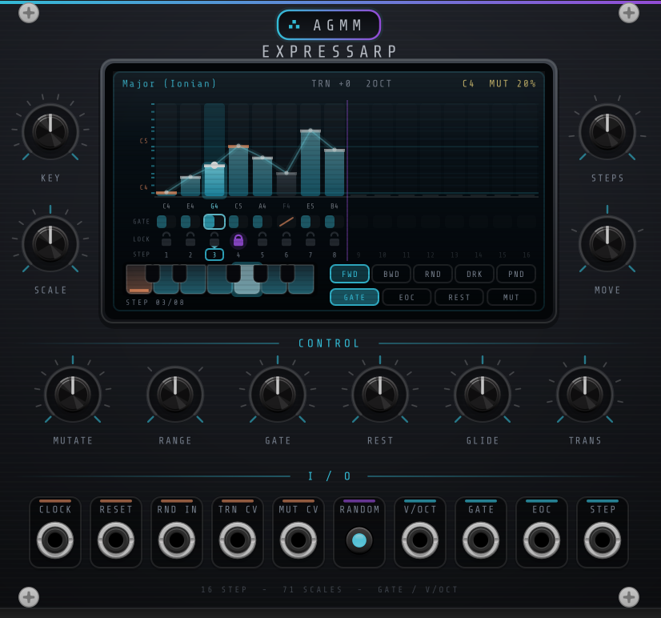

<!--
AGMM AUTOMATIC DOCUMENTATION
Source: ExrpessArpeggiator.cpp
Generated: 2026-11-04 06:17
-->

This code defines a VCV Rack module called `ExpressArpeggiator`, which is an arpeggiator with advanced features like pattern editing, muting, locking, direction control, and more. Here's a breakdown of its key components:

## Module Screenshot

1.  **Module Definition (`ExpressArpeggiator`)**:
    *   Inherits from `rack::Module`.
    *   Contains parameters for controlling the arpeggiator's behavior (e.g., length, root note, scale, direction, transpose, muting, etc.).
    *   Manages internal state like notes, mute/lock flags, playhead position, and playback status.
    *   Implements `process()` to handle incoming clock/reset signals and generate output voltages/gates.

2.  **Widget Definition (`ExpressArpeggiatorWidget`)**:
    *   Inherits from `rack::ModuleWidget`.
    *   Sets up the visual layout of the module in the Rack UI, including:
        *   Panel background (`EAPanel`).
        *   Knobs for controlling parameters.
        *   Input/output ports.
        *   Custom display (`EADisplay`) showing the pattern and status.
        *   Context menu with options to lock/unlock steps, randomize patterns, or clear them.

3.  **Custom Display (`EADisplay`)**:
    *   Inherits from `rack::Widget`.
    *   Draws the visual representation of the arpeggiator's pattern using NanoVG.
    *   Shows:
        *   The note grid with pitch guides and octave markers.
        *   Bars representing each step, colored based on state (muted, locked, current step).
        *   Note names above the bars.
        *   Gate/mute indicators at the bottom.
        *   Lock indicators.
        *   Step numbers.
        *   Direction chips.
        *   Status indicators (gate, end of cycle, rest, mute).
        *   Readouts for scale name, transpose/span, and root note.
        *   Visual effects like scanlines, vignette, and a glass-like overlay.

4.  **Key Features**:
    *   **Pattern Editing**: Users can paint notes into the 16-step grid using the UI.
    *   **Muting/Locking**: Individual steps can be muted or locked to prevent changes during playback.
    *   **Direction Control**: Play direction (forward, backward, random, etc.) can be selected.
    *   **Scale Support**: Uses a table of predefined scales for note selection.
    *   **Transpose/Root**: Allows shifting the entire pattern up/down and setting the root note.
    *   **CV Inputs**: Accepts clock, reset, random trigger, transpose CV, and mute CV inputs.
    *   **Output Signals**: Generates pitch (VOCT), gate, cycle gate, and step signals.

5.  **Visual Design**:
    *   Uses a dark theme with vibrant accent colors (cyan, violet, orange).
    *   Features a grid-based layout for the pattern display.
    *   Includes visual feedback for current step, locked steps, muted steps, and playing notes.
    *   Implements subtle animations via `glow` values that affect bar appearance.

This module provides a powerful and flexible arpeggiator suitable for creating complex rhythmic patterns and melodic sequences within VCV Rack.