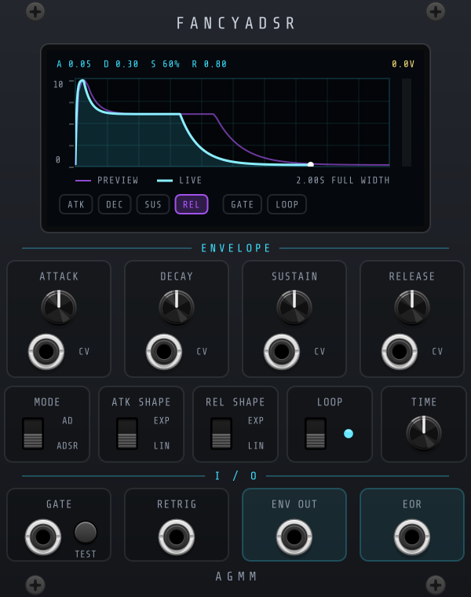

<!--
AGMM AUTOMATIC DOCUMENTATION
Source: FancyADSR.cpp
-->

# FancyADSR

## 1. Overview

`FancyADSR` is a 20 HP envelope generator with per-stage CV control, selectable linear/exponential attack and release shapes, an optional looping mode, and a live scope that shows both the ideal ADSR curve implied by the current knobs (violet preview) and the actual envelope output history (cyan live trace).

Key features:
- Per-stage CV on Attack, Decay, Sustain, Release
- Selectable linear or exponential attack shape
- Selectable linear or exponential release shape
- Loop mode (retrigger from gate while held)
- 5 ms end-of-release (EOR) pulse
- Live scope with preview + live trace
- Selectable scope time axis (50 ms .. 5 s)

## Module Screenshot



## 2. Architecture

### Main Classes

- `FancyADSR`: Core module class inheriting from `rack::Module`
- `FAPanelBackground`: Static panel artwork
- `FADisplayWidget`: Live scope + readouts + chips
- `segCurve` helper: shared curve math for preview

### Inheritance

- `FancyADSR` inherits from `rack::Module`
- Both UI widgets inherit from `rack::TransparentWidget`

### State (grouped)

| Group | Storage |
|-------|---------|
| Envelope | `Stage stage`, `float env`, `float stageTime` |
| EOR | `float eorPulseRemaining` |
| Gate detection | `bool lastGateState`, `bool lastTriggerState` |
| History | `float history[400]`, `int historyCount`, `int historyWritePos`, `float sampleAccumulator` |
| Display | `dispAttack, dispDecay, dispSustain, dispRelease`, `dispAttackShape, dispReleaseShape`, `dispGate`, `eorFlash` |

## 3. DSP Theory

### Envelope stages

The envelope has five stages:

1. **IDLE** — `env = 0`
2. **ATTACK** — ramp 0 → 1 over `attackTime`
3. **DECAY** — ramp 1 → `sustainLev` over `decayTime`
4. **SUSTAIN** — hold at `sustainLev`
5. **RELEASE** — ramp down to 0 over `releaseTime`

### Linear vs exponential segments

The `runSegment` function handles both shapes:

**Linear** (`shape = 0`):

$$
y = \text{start} + (\text{target} - \text{start})\frac{t}{D}
$$

**Exponential** (`shape = 1`):

$$
y = \text{start} + (\text{target} - \text{start})\left(1 - e^{-t/\tau}\right), \quad \tau = \frac{D}{-\ln(0.001)}
$$

The `-ln(0.001)` factor ensures the exponential segment reaches within 0.1% of its target after `D` seconds — so exponential and linear attacks of the same duration sound comparable in length.

### Gate handling

Rising edge:
- If IDLE or RELEASE → start attack
- If SUSTAIN and looping → start attack

Falling edge:
- If ATTACK/DECAY/SUSTAIN → start release

### Trigger handling

Rising edge while not IDLE → restart attack.

### Loop mode

If LOOP is on and the gate is held, when the envelope reaches SUSTAIN it immediately restarts the attack, producing an LFO-like loop.

### End-of-release pulse

When the envelope reaches 0 (release done), a 5 ms pulse is fired on the EOR output and `eorFlash` is set for the display.

### History

The envelope output is sampled into a 400-entry ring buffer at a rate of `timeScale/400` samples per slot, where `timeScale` is the scope time axis (50 ms .. 5 s). This gives a scrolling scope that always shows the last `timeScale` seconds.

### Preview

The UI computes an "ideal" ADSR curve from the current knob values (a 100-point sampled curve) and draws it as a violet line, so you can see the shape the envelope will have before you play it.

## 4. Parameters and Controls

### Knobs

| Parameter | Min | Max | Default | Description |
|-----------|-----|-----|---------|-------------|
| `ATTACK_PARAM` | 0.001 s | 10 s | 0.01 s | Attack time |
| `DECAY_PARAM` | 0.001 s | 10 s | 0.1 s | Decay time |
| `SUSTAIN_PARAM` | 0 | 1 | 0.8 | Sustain level |
| `RELEASE_PARAM` | 0.001 s | 10 s | 0.5 s | Release time |
| `TIME_SCALE_PARAM` | 0.05 s | 5 s | 1 s | Scope time axis |

### Switches

| Switch | Description |
|--------|-------------|
| `ATTACK_SHAPE_PARAM` | Linear / Exponential |
| `RELEASE_SHAPE_PARAM` | Linear / Exponential |
| `LOOP_TOGGLE_PARAM` | Loop on/off |

### Inputs

| Input | Description |
|-------|-------------|
| `GATE_INPUT` | Gate |
| `TRIGGER_INPUT` | Retrigger |
| `ATTACK_CV_INPUT` | Attack CV (5 V adds 1 s) |
| `DECAY_CV_INPUT` | Decay CV (5 V adds 1 s) |
| `SUSTAIN_CV_INPUT` | Sustain CV (5 V adds 100%) |
| `RELEASE_CV_INPUT` | Release CV (5 V adds 1 s) |

### Outputs

| Output | Description |
|--------|-------------|
| `ENV_OUTPUT` | Envelope (0–10 V) |
| `EOR_OUTPUT` | End of release (5 ms pulse) |

### Lights

- `LOOP_LIGHT` — On when loop mode is enabled

### Enumerations

- `Stage`: IDLE, ATTACK, DECAY, SUSTAIN, RELEASE
- `ParamId`: Attack, Decay, Sustain, Release, AttackShape, ReleaseShape, Loop, TimeScale
- `InputId`: Gate, Trigger, AttackCV, DecayCV, SustainCV, ReleaseCV
- `OutputId`: Env, EOR
- `LightId`: Loop

## 5. Inputs and Outputs

### Inputs

| Name | Type | Range | Description |
|------|------|-------|-------------|
| `GATE_INPUT` | Gate | > 1 V | Envelope gate |
| `TRIGGER_INPUT` | Gate | > 1 V | Retrigger |
| `ATTACK_CV_INPUT` | CV | ±5 V | Attack offset (scaled to 1 s) |
| `DECAY_CV_INPUT` | CV | ±5 V | Decay offset (scaled to 1 s) |
| `SUSTAIN_CV_INPUT` | CV | ±5 V | Sustain offset (scaled to 100%) |
| `RELEASE_CV_INPUT` | CV | ±5 V | Release offset (scaled to 1 s) |

### Outputs

| Name | Type | Range | Description |
|------|------|-------|-------------|
| `ENV_OUTPUT` | CV | 0–10 V | Envelope |
| `EOR_OUTPUT` | Gate | 0/10 V | End-of-release 5 ms pulse |

## 6. Signal Processing Pipeline

1. **Gate/trigger edge detect** — Detect rising and falling edges of gate and trigger.
2. **Stage transitions** — On edges, transition between stages as described in §3.
3. **Read parameters + CVs** — Attack, decay, sustain, release times with CV offsets.
4. **Stage evaluation**:
   - **ATTACK**: `env = runSegment(0, 1, attackTime, stageTime, attackShape)`; increment `stageTime`; if `>= attackTime`, transition to DECAY.
   - **DECAY**: `env = runSegment(1, sustainLev, decayTime, stageTime, 1.0)` (always exponential); increment; if `>= decayTime`, transition to SUSTAIN.
   - **SUSTAIN**: `env = sustainLev`; if loop and gate, transition to ATTACK.
   - **RELEASE**: `env = runSegment(env, 0, releaseTime, stageTime, releaseShape)`; increment; if `>= releaseTime`, transition to IDLE and fire EOR.
   - **IDLE**: `env = 0`.
5. **Write env output** — `env * 10 V`.
6. **Write EOR** — 10 V if pulse active.
7. **Update loop LED**.
8. **Update display data** — Sample the envelope into the history ring buffer at `timeScale/400` intervals.

## 7. Important Functions

### `runSegment(float start, float target, float duration, float t, float shape)`

Evaluates one envelope segment at time `t`.

```cpp
if (duration <= 0.0f) return target;
float alpha = clamp(t / duration, 0.0f, 1.0f);
if (shape <= 0.5f) { // linear
    return start + (target - start) * alpha;
} else { // exponential
    const float eps = 0.001f;
    float tau = duration / -std::log(eps);
    float factor = 1.0f - std::exp(-t / tau);
    return start + (target - start) * factor;
}
```

### `onGate(bool high)`

Handles a gate transition.

```cpp
if (high) {
    if (stage == STAGE_IDLE || stage == STAGE_RELEASE) {
        stage = STAGE_ATTACK;
        stageTime = 0.0f;
    } else if (stage == STAGE_SUSTAIN && getLoop()) {
        stage = STAGE_ATTACK;
        stageTime = 0.0f;
    }
} else {
    if (stage == STAGE_ATTACK || stage == STAGE_DECAY || stage == STAGE_SUSTAIN) {
        stage = STAGE_RELEASE;
        stageTime = 0.0f;
    }
}
```

### `onTrigger(bool high)`

Restarts attack from any non-IDLE stage.

### `getAttack()`, `getDecay()`, `getSustain()`, `getRelease()`

Read knob + CV, clamp to valid ranges.

### `getHistorySample(int index)`

Returns the history sample at `index` (0 = oldest).

### `process(const ProcessArgs &args)`

The main callback described in §6.

## 8. Mathematical Implementation

### Linear segment

$$
y = \text{start} + (\text{target} - \text{start})\frac{t}{D}
$$

### Exponential segment

$$
\tau = \frac{D}{-\ln(0.001)}, \quad y = \text{start} + (\text{target} - \text{start})(1 - e^{-t/\tau})
$$

### Stage time

$$
\text{stageTime} \leftarrow \text{stageTime} + \Delta t
$$

Transition when `stageTime >= duration`.

### History sampling

$$
\text{interval} = \frac{\text{timeScale}}{400}
$$

Every `interval` seconds, write `outVoltage` to `history[historyWritePos]`, advance the write head, and saturate `historyCount` at 400.

### CV scaling

$$
\text{attackTime} = \text{clamp}(\text{knob} + \text{CV}/5, 0.001, 10)
$$

Same for decay and release.

$$
\text{sustainLev} = \text{clamp}(\text{knob} + \text{CV}/5, 0, 1)
$$

## 9. Performance and Optimization

### CPU Usage

- Per sample: 1 stage evaluation + 1 segment call (exp or linear) + 1 history write interval check ≈ 30 flops
- Display: 400-point scope + 100-point preview + 6 chips

### Memory Allocation

- All state is fixed-size
- History buffer: 400 floats = 1.6 KB
- No allocation in `process()`

### Buffers

- `history[400]`: 1.6 KB

### Real-time Processing

- All operations are O(1) per sample
- No allocation, no blocking
- The exponential segment uses 1 `exp` call per sample during attack/release

### Thread Safety

- All state written by audio thread, read by UI thread via torn reads
- The 400-entry history buffer is written sequentially by the audio thread and read as a snapshot by the UI

### Numerical Stability

- All times clamped to 0.001 .. 10 s
- Sustain clamped to 0..1
- Envelope output clamped to 0..10 V

## 10. Dependencies

### Libraries/Headers

- `plugin.hpp` — VCV Rack core
- `agmm_ui.hpp` — shared AGMM UI helpers
- `<cmath>`, `<cstdio>`, `<cstring>`, `<algorithm>`

### External Classes

- `rack::Module`, `rack::TransparentWidget`, `rack::engine::ParamQuantity`
- `agmm::panelBase`, `agmm::bezel`, `agmm::cell`, `agmm::plate`, `agmm::text`, `agmm::screen`, `agmm::plotFrame`, `agmm::sectionHeader`, `agmm::meter`, `agmm::chip`, `agmm::withA`, `agmm::violet`, `agmm::accent`, `agmm::bright`, `agmm::warm`, `agmm::dim`, `agmm::ALIGN_L/C/R`, `agmm::CyanLight`

## 11. Summary

`FancyADSR` is a classic ADSR envelope generator with a few nice extras: per-stage CV, selectable attack/release shapes (linear or exponential), loop mode, an EOR pulse, and a live scope that shows both the ideal ADSR curve and the actual output.

The linear/exponential option is significant: exponential attacks sound "punchy" while linear attacks sound "smooth", and being able to switch between them (per-stage, not globally) is a feature usually only found on high-end hardware envelopes. The `τ = D / -ln(0.001)` formula ensures that exponential segments reach their target within 0.1% after exactly `D` seconds — so exponential and linear segments of the same duration feel comparable in length.

The main limitations are: no sustain CV (only sustain is CV-able, not decay-to-sustain), and the EOR pulse is fixed at 5 ms. For a simpler envelope, see any basic ADSR; for a more feature-rich envelope, see the `FancyADSR`-inspired `Pharmakon` (which adds a full multi-FX chain) or `InstantDrone` (which adds an envelope per oscillator).
