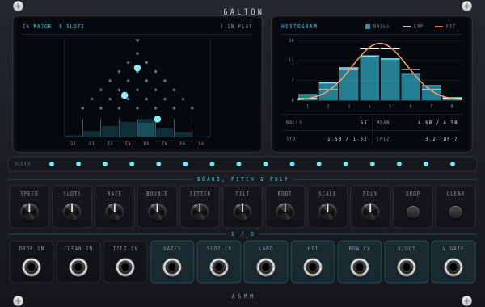

<!--
AGMM AUTOMATIC DOCUMENTATION
Source: Galton.cpp
-->

# Galton

## 1. Overview

`Galton` is a 40 HP interactive Galton board with real ball physics. Balls fall under gravity and bounce off a triangular lattice of pegs, the bin dividers, and the side walls. Every bounce is a real collision, so the landing slots form a bell curve (central limit theorem) without any dice being rolled for the left/right decision.

Key features:
- Real ball physics with peg collisions (not dice rolls)
- 4–16 bins, up to 48 balls on screen
- Adjustable speed, slots, rate, bounce, jitter, tilt
- Root note + scale (16 scales) maps slots to musical pitches
- Polyphonic V/Oct + voice gate outputs (round-robin per landing)
- Slot gates, slot CV, landing trigger, peg-hit trigger, row CV
- Statistics display: live histogram vs. ideal binomial counts and normal fit, with mean, std dev and chi-squared
- Two large displays: the board (left) and the histogram (right)

## Module Screenshot

## 2. Architecture

### Main Classes

- `Galton`: Core module class inheriting from `rack::Module`
- `GLWorld`: Ball physics simulation (no Rack dependencies)
- `RootQuantity`: Custom ParamQuantity for the root note knob
- `GLPanel`: Static panel artwork
- `GLBoardDisplay`: Live board rendering
- `GLHistDisplay`: Live histogram rendering

### Inheritance

- `Galton` inherits from `rack::Module`
- All three UI widgets inherit from `rack::TransparentWidget`

### Structures

- `GLWorld::Ball`: `{ x, y, vx, vy, age, still, life, active, landed }`
- `GLWorld::Ball balls[48]`, `float pegFlash[16][16]`
- `glNoteName`, `glSlotSemis`, `glMidSlot` — musical mapping helpers
- 16 scale tables (`GL_SCALE[16][12]`)

### State (grouped)

| Group | Storage |
|-------|---------|
| Physics world | `GLWorld world` |
| Simulation timing | `float simAcc`, `spawnAcc` |
| Settings | `int slots`, `float gateDuration`, `int gateIdx`, `bool cvBipolar` |
| Gates | `dsp::PulseGenerator gatePulses[16]`, `landPulse`, `hitPulse` |
| LED flash | `float ledFlash[16]` |
| Statistics | `int binCounts[16]`, `bool statsDirty`, `float binomPMF[16]` |
| Transport | `int lastSlot`, `lastRow` |
| Polyphonic pitch | `float voct[16]`, `dsp::PulseGenerator vGate[16]`, `int nextVoice` |
| Snapshot | `int snapCount`, `dispBallX/Y/VX/VY/A[48]`, `dispBallCount`, `dispInPlay`, `dispSlots`, `dispTilt`, `dispLed[16]`, `dispCounts[16]`, `dispLast`, `dispRoot`, `dispScale`, `dispPegFlash[16][16]` |
| Statistics | `int statBalls`, `float statMean`, `statStdDev`, `statChiSq`, `int statDof`, `statExpMean`, `statExpStd` |

## 3. DSP Theory

### Ball physics

Each ball is a disc of radius `BALL_R = 0.19` world units (1 unit = 1 bin width). Gravity is `GRAVITY = 40` units/s². The board has `slots − 1` rows of pegs, with pegs at:

$$
\text{pegX}(r, k) = \frac{\text{slots}}{2} + k - \frac{r}{2}, \quad \text{pegY}(r) = \text{pegTop} + r \cdot \text{rowStep}
$$

### Collision detection

For a ball at `(x, y)` and a fixed disc (peg or divider) at `(cx, cy)` with radius `rr`:

1. Compute `d = sqrt((x−cx)² + (y−cy)²)`.
2. If `d >= BALL_R + rr`, no collision.
3. Else, push the ball out to `BALL_R + rr` along the normal `n = (x−cx, y−cy)/d`.
4. Reflect the velocity about a slightly rotated normal (jitter), with restitution `e`.

### Restitution and jitter

The reflection uses:

$$
\mathbf{v}_{\text{new}} = \mathbf{v}_{\text{old}} - (1 + e)(\mathbf{v}_{\text{old}} \cdot \mathbf{n}') \mathbf{n}'
$$

where $\mathbf{n}'$ is the normal rotated by a random angle up to `jitter * 1.2` radians. A slight tangential friction (0.08×) is also applied.

### Side gravity (tilt)

Tilt adds a constant horizontal acceleration:

$$
v_x \leftarrow v_x + \text{tilt} \cdot \text{GRAVITY} \cdot 0.12 \cdot \Delta t
$$

### Sub-stepping

The simulation runs at a fixed `SIM_STEP = 1/480 s` per step, with up to 64 steps per sample. This makes the physics independent of the Rack sample rate.

### Landing detection

A ball is "landed" when its Y exceeds `binTop + 0.4`. The slot is `floor(x)`, clamped to `[0, slots−1]`. Each landing triggers the slot gate, increments the bin count, fires the land pulse, and assigns a V/Oct value to the next voice.

### Binomial PMF

The ideal counts for a Galton board with `n` slots and `p = 0.5` per bounce:

$$
P(k) = \binom{n-1}{k} \cdot 0.5^{n-1}, \quad k = 0,\ldots,n-1
$$

The histogram display overlays the actual counts with the expected counts and a normal fit.

### Statistics

- **Mean**: $\bar{x} = \frac{1}{N} \sum_k (k+1) \cdot \text{count}[k]$
- **Std dev**: $\sigma = \sqrt{\frac{1}{N} \sum_k ((k+1) - \bar{x})^2 \cdot \text{count}[k]}$
- **Chi-squared**: $\chi^2 = \sum_k \frac{(\text{count}[k] - N \cdot P(k))^2}{N \cdot P(k)}$ (for expected ≥ 1)
- **Expected mean**: $\frac{\text{slots}+1}{2}$
- **Expected std**: $\sqrt{\frac{\text{slots}-1}{4}}$

### Pitch mapping

The middle slot plays the root note. Slots above and below it climb/descend the scale, wrapping into the next octave:

$$
\text{semis}(s) = \text{root} + \text{oct} \cdot 12 + \text{scale}[\text{idx}]
$$

where `d = s − midSlot`, `oct = floor(d / scaleLen)`, `idx = d − oct * scaleLen`.

## 4. Parameters and Controls

### Knobs

| Parameter | Min | Max | Default | Description |
|-----------|-----|-----|---------|-------------|
| `SPEED_PARAM` | 0.2 | 3.0 | 1.0 | Simulation speed multiplier |
| `SLOTS_PARAM` | 4 | 16 | 8 | Number of bins/LEDs/poly channels |
| `RATE_PARAM` | 0 | 16 | 4 | Auto-drop rate (balls/s) |
| `BOUNCE_PARAM` | 0.1 | 0.9 | 0.4 | Peg restitution |
| `JITTER_PARAM` | 0 | 1 | 0.5 | Peg surface roughness |
| `TILT_PARAM` | −1 | 1 | 0 | Board tilt (skews distribution) |
| `ROOT_PARAM` | −24 | 24 | 0 | Root note (semitones from C4) |
| `SCALE_PARAM` | 0 | 15 | 0 | Scale |
| `POLY_PARAM` | 1 | 16 | 1 | Polyphony channels |

### Buttons

| Button | Description |
|--------|-------------|
| `DROP_PARAM` | Drop a ball now |
| `CLEAR_PARAM` | Empty the board and reset stats |

### Inputs

| Input | Description |
|-------|-------------|
| `DROP_INPUT` | Drop trigger |
| `CLEAR_INPUT` | Clear trigger |
| `TILT_INPUT` | Tilt CV (±5 V = full tilt) |

### Outputs

| Output | Description |
|--------|-------------|
| `GATES_OUTPUT` | Slot gates (polyphonic) |
| `CV_OUTPUT` | Slot CV (last landing, 0–10 V or −5..+5 V) |
| `LAND_OUTPUT` | Landing trigger |
| `HIT_OUTPUT` | Peg-hit trigger |
| `ROW_OUTPUT` | Peg row CV (last hit, 0–10 V or −5..+5 V) |
| `VOCT_OUTPUT` | Pitch of landing slot (1 V/oct, polyphonic) |
| `VGATE_OUTPUT` | Voice gates (polyphonic) |

### Lights

- `SLOT_LIGHT + i` (16 total) — per-slot gate activity

### Enumerations

- `ParamId`: Speed, Slots, Drop, Clear, Rate, Bounce, Jitter, Tilt, Root, Scale, Poly
- `InputId`: DropIn, ClearIn, TiltCV
- `OutputId`: Gates, Cv, Land, Hit, Row, VOct, VGate
- `LightId`: SlotLight (16)

## 5. Inputs and Outputs

### Inputs

| Name | Type | Range | Description |
|------|------|-------|-------------|
| `DROP_INPUT` | Gate | > 1 V | Drop a ball |
| `CLEAR_INPUT` | Gate | > 1 V | Clear the board |
| `TILT_INPUT` | CV | ±5 V | Adds to tilt |

### Outputs

| Name | Type | Range | Description |
|------|------|-------|-------------|
| `GATES_OUTPUT` | Poly Gate | 0/10 V | Slot gates |
| `CV_OUTPUT` | CV | 0/10 or ±5 V | Last slot index (normalized) |
| `LAND_OUTPUT` | Gate | 0/10 V | 2 ms pulse on any landing |
| `HIT_OUTPUT` | Gate | 0/10 V | 2 ms pulse on any peg hit |
| `ROW_OUTPUT` | CV | 0/10 or ±5 V | Last peg-hit row (normalized) |
| `VOCT_OUTPUT` | Poly CV | 1 V/oct | Pitch of last landing (round-robin voices) |
| `VGATE_OUTPUT` | Poly Gate | 0/10 V | Voice gates |

### Menu Options

- Gate duration (5 ms .. 1 s, 10 presets)
- Bipolar CV outputs (−5..+5 V instead of 0..10 V)

## 6. Signal Processing Pipeline

1. **Parameter read** — Speed, rate, bounce, jitter, tilt (with CV), root, scale, polyphony, slots.
2. **Slot count change** — If slots changed, rebuild the world.
3. **Manual triggers** — Drop button/input, clear button/input.
4. **Auto drops** — If rate > 0, accumulate `dt * speed * rate` and spawn a ball every full integer.
5. **Physics** — Accumulate `dt * speed`, step in `SIM_STEP` chunks (up to 64), apply side gravity from tilt.
6. **Events** — For each landing: fire slot gate, increment bin count, fire land pulse, assign V/Oct to next voice, fire voice gate. For peg hits: fire hit pulse.
7. **Outputs** — Set poly gates, slot CV (bipolar or unipolar), row CV, land, hit, V/Oct, VGate.
8. **Statistics** — Recompute mean/std/chi-squared if bins changed.
9. **Snapshot** — Every 128 samples, copy ball states and bin counts for the UI.

## 7. Important Functions

### `GLWorld::collideDisc(Ball &b, float cx, float cy, float rr, float e, float jitter, float &impact)`

Circle-circle collision with jittered reflection.

### `GLWorld::step(float h, float gx, float e, float jitter)`

One physics sub-step. Applies gravity, drag, position integration, peg collisions, bin divider collisions, wall/floor bouncing, and landing detection.

### `Galton::binomialPMF(int k, int n, float p)`

$$
P(k) = \binom{n}{k} p^k (1-p)^{n-k}
$$

### `Galton::computeStats()`

Recomputes mean, std dev, chi-squared against the current bin counts.

### `Galton::makeSnapshot(float tilt)`

Copies ball states and bin counts for the UI.

### `Galton::process(const ProcessArgs &args)`

The main callback described in §6.

## 8. Mathematical Implementation

### Peg positions

$$
\text{pegX}(r,k) = \frac{\text{slots}}{2} + k - \frac{r}{2}, \quad \text{pegY}(r) = 0.8 + 0.5 r
$$

### Ball physics

$$
\mathbf{v} \leftarrow \mathbf{v} + (\text{gravity} + \text{tilt side}) \cdot \Delta t
$$

$$
\mathbf{x} \leftarrow \mathbf{x} + \mathbf{v} \cdot \Delta t
$$

### Collision response

$$
\mathbf{v}' = \mathbf{v} - (1+e)(\mathbf{v} \cdot \mathbf{n}')\mathbf{n}'
$$

### Binomial PMF

$$
P(k) = \binom{n-1}{k} 0.5^{n-1}
$$

### Chi-squared

$$
\chi^2 = \sum_k \frac{(\text{count}[k] - N \cdot P(k))^2}{N \cdot P(k)}
$$

### Slot pitch

$$
\text{semis}(s) = \text{root} + \text{oct} \cdot 12 + \text{scale}[\text{idx}]
$$

## 9. Performance and Optimization

### CPU Usage

- Up to 48 balls × (position + velocity + peg queries + wall checks) per substep
- Up to 64 substeps per sample → worst case ≈ 48 × 64 × 20 = 61 K flops/sample
- Realistic: 4–8 balls in flight, 1–8 substeps → ~1500 flops/sample
- Histogram display: O(slots) per frame

### Memory Allocation

- All state is fixed-size
- No allocation in `process()`
- `GLWorld balls[48]` ≈ 48 × 28 bytes = 1.3 KB

### Buffers

- `pegFlash[16][16]`: 256 floats
- Display snapshots: 48 × 5 floats + 16 × 2 + 16 × 16 = 528 floats

### Real-time Processing

- Physics sub-steps are bounded (max 64)
- No allocation, no blocking
- Snapshot happens only every 128 samples

### Thread Safety

- All state written by audio thread, read by UI thread via torn reads
- The 16 gate pulses are `dsp::PulseGenerator` (audio-thread only)

### Numerical Stability

- Ball positions clamped to `[BALL_R, slots - BALL_R]`
- Velocity capped at `MAX_SPEED = 30`
- Drag dampens sideways drift
- A ball that dawdles for > 5 s is shaken loose

## 10. Dependencies

### Libraries/Headers

- `plugin.hpp` — VCV Rack core
- `agmm_ui.hpp` — shared AGMM UI helpers
- `<cmath>`, `<cstdint>`, `<cstdio>`, `<cstring>`, `<algorithm>`, `<memory>`

### External Classes

- `rack::Module`, `rack::TransparentWidget`, `rack::engine::ParamQuantity`
- `rack::dsp::PulseGenerator`, `rack::dsp::SchmittTrigger`
- `agmm::panelBase`, `agmm::bezel`, `agmm::plate`, `agmm::cell`, `agmm::text`, `agmm::plotFrame`, `agmm::screen`, `agmm::sectionHeader`, `agmm::withA`, `agmm::violet`, `agmm::accent`, `agmm::bright`, `agmm::warm`, `agmm::dim`, `agmm::textCol`, `agmm::ALIGN_L/C/R`, `agmm::CyanLight`

## 11. Summary

`Galton` is a physically accurate Galton board that generates a bell curve from real ball physics rather than dice rolls. It's a beautiful demonstration of the central limit theorem, and it's also a usable musical tool: each bin maps to a note in a scale, and each landing produces a V/Oct value and a gate.

The module's display is split between the board (left) and the histogram (right), which shows the running bin counts, the ideal binomial counts, and a normal fit. The statistics readout (mean, std dev, chi-squared) lets you verify that the board really is producing a bell curve.

The main strengths are: the real physics (pegs and dividers are collided against, not simulated by dice rolls), the musical mapping (16 scales, root, octave), and the polyphonic V/Oct output (round-robin per landing). The main limitations are: at very high ball rates the CPU can spike (up to 48 balls in flight), and the physics can occasionally produce a ball that sits on a peg for a moment (the module has a "still" detector that shakes it loose after 0.3 s).
