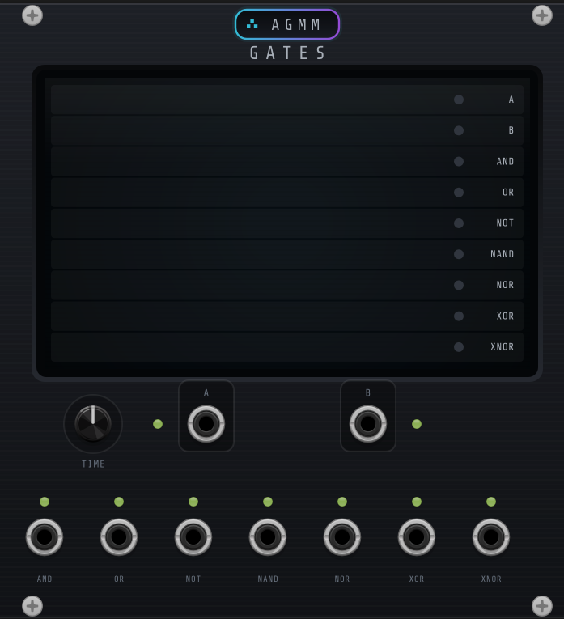

<!--
AGMM AUTOMATIC DOCUMENTATION
Source: Gates.cpp
Generated: 2026-11-04 06:18
-->

# Gates

## 1. Overview

The `Gates` module is a digital logic gate implementation for VCV Rack that processes two binary inputs (A and B) through various Boolean operations to produce seven distinct outputs: AND, OR, NOT, NAND, NOR, XOR, and XNOR.

The module features:
- Two input jacks for binary signals (A and B)
- Seven output jacks corresponding to logic gate functions
- A time knob that controls the display update rate
- Real-time visualization of input/output signal history
- Visual indicators for active inputs/outputs
- Multi-channel support for both inputs and outputs

## Module Screenshot



## 2. Architecture

### Main Classes

1. **`Gates`** - Core module class inheriting from `rack::Module`
2. **`TimeQuantity`** - Custom parameter quantity class for time knob display formatting
3. **`GTPanel`** - Panel widget for visual representation
4. **`GTDisplay`** - Display widget showing signal history
5. **`GatesWidget`** - Module widget combining panel and display

### Inheritance

- `Gates` inherits from `rack::Module`
- `TimeQuantity` inherits from `rack::ParamQuantity`

### Structures

```cpp
struct Gates : Module {
    enum ParamId { PARAM_TIME, PARAMS_LEN };
    enum InputId { INPUT_A, INPUT_B, INPUTS_LEN };
    enum OutputId {
        OUTPUT_AND, OUTPUT_OR, OUTPUT_NOT, OUTPUT_NAND,
        OUTPUT_NOR, OUTPUT_XOR, OUTPUT_XNOR, OUTPUTS_LEN
    };
    enum LightId {
        LIGHT_A, LIGHT_B,
        LIGHT_AND, LIGHT_OR, LIGHT_NOT, LIGHT_NAND,
        LIGHT_NOR, LIGHT_XOR, LIGHT_XNOR,
        LIGHTS_LEN
    };
```

### Relationships

- `Gates` contains all logic processing and state management
- `TimeQuantity` customizes parameter display behavior for the time knob
- `GTPanel` handles panel-level drawing and layout
- `GTDisplay` renders signal history visualization
- `GatesWidget` combines all visual elements into a complete module widget

## 3. DSP Theory

### Logic Operations

The module implements standard Boolean logic operations on binary inputs:

- **AND**: $ A \land B $
- **OR**: $ A \lor B $
- **NOT**: $ \lnot A $
- **NAND**: $ \lnot (A \land B) $
- **NOR**: $ \lnot (A \lor B) $
- **XOR**: $ A \oplus B $
- **XNOR**: $ \lnot (A \oplus B) $

### Signal Processing

The module operates on binary signals where:
- Input voltage > 1V represents logic high (true)
- Input voltage ≤ 1V represents logic low (false)

Output voltages are either:
- 0V (logic low)
- 10V (logic high)

### History Sampling

Signal history is stored in circular buffers for visualization purposes, with sampling rate determined by the time knob setting.

## 4. Parameters and Controls

### Knobs

- **Time** (`PARAM_TIME`): 
  - Range: 0.0 to 1.0
  - Default: 0.5 (500 ms/screen)
  - Mapping: Logarithmic from 50000 ms to 5 ms
  - Display: Shows actual time in milliseconds or seconds per screen

### Switches/Buttons

None explicitly defined.

### CV Inputs

- **Input A** (`INPUT_A`): Binary input signal (0V or 10V)
- **Input B** (`INPUT_B`): Binary input signal (0V or 10V)

### Gates

- **Input A**: Binary input
- **Input B**: Binary input

### Enumerations

```cpp
enum ParamId { PARAM_TIME, PARAMS_LEN };
enum InputId { INPUT_A, INPUT_B, INPUTS_LEN };
enum OutputId {
    OUTPUT_AND, OUTPUT_OR, OUTPUT_NOT, OUTPUT_NAND,
    OUTPUT_NOR, OUTPUT_XOR, OUTPUT_XNOR, OUTPUTS_LEN
};
enum LightId {
    LIGHT_A, LIGHT_B,
    LIGHT_AND, LIGHT_OR, LIGHT_NOT, LIGHT_NAND,
    LIGHT_NOR, LIGHT_XOR, LIGHT_XNOR,
    LIGHTS_LEN
};
```

## 5. Inputs and Outputs

### Inputs

- **Input A** (`INPUT_A`): 
  - Voltage range: 0V to 10V
  - Behavior: Logic high when > 1V, logic low otherwise
  - Channels: Multi-channel support (up to 16 channels)

- **Input B** (`INPUT_B`):
  - Voltage range: 0V to 10V
  - Behavior: Logic high when > 1V, logic low otherwise
  - Channels: Multi-channel support (up to 16 channels)

### Outputs

- **AND** (`OUTPUT_AND`): 
  - Voltage range: 0V or 10V
  - Behavior: High only when both inputs are high

- **OR** (`OUTPUT_OR`):
  - Voltage range: 0V or 10V
  - Behavior: High when either input is high

- **NOT** (`OUTPUT_NOT`):
  - Voltage range: 0V or 10V
  - Behavior: Inverted input A

- **NAND** (`OUTPUT_NAND`):
  - Voltage range: 0V or 10V
  - Behavior: High when inputs are not both high

- **NOR** (`OUTPUT_NOR`):
  - Voltage range: 0V or 10V
  - Behavior: High when neither input is high

- **XOR** (`OUTPUT_XOR`):
  - Voltage range: 0V or 10V
  - Behavior: High when inputs differ

- **XNOR** (`OUTPUT_XNOR`):
  - Voltage range: 0V or 10V
  - Behavior: High when inputs are equal

## 6. Signal Processing Pipeline

1. **Input sampling**: Read voltage levels from both input jacks
2. **Logic evaluation**: Apply Boolean operations to input values
3. **Output generation**: Set output voltages based on logic results (0V or 10V)
4. **Channel management**: Handle multi-channel inputs/outputs
5. **History recording**: Sample current states for visualization
6. **Light updates**: Update visual indicators for active signals

## 7. Important Functions

### `process()`

Main processing function that:
- Converts time knob value to milliseconds per screen
- Reads input voltages and determines binary states
- Computes all logic gate outputs
- Sets output voltages
- Updates light indicators
- Records history for visualization

### `timeKnobToMs()`

Converts logarithmic time knob parameter (0.0-1.0) to actual milliseconds:
$$ \text{ms} = 50000 \times \left(\frac{5}{50000}\right)^t $$

### `msToTimeKnob()`

Inverse conversion from milliseconds to time knob parameter:
$$ t = \frac{\log(\text{ms}/50000)}{\log(5/50000)} $$

## 8. Mathematical Implementation

### Time Mapping

The time knob uses a logarithmic mapping from 0.0 to 1.0:

$$
\text{ms} = 50000 \times \left(\frac{5}{50000}\right)^t
$$

Where:
- $ t \in [0, 1] $
- $ \text{ms} \in [5, 50000] $

### History Sampling Rate

The history buffer is sampled at a rate determined by:
$$
\text{slotSec} = \frac{\text{screenMs}}{1000 \times \text{HIST}}
$$

Where `HIST` = 512 samples.

## 9. Performance and Optimization

### CPU Usage Considerations

- Simple Boolean operations with minimal computational overhead
- History buffer sampling occurs only during process() calls
- No complex mathematical functions beyond basic trigonometric and logarithmic operations

### Memory Allocation

- Fixed-size arrays for history buffers (512 elements each)
- No dynamic memory allocation in main processing loop
- Stack-based local variables for temporary calculations

### Buffers

- Circular buffers for signal history (512 samples per channel)
- Single-channel history for visualization display
- No intermediate buffers required

### Real-time Processing

- All operations completed within single process() call
- History sampling rate calculated at each sample time
- No blocking or asynchronous operations

### Thread Safety

- Module operates in real-time audio thread context
- No external synchronization required
- State updates are atomic within the process() function

### Numerical Stability

- Uses standard floating-point arithmetic
- Clamp values to valid ranges where necessary
- No iterative algorithms or feedback loops that could cause instability

## 10. Dependencies

### Libraries/Headers

- `rack.hpp` - VCV Rack core library
- `<cmath>` - Standard math functions (pow, log)
- `<cstdio>` - Standard I/O functions (snprintf)
- `<cstring>` - String operations
- `<algorithm>` - Standard algorithms (max)

### Classes/Types

- `rack::Module`
- `rack::ParamQuantity`
- `rack::TransparentWidget`
- `rack::DrawArgs`
- `rack::NVGcontext`
- `rack::Vec`
- `rack::Model`
- `rack::ModuleWidget`

## 11. Summary

The `Gates` module is a digital logic gate implementation that processes two binary inputs through standard Boolean operations to produce seven distinct outputs. It features:

- Real-time binary signal processing with multi-channel support
- Visual history display showing input/output waveforms
- Logarithmic time knob for controlling display update rate
- Complete visual feedback through LED indicators
- Efficient memory usage with fixed-size circular buffers
- Standard VCV Rack module architecture and widget system

The implementation is straightforward, focusing on accurate logic gate operations while providing visualization capabilities for signal analysis. The module supports both single-channel and multi-channel operation, making it suitable for various digital signal processing applications within the VCV Rack ecosystem.