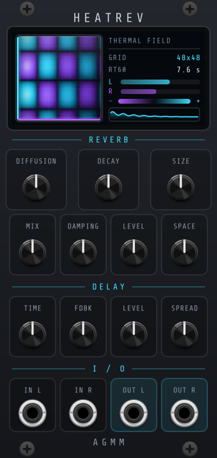

<!--
AGMM DOCUMENTATION
Source: HeatRev.cpp
-->

# HeatRev

## 1. Overview

`HeatRev` is a 12 HP hybrid reverb/echo effect built from three layers:

1. A stereo delay/echo stage with feedback and L/R time spread.
2. A "Cathedral" reverb: pre-delay, early reflections, input diffusion, and an
   8-line feedback delay network (FDN) with an orthonormal Hadamard feedback
   matrix.
3. A 2D "heat grid" diffusion network that adds a slowly moving, warm resonant
   texture to the tail.

Key features:

- 8-line FDN reverb (Cathedral) with orthonormal Hadamard feedback
- Pre-delay, early reflections, input all-pass diffusion
- Reverb controls: Diffusion, Decay, Size, Mix, Damping, Level, Space
- Delay controls: Time, Feedback, Level, Stereo Spread
- 2D heat-grid diffusion network with live thermal-map display
- Soft thermal display with meters, RT60 readout, and energy history
- Robust against NaN/inf, runaway loops, and bad upstream modules
- Buffers allocated once — **no allocation on the audio thread**

## Module Screenshot



## 2. Architecture

### Main Classes

- `HeatRev` — core module, inherits `rack::Module`
- `SimpleLPF` — one-pole low-pass
- `StereoDelay` — stereo delay with smoothed fractional reads
- `Cathedral` — pre-delay + early reflections + input diffusion + 8-line FDN
- `HeatGrid` — 2D Laplacian diffusion plate with ghost border
- `HRPanelBackground` — static panel artwork (anonymous namespace)
- `HRDisplayWidget` — live thermal display (anonymous namespace)
- `HeatRevWidget` — module widget that assembles panel, display, knobs, jacks

### Inheritance

- `HeatRev` inherits from `rack::Module`
- `HRPanelBackground` and `HRDisplayWidget` inherit from `rack::TransparentWidget`
- `HeatRevWidget` inherits from `rack::ModuleWidget`

### Structures

| Structure | Storage | Size |
|-----------|---------|------|
| `Cathedral::line[8]` | 8 delay lines | 32768 samples each |
| `Cathedral::pdL/pdR` | pre-delay buffers | 131072 samples each |
| `Cathedral::apL[4]/apR[4]` | input diffusers | 2048 samples each |
| `StereoDelay::bufferL/R` | L/R delay buffers | `(sr * 1.05) + 8` samples |
| `HeatGrid::a`, `HeatGrid::b` | ping-pong diffusion buffers | 66 × 66 floats each (MAXN=64 + ghost border) |
| `HeatRev::viz[64][64]` | display snapshot | 64 × 64 floats |
| `HRDisplayWidget::pix` | RGBA texture | 64 × 64 × 4 bytes |

### State (grouped)

| Group | Storage |
|-------|---------|
| Heat grid | `HeatGrid grid` (buffers `a`, `b`, `n`, `stride`) |
| Delay | `StereoDelay delay` |
| Reverb | `Cathedral cathedral` |
| DC block | `float dcL, dcR, dcCoef` |
| LP filter | `SimpleLPF lpL, lpR` |
| Fade | `float fade, fadeStep` |
| Cached decay | `float lastDecayP, rt60, gridFb, tailComp` |
| Display | `float viz[64][64]`, `int vizN`, `float vizNorm`, `int vizCounter`, `float vizEnergy, vizPkL, vizPkR, vizRt60` |
| Peak meters | `float pkL, pkR, pkDecay` |
| Watchdog | `int flushCount` |

## 3. DSP Theory

### Layer 1: Stereo delay

A stereo feedback delay with smoothed delay time. Each sample:

- Smooth delay time with an exponential glide (~50 ms):

  ```
  smCoef = 1 - exp(-1 / (0.05 * sr))
  curL   += (targetL - curL) * smCoef
  curR   += (targetR - curR) * smCoef
  ```

- Read with linear interpolation (integer + fraction so the index can never leave the buffer).
- Write `in + feedback * read` back into the buffer, clamped to ±128 V and finite-checked.

Note: this version does **not** low-pass the delay feedback; the delay is a clean
repeat. (The previous doc's claim of a 0.4× one-pole feedback filter no longer
applies.)

Internal limits:

- Delay time per side is clamped to `[5, 1000]` ms, buffer size `(sr * 1.05) + 8`.
- Feedback is clamped to `[0, 0.95]`.

### Layer 2: Cathedral reverb

**Input high-pass** (60 Hz, one-pole) removes rumble before the reverb.

**Pre-delay**:

```
pre = (0.010 + 0.060 * space) * sr
```

**Early reflections** — 7 taps per channel, read from the pre-delay buffer:

| Left taps (ms) | 7 | 19 | 31 | 47 | 67 | 89 | 113 |
|----------------|---|---|---|---|---|---|---|
| Left gains     | 0.80 | -0.65 | 0.55 | -0.45 | 0.38 | -0.30 | 0.24 |

| Right taps (ms) | 11 | 23 | 37 | 53 | 73 | 97 | 127 |
|-----------------|---|---|---|---|---|---|---|
| Right gains     | -0.78 | 0.62 | -0.52 | 0.43 | -0.36 | 0.29 | -0.23 |

Taps are scaled by `tscale = 0.6 * scaleSm * 0.001 * sr`.

**Input diffusion** — 4 series all-passes per channel with fixed lengths:

```
CATH_AP_L = {113, 173, 307, 443}   // samples @ 48 kHz
CATH_AP_R = {127, 191, 331, 461}
ag = 0.25 + 0.5 * diffusion
```

**FDN** — 8 delay lines, each with its own one-pole damping filter and per-line
RT60 gain. Line base lengths (samples @ 48 kHz):

```
CATH_BASE = {1031, 1327, 1621, 1933, 2269, 2663, 3109, 3571}
```

The delay-line read position is slowly modulated to avoid metallic ringing:

```
depth = (1 + 7 * space) * srk       // srk = sr / 48000
len   = base * srk * scaleSm + depth * sin(lfoPh[i])
lfoPh[i] += 2π * (0.11 + 0.037 * i) / sr
```

Per-line loop gain from RT60:

```
g[i] = 10^(-3 * len / (rt60 * sr))
```

Input gain is normalised against the sum of squared gains so long decays do
not get louder:

```
inGain = sqrt(max(0.02, 1 - (Σ g[i]^2) / 8))
```

Feedback matrix is the **8×8 Hadamard** matrix, normalised by `1/√8` so it is
orthonormal (energy-preserving):

```
A = (1 / √8) * H8
```

Applied with an in-place fast Walsh–Hadamard butterfly, then scaled by `k8 =
0.35355339`.

**Damping** — a one-pole low-pass per line with coefficient:

```
fc = 14000 * 0.0857^damping          // ~14 kHz .. 1.2 kHz
fc = min(fc, 0.45 * sr)
b  = exp(-2π * fc / sr)
lp[i] = (1 - b) * x[i] + b * lp[i]
```

**FDN output** — alternating L/R taps:

```
fdnL = 0.5 * (x[0] + x[2] + x[4] + x[6])
fdnR = 0.5 * (x[1] + x[3] + x[5] + x[7])
```

### Layer 3: Heat grid

A 2D Laplacian diffusion plate of size `n × n` (`4 ≤ n ≤ 64`). Stored with a
one-cell ghost border so the inner loop has no per-cell branches (vectorisable).

Each sample:

1. **Inject** — left channel into column 0, right channel into row `n-1`
   (bottom edge), with gain `0.3 * tailComp`.
2. **Diffuse + decay** (5-point Laplacian, reflecting edges):

   ```
   next[y][x] = (state[y][x] + k * (state[y-1][x] + state[y+1][x]
                                   + state[y][x-1] + state[y][x+1]
                                   - 4 * state[y][x])) * fb
   ```

   with `k = diffusion * 0.25` and `fb = gridFb`.

3. **Read** — average 3 cells per side:

   ```
   rawL = (tap(0.28, 0.62) + tap(0.50, 0.50) + tap(0.72, 0.35)) / 3
   rawR = (tap(0.62, 0.28) + tap(0.50, 0.50) + tap(0.35, 0.72)) / 3
   ```

4. **DC block** (one-pole high-pass @ 40 Hz) then **low-pass** @ 4 kHz, then
   soft-limit to ±3 V:

   ```
   heat = 3 * tanh(x * 0.1)
   ```

### Output mix

```
wet   = (fdn + er * 0.35 * space + 0.35 * heat) * level
wet   = 8 * tanh(wet / 8)                         // smooth wet limiter
wet  *= fade                                       // 80 ms fade-in
out   = (1 - mix) * in + mix * wet
out   = softClip(out, ±9 V, slope 0.3)            // gentle above 9 V
out   = clamp(out, -10, 10)                        // final output clamp
```

### Safety

- Input sanitisation (`hrSanitize`): NaN/inf → 0, hard-limit ±24 V.
- Echo loop internal clamp ±128 V.
- FDN injection per line clamped ±64 V.
- Watchdog: sum of |fdnL|+|fdnR|+|erL|+|erR|+|delayL|+|delayR|+|heatL|+|heatR|
  must be finite and `< 5000`; otherwise `flushAll()` runs and the wet path
  fades back in over 80 ms.
- Wet path fade-in after any (re)start, sample-rate change, reset, or flush.
- Heat grid feedback clamped to `[0.99, 0.99995]`.

## 4. Parameters and Controls

### Reverb knobs

| Parameter | Enum | Min | Max | Default | Description |
|-----------|------|-----|-----|---------|-------------|
| `DIFFUSION_PARAM` | 0 | 0 | 1 | 0.7 | Input diffusion |
| `DECAY_PARAM` | 1 | 0 | 1 | 0.8 | RT60 (0.5–15 s) |
| `SIZE_PARAM` | 2 | 4 | 64 | 48 | Size in cells (snap) |
| `MIX_PARAM` | 3 | 0 | 1 | 0.7 | Dry/wet |
| `DAMPING_PARAM` | 4 | 0 | 1 | 0.55 | Damping cutoff |
| `LEVEL_PARAM` | 5 | 0 | 1 | 0.8 | Wet level |
| `SPACE_PARAM` | 10 | 0 | 1 | 0.7 | Pre-delay + reflections + shimmer |

### Delay knobs

| Parameter | Enum | Min | Max | Default | Description |
|-----------|------|-----|-----|---------|-------------|
| `DELAY_TIME_PARAM` | 6 | 10 ms | 500 ms | 80 ms | Delay time |
| `DELAY_FEEDBACK_PARAM` | 7 | 0 | 0.95 | 0.4 | Feedback |
| `DELAY_LEVEL_PARAM` | 8 | 0 | 1 | 0.7 | Delay level |
| `STEREO_SPREAD_PARAM` | 9 | 0 | 50 ms | 15 ms | L/R delay offset |

### Enumerations

```
ParamId:  Diffusion, Decay, Size, Mix, Damping, Level,
          DelayTime, DelayFeedback, DelayLevel, StereoSpread,
          Space          // appended last so old patches keep their settings
InputId:  InL, InR
OutputId: OutL, OutR
```

## 5. Inputs and Outputs

### Inputs

| Name | Type | Range | Description |
|------|------|-------|-------------|
| `INPUT_L` | Audio | ±10 V (guarded to ±24 V) | Left audio |
| `INPUT_R` | Audio | ±10 V (guarded to ±24 V) | Right audio |

### Outputs

| Name | Type | Range | Description |
|------|------|-------|-------------|
| `OUTPUT_L` | Audio | ±10 V | Left output (clamped) |
| `OUTPUT_R` | Audio | ±10 V | Right output (clamped) |

### Bypass

`configBypass(INPUT_L, OUTPUT_L)` and `configBypass(INPUT_R, OUTPUT_R)`.

## 6. Signal Processing Pipeline

1. **Sample-rate update** — `prepare(sr)` runs on the first `process()` call or when the rate changes.
2. **Parameter read** — all knobs.
3. **Cached decay values** — recomputed only when `DECAY_PARAM` changes:
   - `rt60 = 0.5 * 30^decayP` (0.5–15 s)
   - `gridFb = clamp(1 - 0.01 * (1 - decayP)^2.5, 0.99, 0.99995)`
   - `tailComp = min(1, sqrt((1 - gridFb) / 6e-4))`
4. **Size / heat-grid settings** — `grid.setSize(round(size))`; no allocation.
5. **Delay settings** — L/R delay times (with spread), feedback.
6. **Input guard** — `hrSanitize` on both channels.
7. **Delay processing** — read delayed L/R, write input + feedback.
8. **Reverb processing** — Cathedral receives `dry + delayed * delayLevel`.
9. **Heat-grid injection** — left into column 0, right into bottom row.
10. **Heat-grid diffusion** — Laplacian + decay (`step(diffK, gridFb)`).
11. **Heat-grid read** — 3-cell average per side.
12. **DC block + LP** — remove DC and limit highs; soft-limit heat to ±3 V.
13. **Watchdog** — flush all state on runaway or non-finite values.
14. **Wet mix** — `(fdn + er*0.35*space + 0.35*heat) * level`.
15. **Wet limiter** — `8 * tanh(wet / 8)`.
16. **Wet fade-in** — 80 ms.
17. **Dry/wet mix** — with the sanitised input.
18. **Soft clip / clamp** — softClip at ±9 V, then clamp ±10 V.
19. **Output write**.
20. **Display update** — every 512 samples, `publishViz()` snapshots the grid.

## 7. Important Functions

### `void HeatRev::prepare(float sr)`

Allocates everything that depends on the sample rate (delays, filters, DC
coefficients), resets all state, and restarts the wet fade-in. Runs on the
first `process()` call and whenever the sample rate changes.

### `void HeatRev::flushAll()`

Silences echo, reverb, grid, filters, meters and peak state; restarts the fade.
Called on reset, sample-rate change, and watchdog trips.

### `void HeatRev::publishViz()`

Snapshots the heat grid to `viz[][]` (auto-scaled with fast attack / ~3 s
release), and updates `vizEnergy`, `vizPkL`, `vizPkR`, `vizRt60`, `vizN`.
Called every 512 samples.

### `void HeatRev::process(const ProcessArgs &args)`

The main audio callback described in §6.

### `std::pair<float, float> StereoDelay::process(float inL, float inR)`

Smoothed-time stereo delay with linear interpolation and bounded, finite-checked
feedback writes. Returns the delayed L/R pair.

### `void Cathedral::process(float inL, float inR, float sr, float rt60, float damping, float scaleTarget, float diffusion, float space, float &fdnL, float &fdnR, float &erL, float &erR)`

The full Cathedral reverb: input high-pass → pre-delay → early reflections →
input diffusion → 8-line FDN with Hadamard mixing.

### `void HeatGrid::step(float k, float fb)`

One Laplacian diffusion step with decay and reflecting ghost edges.

### `float HeatGrid::tap(float fx, float fy) const`

Samples a cell at normalised coordinates.

### `static float Cathedral::allpass(std::vector<float> &buf, int &idx, int len, float gain, float x)`

One all-pass stage, length clamped to the buffer.

### `static float hrSanitize(float x, float lim)`

NaN/inf → 0, hard-clamped to `±lim`.

### `void HRDisplayWidget::step()`

Per-frame UI easing: resamples the grid to the fixed 64×64 texture with bilinear
interpolation, applies the thermal colour map, and advances meters and the
energy history sparkline.

## 8. Mathematical Implementation

### Cathedral RT60 gain

```
g_i = 10^(-3 * D_i / (RT60 * fs))
```

### Hadamard feedback

```
A = (1 / √8) * H8
```

where `H8` is the 8×8 Hadamard matrix. Applied in-place with a fast
Walsh–Hadamard butterfly.

### Damping filter

```
fc = 14000 * 0.0857^damping
fc = min(fc, 0.45 * sr)
b  = exp(-2π * fc / sr)
y  = (1 - b) * x + b * y
```

### Heat-grid diffusion

```
next[y][x] = state[y][x] + k * (state[y-1][x] + state[y+1][x]
                              + state[y][x-1] + state[y][x+1]
                              - 4 * state[y][x])
```

### Heat-grid decay

```
next *= gridFb,   gridFb ∈ [0.99, 0.99995]
```

### Heat-grid read (L)

```
rawL = (state[0.28, 0.62] + state[0.50, 0.50] + state[0.72, 0.35]) / 3
```

### Heat-grid read (R)

```
rawR = (state[0.62, 0.28] + state[0.50, 0.50] + state[0.35, 0.72]) / 3
```

### DC block

```
dcCoef = 1 - exp(-2π * 40 / sr)
dc    += (raw - dc) * dcCoef
y      = raw - dc
```

### Wet mix

```
wet = (fdn + er * 0.35 * space + 0.35 * heat) * level
wet = 8 * tanh(wet / 8)
wet *= fade
out = (1 - mix) * in + mix * wet
out = softClip(out, ±9 V, slope 0.3)
out = clamp(out, -10, 10)
```

### Heat soft limit

```
heat = 3 * tanh(x * 0.1)        // bounded to ±3 V
```

### Decay-derived values

```
rt60     = 0.5 * 30^decayP
gridFb   = clamp(1 - 0.01 * (1 - decayP)^2.5, 0.99, 0.99995)
tailComp = min(1, sqrt((1 - gridFb) / 6e-4))
```

### Delay / reverb scale

```
scaleTarget = 0.6 + 1.4 * (size - 4) / 60      // 0.6 .. 2.0
delayTimeL  = clamp(ms - spread/2, 5, 1000)
delayTimeR  = clamp(ms + spread/2, 5, 1000)
```

## 9. Performance and Optimization

### CPU Usage

- Cathedral: 8 delay lines × (read + damping + write + Hadamard) ≈ 8 × 20 flops = 160
- Pre-delay + early reflections: ~30 flops
- Input diffusion: 4 × 2 all-pass × 2 channels ≈ 60 flops
- Heat grid: `n² × 10` flops (up to 64×64×10 = 40 K flops) — dominant cost
- Delay: ~40 flops
- Filters + output: ~30 flops
- **Total**: ~42 K flops/sample at `n = 64` — borderline for slower CPUs.
  `n = 32` (≈10 K flops) is a good balance for most patches.

### Memory Allocation

| Component | Floats | Size |
|-----------|--------|------|
| Cathedral FDN | 8 × 32768 = 262144 | ~1.0 MB |
| Cathedral pre-delay | 2 × 131072 = 262144 | ~1.0 MB |
| Cathedral all-passes | 8 × 2048 = 16384 | ~64 KB |
| Heat grid (`a` + `b`) | 2 × 66 × 66 = 8712 | ~35 KB |
| Delay | 2 × 50408 ≈ 100816 | ~400 KB |
| Display texture | 64 × 64 × 4 bytes | 16 KB |

### Real-time Processing

- Heat grid is `O(n²)` per sample (up to 4096 cells × 10 flops = 40 K flops).
- **All buffers are allocated once** — `HeatGrid` preallocates the maximum
  `66 × 66` and `setSize()` only clears the buffer. Changing SIZE does **not**
  allocate on the audio thread.
- Display snapshot is published every 512 samples (`publishViz()`).

### Thread Safety

- All state written by the audio thread; UI reads via `viz[][]` and scalar
  snapshots. A torn read is only cosmetic.
- The `HRDisplayWidget` eases the displayed field toward the latest snapshot,
  so motion is fluid even at the ~90 Hz data rate.

### Numerical Stability

- Cathedral: FDN gain `< 1`, orthonormal Hadamard matrix ⇒ tail can only decay.
- Heat grid: feedback clamped to `< 1`.
- Delay: feedback clamped to `≤ 0.95`, loop writes clamped and finite-checked.
- Input sanitised before entering any feedback path.
- Watchdog flushes everything on runaway or non-finite values.
- Wet path soft-limited and output clamped.
- Wet-path fade-in (80 ms) masks start-up transients.

## 10. Dependencies

### Libraries / Headers

- `plugin.hpp` — VCV Rack core
- `agmm_ui.hpp` — shared AGMM UI helpers
- `<vector>`, `<cmath>`, `<cstdio>`, `<cstring>`, `<algorithm>`, `<utility>`

### External Classes

- `rack::Module`, `rack::ModuleWidget`, `rack::TransparentWidget`, `rack::engine::ParamQuantity`
- `rack::math::clamp`
- `agmm::panelBase`, `agmm::bezel`, `agmm::cell`, `agmm::text`, `agmm::screen`, `agmm::sectionHeader`, `agmm::withA`
- `agmm::violet`, `agmm::accent`, `agmm::ALIGN_L/C/R`
- UI widgets: `RoundSmallBlackKnob`, `DarkPJ301MPort`, `ScrewBlack`

## 11. Display

The display is a 160 × 78 px screen. Layout:

```
 +-----------------+  THERMAL FIELD
 |                 |  GRID        48x48
 |   heat plate    |  RT60        7.6 s
 |   (70x70, true  |  L  ======-----
 |    square, GPU  |  R  ====-------
 |    bilinear     |  - [violet|dark|cyan] +
 |    texture)     |  [ energy history ]
 +-----------------+
```

- **Thermal plate** — 70 × 70 px on the left at `(4, 4)`. A 64 × 64 RGBA texture
  bilinear-filtered by the GPU. The UI eases each cell toward the snapshot with
  a 0.45 coefficient.
- **Colour map** — diverging thermal palette with `sqrt(|u|)` gamma so faint
  interior structure stays visible. Positive: black → deep teal → cyan →
  white-hot. Negative: black → indigo → violet → pale lilac.
- **Overlays** — faint 8×8 reference grid, vignette, glass highlight, injection
  edges (left edge = left channel, bottom edge = right channel), frame.
- **Right column** — GRID size, RT60 value, L/R dB meters, sign legend,
  76-sample energy history sparkline (~7.6 s of history at ~10 Hz).
- **Module browser preview** — a static demo field, meters, and sparkline are
  shown when no module is bound.

## 12. Safety and Robustness

- **Input sanitisation** — `hrSanitize(x, 24)` replaces NaN/inf with 0 and
  hard-limits to ±24 V before any feedback path.
- **Echo loop** — writes finite-checked and clamped to ±128 V.
- **FDN injection** — per-line write clamped to ±64 V.
- **Watchdog** — every sample, the sum of `|fdnL| + |fdnR| + |erL| + |erR| +
  |delayL| + |delayR| + |heatL| + |heatR|` must be finite and `< 5000`;
  otherwise `flushAll()` runs and the wet fade-in restarts.
- **Wet fade-in** — 80 ms after any (re)start, so start-up transients are masked.
- **Fade step** — `1 / (0.08 * sr)`.
- **Output** — softClip at ±9 V (slope 0.3), then final clamp to ±10 V.

## 13. Summary

`HeatRev` is a hybrid reverb/echo that combines three layers:

1. A stereo feedback delay with smoothed time.
2. A Cathedral 8-line FDN reverb with orthonormal Hadamard feedback, pre-delay,
   early reflections, input diffusion, and per-line damping.
3. A 2D heat-grid diffusion network — a Laplacian plate with feedback decay —
   that adds a warm, slowly evolving resonant texture.

The heat grid is the distinctive feature: it is essentially a physical model of
heat diffusion on a 2D plate, and it gives the reverb a character that is not
found in typical reverb designs. The live thermal display shows the field as a
smooth, GPU-filtered map with cyan (positive) and violet (negative) regions,
alongside GRID size, RT60, L/R meters, and a rolling energy history.

Notable engineering improvements in this version:

- All buffers are allocated once. Changing SIZE does not allocate on the audio
  thread, so there is **no allocation glitch**.
- The heat grid uses a ghost border so its inner loop is branch-free and
  vectorisable — significantly faster at 64×64 than the previous version.
- Comprehensive input sanitisation, loop clamps, and a watchdog flush guarantee
  that no upstream glitch can poison the echo or reverb loop.
- A wet-path fade-in masks transients after load, reset, and sample-rate changes.

The main limitation is CPU: at `size = 64`, the heat grid alone is ~40 K
flops/sample. For most patches, `size = 32` (~10 K flops) is a better balance.