# AGMM Module Gallery

| No | Module | Image |
|----|--------|-------|
| 1 | AMB | 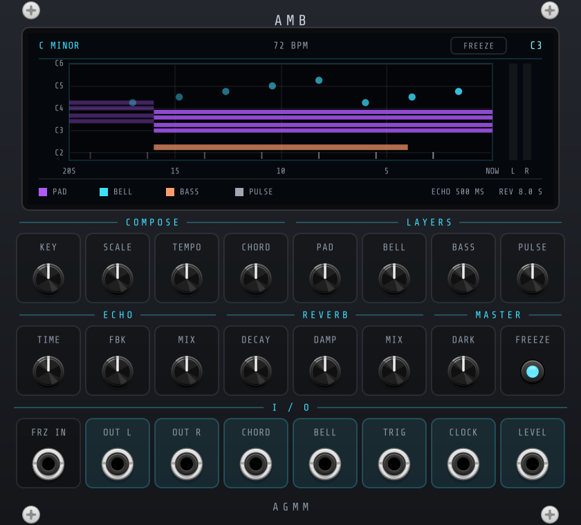 |
| 2 | AMB_MINI | 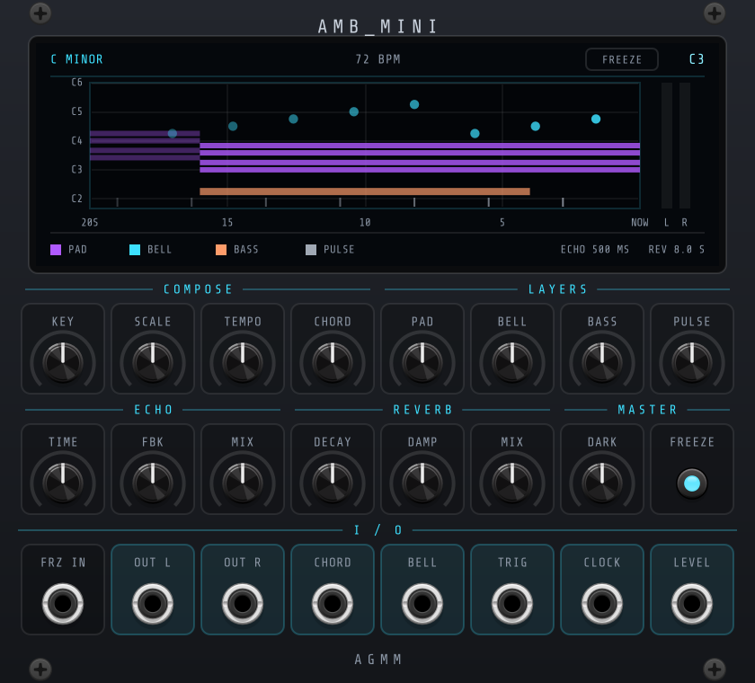 |
| 3 | Ambience | 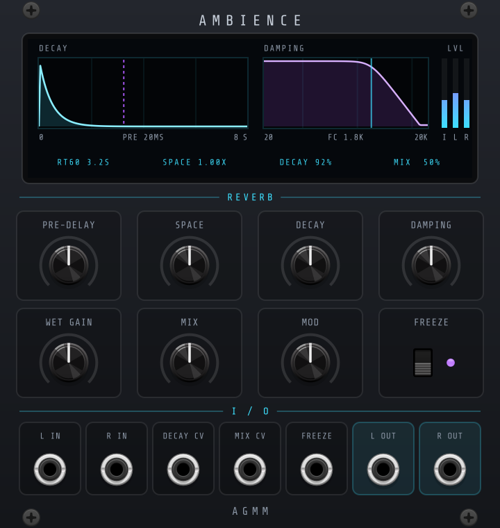 |
| 4 | ArpLib |  |
| 5 | Bastion | 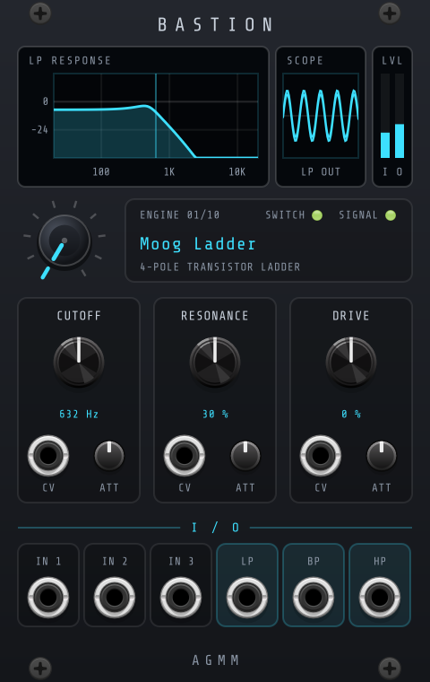 |
| 6 | BlackHoleReverb |  |
| 7 | BouncingBalls | 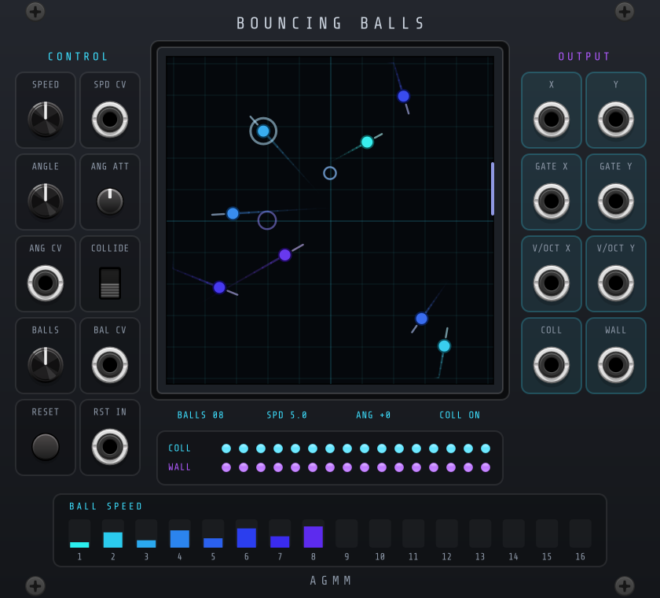 |
| 8 | CellAutoGate | 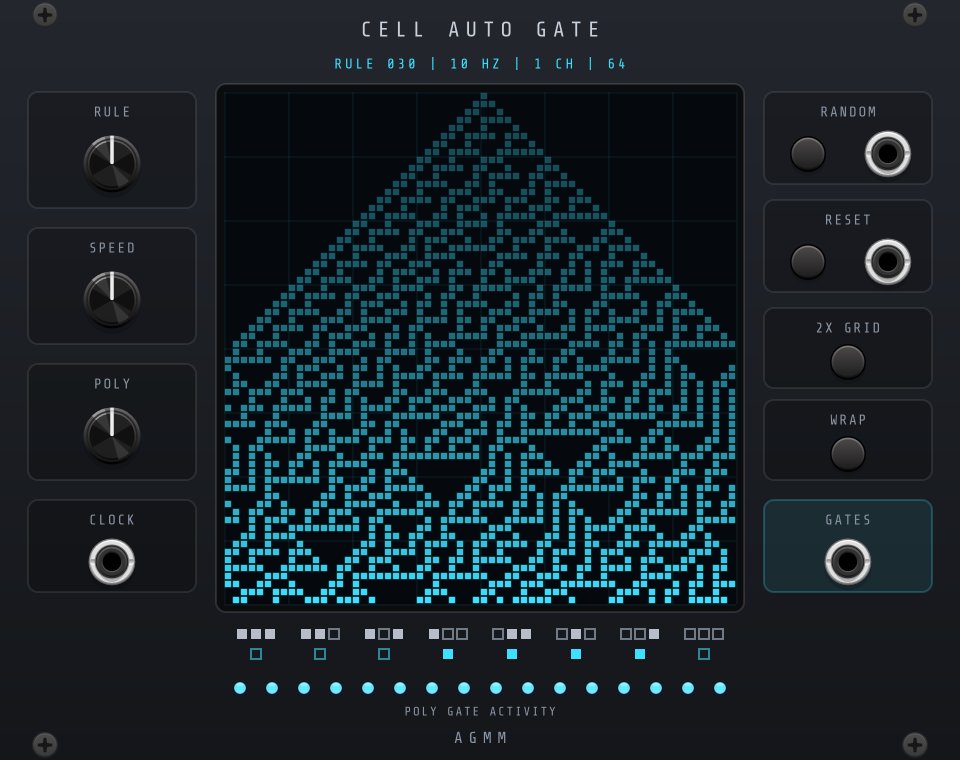 |
| 9 | Crypto |  |
| 10 | DarkHall |  |
| 11 | DarkHallGranular |  |
| 12 | Dice | 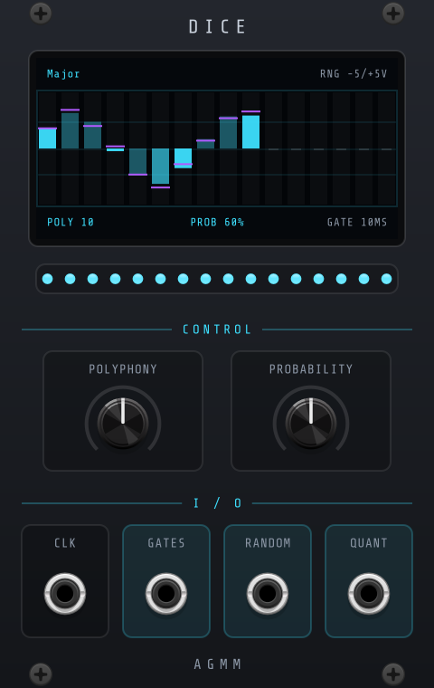 |
| 13 | DiceOnSteroids |  |
| 14 | Evolved |  |
| 15 | ExpressArpeggiator |  |
| 16 | FancyADSR |  |
| 17 | Galton | 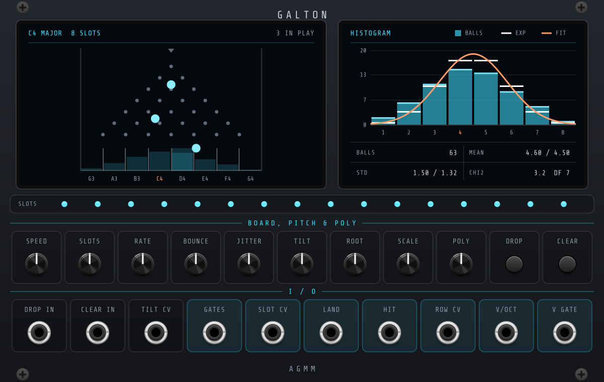 |
| 18 | Gates |  |
| 19 | HeatRev |  |
| 20 | InfinityRev |  |
| 21 | InstantDrone | 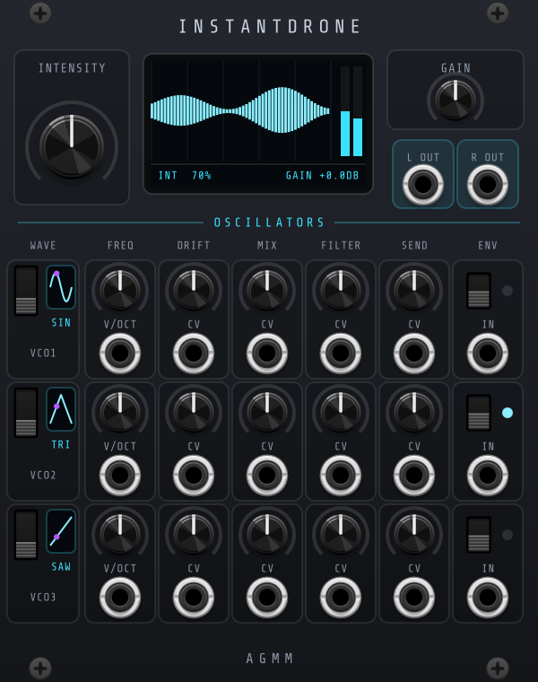 |
| 22 | Ladder | 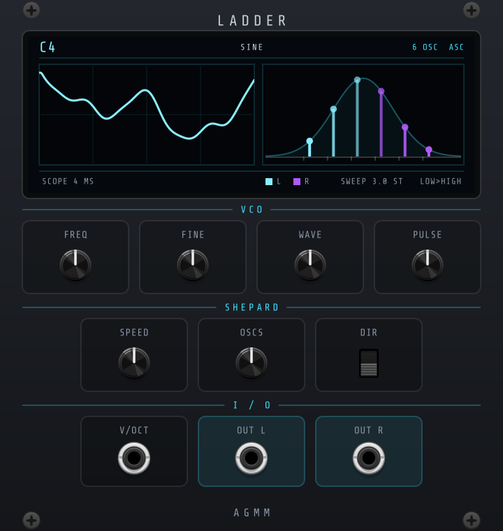 |
| 23 | Lifeform |  |
| 24 | LSDrone |  |
| 25 | MagicBox | 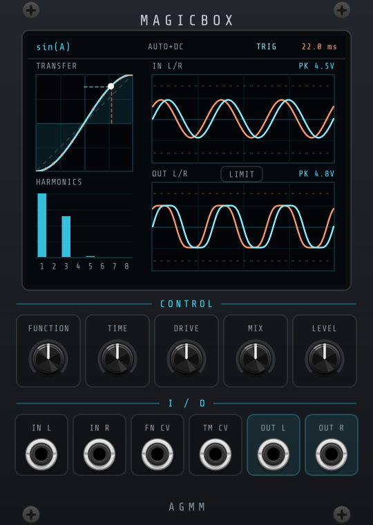 |
| 26 | Merger |  |
| 27 | Mixer3 |  |
| 28 | Mixer6 |  |
| 29 | Oscillator |  |
| 30 | Pharmakon |  |
| 31 | Phasmal |  |
| 32 | Plot | 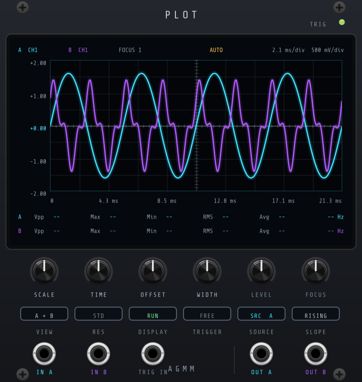 |
| 33 | PsyDelay |  |
| 34 | PsyLFO |  |
| 35 | PsyReverb |  |
| 36 | PsyReverb2 | 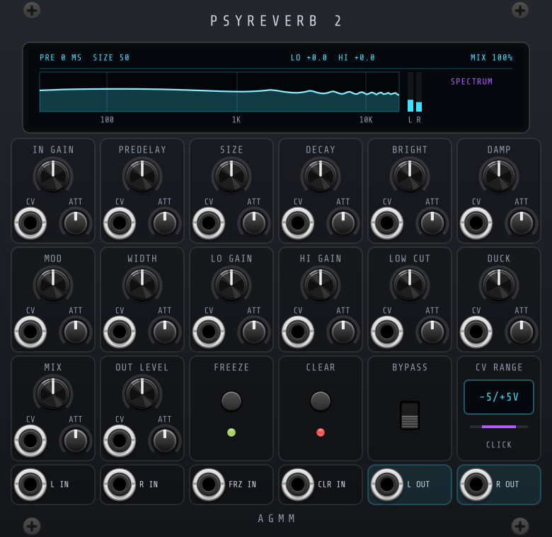 |
| 37 | PsySeq |  |
| 38 | Quantara | 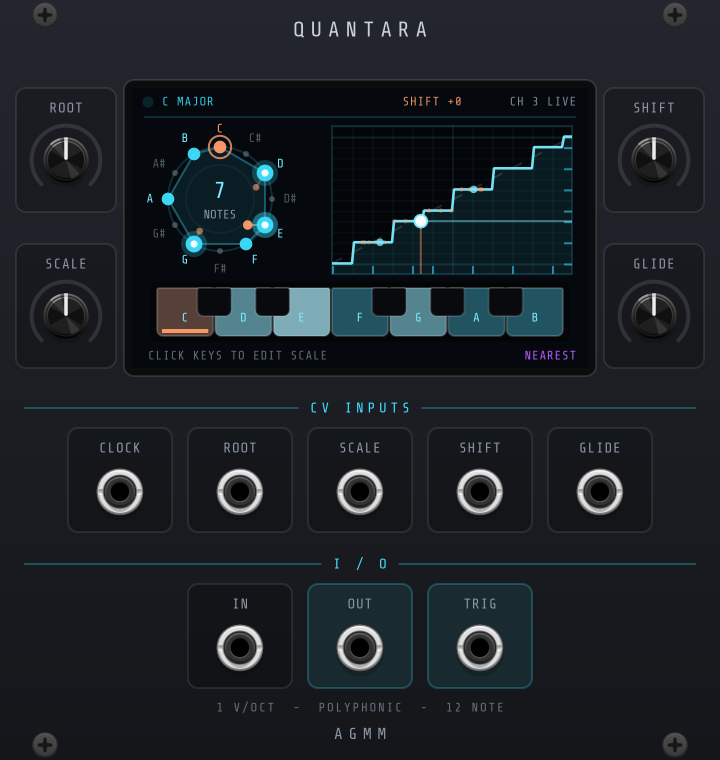 |
| 39 | RainStorm |  |
| 40 | RandomWalk |  |
| 41 | Range |  |
| 42 | Reverb | 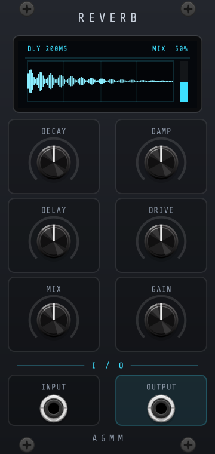 |
| 43 | Sampler |  |
| 44 | SickDelay |  |
| 45 | Spikes |  |
| 46 | Splitter |  |
| 47 | SpringPendulum |  |
| 48 | Stagger |  |
| 49 | Stagger2 |  |
| 50 | Stasis |  |
| 51 | Swapper | 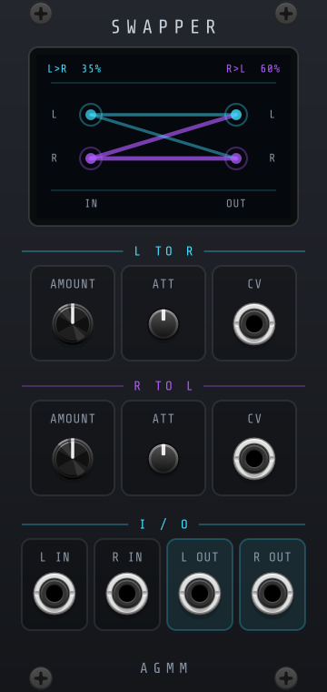 |
| 52 | SwitchLines1to8 |  |
| 53 | SwitchLines8to1 |  |
| 54 | TritoneParadox |  |
| 55 | VCA2 |  |
| 56 | VCAPoly |  |
| 57 | Vortex | 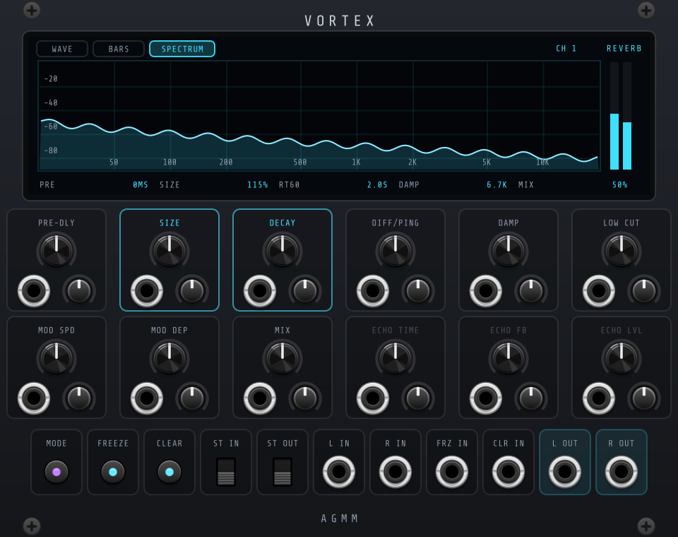 |
| 58 | Whirlpool |  |
| 59 | XBodyProblem |  |