# AGMM Module Gallery

| No | Module | Image |
|----|--------|-------|
| 1 | AMB |  |
| 2 | AMB_MINI |  |
| 3 | Ambience |  |
| 4 | ArpLib |  |
| 5 | Bastion |  |
| 6 | BlackHoleReverb | 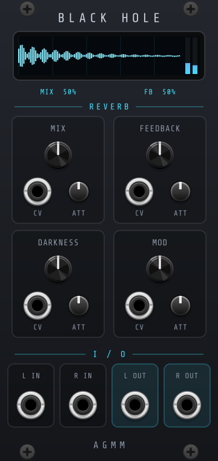 |
| 7 | BouncingBalls |  |
| 8 | CellAutoGate |  |
| 9 | DarkHall |  |
| 10 | DarkHallGranular |  |
| 11 | Dice |  |
| 12 | DiceOnSteroids |  |
| 13 | Evolved |  |
| 14 | ExpressArpeggiator |  |
| 15 | FancyADSR | 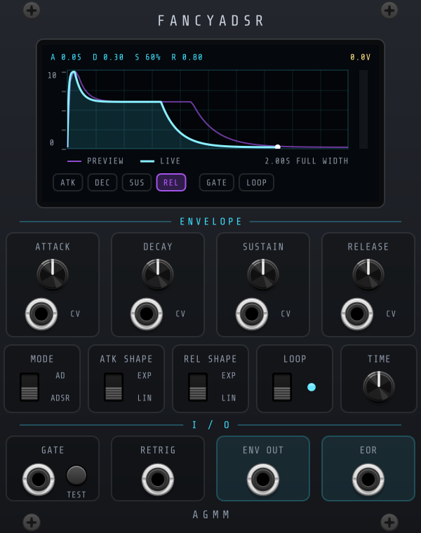 |
| 16 | Galton |  |
| 17 | Gates | 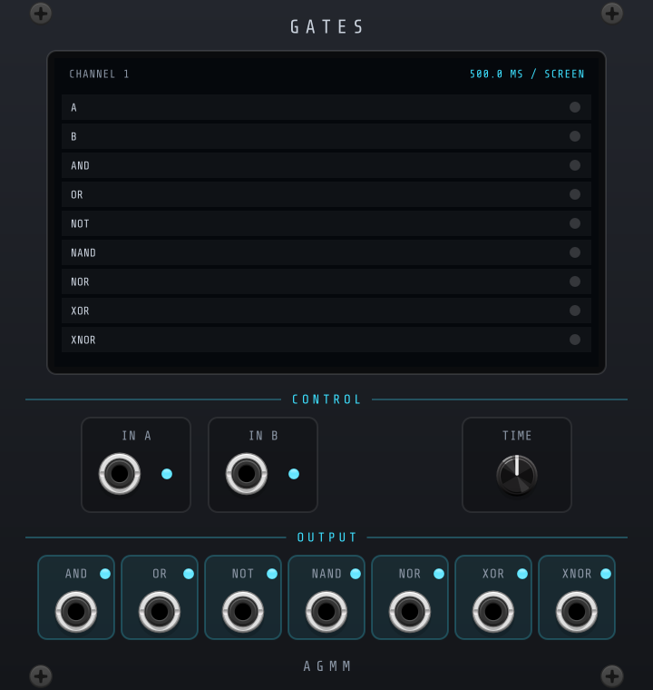 |
| 18 | HeatRev |  |
| 19 | InfinityRev |  |
| 20 | InstantDrone |  |
| 21 | Ladder |  |
| 22 | Lifeform | 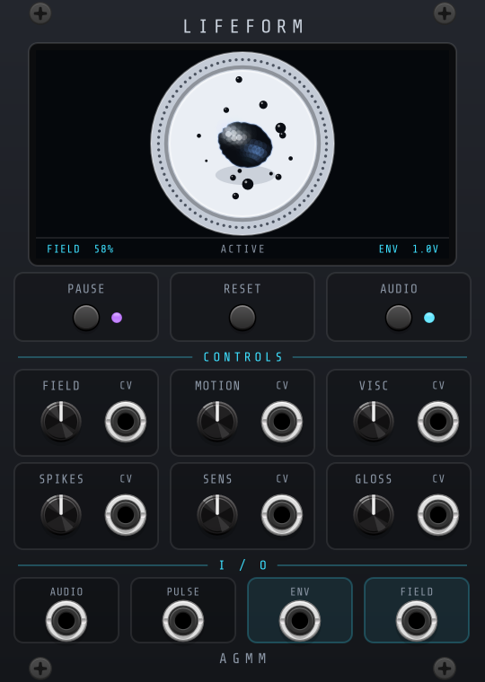 |
| 23 | LSDrone |  |
| 24 | MagicBox |  |
| 25 | Merger |  |
| 26 | Mixer3 |  |
| 27 | Mixer6 |  |
| 28 | Oscillator |  |
| 29 | Pharmakon |  |
| 30 | Phasmal |  |
| 31 | Plot |  |
| 32 | PsyDelay | 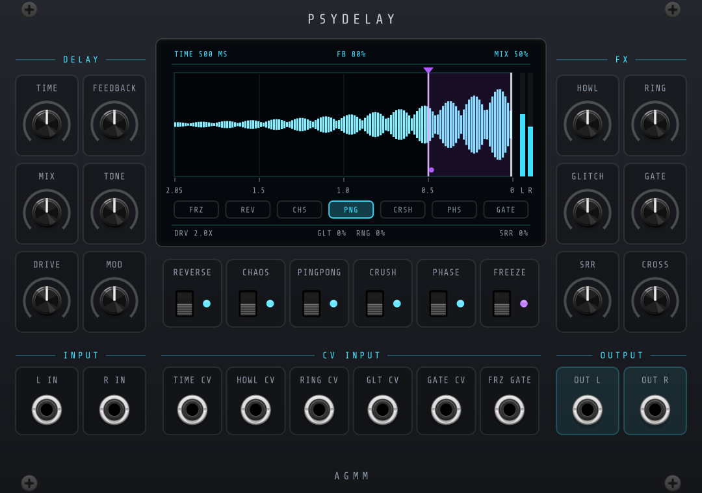 |
| 33 | PsyLFO |  |
| 34 | PsyReverb |  |
| 35 | PsyReverb2 |  |
| 36 | PsySeq | 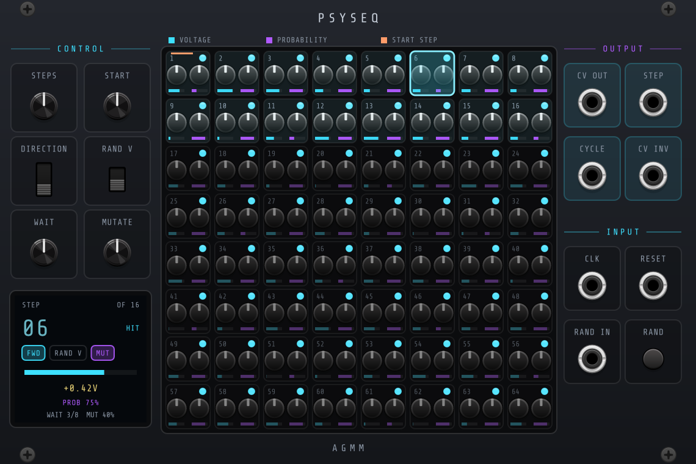 |
| 37 | Quantara |  |
| 38 | RainStorm | 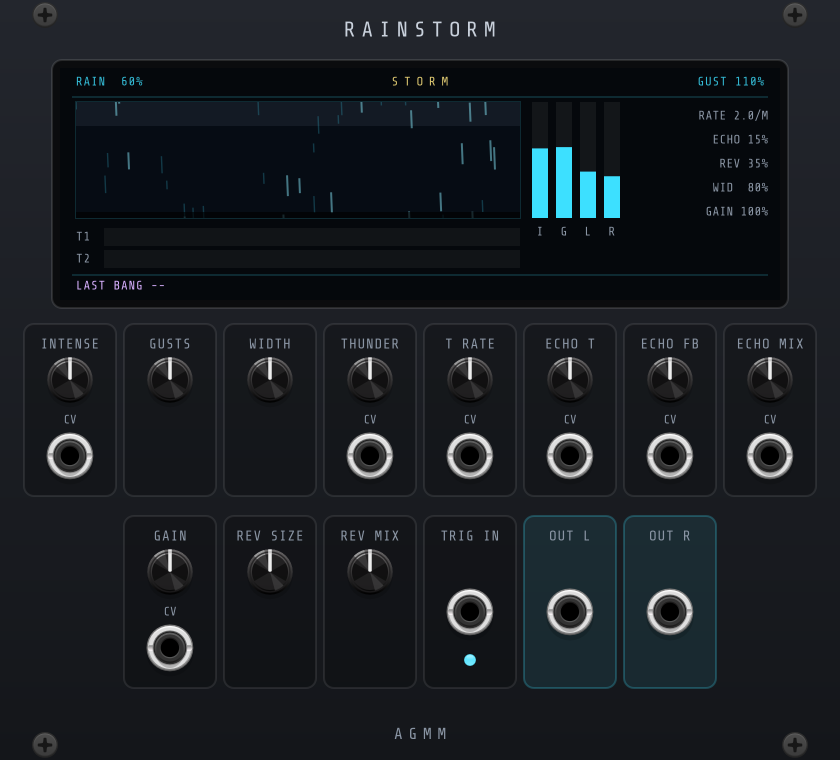 |
| 39 | RandomWalk | 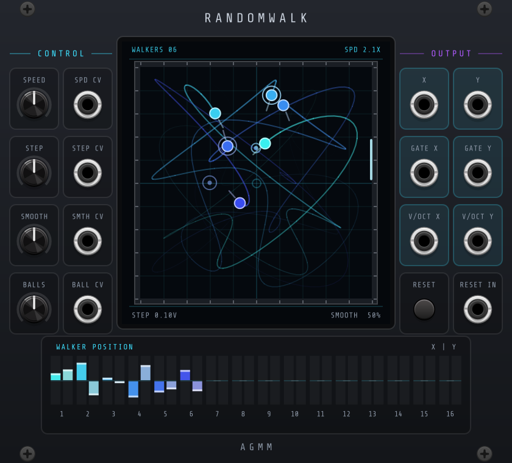 |
| 40 | Range | 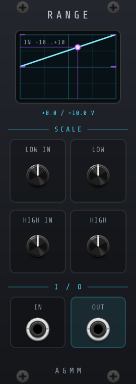 |
| 41 | Reverb |  |
| 42 | Sampler | 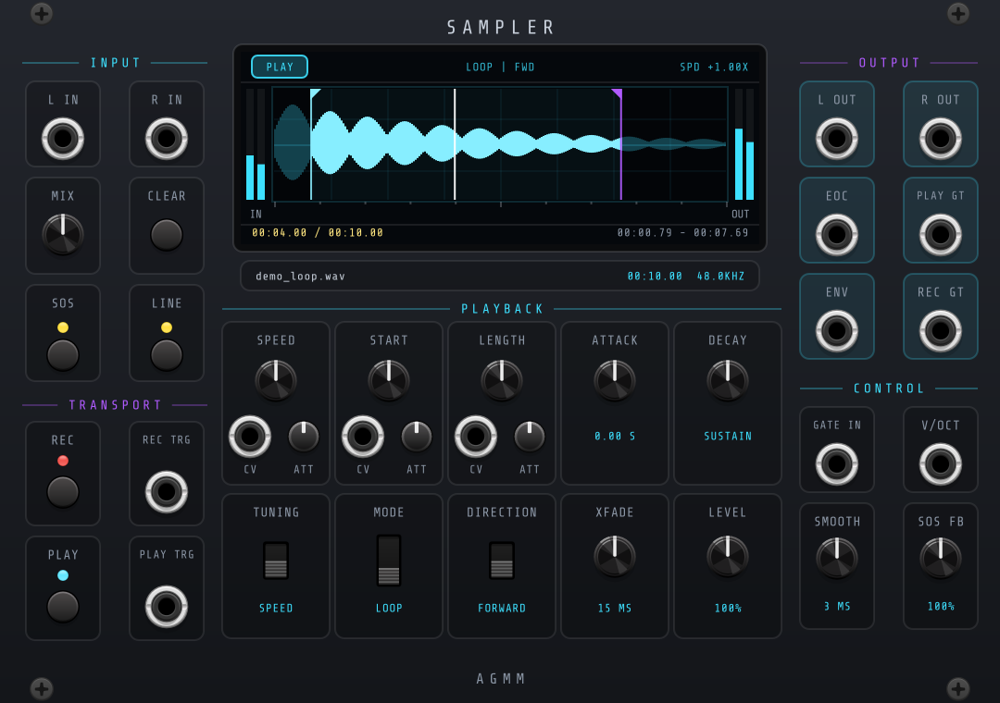 |
| 43 | SickDelay |  |
| 44 | Spikes |  |
| 45 | Splitter |  |
| 46 | SpringPendulum | 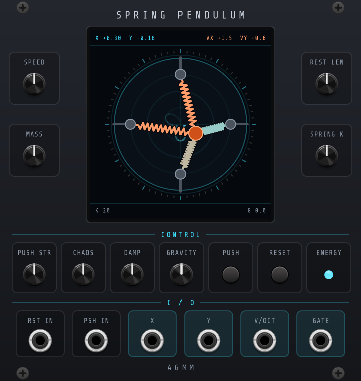 |
| 47 | Stagger | 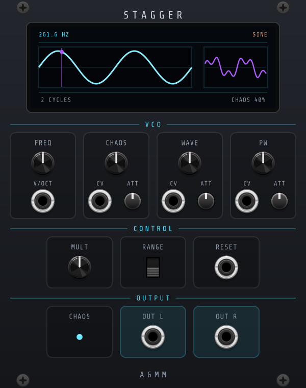 |
| 48 | Stagger2 |  |
| 49 | Stasis |  |
| 50 | Swapper |  |
| 51 | SwitchLines1to8 | 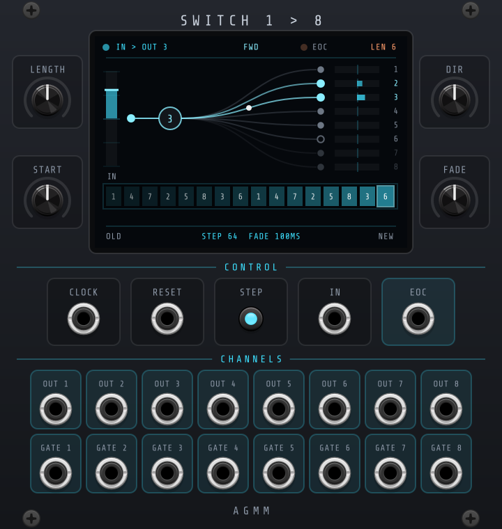 |
| 52 | SwitchLines8to1 |  |
| 53 | TritoneParadox | 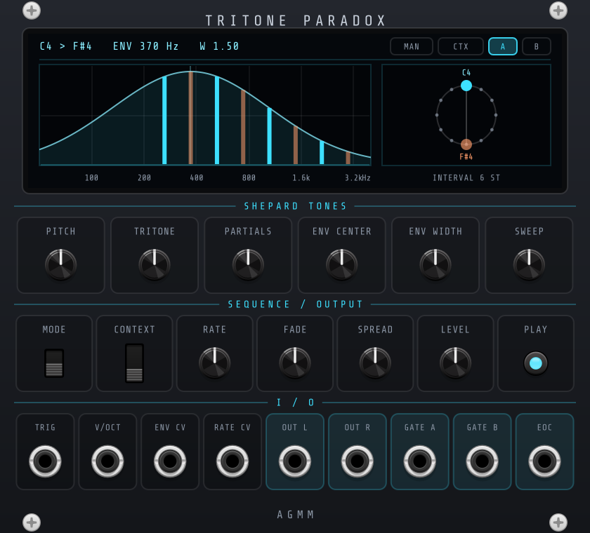 |
| 54 | VCA2 | 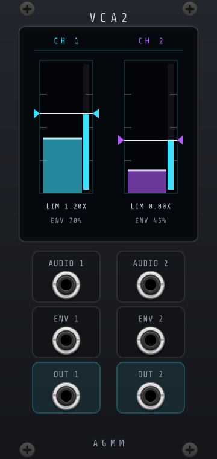 |
| 55 | VCAPoly |  |
| 56 | Vortex |  |
| 57 | Whirlpool |  |
| 58 | XBodyProblem |  |