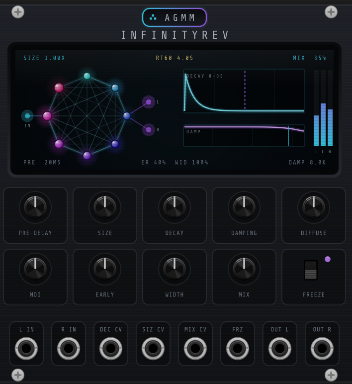

<!--
AGMM AUTOMATIC DOCUMENTATION
Source: InfinityRev.cpp
-->

# InfinityRev

## 1. Overview

`InfinityRev` is a 24 HP stereo reverb with a fully parametric 8-line feedback delay network. The FDN uses an orthonormal Hadamard feedback matrix so the tail is energy-preserving when the per-line loop gains are 1, and the RT60 control sets those gains for a target decay. A Freeze switch (and gate input) pushes the loop gains to just under 1 and disables damping so the tail can be held indefinitely.

Key features:
- 8-line FDN with orthonormal Hadamard feedback
- Modulated delay times (slow LFO per line)
- Per-line damping (one-pole low-pass)
- RT60-based decay with display in seconds
- Freeze switch + gate input
- Input pre-delay (0–250 ms)
- 6-tap early reflection bank
- Input diffusion (4 Schroeder all-passes per channel)
- Stereo width control (M/S)
- Equal-power dry/wet mix
- DC block + soft limiter
- CV over decay, size, mix
- Live display with FDN line activity, decay curve, damping response, meters

## Module Screenshot



## 2. Architecture

### Main Classes

- `InfinityRev`: Core module class inheriting from `rack::Module`
- `IRDelayLine`: Circular delay with linear + cubic (Hermite) fractional read
- `IRAllpass`: Fixed-length Schroeder all-pass
- `IRPanel`: Static panel artwork
- `IRDisplay`: Live display with FDN/decay/damping/meters

### Inheritance

- `InfinityRev` inherits from `rack::Module`
- Both UI widgets inherit from `rack::TransparentWidget`

### Structures

- `IRDelayLine`: `{ std::vector<float> buf; int w, n; readLinear(); readCubic(); }`
- `IRAllpass`: `{ std::vector<float> buf; int pos; process(); }`

### State (grouped)

| Group | Storage |
|-------|---------|
| Pre-delay | `IRDelayLine pdL, pdR` |
| Early reflections | `IRDelayLine er` |
| Input diffusion | `IRAllpass apL[4], apR[4]` |
| FDN lines | `IRDelayLine fdn[8]` |
| Damping | `float lp[8]` |
| Modulation | `float phase[8]` |
| Feedback | `float gain[8]` |
| Coefficients | `float dampK, apG` |
| Smoothing | `float sizeS, freezeS, smoothK` |
| DC block | `float dcInL, dcOutL, dcInR, dcOutR` |
| Display | `float lineLevel[8]`, `float meterIn`, `meterOutL`, `meterOutR`, `dispRt60`, `dispCut`, `dispMix` |

### Constants

- `kBaseMs[8]`: `{29.7, 37.1, 41.1, 43.7, 53.3, 59.9, 67.3, 73.1}` (mutually incommensurate to avoid ringing)
- `kLfoHz[8]`: `{0.11, 0.17, 0.23, 0.29, 0.37, 0.43, 0.53, 0.61}` (slow modulation)
- `kSignL[8]`, `kSignR[8]`: Hadamard rows for decorrelated L/R
- `kApMsL[4]`, `kApMsR[4]`: input diffuser delays
- `kErMs[6]`, `kErGL[6]`, `kErGR[6]`: early reflection taps

## 3. DSP Theory

### The 8-line FDN

The FDN stores `x[i]` in each delay line, reads `y[i]`, applies a feedback matrix `A`, and writes back with the input:

$$
\mathbf{x}[n] = \mathbf{in}[n] + A \cdot \text{diag}(g) \cdot \mathbf{y}[n - D_i]
$$

where `A` is the normalized Hadamard matrix:

$$
A = \frac{1}{\sqrt{8}} H_8
$$

Because $H_8$ is orthogonal, $A^T A = I$, so the tail cannot amplify or cancel — only the per-line gains $g_i$ control the decay.

### Per-line RT60 gain

For a target RT60, each delay line's gain is:

$$
g_i = 10^{-3 D_i / (RT60 \cdot f_s)}
$$

where `D_i = kBaseMs[i] * 0.001 * sizeS * f_s` is the delay length in samples.

### Freeze

Freeze smoothly interpolates the decay toward 1 and disables the damping:

$$
g_i \leftarrow g_i + (0.99995 - g_i) \cdot \text{freezeS}
$$

$$
\text{dampK} \leftarrow \text{dampK} + (1 - \text{dampK}) \cdot \text{freezeS}
$$

At freeze = 1, the loop is essentially lossless (0.99995 per round trip), so the tail holds indefinitely.

### Input diffusion

Four series Schroeder all-passes on the pre-delayed input:

$$
y = d + g(x - g d), \quad \text{buf} = x - g d
$$

with $g = 0.1 + 0.65 \cdot \text{diffusion}$.

### Early reflections

Six taps per channel from a shared delay line:

$$
\text{erL} = \sum_k g^L_k \cdot \text{er}[\text{ms}^L_k \cdot \text{sr}]
$$

### Output taps

The wet L/R is read before the feedback matrix is applied (so it's decorrelated with the input):

$$
\text{wetL} = \frac{1}{8}\sum_i \text{sign}_L[i] \cdot y[i], \quad \text{wetR} = \frac{1}{8}\sum_i \text{sign}_R[i] \cdot y[i]
$$

### Stereo width

M/S processing:

$$
\text{mid} = \frac{L+R}{2}, \quad \text{side} = \frac{L-R}{2} \cdot \text{width}
$$

$$
L' = \text{mid} + \text{side}, \quad R' = \text{mid} - \text{side}
$$

### Equal-power mix

$$
\text{out} = \cos(\text{mix} \cdot \pi/2) \cdot \text{dry} + \sin(\text{mix} \cdot \pi/2) \cdot \text{wet}
$$

### DC block

$$
y[n] = x[n] - x[n-1] + 0.995 y[n-1]
$$

### Soft limiter

Linear below ±8 V, tanh shoulder above, asymptote at ±10 V:

$$
y = \begin{cases} x & |x| \le 8 \\ 8 + 2\tanh((|x|-8)/2) & |x| > 8 \end{cases}
$$

## 4. Parameters and Controls

### Knobs

| Parameter | Min | Max | Default | Description |
|-----------|-----|-----|---------|-------------|
| `PREDELAY_PARAM` | 0 | 250 ms | 20 ms | Pre-delay |
| `SIZE_PARAM` | 0.5 | 2.0 | 1.0 | Delay scaling |
| `DECAY_PARAM` | 0 | 1 | 0.65 | RT60 (0.2–60 s) |
| `DAMP_PARAM` | 0 | 1 | 0.4 | Damping cutoff (20 kHz .. 1 kHz) |
| `DIFFUSION_PARAM` | 0 | 1 | 0.75 | Input diffusion |
| `MOD_PARAM` | 0 | 1 | 0.3 | Modulation depth |
| `ER_PARAM` | 0 | 1 | 0.4 | Early reflections |
| `WIDTH_PARAM` | 0 | 1.5 | 1.0 | Stereo width |
| `MIX_PARAM` | 0 | 1 | 0.35 | Dry/wet |

### Switch

| Parameter | Description |
|-----------|-------------|
| `FREEZE_PARAM` | Freeze on/off |

### Inputs

| Input | Description |
|-------|-------------|
| `INPUT_L` | Left (mono if R empty) |
| `INPUT_R` | Right |
| `DECAY_CV_INPUT` | Decay CV (10 V = full range) |
| `SIZE_CV_INPUT` | Size CV (10 V adds 1.5×) |
| `MIX_CV_INPUT` | Mix CV (10 V = 100%) |
| `FREEZE_GATE_INPUT` | Freeze gate |

### Outputs

| Output | Description |
|--------|-------------|
| `OUTPUT_L` | Left |
| `OUTPUT_R` | Right |

### Lights

- `FREEZE_LIGHT` — Freeze active

### Enumerations

- `ParamId`: PreDelay, Size, Decay, Damp, Diffusion, Mod, ER, Width, Mix, Freeze
- `InputId`: InL, InR, DecayCV, SizeCV, MixCV, FreezeGate
- `OutputId`: OutL, OutR
- `LightId`: FreezeLight

## 5. Inputs and Outputs

### Inputs

| Name | Type | Range | Description |
|------|------|-------|-------------|
| `INPUT_L` | Audio | ±10 V | Left audio |
| `INPUT_R` | Audio | ±10 V | Right audio |
| `DECAY_CV_INPUT` | CV | ±10 V | Decay modulation |
| `SIZE_CV_INPUT` | CV | ±10 V | Size modulation |
| `MIX_CV_INPUT` | CV | ±10 V | Mix modulation |
| `FREEZE_GATE_INPUT` | Gate | > 1 V | Freeze |

### Outputs

| Name | Type | Range | Description |
|------|------|-------|-------------|
| `OUTPUT_L` | Audio | ±10 V | Left |
| `OUTPUT_R` | Audio | ±10 V | Right |

### Bypass

`configBypass(INPUT_L, OUTPUT_L)` and `configBypass(INPUT_R, OUTPUT_R)`.

## 6. Signal Processing Pipeline

1. **Sample-rate change** — Re-prepare all delay lines.
2. **Parameter read** — All 10 params.
3. **Size / freeze smoothing** — `sizeS`, `freezeS` one-pole smoothed.
4. **Control-rate update** — Every 32 samples: compute `rt60`, per-line gains, `dampK`, `apG`.
5. **Pre-delay + early reflections** — Read pre-delay at `pdSamp`; write new L/R.
6. **Input diffusion** — 4 series all-passes.
7. **FDN** — For each line: read (with modulation), damp, multiply by gain. Apply Hadamard matrix. Write input + feedback.
8. **Output taps** — `wetL`, `wetR` from the delayed lines.
9. **Mix in early reflections**.
10. **Stereo width** — M/S.
11. **Equal-power dry/wet**.
12. **DC block + soft limit**.
13. **Write outputs, update meters**.

## 7. Important Functions

### `IRDelayLine::readCubic(float d)`

4-point Hermite interpolation for smooth fractional delays.

```cpp
float rp = (float)w - d;
int i1 = (int)std::floor(rp);
float f = rp - (float)i1;
i1 = wrap(i1);
float xm1 = buf[wrap(i1 - 1)];
float x0 = buf[i1];
float x1 = buf[wrap(i1 + 1)];
float x2 = buf[wrap(i1 + 2)];
float c1 = 0.5f * (x1 - xm1);
float c2 = xm1 - 2.5f * x0 + 2.f * x1 - 0.5f * x2;
float c3 = 0.5f * (x2 - xm1) + 1.5f * (x0 - x1);
return ((c3 * f + c2) * f + c1) * f + x0;
```

### `updateControl()`

Recomputes per-line gains from RT60, damping coefficient from cutoff, and diffusion all-pass gain. Called every 32 samples.

### `softLimit(float x)`

Custom limiter with a hard asymptote at ±10 V.

### `process(const ProcessArgs &args)`

The main callback described in §6.

## 8. Mathematical Implementation

### RT60 gain

$$
g_i = 10^{-3 D_i / (RT60 \cdot f_s)}
$$

with `D_i = kBaseMs[i] * 0.001 * sizeS * f_s`.

### RT60 knob mapping

$$
\text{RT60} = 0.2 \cdot 300^{\text{decay}}
$$

So decay = 0 → 0.2 s, decay = 0.5 → 3.5 s, decay = 1 → 60 s.

### Damping cutoff

$$
f_c = 20000 \cdot 0.05^{\text{damp}}
$$

So damp = 0 → 20 kHz, damp = 1 → 1 kHz.

### Hadamard matrix

$$
A = \frac{1}{\sqrt{8}} \begin{pmatrix}
1&1&1&1&1&1&1&1 \\
1&-1&1&-1&1&-1&1&-1 \\
1&1&-1&-1&1&1&-1&-1 \\
1&-1&-1&1&1&-1&-1&1 \\
1&1&1&1&-1&-1&-1&-1 \\
1&-1&1&-1&-1&1&-1&1 \\
1&1&-1&-1&-1&-1&1&1 \\
1&-1&-1&1&-1&1&1&-1
\end{pmatrix}
$$

Implemented via the fast Walsh-Hadamard transform.

### Soft limiter

$$
y = \begin{cases} x & |x| \le 8 \\ \text{sign}(x)\left(8 + 2\tanh\left(\frac{|x|-8}{2}\right)\right) & |x| > 8 \end{cases}
$$

### DC block

$$
y[n] = x[n] - x[n-1] + 0.995 y[n-1]
$$

## 9. Performance and Optimization

### CPU Usage

- Pre-delay: 2 reads + 2 writes
- Diffusion: 8 all-passes
- FDN: 8 lines × (cubic read + damping + gain) + Hadamard ≈ 8 × 30 + 30 = 270 flops
- Output: taps + M/S + EQ ≈ 20 flops
- Control-rate: every 32 samples, ~50 flops
- Total: ~350 flops/sample

### Memory Allocation

- `pdL`, `pdR`: 0.26 × sr samples each ≈ 12.5 K floats each
- `er`: 0.10 × sr samples ≈ 4.8 K floats
- `fdn[i]`: 0.30 × sr samples each ≈ 14.4 K floats each
- `apL[4]`, `apR[4]`: ~1.5 K floats total
- Total ≈ 150 K floats ≈ 600 KB

### Buffers

- 8 × 14400 FDN floats
- 2 × 12480 pre-delay floats
- 4800 ER floats
- 8 × ~500 diffuser floats

### Real-time Processing

- All loops bounded
- Control-rate updates limited to every 32 samples
- No allocation in `process()`

### Thread Safety

- All state written by audio thread, read by UI thread via torn reads

### Numerical Stability

- Orthogonal Hadamard matrix preserves energy
- Per-line gain < 1 (unless frozen, at which point it's 0.99995)
- Soft limiter at ±10 V
- DC blocker removes any offset
- Freeze smoothing prevents clicks

## 10. Dependencies

### Libraries/Headers

- `plugin.hpp` — VCV Rack core
- `agmm_ui.hpp` — shared AGMM UI helpers
- `<vector>`, `<cmath>`, `<cstdio>`, `<cstring>`, `<algorithm>`

### External Classes

- `rack::Module`, `rack::TransparentWidget`, `rack::engine::ParamQuantity`
- `agmm::panelBase`, `agmm::bezel`, `agmm::cell`, `agmm::plate`, `agmm::text`, `agmm::plotFrame`, `agmm::screen`, `agmm::sectionHeader`, `agmm::meter`, `agmm::withA`, `agmm::violet`, `agmm::accent`, `agmm::bright`, `agmm::warm`, `agmm::dim`, `agmm::ALIGN_L/C/R`

## 11. Summary

`InfinityRev` is a fully parametric 8-line FDN reverb. It's the most "proper" reverb in the AGMM collection: every aspect is modeled from first principles (orthogonal Hadamard matrix, RT60-based decay, per-line damping), and the result is a clean, stable, transparent reverb that can go from a small room to a 60-second infinite hall.

The freeze mode is the standout feature: when engaged, the decay gains are pushed to 0.99995 and the damping is disabled, so the existing tail circulates forever. Combined with the display's FDN line activity bars, it's a beautiful way to "capture" a moment of audio and stretch it into infinity.

The main limitations are: the delay lengths are fixed (scaled by SIZE) so you can't do arbitrary room shapes, and the early reflection taps are hard-coded. But for a general-purpose reverb, this is a very complete implementation.
