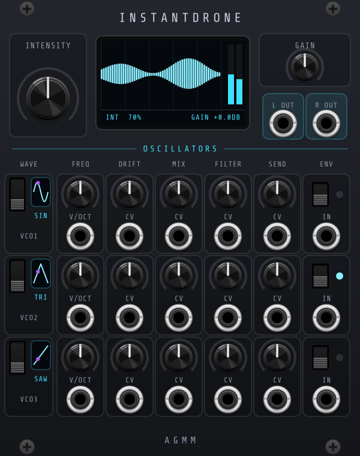

<!--
AGMM AUTOMATIC DOCUMENTATION
Source: InstantDrone.cpp
-->

# InstantDrone

## 1. Overview

`InstantDrone` is a 20 HP three-oscillator drone synth with per-oscillator controls, a multi-tap delay-based reverb, and a live scope of the stereo output. Each oscillator has its own frequency (V/Oct plus knob), waveform (sine/triangle/saw), mix level, drift amount (random slow pitch wander), low-pass filter cutoff and reverb send, all with dedicated CV inputs.

Key features:
- 3 independent oscillators
- Per-oscillator V/Oct pitch, waveform, mix, drift, filter, reverb send
- Optional envelope input per oscillator (with bypass switch)
- Multi-tap delay-based reverb (4 delay lines per channel)
- Master gain trim (dB)
- Live scope + L/R meters
- Drift: slow random pitch wander for organic movement

## Module Screenshot



## 2. Architecture

### Main Classes

- `InstantDrone`: Core module class inheriting from `rack::Module`
- `DroneDelay`: Fixed-length circular delay (44100 samples)
- `DRPanelBackground`: Static panel artwork
- `DRDisplayWidget`: Live scope + meters + readouts
- `DRWaveWidget`: Per-oscillator mini waveform display
- `DREnvLed`: Per-oscillator envelope-active LED

### Inheritance

- `InstantDrone` inherits from `rack::Module`
- All UI widgets inherit from `rack::TransparentWidget`

### State (grouped)

| Group | Storage |
|-------|---------|
| Oscillator phases | `float phases[3]` |
| Drift | `float driftValues[3]`, `driftTargets[3]` |
| Filters | `float lowpass1, lowpass2, lowpass3` |
| Reverb L | `DroneDelay delayL[4]` |
| Reverb R | `DroneDelay delayR[4]` |
| Display | `float scopeMin[55]`, `scopeMax[55]`, `scopeHead`, `scopeCount`, `scopeBMin`, `scopeBMax`, `peakL`, `peakR` |

## 3. DSP Theory

### Oscillator synthesis

Each oscillator has three waveforms:

- **Sine**: $\sin(2\pi \phi)$
- **Triangle**: $1 - 4|\phi - 0.5|$
- **Saw**: $2\phi - 1$

The phase accumulator advances at `freq * dt`, where `freq = 261.626 * 2^pitch` and `pitch = FREQ_knob + V/Oct CV + drift`.

### Drift

Each oscillator has a slow random walk on its pitch:

$$
\text{driftTarget} \sim \text{Uniform}[-1, 1] \quad \text{when } u < 0.002
$$

$$
\text{drift} \leftarrow \text{drift} + (\text{driftTarget} - \text{drift}) \cdot 0.01
$$

The `drift` value is scaled by the DRIFT knob + CV, and added to the pitch. This gives the oscillator a slow, organic pitch wobble (like tape wow/flutter).

### Envelope

If the envelope switch is on:

$$
\text{envelope} = \text{clamp}(\text{ENV\_input} / 10, 0, 1)
$$

Otherwise `envelope = 1`.

### Per-oscillator low-pass

A one-pole LP on the oscillator output:

$$
\text{lp} \leftarrow \text{lp} + f(\text{osc} - \text{lp}), \quad f = \text{cutoff} \cdot 0.15
$$

### Multi-tap delay reverb

Four delay lines per channel, each with its own tap time:

- Left: `{3431, 5743, 7853, 9437}` samples
- Right: `{3721, 5923, 8147, 9601}` samples

Each line reads, writes input + feedback × previous read:

$$
\text{read} = \text{buf}[(\text{writePos} - \text{len}) \bmod 44100], \quad \text{buf}[\text{writePos}] = \text{in} + \text{read} \cdot 0.985
$$

The four reads are averaged to form the wet signal.

### Output gain

$$
\text{out} \leftarrow \text{out} \cdot 10^{\text{gainDb}/20}
$$

## 4. Parameters and Controls

### Per-oscillator (×3)

| Parameter | Min | Max | Default | Description |
|-----------|-----|-----|---------|-------------|
| `FREQ{n}_PARAM` | −3 | 3 | 0 | Frequency (octaves from C4) |
| `WAVE{n}_PARAM` | 0 | 2 | 0 | Waveform (Sine, Triangle, Saw) |
| `MIX{n}_PARAM` | 0 | 1 | 0.5 | Mix level |
| `DRIFT{n}_PARAM` | 0 | 1 | 0.2 | Drift amount |
| `SEND{n}_PARAM` | 0 | 1 | 0.5 | Reverb send |
| `FILT{n}_PARAM` | 0 | 1 | 0.6 | Filter cutoff |

### Master

| Parameter | Min | Max | Default | Description |
|-----------|-----|-----|---------|-------------|
| `REVERB_WET_PARAM` | 0 | 1 | 0.7 | Drone intensity (wet mix) |
| `OUTPUT_GAIN_PARAM` | −10 dB | 10 dB | 0 dB | Output gain |

### Envelope switches (×3)

| Switch | Description |
|--------|-------------|
| `ENV{n}_SWITCH` | Envelope bypass (Off = bypassed, On = active) |

### Inputs (×3 per oscillator)

| Input | Description |
|-------|-------------|
| `VOCT{n}_INPUT` | V/Oct |
| `DRIFT{n}_CV` | Drift CV |
| `MIX{n}_CV` | Mix CV |
| `FILT{n}_CV` | Filter CV |
| `SEND{n}_CV` | Send CV |
| `ENV{n}_INPUT` | Envelope input |

### Outputs

| Output | Description |
|--------|-------------|
| `LEFT_OUTPUT` | Left |
| `RIGHT_OUTPUT` | Right |

### Enumerations

- `ParamId`: Freq1..3, Wave1..3, Mix1..3, Drift1..3, Send1..3, Filt1..3, ReverbWet, OutputGain, Env1..3 Switch
- `InputId`: VOct1..3, Drift1..3 CV, Mix1..3 CV, Filt1..3 CV, Send1..3 CV, Env1..3
- `OutputId`: Left, Right

## 5. Inputs and Outputs

### Inputs

| Name | Type | Range | Description |
|------|------|-------|-------------|
| `VOCT{n}_INPUT` | CV | 1 V/oct | Pitch CV |
| `DRIFT{n}_CV` | CV | ±5 V | Drift offset |
| `MIX{n}_CV` | CV | ±5 V | Mix offset |
| `FILT{n}_CV` | CV | ±5 V | Filter offset |
| `SEND{n}_CV` | CV | ±5 V | Send offset |
| `ENV{n}_INPUT` | CV | 0–10 V | Envelope |

### Outputs

| Name | Type | Range | Description |
|------|------|-------|-------------|
| `LEFT_OUTPUT` | Audio | ±10 V | Left |
| `RIGHT_OUTPUT` | Audio | ±10 V | Right |

## 6. Signal Processing Pipeline

1. **Per oscillator**:
   - Update drift target if random roll < 0.002
   - Slew drift value
   - Read V/Oct CV + FREQ knob + drift → pitch
   - Compute frequency
   - Advance phase
   - Generate waveform
   - Read mix knob + CV
   - Read envelope (if active) else 1
   - Compute `oscillator = rawOsc * 5 * baseGain * envelope`
   - Apply one-pole LP filter
   - Add to dry sum
   - Add to reverb send (× send knob + CV)
2. **Multi-tap delay reverb** — Process reverb send through 4 delay lines per channel, average
3. **Mix** — `out = drySum + wet * wetAmount`
4. **Output gain** — Apply dB gain
5. **Display** — Peaks + scope

## 7. Important Functions

### `getWaveform(float phase, int type)`

Returns the selected waveform at the given phase.

```cpp
switch (type) {
case 0: return std::sin(2.f * M_PI * phase);
case 1: return 1.f - 4.f * std::fabs(phase - 0.5f);
case 2: return 2.f * phase - 1.f;
default: return std::sin(2.f * M_PI * phase);
}
```

### `DroneDelay::process(float input, float feedback, int length)`

Circular delay with feedback.

```cpp
length = clamp(length, 1, 44099);
int readPos = (writePos - length + 44100) % 44100;
float output = buffer[readPos];
buffer[writePos] = input + output * feedback;
writePos = (writePos + 1) % 44100;
return output;
```

### `process(const ProcessArgs &args)`

The main callback described in §6.

## 8. Mathematical Implementation

### Oscillator frequency

$$
f = 261.626 \cdot 2^{\text{pitch}}
$$

where `pitch = FREQ + V/Oct + drift`.

### Drift update

$$
\text{drift} \leftarrow \text{drift} + (\text{target} - \text{drift}) \cdot 0.01
$$

with target re-rolled when `uniform() < 0.002`.

### Low-pass filter

$$
\text{lp} \leftarrow \text{lp} + f(\text{osc} - \text{lp}), \quad f = \text{cutoff} \cdot 0.15
$$

### Delay feedback

$$
\text{buf}[w] = \text{in} + \text{read} \cdot 0.985
$$

### Output gain

$$
g = 10^{\text{dB}/20}
$$

## 9. Performance and Optimization

### CPU Usage

- 3 oscillators × (phase advance + waveform + LP) ≈ 3 × 20 flops
- 3 drift updates ≈ 15 flops
- 8 delay lines (4 L + 4 R) × (read + write) ≈ 8 × 10 flops
- Total: ~150 flops/sample

### Memory Allocation

- `DroneDelay` buffers: 8 × 44100 floats ≈ 1.4 MB
- No allocation in `process()`

### Buffers

- `delayL[4]`, `delayR[4]`: 8 × 44100 = 352800 floats ≈ 1.4 MB

### Real-time Processing

- All loops bounded by 3 (oscillators) or 4 (delay lines)
- No allocation, no blocking

### Thread Safety

- All state written by audio thread, read by UI thread via torn reads

### Numerical Stability

- Output gain clamped to ±10 dB
- Feedback 0.985 < 1
- Waveforms bounded to ±1

## 10. Dependencies

### Libraries/Headers

- `plugin.hpp` — VCV Rack core
- `agmm_ui.hpp` — shared AGMM UI helpers
- `<cmath>`, `<cstdio>`, `<cstring>`, `<algorithm>`

### External Classes

- `rack::Module`, `rack::TransparentWidget`, `rack::engine::ParamQuantity`
- `agmm::panelBase`, `agmm::bezel`, `agmm::cell`, `agmm::plate`, `agmm::text`, `agmm::plotFrame`, `agmm::screen`, `agmm::sectionHeader`, `agmm::meter`, `agmm::withA`, `agmm::violet`, `agmm::accent`, `agmm::bright`, `agmm::warm`, `agmm::dim`, `agmm::ALIGN_L/C/R`

## 11. Summary

`InstantDrone` is a compact 3-oscillator drone synth. It's focused on slow, evolving textures: the drift feature adds a tape-like wow/flutter to each oscillator, the per-oscillator low-pass filtering lets you shape the timbre, and the multi-tap delay reverb adds depth and space.

The most distinctive feature is the drift: each oscillator has a slow random pitch walk that never exactly repeats, giving the drone a "living" quality. Combined with the per-oscillator envelope (which can be bypassed), it's a versatile module for both static drones and evolving textures.

The main limitations are: the reverb is a simple multi-tap delay rather than a proper algorithmic reverb, and the filter is a fixed one-pole (no resonance). But for a compact 20 HP drone voice, these are reasonable trade-offs.
