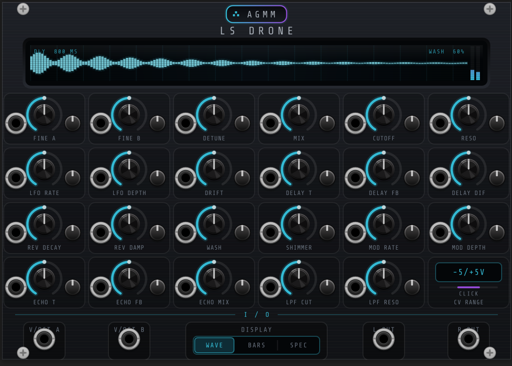

<!--
AGMM AUTOMATIC DOCUMENTATION
Source: LSDrone.cpp
Generated: 2026-11-04 06:22
-->

This is a complex VCV Rack module implementation for an "LSDrone" plugin, featuring:

## Module Screenshot

1. **Module Structure**:
   - `LSDrone` (core module with parameters, audio processing)
   - `LSDroneWidget` (panel layout and UI elements)
   - `LSDisplayWidget` (audio visualization display)
   - `LSCvRangeWidget` (CV range toggle)
   - `LSViewWidget` (display mode selector)

2. **Key Features**:
   - Audio visualization with 3 modes: Waveform, Bars, Spectrum
   - CV input handling with bipolar/unipolar range switching
   - 23 control knobs with associated CV inputs and attenuverters
   - I/O section with stereo outputs and CV inputs
   - Real-time audio analysis using FFT
   - Scanline effects and glass reflection for display
   - Context menu for global settings

3. **Technical Details**:
   - Uses NVG (NanoVG) for rendering graphics
   - Implements audio processing with FFT analysis
   - Supports multiple display modes with different visualizations
   - Includes level meters for left/right channels
   - Has a sophisticated color scheme with gradients and transparency
   - Uses custom widgets for interactive elements

4. **UI Components**:
   - Panel background with gradient and brushed texture
   - Control cells with labels
   - Display bezel with radial gradient
   - Interactive knobs, CV jacks, and attenuverters
   - Mode selector switch (WAVE/BARS/SPEC)
   - CV range toggle button
   - Context menu for global settings

The module appears to be a sophisticated drone/ambient sound generator with real-time visualization capabilities, likely used for experimental audio processing or generative music applications. The code demonstrates advanced VCV Rack plugin development techniques including custom widgets, audio analysis, and complex UI layouts.