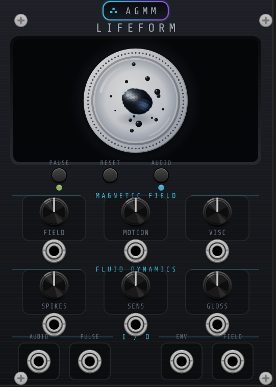

<!--
AGMM AUTOMATIC DOCUMENTATION
Source: Lifeform.cpp
Generated: 2026-11-04 06:21
-->

This code defines a VCV Rack module called "Lifeform" that simulates a complex, animated physical system with magnetic fields, fluid dynamics, and particle interactions. Here's a breakdown of its key components:

## Module Screenshot

1.  **Core Simulation Logic (`stepPhysics`)**:
    *   **Drops**: Simulates the motion of droplets on a spherical surface using spring-damper physics (`d.dv`, `d.dist`) and magnetic forces (`magD`, `field`). Droplets are projected onto the screen for rendering.
    *   **Spikes**: Models dynamic spikes that grow and move based on magnetic field interactions, with visual properties like length (`hpx`), visibility (`vis`), and lighting (`spec`, `lit`).
    *   **Body Dynamics**: The overall shape of the "body" (represented by `sil`) evolves over time due to magnetic forces and rotation (`om`). It's built from a grid of points (`wpos`, `wnorm`) that define its surface.
    *   **Rotation**: The entire system rotates (`Rm`) based on parameters like `spinVel` and `visc`.
    *   **Magnetic Field Interaction**: The magnetic field strength (`field`) and direction (`magD`) are influenced by external inputs (audio, pulse) and parameters. The `act` variable modulates the overall effect.

2.  **Rendering (`buildGeometry`, `draw`)**:
    *   **Surface Points & Normals**: Calculates the 3D positions (`wpos`) and surface normals (`wnorm`) of the body's grid points using a `surfaceR` function.
    *   **Silhouette**: Computes the projected silhouette (`sil`) by finding the maximum distance from the center for each angular bin, creating an outline of the body.
    *   **Spikes & Drops**: Calculates positions and visual properties (size, lighting) for spikes and droplets based on their physics state and the current 3D scene.
    *   **Drawing (`draw`)**: Renders the entire scene in layers:
        *   `drawDish`: Draws the physical housing of the device (bezel, glass, etc.).
        *   `drawShadow`: Adds a subtle shadow beneath the device.
        *   `drawBody`: Renders the main body with gradients, highlights, and reflections based on normals and lighting vectors (`Lv`, `Hv`, `H2v`).
        *   `drawSpikes`: Draws spikes as outlined paths with glints and sparkling tips.
        *   `drawDrops`: Renders droplets with radial gradients and highlights.
        *   `drawGlassOverlay`: Adds final touches like inner edge shading, window reflections, and a glass lip.

3.  **Module Structure (`LifeformModule`, `LifeformWidget`)**:
    *   **Parameters**: Includes controls for `PAUSE`, `RESET`, `AUDIO`, and six adjustable parameters (likely affecting `field`, `visc`, `spinVel`, etc.).
    *   **Inputs/Outputs**: Accepts audio, pulse, and envelope signals to influence the simulation.
    *   **Panel Design (`LFPanelBackground`)**: Defines the visual layout of the module's panel, including labels, knobs, buttons, and input/output jacks.

In essence, this module creates a visually engaging, physics-based animation that responds dynamically to user inputs, simulating complex interactions between magnetic forces, fluid dynamics, and particle motion on a spherical surface. The visual output is rich with lighting effects, reflections, and dynamic elements like moving droplets and growing spikes.