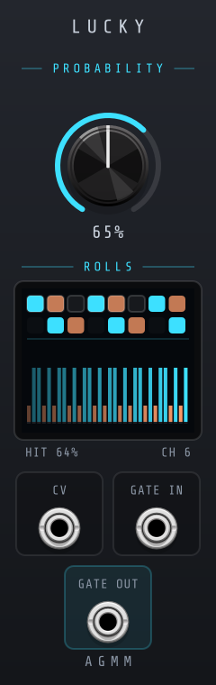

<!--
AGMM AUTOMATIC DOCUMENTATION
Source: LuckyGate.cpp
-->

# LuckyGate

## 1. Overview

`LuckyGate` is an 8 HP probabilistic polyphonic gate processor. On every rising edge of the `GATE` input it rolls an independent die per channel against the `PROBABILITY` knob (plus optional CV), and if the roll succeeds the output follows the input gate for its entire duration; if it fails the output stays low for the whole gate. Each of up to 16 channels rolls independently, making it a simple but musical way to thin out dense trigger streams, add probability to a drum pattern, or humanise a clock.

Key features:
- Per-channel independent dice roll on every rising edge
- Probability knob (0–100 %) plus CV input with 0–10 V full-scale range
- Output follows the input gate for the full duration when the roll succeeds
- Fully polyphonic (1..16 channels)
- Live 2-row channel grid (16 cells) showing pass (accent) vs reject (warm) fading activity
- Scrolling 32-slot roll history (tall bar = pass, short bar = reject)
- `HIT %` running success rate and `CH` active channel count readouts
- `PROBABILITY` ring knob with a violet dot showing the CV-modulated effective value for channel 0
- Bypass patched from `GATE_INPUT` to `GATE_OUTPUT`

## Module Screenshot

## 2. Architecture

### Main Classes

- `LuckyGate`: Core module class inheriting from `rack::Module`
- `LuckyGatePanel`: Static panel artwork + live roll grid + history strip + knob ring
- `LuckyGateWidget`: `ModuleWidget` placing the panel, one big knob, two inputs and one output

### Inheritance

- `LuckyGate` inherits from `rack::Module`
- `LuckyGatePanel` inherits from `rack::TransparentWidget`

### State (grouped)

| Group | Storage |
|-------|---------|
| Per-channel triggers | `dsp::SchmittTrigger gateTrig[16]` |
| Per-channel decision | `bool pass[16]` |
| Display brightness | `float passLvl[16]`, `float rejLvl[16]` (exponential decay) |
| History | `uint8_t hist[32]`, `int histHead` |
| Statistics | `uint32_t rolls`, `uint32_t passes` |
| Channel count | `int activeChannels` |

### Constants

| Name | Value | Meaning |
|------|-------|---------|
| `MAX_CH` | 16 | maximum polyphonic channels |
| `HIST_LEN` | 32 | roll history slots |

## 3. DSP Theory

### Input detection

Each channel uses a `dsp::SchmittTrigger` with thresholds 0.1 V (low) and 2 V (high), so a rising edge is detected at 2 V and a falling edge at 0.1 V — well inside the audio-rate Rack gate convention (0 V / 10 V).

### Probability per roll

At each rising edge on channel `c`:

$$
p_c = \operatorname{clamp}\!\left(\text{PROB} + \frac{V_{\text{cv}}(c)}{10},\ 0,\ 1\right)
$$

Where `V_cv(c)` is the polyphonic voltage on channel `c` of the CV input (0 V if the CV cable is not patched). The test uses `random::uniform() < p_c` — a uniform draw from `[0, 1)`.

### Output

The output on channel `c` is the input gate AND the decision:

$$
\text{out}_c = \text{high}_c \land \text{pass}_c
$$

The decision is latched at the rising edge and only cleared when the gate goes low, so a successful roll makes the output follow the input for the entire high phase. A failed roll leaves the output low until the next rising edge.

### Unused channels

Channels `c >= gate_ch` reset their trigger, clear `pass[c]`, and decay both brightness levels. Channels between `gate_ch` and `out_ch - 1` (only possible if `out_ch > gate_ch`, which does not happen here because `out_ch = max(1, gate_ch)`) would output 0 V. In practice this branch is only reached for `c >= gate_ch` after `out_ch` has been set to `max(1, gate_ch)`.

### Statistics

`rolls` counts every rising edge; `passes` counts successful rolls. Both are rescaled by a factor of 2 whenever `rolls > 100000` so they cannot overflow `uint32_t` over long sessions:

$$
\text{rolls} > 100000 \Rightarrow \text{rolls} \mathrel{/}= 2,\ \text{passes} \mathrel{/}= 2
$$

### Display decay

Both display brightness levels decay exponentially at 10 Hz:

$$
l \leftarrow l \cdot e^{-\Delta t \cdot 10}
$$

`passLvl[c]` is refreshed to 1 whenever the output goes high. `rejLvl[c]` is refreshed to 1 whenever the input is high but the roll failed. This gives a clear visual heartbeat even on a fast clock.

### History ring

Every rising edge writes `hist[histHead] = pass ? 1 : 2` and advances `histHead` modulo `HIST_LEN`, so the display always shows the last 32 rolls.

## 4. Parameters and Controls

### Knobs

| Parameter | Min | Max | Default | Description |
|-----------|-----|-----|---------|-------------|
| `PROB_PARAM` | 0 | 1 | 0.5 | Probability (displayed as 0–100 %) |

The knob is drawn as a big knob with an external probability ring in `LuckyGatePanel`. The ring shows the knob position as an accent-coloured arc from the lower-left to the current angle.

### Inputs

| Input | Description |
|-------|-------------|
| `GATE_INPUT` | Polyphonic gate to test |
| `PROB_CV_INPUT` | Probability CV (0..10 V covers the full 0..1 range, per channel) |

The CV input is polyphonic: `V_cv(c)` on channel `c` modulates the probability of channel `c` independently.

### Outputs

| Output | Description |
|--------|-------------|
| `GATE_OUTPUT` | Gated output (0 V / 10 V) |

Output channel count = `max(1, gate_ch)`.

### Enumerations

- `ParamId`: `PROB_PARAM`
- `InputId`: `GATE_INPUT`, `PROB_CV_INPUT`
- `OutputId`: `GATE_OUTPUT`
- `LightId`: none (no physical lights on the panel; the display grid is drawn by the panel)

### Bypass

`configBypass(GATE_INPUT, GATE_OUTPUT)` — with no processing, Rack can pass the input through when the module is bypassed.

## 5. Inputs and Outputs

### Input

| Name | Type | Range | Description |
|------|------|-------|-------------|
| `GATE_INPUT` | Poly Gate | 0..10 V | Gate to test (Schmitt 0.1 V / 2 V) |
| `PROB_CV_INPUT` | Poly CV | 0..10 V | Probability modulation (full-scale) |

### Output

| Name | Type | Range | Description |
|------|------|-------|-------------|
| `GATE_OUTPUT` | Poly Gate | 0 / 10 V | Gated output |

### Polyphony

- `activeChannels = gate_ch` (as reported by the input jack)
- Output channels = `max(1, gate_ch)`
- CV is read per channel; if the CV cable is mono, its voltage is applied to every channel identically (Rack poly behaviour)

## 6. Signal Processing Pipeline

1. **Read channel count** — `ch = gate_ch`, `outCh = max(1, ch)`; set output channels.
2. **Read PROB knob** and CV-connection flag; compute the display decay factor `e^{-dt · 10}`.
3. **Per channel, up to `MAX_CH`**:
   1. If `c >= ch`: reset the trigger, clear `pass[c]`, decay brightnesses, output 0 V, continue.
   2. Remember `wasHigh` from the Schmitt trigger; advance it on the current input voltage.
   3. On a rising edge (`high && !wasHigh`):
      - Compute `p = clamp(PROB + V_cv(c)/10, 0, 1)`
      - Roll `random::uniform() < p` → `pass[c]`
      - Increment `rolls` (and `passes` on success), halving both if `rolls > 100000`
      - Push `pass ? 1 : 2` into `hist[histHead]`, advance `histHead`
   4. If the gate is now low, clear `pass[c]` (so a low gate never outputs high).
   5. Compute `outHigh = high && pass[c]`; write 10 V or 0 V.
   6. Update brightnesses: `passLvl[c] = outHigh ? 1 : passLvl[c] * decay`; `rejLvl[c] = (high && !pass[c]) ? 1 : rejLvl[c] * decay`.

## 7. Important Functions

### `void onReset() override`

Resets all 16 Schmitt triggers, clears `pass`, `passLvl`, `rejLvl`, the 32-slot history, `histHead`, `rolls` and `passes`.

### `void process(const ProcessArgs &args) override`

The per-sample audio callback described in §6. It is the entire DSP of the module.

### `void LuckyGatePanel::draw(const DrawArgs& args) override`

Draws the static panel, the probability ring, the channel grid (16 cells in 8×2), the 32-slot roll history, and the `HIT %` / `CH` readouts. Falls back to demo values when `module` is `nullptr` (module browser).

### `LuckyGateWidget::LuckyGateWidget(LuckyGate* module)`

Builds the widget tree: panel background, one `RoundBigBlackKnob` for probability, two `PJ301MPort` inputs and one output.

## 8. Mathematical Implementation

### Probability per roll

$$
p_c = \operatorname{clamp}\!\left(\text{PROB} + \frac{V_{\text{cv}}(c)}{10},\ 0,\ 1\right)
$$

### Dice roll

$$
\text{pass}_c = \big[\, U < p_c \,\big], \quad U \sim \text{Uniform}[0, 1)
$$

### Output

$$
\text{out}_c = \text{high}_c \land \text{pass}_c
$$

### History ring index

$$
\text{histHead} \leftarrow (\text{histHead} + 1) \bmod 32
$$

### Display decay

$$
l \leftarrow l \cdot e^{-\Delta t \cdot 10}
$$

### Running hit rate

$$
\text{hit\%} = 100 \cdot \frac{\text{passes}}{\text{rolls}}
$$

### Statistics rescaling

$$
\text{rolls} > 100000 \Rightarrow \text{rolls} \mathrel{/}= 2,\ \text{passes} \mathrel{/}= 2
$$

## 9. Performance and Optimization

### CPU Usage

- Per sample: 16 Schmitt triggers, 16 uniform draws (only on rising edges), plus a few multiplies for brightness decay
- The inner loop is bounded by `MAX_CH = 16` and exits early for unused channels
- Rough estimate: < 100 flops/sample steady state; a small burst per edge (one `random::uniform()` per active channel)

### Memory Allocation

- All state is fixed-size: 16 Schmitt triggers + 16 booleans + 32 brightness floats + 32 bytes of history + 2 counters
- No allocation in `process()`

### Buffers

- `hist[32]` (32 bytes)

### Real-time Processing

- All operations are O(MAX_CH) = O(16) per sample
- No allocation, no locks, no blocking
- The expensive path (`random::uniform()` and history write) fires only on rising edges

### Thread Safety

- `passLvl`, `rejLvl`, `hist`, `histHead`, `rolls`, `passes`, `activeChannels` are written by the audio thread and read by the UI thread via torn reads. All values are simple scalars or small arrays; the display tolerates a torn read for one frame.
- `pass[]` is audio-thread-only (never read from the UI).

### Numerical Stability

- Inputs are Schmitt-triggered at 2 V / 0.1 V — no floating-point ambiguity about thresholds
- Probability is clamped to `[0, 1]` after CV addition
- Uniform draw is a 24-bit integer scaled to `[0, 1)` by Rack's `random::uniform()`
- Brightness decay is stable at 10 Hz for every reasonable sample rate
- `rolls` / `passes` halve at 100000, so they never overflow `uint32_t` for any practical session length

## 10. Dependencies

### Libraries/Headers

- `plugin.hpp` — VCV Rack core
- `agmm_ui.hpp` — shared AGMM UI helpers
- `<cmath>` (via `agmm_ui.hpp`), `<cstdio>` (for `snprintf`), `<algorithm>` (for `std::max`)

### External Classes

- `rack::Module`, `rack::ModuleWidget`, `rack::TransparentWidget`
- `rack::dsp::SchmittTrigger`
- `rack::random` (for `random::uniform()`)
- `rack::clamp` (or the local `clamp` from `agmm_ui.hpp`)
- `agmm::panelBase`, `agmm::bezel`, `agmm::screen`, `agmm::cell`, `agmm::sectionHeader`, `agmm::text`
- `agmm::accent`, `agmm::violet`, `agmm::warm`, `agmm::dim`, `agmm::textCol`
- `agmm::withA`, `agmm::ALIGN_L/C/R`

## 11. Summary

`LuckyGate` is a polyphonic probabilistic gate. Every rising edge on the input rolls an independent die per channel against the `PROBABILITY` knob (plus CV), and if the roll succeeds the output follows the input for the full gate; if it fails the output stays silent for that gate. It is a compact, musical way to thin out a dense trigger stream, add probability to a drum pattern, or humanise a clock, and because every channel rolls independently you can build probabilistic polyrhythms just by feeding it a chord of gates.

The display is small but effective: a 16-cell grid shows which channels are currently passing (accent) versus rejecting (warm), a 32-slot history strip shows the recent roll history as tall (pass) versus short (reject) bars, the `HIT %` statistic tracks the running success rate, and the `CH` count shows how many channels are actually driving the module. The probability ring on the knob has a small violet dot that follows the CV-modulated effective probability for channel 0, so you can see at a glance how far the CV has pushed the dice.

The main limitations are the single output and the single knob. If you need different probabilities per channel, you can patch a polyphonic CV into `PROB_CV_INPUT` — each channel of the CV independently offsets the knob. If you need a logic function (AND/OR/XOR etc.), use a `Gates` module instead; `LuckyGate` is deliberately just a die.