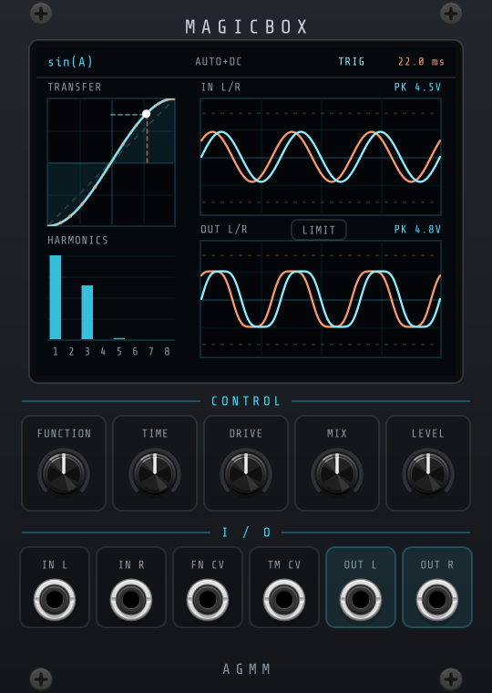

<!--
AGMM AUTOMATIC DOCUMENTATION
Source: MagicBox.cpp
-->

# MagicBox

## 1. Overview

`MagicBox` is an 18 HP waveshaper with a live transfer curve, a harmonic bar display and two oscilloscope traces (input / output). It offers 20 different shaping functions, auto-level, DC blocker, drive, dry/wet and output level. The display shows the current shaping function as a transfer curve with an operating-point trail, eight harmonic bars, and IN/OUT scopes.

Key features:
- 20 shaping functions (A^2, A^3, trig, exp, sinh, tanh, wavefolder, Chebyshev T3/T5, rectifiers, log, bitcrush)
- Auto-level: normalises the input to ±1 before shaping
- DC blocker: removes the DC created by asymmetric functions
- Drive: pre-gain into the shaper
- Dry/wet mix and output level
- Live transfer curve with recent operating points
- 8 harmonic bars (odd/even colour-coded)
- IN/OUT scopes with PK meters and limiter flash

## Module Screenshot

## 2. Architecture

### Main Classes

- `MagicBox`: Core module class inheriting from `rack::Module`
- `MBTimeQ`: Custom ParamQuantity for the log TIME knob
- `MBNorm`: Normalisation table for the 20 shaping functions
- `MBPanelBackground`: Static panel artwork
- `MBDisplayWidget`: Live transfer/harmonics/scopes display

### Inheritance

- `MagicBox` inherits from `rack::Module`
- Both UI widgets inherit from `rack::TransparentWidget`

### Structures

- `mbRaw(float x, int f)`: The 20 shaping functions
- `MBNorm { float off[20]; float gain[20]; }`: Per-function DC offset and gain
- `MBKnob { int param; const char *label; }`

### State (grouped)

| Group | Storage |
|-------|---------|
| Settings | `bool autoLevel`, `bool dcBlock` |
| DSP | `float peak[2]`, `float dcX[2]`, `float dcY[2]` |
| Function crossfade | `int funcCur, funcPrev`, `float xfade` |
| Scope | `float scMin[4][128]`, `scMax[4][128]`, `bool scValid[128]`, `float accMin[4]`, `accMax[4]`, `int capState, capCol`, `float capCount, holdTimer, sweepScale`, `bool trigLow, lastTrig` |
| Display | `float vTime, vDrive, vMix, peakIn, peakOut, limitFlash`, `bool vLConn, vRConn`, `float opN, opY`, `trN[48], trY[48]`, `trHead, trCount, trTimer` |

## 3. DSP Theory

### The 20 shaping functions

Each function takes `x ∈ [−1, 1]` and returns a shaped value. The raw functions are:

| # | Name | Formula |
|---|------|---------|
| 0 | A^2 | $x^2$ (rectifies, octave up) |
| 1 | A^3 | $x^3$ (odd harmonics) |
| 2 | sin(A) | $\sin(\pi x/2)$ (smooth saturation) |
| 3 | cos(A) | $\cos(\pi x)$ (inverted, octave doubling) |
| 4 | tan(A) | $\tan(1.2 x)$ (bright mid boost) |
| 5 | sqrt(A) | $\text{sign}(x)\sqrt{|x|}$ (gritty expansion) |
| 6 | cbrt(A) | $\sqrt[3]{x}$ (mild expansion) |
| 7 | exp(A) | $e^x$ (asymmetric, even harmonics) |
| 8 | sinh(A) | $\sinh(2x)$ (odd expansion) |
| 9 | cosh(A) | $\cosh(2x)$ (rectifying) |
| 10 | tanh(A) | $\tanh(3x)$ (tube saturation) |
| 11 | fold(A) | $\arcsin(\sin(2\pi x)) / (\pi/2)$ (wavefolder) |
| 12 | T3(A) | $4x^3 - 3x$ (Chebyshev 3rd) |
| 13 | T5(A) | $x(16x^4 - 20x^2 + 5)$ (Chebyshev 5th) |
| 14 | \|A\| | $\|x\|$ (full-wave rectifier) |
| 15 | half(A) | $\max(x, 0)$ (half-wave rectifier) |
| 16 | asin(A) | $\arcsin(x) / (\pi/2)$ (expands ends) |
| 17 | atan(A) | $\arctan(4x)$ (soft clipper) |
| 18 | log(A) | $\text{sign}(x)\log(1+8\|x\|)$ (compressor) |
| 19 | crush(A) | $\text{round}(4x)/4$ (bitcrusher, 9 levels) |

### Normalisation

Each function is normalized so that $f(0) = 0$ and $\max_{[-1,1]} |f| = 1$:

$$
\text{shape}(x) = (\text{raw}(x) - \text{off}) \cdot \text{gain}
$$

The offsets and gains are computed once on a 512-point grid (via `MBNorm`).

### Soft clip

Pre-drive soft clip on the shaped input:

$$
\text{softClip}(x) = \begin{cases} x & |x| \le 0.9 \\ \text{sign}(x)(0.9 + 0.1\tanh(10(|x| - 0.9))) & |x| > 0.9 \end{cases}
$$

### Drive

DRIVE is an exponential control from −2 to +2 (i.e., 1/4× .. 4×):

$$
\text{drive} = 2^{\text{knob}}
$$

### Auto-level

If autoLevel is on, the input is divided by a slow peak follower (0.4 s decay):

$$
\text{peak} \leftarrow \max(|\text{in}|, \text{peak} \cdot e^{-\Delta t/0.4})
$$

$$
g = \max(\text{peak}, 0.02)
$$

The 0.02 floor prevents amplifying hiss in silence.

### DC blocker

A standard one-pole high-pass at 8 Hz:

$$
y[n] = x[n] - x[n-1] + R y[n-1], \quad R = 1 - 2\pi \cdot 8/f_s
$$

### Function change crossfade

When the function changes, the output crossfades from `funcPrev` to `funcCur` over 8 ms.

### Output limiter

Transparent below ±8 V, then a soft knee that never exceeds ±10 V:

$$
\text{limit}(x) = \begin{cases} x & |x| \le 8 \\ \text{sign}(x)(8 + 2\tanh(0.5(|x| - 8))) & |x| > 8 \end{cases}
$$

## 4. Parameters and Controls

### Knobs

| Parameter | Min | Max | Default | Description |
|-----------|-----|-----|---------|-------------|
| `FUNC_PARAM` | 0 | 19 | 2 | Function |
| `TIME_PARAM` | 0 | 1 | 0.22 | Scope time (5 ms .. 4 s) |
| `DRIVE_PARAM` | −2 | 2 | 0 | Drive (exponential, 0.25× .. 4×) |
| `MIX_PARAM` | 0 | 1 | 1 | Dry/wet |
| `LEVEL_PARAM` | 0 | 1.5 | 1 | Output level |

### Inputs

| Input | Description |
|-------|-------------|
| `IN_L_INPUT` | Left / mono |
| `IN_R_INPUT` | Right (normalled to left) |
| `FUNC_CV_INPUT` | Function CV (0–10 V sweeps all 20) |
| `TIME_CV_INPUT` | Time CV (0–10 V sweeps full range) |

### Outputs

| Output | Description |
|--------|-------------|
| `OUT_L_OUTPUT` | Left |
| `OUT_R_OUTPUT` | Right |

### Enumerations

- `ParamId`: Func, Time, Drive, Mix, Level
- `InputId`: InL, InR, FuncCV, TimeCV
- `OutputId`: OutL, OutR
- `CapState`: CAP_RUN, CAP_ARMED

### Menu

- Auto level (normalise to input envelope)
- DC blocker (turn off for CV signals)

## 5. Inputs and Outputs

### Inputs

| Name | Type | Range | Description |
|------|------|-------|-------------|
| `IN_L_INPUT` | Audio | ±10 V | Left (mono if R empty) |
| `IN_R_INPUT` | Audio | ±10 V | Right (normalled to L) |
| `FUNC_CV_INPUT` | CV | 0–10 V | Function selection (0..19) |
| `TIME_CV_INPUT` | CV | 0–10 V | Scope time |

### Outputs

| Name | Type | Range | Description |
|------|------|-------|-------------|
| `OUT_L_OUTPUT` | Audio | ±10 V | Left |
| `OUT_R_OUTPUT` | Audio | ±10 V | Right |

### Bypass

`configBypass(IN_L, OUT_L)` and `configBypass(IN_R, OUT_R)`.

## 6. Signal Processing Pipeline

1. **Read controls** — Function + CV, time, drive, mix, level.
2. **Function change** — Detect change; store previous; set xfade = 1.
3. **Read inputs** — Normalize to ±1 (`x = in * 0.2`).
4. **Auto-level** — Update peak follower; compute gain.
5. **Drive** — `xs = softClip(n * drive)`.
6. **Shaping** — `ys = shape(xs, funcCur)` + optional crossfade with `funcPrev`.
7. **DC block** — If enabled.
8. **Wet mix** — `wet = w * g * 5`.
9. **Dry/wet** — `o = (v + (wet - v) * mix) * level`.
10. **Limiter** — `o = limit(o)`; flag if limited.
11. **Write outputs** — Left, right.
12. **Update scope** — Sample per-column min/max.
13. **Update display** — Operating point, harmonic analysis, trail buffer.

## 7. Important Functions

### `mbRaw(float x, int f)`

The 20 shaping functions.

### `mbShape(float x, int f)`

Normalised version of `mbRaw` (DC offset removed, peak-normalised).

### `mbSoftClip(float x)`

Pre-drive soft clip.

### `mbLimit(float x)`

Output limiter.

### `mbSanitize(float v)`

Rejects NaN/Inf, clamps to ±30 V.

### `MagicBox::process(const ProcessArgs &args)`

The main callback described in §6.

### `MBDisplayWidget::updateHarmonics(int func, float drive)`

128-point DFT of the shaped full-scale sine, computed only when the function or drive changes.

## 8. Mathematical Implementation

### Auto-level

$$
\text{peak} \leftarrow \max(|x|, \text{peak} \cdot e^{-\Delta t/0.4})
$$

$$
g = \max(\text{peak}, 0.02)
$$

### Soft clip

$$
\text{softClip}(x) = \text{sign}(x) \cdot \min(|x|, 0.9 + 0.1\tanh(10\max(|x|-0.9, 0)))
$$

### Drive

$$
\text{drive} = 2^{\text{knob}}, \quad \text{knob} \in [-2, 2]
$$

### DC blocker

$$
y[n] = x[n] - x[n-1] + R y[n-1], \quad R = \max(0.9, 1 - 2\pi \cdot 8/f_s)
$$

### Crossfade

$$
w = w_{\text{new}} + (w_{\text{prev}} - w_{\text{new}}) \cdot \text{xfade}
$$

with `xfade` decreasing from 1 to 0 over 8 ms.

### Output limiter

$$
\text{limit}(x) = \text{sign}(x) \cdot \min(|x|, 8 + 2\tanh(0.5\max(|x| - 8, 0)))
$$

## 9. Performance and Optimization

### CPU Usage

- Per sample: 2 channels × (1 exp + 1 shape + 1 dc block + 1 mix + 1 limit) ≈ 40 flops
- Harmonic analysis: 128 × 8 × 2 = 2048 flops, only when function or drive changes
- Scope: ~100 flops/frame
- Total: ~50 flops/sample + ~5 K flops/frame

### Memory Allocation

- All state is fixed-size
- No allocation in `process()`
- `MBNorm` table is a static local (built on first use, reused thereafter)

### Buffers

- `scMin[4][128]`, `scMax[4][128]`: 1024 floats
- `trN[48]`, `trY[48]`: 96 floats
- `hMag[8]`: 8 floats

### Real-time Processing

- All loops bounded
- No allocation, no blocking
- `MBNorm` is built once, thread-safe via magic static

### Thread Safety

- All state written by audio thread, read by UI thread via torn reads
- `MBNorm` is immutable after construction

### Numerical Stability

- `mbSanitize` rejects NaN/Inf
- `softClip` and `limit` are bounded
- `dcBlock` state is preserved across function changes

## 10. Dependencies

### Libraries/Headers

- `plugin.hpp` — VCV Rack core
- `agmm_ui.hpp` — shared AGMM UI helpers
- `<cmath>`, `<cstdio>`, `<cstring>`, `<string>`, `<vector>`, `<algorithm>`, `<memory>`

### External Classes

- `rack::Module`, `rack::TransparentWidget`, `rack::engine::ParamQuantity`
- `agmm::panelBase`, `agmm::bezel`, `agmm::cell`, `agmm::text`, `agmm::screen`, `agmm::plotFrame`, `agmm::sectionHeader`, `agmm::meter`, `agmm::chip`, `agmm::withA`, `agmm::violet`, `agmm::accent`, `agmm::bright`, `agmm::warm`, `agmm::dim`, `agmm::ALIGN_L/C/R`, `agmm::CyanLight`

## 11. Summary

`MagicBox` is a versatile waveshaper with 20 different shaping functions. Unlike most waveshapers, it has a rich live display: the transfer curve shows exactly what the shaper is doing, the operating-point trail shows where the signal currently sits on that curve, and the harmonic bars show the frequency-domain effect. This makes it a great module for learning about waveshaping — you can see the effect of each function in real time.

The auto-level and DC-blocker features are essential: without auto-level, changing the input level would change the amount of distortion; without DC-blocking, asymmetric functions like exp() would add a DC offset that would poison downstream modules. Both are toggleable from the context menu.

The main limitation is CPU: 2 channels × 5 functions × ~10 flops = 100 flops/sample, plus the harmonic analysis (2 K flops when the function changes) and the scope (5 K flops/frame). It's not the heaviest module, but it's not trivial either.
