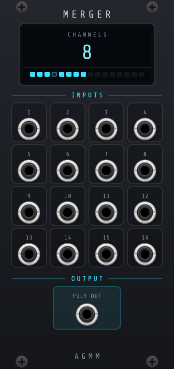

<!--
AGMM AUTOMATIC DOCUMENTATION
Source: Merger.cpp
-->

# Merger

## 1. Overview

`Merger` is a 12 HP utility that merges 16 monophonic inputs into one polyphonic output. Each of the 16 inputs becomes one channel of the poly cable. The output channel count is the **highest connected input**, so patching input 9 gives a 9-channel cable even if inputs 1–8 are empty; the empty ones simply carry 0 V. This keeps the channel numbering stable (input N always = channel N) instead of compacting the cable, which would silently re-pitch downstream modules whenever a cable is added or removed.

Key features:
- 16 monophonic inputs → 1 polyphonic output
- Output channel count = highest connected input
- Stable channel numbering (no compaction)
- 4×4 grid layout for easy patching
- 16-segment display showing which channels are active
- Large channel count readout

## Module Screenshot



## 2. Architecture

### Main Classes

- `Merger`: Core module class inheriting from `rack::Module`
- `MGPanelBackground`: Static panel artwork
- `MGDisplayWidget`: Live channel count + segment bar

### Inheritance

- `Merger` inherits from `rack::Module`
- Both UI widgets inherit from `rack::TransparentWidget`

### State

| Group | Storage |
|-------|---------|
| Display | `int channels`, `bool active[16]` |

That's it — the module is essentially stateless. All the DSP is a single loop in `process()`.

## 3. DSP Theory

### Channel counting

Each sample, the module scans all 16 inputs and records:

1. Which inputs are connected (`active[i]`)
2. The index of the **highest** connected input + 1 (`last`)

The output channel count is `last`. This is the only "signal processing" — the module is a passive router.

### Why not compaction?

A common alternative is to compact the poly cable (skip empty channels). This is wrong for the following reason:

- **Before**: Input 5 connected, output has 5 channels (input 5 = channel 5)
- **After patching input 3**: If compacted, input 3 = channel 1, input 5 = channel 2. Downstream modules would now play the wrong note.

With the "highest connected" rule:
- **Before**: Input 5 = channel 5
- **After patching input 3**: Input 3 = channel 3, input 5 = channel 5. Downstream modules are unaffected.

This is the crucial design decision that makes `Merger` a reliable poly utility.

## 4. Parameters and Controls

### Knobs

None.

### Buttons

None.

### Inputs

| Input | Description |
|-------|-------------|
| `MERGE_INPUT + 0..15` | 16 monophonic inputs |

### Outputs

| Output | Description |
|--------|-------------|
| `POLY_OUTPUT` | Polyphonic output |

### Enumerations

- `ParamId`: (none)
- `InputId`: `ENUMS(MERGE_INPUT, 16)`
- `OutputId`: POLY_OUTPUT
- `LightId`: (none)

## 5. Inputs and Outputs

### Inputs

| Name | Type | Range | Description |
|------|------|-------|-------------|
| `MERGE_INPUT + 0..15` | Audio/CV | ±10 V | 16 monophonic inputs |

### Output

| Name | Type | Range | Description |
|------|------|-------|-------------|
| `POLY_OUTPUT` | Poly | ±10 V | Polyphonic output (1..16 channels) |

### Channel Count

The output channel count is `max(connected input indices) + 1`. So:
- No inputs → 0 channels (silent)
- Only input 1 → 1 channel
- Inputs 1 and 5 → 5 channels (1, 2, 3, 4 carry 0 V)
- All 16 inputs → 16 channels

## 6. Signal Processing Pipeline

The entire pipeline is 3 lines of code:

```cpp
int last = 0;
for (int i = 0; i < 16; ++i) {
    bool c = inputs[MERGE_INPUT + i].isConnected();
    active[i] = c;
    if (c) last = i + 1;
}
channels = last;

outputs[POLY_OUTPUT].setChannels(last);
for (int i = 0; i < last; ++i)
    outputs[POLY_OUTPUT].setVoltage(inputs[MERGE_INPUT + i].getVoltage(), i);
```

1. Scan all 16 inputs, record `active[]`, find `last`.
2. Set the output channel count to `last`.
3. Copy each input's voltage to the matching output channel.

## 7. Important Functions

### `process(const ProcessArgs &args)`

The only non-trivial function. It's a single pass over the 16 inputs.

There are no helper functions — the module is intentionally minimal.

## 8. Mathematical Implementation

This module has no mathematical processing. It's a pure router.

The only "computation" is the max-index-of-connected-inputs:

$$
N_{\text{out}} = 1 + \max_{i \in [0,15]} \{i : \text{input}_i \text{ connected}\}
$$

## 9. Performance and Optimization

### CPU Usage

- 16 `isConnected()` checks per sample (very cheap)
- 16 `getVoltage()` calls + `setVoltage()` calls (cheap)
- Total: ~50 ops/sample

### Memory Allocation

- No allocation ever
- Fixed-size arrays

### Buffers

- `bool active[16]` — 16 bools

### Real-time Processing

- The entire process is O(16), bounded
- No branches that could stall
- No allocation, no blocking

### Thread Safety

- All state written by audio thread, read by UI thread via torn reads
- `channels` is the only shared variable, and it's a single int read

### Numerical Stability

- No numerical operations
- Just copies voltages

## 10. Dependencies

### Libraries/Headers

- `plugin.hpp` — VCV Rack core
- `agmm_ui.hpp` — shared AGMM UI helpers
- `<cmath>`, `<cstdio>`, `<cstring>`, `<algorithm>`, `<memory>`

### External Classes

- `rack::Module`, `rack::TransparentWidget`, `rack::engine::ParamQuantity`
- `agmm::panelBase`, `agmm::bezel`, `agmm::cell`, `agmm::text`, `agmm::screen`, `agmm::sectionHeader`, `agmm::withA`, `agmm::accent`, `agmm::bright`, `agmm::dim`, `agmm::ALIGN_L/C/R`

## 11. Summary

`Merger` is the simplest module in the AGMM collection: 16 mono inputs → 1 poly output, with a channel count rule that preserves channel numbering. It's a utility module — you won't patch it for its sound, you'll patch it to combine mono signals into a poly cable.

The design choice to keep stable channel numbering (rather than compacting) is the module's defining feature. Without it, adding or removing a single cable would re-pitch every downstream voice. With it, you can patch and unpatch freely without worrying about what happens downstream.

The main limitation is that it's a "dumb" merger: no attenuation, no summing, no offset. For those features, chain it with a `Mixer3` or `Mixer6`, or use one of the AGMM CV utilities.
