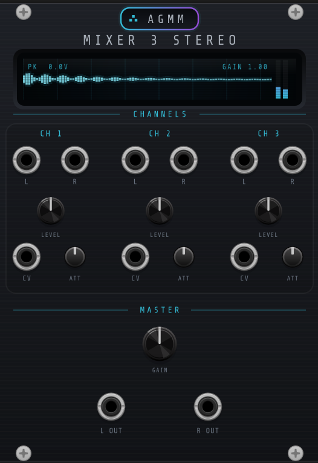

<!--
AGMM AUTOMATIC DOCUMENTATION
Source: Mixer3.cpp
Generated: 2026-11-04 06:23
-->

# Mixer3

## 1. Overview

The `Mixer3` module is a stereo 3-channel audio mixer for VCV Rack. It accepts three stereo input channels (L/R) and provides a single stereo output (L/R). Each channel has independent level control, CV-controlled attenuation, and a master gain stage. The module also includes a visual display showing the signal scope and peak meters.

## Module Screenshot

## 2. Architecture

### Main Classes
- `Mixer3`: Core module class inheriting from `rack::Module`
- `M3PanelBackground`: Custom widget for panel rendering
- `M3DisplayWidget`: Custom widget for scope and meter display
- `Mixer3Widget`: Module widget class inheriting from `rack::ModuleWidget`

### Inheritance
- `Mixer3` inherits from `rack::Module`
- `M3PanelBackground` and `M3DisplayWidget` inherit from `rack::TransparentWidget`
- `Mixer3Widget` inherits from `rack::ModuleWidget`

### Structures
- `CVRange`: Enumeration with two values:
  - `BIPOLAR_M5_5`: -5V to +5V range for CV scaling
  - `UNIPOLAR_0_10`: 0V to +10V range for CV scaling

### Relationships
- `Mixer3Widget` contains and manages `M3PanelBackground` and `M3DisplayWidget`
- All widgets are linked to the `Mixer3` module instance
- Parameters, inputs, and outputs are configured through `Mixer3::config()` methods

### Module Organization
The module is organized into:
1. Parameter definitions (knobs, attenuverters)
2. Input definitions (audio L/R, CV)
3. Output definitions (stereo mix)
4. Processing logic in `process()` method
5. Display tracking and visualization components

## 3. DSP Theory

### Mathematical Equations

The core mixing operation is:
$$
\text{mix}_L = \sum_{i=1}^{3} (\text{in}_{L,i} \times \text{gain}_i)
$$
$$
\text{mix}_R = \sum_{i=1}^{3} (\text{in}_{R,i} \times \text{gain}_i)
$$

Where:
- $\text{in}_{L,i}$ and $\text{in}_{R,i}$ are the left and right input voltages for channel $i$
- $\text{gain}_i = \text{levelKnob}_i + (\text{CV}_i \times \text{attenuverter}_i)$

The final output is:
$$
\text{out}_L = \text{mix}_L \times \text{masterGain}
$$
$$
\text{out}_R = \text{mix}_R \times \text{masterGain}
$$

### Algorithms
- **Level Control**: Linear gain control with CV modulation via attenuverter
- **CV Scaling**: Two modes:
  - Unipolar (0V to +10V): $ \text{scaledCV} = \frac{\text{cv}}{10} $
  - Bipolar (-5V to +5V): $ \text{scaledCV} = \frac{\text{cv}}{5} $
- **Peak Detection**: Exponential decay smoothing with time constant based on sample rate
- **Scope Display**: Moving average of signal range over time

### Filters
None explicitly implemented.

### Oscillators
None explicitly implemented.

### Delay Lines
None explicitly implemented.

### Feedback Systems
None explicitly implemented.

### Modulation
- CV inputs modulate channel gain via attenuverter control
- Attenuverter allows both positive and negative modulation (±1.0 range)
- Gain is clamped between 0 and 1

### Random Processes
None explicitly implemented.

## 4. Parameters and Controls

### Knobs
- **Channel 1 Level**: 0.0 to 1.0, default 0.0
- **Channel 2 Level**: 0.0 to 1.0, default 0.0
- **Channel 3 Level**: 0.0 to 1.0, default 0.0
- **Master Gain**: 0.0 to 2.0, default 1.0

### Switches
None explicitly defined.

### Buttons
None explicitly defined.

### CV Inputs
- **Channel 1 CV**: Modulates channel gain (0V to +10V or -5V to +5V depending on mode)
- **Channel 2 CV**: Modulates channel gain (0V to +10V or -5V to +5V depending on mode)
- **Channel 3 CV**: Modulates channel gain (0V to +10V or -5V to +5V depending on mode)

### Gates
None explicitly defined.

### Enumerations
- `CVRange`: 
  - `BIPOLAR_M5_5` (-5V to +5V)
  - `UNIPOLAR_0_10` (0V to +10V, default)

### Parameter Ranges
- Level knobs: [0.0, 1.0]
- Attenuverters: [-1.0, 1.0]
- Master gain: [0.0, 2.0]

### Default Values
- All level knobs: 0.0
- All attenuverters: 0.0
- Master gain: 1.0
- CV range mode: `UNIPOLAR_0_10`

## 5. Inputs and Outputs

### Inputs
- **Channel 1 L**: Audio input (left channel)
- **Channel 1 R**: Audio input (right channel)
- **Channel 2 L**: Audio input (left channel)
- **Channel 2 R**: Audio input (right channel)
- **Channel 3 L**: Audio input (left channel)
- **Channel 3 R**: Audio input (right channel)
- **Channel 1 CV**: Control voltage for level modulation
- **Channel 2 CV**: Control voltage for level modulation
- **Channel 3 CV**: Control voltage for level modulation

### Outputs
- **Output L**: Mixed left channel output
- **Output R**: Mixed right channel output

### Voltage Ranges
- Audio inputs/outputs: ±10V (standard VCV Rack audio range)
- CV inputs: 0V to +10V or -5V to +5V depending on `cvRangeMode` setting
- Gain values: [0.0, 1.0] for channel levels after modulation

## 6. Signal Processing Pipeline

1. **Input Reading**: Read all 9 input signals (3 stereo channels × 2 inputs each + 3 CV inputs)
2. **CV Scaling**: Apply scaling based on `cvRangeMode` setting
3. **Gain Calculation**: 
   - Calculate base gain from level knob
   - Add CV modulation scaled by attenuverter
   - Clamp gain to [0.0, 1.0]
4. **Mixing**: Multiply each channel's audio input by its calculated gain and sum across channels
5. **Master Gain**: Apply master gain stage to final mix
6. **Output**: Set output voltages
7. **Display Tracking**: Update peak meters and scope data

## 7. Important Functions

### `scaleCV(float v) const`
- Scales CV input voltage based on current `cvRangeMode`
- Returns scaled value in range [-1.0, 1.0] for bipolar or [0.0, 1.0] for unipolar

### `process(const ProcessArgs &args) override`
- Main DSP processing function called each sample
- Implements the mixing algorithm with CV modulation
- Updates display tracking data (peak detection, scope)

### `dataToJson() override` / `dataFromJson(json_t* root) override`
- Serialize/deserialize module state including `cvRangeMode`

## 8. Mathematical Implementation

### Gain Calculation
$$
\text{gain}_i = \max(0.0, \min(1.0, \text{levelKnob}_i + (\text{CV}_i \times \text{attenuverter}_i)))
$$

### Peak Detection
$$
\text{peak}_{L/R} = \max(|\text{output}_{L/R}|, \text{peak}_{L/R} \times \text{decay})
$$
Where decay factor is:
$$
\text{decay} = 1.0 - 4.0 \times \text{sampleTime}
$$

### Scope Tracking
- Maintains a circular buffer of 96 samples
- Each sample bucket covers approximately 2.5ms
- Updates min/max range for each bucket

## 9. Performance and Optimization

### CPU Usage Considerations
- Simple arithmetic operations (addition, multiplication, clamping)
- Minimal conditional logic
- Fixed-size processing loop (3 channels)

### Memory Allocation
- Stack-based arrays: `scopeMin`, `scopeMax` (96 elements each)
- No dynamic allocation in main processing path

### Buffers
- Circular buffer for scope display (96 elements)
- Peak detection variables (`peakL`, `peakR`)

### Real-time Processing
- All operations performed in real-time within `process()` method
- No blocking or time-consuming operations

### Thread Safety
- Module state is accessed only from the main audio thread
- No inter-thread synchronization required

### Numerical Stability
- Clamping ensures gain values stay within [0.0, 1.0]
- Exponential decay for peak detection prevents runaway values
- Floating-point arithmetic used throughout

## 10. Dependencies

### Libraries/Headers
- `rack.hpp`: VCV Rack core library
- `<cmath>`: Standard math functions (std::max, std::min, std::fabs)
- `<cstdio>`: Standard I/O (unused in this file)
- `<cstring>`: String operations (unused in this file)
- `<algorithm>`: Standard algorithms (std::max, std::min)
- `<memory>`: std::shared_ptr
- `<string>`: std::string

### Classes/Types
- `rack::Module`: Base module class
- `rack::ModuleWidget`: Module widget base class
- `rack::TransparentWidget`: Widget for transparent drawing
- `rack::Param`: Parameter interface
- `rack::Input`: Input port interface
- `rack::Output`: Output port interface
- `rack::json_t`: JSON data structure (from VCV Rack)

## 11. Summary

The `Mixer3` module is a stereo 3-channel audio mixer with CV-controlled gain stages and master output control. It implements linear mixing with per-channel level knobs, CV inputs with attenuverters, and a master gain stage. The module supports two CV scaling modes (unipolar 0-10V or bipolar -5 to +5V) and includes visual feedback through peak meters and a signal scope display. The implementation is straightforward with no complex DSP algorithms, focusing on efficient real-time processing and clean audio routing.