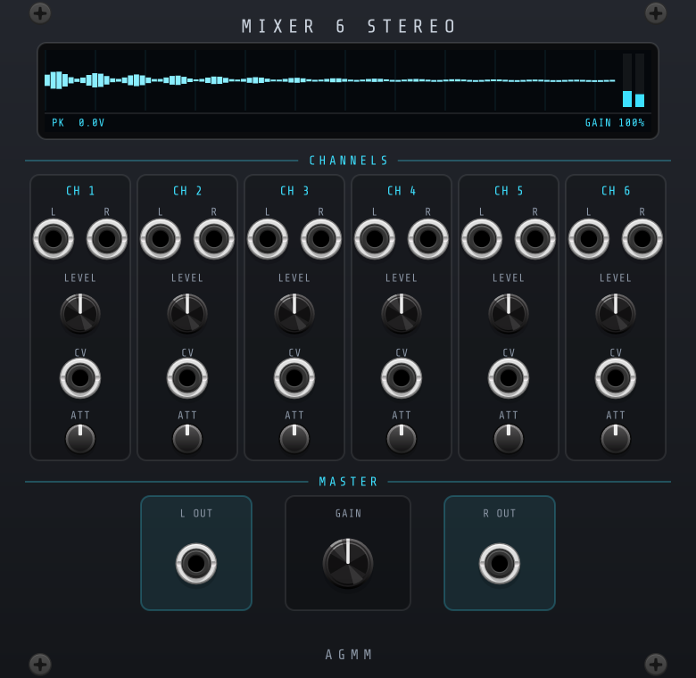

<!--
AGMM AUTOMATIC DOCUMENTATION
Source: Mixer6.cpp
-->

# Mixer6

## 1. Overview

`Mixer6` is a 26 HP six-channel version of `Mixer3`. It has the same structure (per-channel L/R inputs, level knob + CV/attenuverter, master gain), but with 6 channels laid out in narrower stacked plates for a taller panel. The extra channels and compact layout make it the "full-size" stereo mixer of the AGMM collection.

Key features:
- 6 stereo channels (L/R inputs per channel)
- Per-channel level knob + CV with bipolar attenuverter
- Master gain
- Scope of the mono mix + L/R meters
- Selectable CV range (bipolar/unipolar) via menu, persisted

## Module Screenshot

## 2. Architecture

### Main Classes

- `Mixer6`: Core module class inheriting from `rack::Module`
- `MxPanelBackground`: Static panel artwork
- `MxDisplayWidget`: Live scope + meters + readouts

### Inheritance

- `Mixer6` inherits from `rack::Module`
- Both UI widgets inherit from `rack::TransparentWidget`

### State (grouped)

| Group | Storage |
|-------|---------|
| CV mode | `CVRange cvRangeMode` |
| Display | `float scopeMin[96]`, `scopeMax[96]`, `scopeHead`, `scopeCount`, `scopeBMin`, `scopeBMax`, `peakL`, `peakR` |

## 3. DSP Theory

### Per-channel gain

Identical to `Mixer3`:

$$
g_c = \text{clamp}(\text{LEVEL}_c + \text{atten}_c \cdot \text{scaleCV}(\text{CV}_c), 0, 1)
$$

### Summing

$$
\text{mixL} = \sum_{c=1}^{6} \text{inL}_c \cdot g_c, \quad \text{mixR} = \sum_{c=1}^{6} \text{inR}_c \cdot g_c
$$

### Master gain

$$
\text{outL} = \text{mixL} \cdot g_{\text{master}}, \quad \text{outR} = \text{mixR} \cdot g_{\text{master}}
$$

The only difference from `Mixer3` is the number of channels (6 vs 3).

## 4. Parameters and Controls

### Knobs

| Parameter | Min | Max | Default | Description |
|-----------|-----|-----|---------|-------------|
| `PARAM_CH1_LEVEL` .. `PARAM_CH6_LEVEL` | 0 | 1 | 0 | Channel levels |
| `PARAM_CH1_ATTV` .. `PARAM_CH6_ATTV` | −1 | 1 | 0 | Channel CV attenuverters |
| `PARAM_MASTER_GAIN` | 0 | 2 | 1 | Master gain |

### Inputs

| Input | Description |
|-------|-------------|
| `INPUT_CH1_L` .. `INPUT_CH6_L` | 6 L audio inputs |
| `INPUT_CH1_R` .. `INPUT_CH6_R` | 6 R audio inputs |
| `INPUT_CH1_CV` .. `INPUT_CH6_CV` | 6 level CV inputs |

### Outputs

| Output | Description |
|--------|-------------|
| `OUTPUT_L` | Mix L |
| `OUTPUT_R` | Mix R |

### Enumerations

- `CVRange`: BIPOLAR_M5_5, UNIPOLAR_0_10
- `ParamId`: CH1Level..CH6Level, CH1Attv..CH6Attv, MasterGain
- `InputId`: CH1L..CH6L, CH1R..CH6R, CH1CV..CH6CV
- `OutputId`: OutputL, OutputR

## 5. Inputs and Outputs

### Inputs

| Name | Type | Range | Description |
|------|------|-------|-------------|
| `INPUT_CH1_L` .. `INPUT_CH6_L` | Audio | ±10 V | 6 L inputs |
| `INPUT_CH1_R` .. `INPUT_CH6_R` | Audio | ±10 V | 6 R inputs |
| `INPUT_CH1_CV` .. `INPUT_CH6_CV` | CV | ±10 V | 6 level CVs |

### Outputs

| Name | Type | Range | Description |
|------|------|-------|-------------|
| `OUTPUT_L` | Audio | ±10 V | Mix L |
| `OUTPUT_R` | Audio | ±10 V | Mix R |

### Menu

- CV range: bipolar (−5..+5) or unipolar (0..+10)

## 6. Signal Processing Pipeline

Identical to `Mixer3` but with 6 channels:

1. Read CV mode.
2. For each of 6 channels:
   - Compute gain.
   - Read L/R inputs.
   - Add to mix.
3. Multiply by master gain.
4. Write outputs.
5. Update display.

## 7. Important Functions

### `scaleCV(float v)`

Same as `Mixer3`.

### `process(const ProcessArgs &args)`

Loop over 6 channels instead of 3.

## 8. Mathematical Implementation

### Per-channel gain

$$
g_c = \text{clamp}(\text{LEVEL}_c + \text{atten}_c \cdot \text{scaleCV}(\text{CV}_c), 0, 1)
$$

### Summing (6 channels)

$$
\text{mixL} = \sum_{c=1}^{6} \text{inL}_c \cdot g_c, \quad \text{mixR} = \sum_{c=1}^{6} \text{inR}_c \cdot g_c
$$

### Master output

$$
\text{outL} = \text{mixL} \cdot g_{\text{master}}, \quad \text{outR} = \text{mixR} \cdot g_{\text{master}}
$$

### Peak followers

$$
\text{peakL} \leftarrow \max(|\text{outL}|, \text{peakL} \cdot (1 - 4\Delta t))
$$

## 9. Performance and Optimization

### CPU Usage

- 6 channels × (2 reads + 2 multiplies + 1 add) ≈ 60 flops
- 1 master multiply
- Peak + scope ≈ 10 flops
- Total: ~80 flops/sample

### Memory Allocation

- No allocation in `process()`
- `scopeMin[96]`, `scopeMax[96]` fixed-size

### Buffers

- `scopeMin[96]`, `scopeMax[96]`: 192 floats

### Real-time Processing

- Loop bounded by 6
- No allocation, no blocking

### Thread Safety

- All state written by audio thread, read by UI thread via torn reads

### Numerical Stability

- Gain clamped to `[0, 1]`
- Master gain `[0, 2]`
- No feedback, no accumulation issues

## 10. Dependencies

### Libraries/Headers

- `plugin.hpp` — VCV Rack core
- `agmm_ui.hpp` — shared AGMM UI helpers
- `<cmath>`, `<cstdio>`, `<cstring>`, `<algorithm>`, `<memory>`, `<string>`

### External Classes

- `rack::Module`, `rack::TransparentWidget`, `rack::engine::ParamQuantity`
- `agmm::panelBase`, `agmm::bezel`, `agmm::plate`, `agmm::cell`, `agmm::text`, `agmm::screen`, `agmm::plotFrame`, `agmm::sectionHeader`, `agmm::meter`, `agmm::withA`, `agmm::violet`, `agmm::accent`, `agmm::bright`, `agmm::warm`, `agmm::dim`, `agmm::ALIGN_L/C/R`

## 11. Summary

`Mixer6` is `Mixer3` with 6 channels instead of 3. It uses a narrower per-channel plate (56 px wide vs 80 px) to fit 6 channels into a 26 HP panel, with the CV jack and attenuverter stacked vertically instead of side-by-side.

The design trade-off is: more channels, but less space per channel. For a small patch, `Mixer3` is more comfortable; for a large patch, `Mixer6` is essential. Both have the same feature set (level knob + CV/atten, master gain, CV range selection).

The main limitation (shared with `Mixer3`) is that the mixer is stereo-only: no pan, no mono, no sends. For a simple submix, this is fine; for a full mixing console, look elsewhere.
