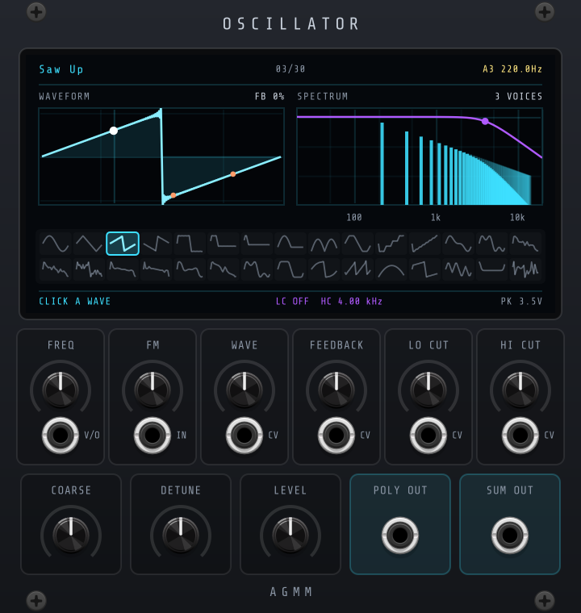

<!--
AGMM AUTOMATIC DOCUMENTATION
Source: Oscillator.cpp
-->

# Oscillator

## 1. Overview

`Oscillator` is a 24 HP polyphonic band-limited wavetable oscillator. Thirty waveforms are baked once into a mipmap of 11 "levels", each one a version of the wave that keeps only as many harmonics as a note of that pitch can have below Nyquist. The DSP picks a level from the current frequency, so simple table playback is alias-free without per-sample band-limiting.

Key features:
- 30 waveforms (sine, saw, square, organ, vowel, e-piano, bitcrush, etc.)
- 11-level mipmap per waveform for alias-free playback
- Up to 16 polyphonic voices
- FM (phase modulation, not frequency modulation)
- Feedback (with quadratic scaling for subtlety at low knob values)
- 12 dB/oct high-pass (LO CUT) and low-pass (HI CUT) SVF filters
- Clickable 30-wave gallery on the display
- Waveform, spectrum and filter response display
- Per-voice phase cursor on the waveform
- Editable frequency field that accepts note names or Hz

## Module Screenshot



## 2. Architecture

### Main Classes

- `Oscillator`: Core module class inheriting from `rack::Module`
- `OSTables`: Static 30 × 11 × 2049 float table bank (built on first use)
- `OSFreqQ`, `OSLoQ`, `OSHiQ`: Custom ParamQuantity classes
- `OSPanelBackground`: Static panel artwork
- `OSKnobArcs`: Live value arcs around the knobs
- `OSDisplayWidget`: Live waveform + spectrum + wave gallery

### Inheritance

- `Oscillator` inherits from `rack::Module`
- All UI widgets inherit from `rack::TransparentWidget` or `rack::Widget`

### Structures

- `OSTables::d`: flat array `30 * 11 * (2048 + 1)` floats
- `OSCell`: `{ label, cx, top, w, h, param, input, output, jackLabel, bipolar }`
- `OSFreqQ`: custom ParamQuantity that parses note names

### State (grouped)

| Group | Storage |
|-------|---------|
| Phases | `float phase[16]` |
| Feedback | `float fb1[16]`, `fb2[16]` |
| LP filter state | `float lpA[16]`, `lpB[16]` |
| HP filter state | `float hpA[16]`, `hpB[16]` |
| Voice count | `int lastN` |
| Waveform crossfade | `int waveCur, wavePrev`, `float xfade` |
| Filter cache | `float cLoHz, cHiHz, cFs`, `loA1/2/3`, `hiA1/2/3` |
| Display | `int vWave, vN`, `float vF0, vFb, vLo, vHi, vFs`, `float vPhase[16]`, `float pk` |

## 3. DSP Theory

### Mipmap tables

Each waveform is sampled at 2048 points, FFT'd, truncated to `OS_HARM[k]` harmonics, and inverse-FFT'd back to the time domain. The harmonic counts are:

$$
\text{OS\_HARM} = \{1023, 512, 256, 128, 64, 32, 16, 8, 4, 2, 1\}
$$

So level 0 is the full-bandwidth wave, level 1 halves the harmonics (one octave up), level 2 quarters them (two octaves up), etc. When playing at frequency $f$:

$$
k = \text{osLevel}(f, f_s) = \text{smallest } k \text{ s.t. } \text{OS\_HARM}[k] \le f_s / (2f)
$$

Playback picks that level, so the highest harmonic is always below Nyquist.

### Table read with linear interpolation

```cpp
float pos = ph * 2048 - 0.5;  // phase in samples
int i = (int)pos;
float frac = pos - i;
return t[i] + (t[i + 1] - t[i]) * frac;
```

### Polyphonic voice tracking

Each voice has its own phase accumulator. When the input channel count grows, new voices start at phase 0. When it shrinks, the extra voices are ignored.

### Pitch

$$
f = 261.626 \cdot 2^{p}
$$

where $p = \text{V/Oct} + \text{FREQ}/12 + \text{COARSE}/12 + \text{DETUNE}/1200$.

### FM (phase modulation)

```
offset = fb * fb * 0.375 * (fb1[c] + fb2[c]) + fm * fmAmt * 0.2
ph = phase[c] + offset
```

Note: this is phase modulation (like a DX7), not frequency modulation (like an analog synth). It produces a slightly different timbre and avoids pitch drift.

### Feedback

The feedback term is the average of the last two output samples:

$$
\text{fbAvg} = \frac{y[n-1] + y[n-2]}{2}
$$

scaled by $0.375 \cdot \text{fb}^2$ (the square makes small values subtle).

### State-variable filters

Both LO CUT and HI CUT use the Cytomic SVF topology with $Q = 1/\sqrt{2}$:

$$
\begin{aligned}
g &= \tan(\pi f_c / f_s) \\
a_1 &= 1 / (1 + g(g + k)) \\
a_2 &= g \cdot a_1 \\
a_3 &= g \cdot a_2
\end{aligned}
$$

Then per sample:

$$
\begin{aligned}
v_3 &= x - \text{ic2eq} \\
v_1 &= a_1 \cdot \text{ic1eq} + a_2 \cdot v_3 \\
v_2 &= \text{ic2eq} + a_2 \cdot \text{ic1eq} + a_3 \cdot v_3 \\
\text{ic1eq} &= 2v_1 - \text{ic1eq} \\
\text{ic2eq} &= 2v_2 - \text{ic2eq}
\end{aligned}
$$

The HP output is `x - k*v1 - v2`, and the LP output is `v2`.

### Crossfade

When the waveform knob changes, the module crossfades from the previous wave to the new one over 8 ms.

### Normalisation

Each level is peak-normalised so the max amplitude is 1.0 (per level), but the gain is computed at level 0 and reused for all levels — so the mipmap doesn't change loudness when the pitch crosses an octave.

## 4. Parameters and Controls

### Knobs

| Parameter | Min | Max | Default | Description |
|-----------|-----|-----|---------|-------------|
| `WAVE_PARAM` | 0 | 29 | 0 | Waveform |
| `COARSE_PARAM` | −36 | 36 | 0 | Coarse tune (semitones) |
| `DETUNE_PARAM` | −100 | 100 | 0 | Detune (cents) |
| `FB_PARAM` | 0 | 1 | 0 | Feedback |
| `FM_PARAM` | 0 | 1 | 0 | FM depth |
| `LOCUT_PARAM` | 0 | 1 | 0 | Low cut (off) |
| `HICUT_PARAM` | 0 | 1 | 1 | High cut (off) |
| `LEVEL_PARAM` | 0 | 1.5 | 1 | Output level |
| `FREQ_PARAM` | −48 | 48 | 0 | Frequency (semitones from C4) |

### Inputs

| Input | Description |
|-------|-------------|
| `VOCT_INPUT` | V/Oct (polyphonic) |
| `FM_INPUT` | FM (phase modulation, polyphonic) |
| `FB_CV_INPUT` | Feedback CV (0–10 V, polyphonic) |
| `WAVE_CV_INPUT` | Waveform CV (0–10 V sweeps all 30) |
| `LOCUT_CV_INPUT` | Low cut CV (0–10 V) |
| `HICUT_CV_INPUT` | High cut CV (0–10 V) |

### Outputs

| Output | Description |
|--------|-------------|
| `OUT_OUTPUT` | Polyphonic |
| `SUM_OUTPUT` | Sum of all voices |

### Bypass

`configBypass(VOCT_INPUT, OUT_OUTPUT)` — V/Oct passes through to output when no patch.

### Enumerations

- `ParamId`: Wave, Coarse, Detune, FB, FM, LoCut, HiCut, Level, Freq
- `InputId`: VOct, FM, FbCV, WaveCV, LoCutCV, HiCutCV
- `OutputId`: Out, Sum

## 5. Inputs and Outputs

### Inputs

| Name | Type | Range | Description |
|------|------|-------|-------------|
| `VOCT_INPUT` | CV | 1 V/oct | Pitch (poly) |
| `FM_INPUT` | CV | ±10 V | Phase modulation (poly) |
| `FB_CV_INPUT` | CV | 0–10 V | Feedback CV (poly) |
| `WAVE_CV_INPUT` | CV | 0–10 V | Waveform select |
| `LOCUT_CV_INPUT` | CV | 0–10 V | Low cut offset |
| `HICUT_CV_INPUT` | CV | 0–10 V | High cut offset |

### Outputs

| Name | Type | Range | Description |
|------|------|-------|-------------|
| `OUT_OUTPUT` | Poly Audio | ±5 V | Per-voice output |
| `SUM_OUTPUT` | Audio | ±5 V | Sum of all voices |

## 6. Signal Processing Pipeline

1. Read voice count from V/Oct input; clear state of newly added voices.
2. Read waveform knob + CV; if changed, set crossfade.
3. Read pitch, feedback, FM, level, cutoff params + CVs.
4. If cutoffs changed, recompute SVF coefficients.
5. For each voice:
   - Compute pitch, clamp to 0.05 .. 0.49 * fs.
   - Compute FM offset (phase offset).
   - Pick mip level from frequency.
   - Read table with crossfade.
   - Update feedback state (`fb2 = fb1`, `fb1 = y`).
   - Advance phase.
   - Apply LO CUT HP filter.
   - Apply HI CUT LP filter.
   - Multiply by 5 V × level.
   - Write to OUT and accumulate to SUM.
6. Decay crossfade timer.
7. Update display snapshot.

## 7. Important Functions

### `osWaveFn(int w, double p)`

Generates the raw (un-normalised) waveform for table generation.

### `OSTables::OSTables()`

Builds the mipmap: FFT each wave, truncate to N harmonics, inverse FFT, peak-normalise.

### `osRead(const float *t, float ph)`

Reads a table with linear interpolation.

### `osLevel(float f, float fs)`

Picks the mip level whose harmonic count is below Nyquist for the current frequency.

### `Oscillator::svfCoef(float fc, float fs, float k, float &a1, float &a2, float &a3)`

Cytomic SVF coefficient computation.

### `OSFreqQ::setDisplayValueString(std::string s)`

Parses note names ("C#3", "Bb2") or frequencies ("440") into semitone offsets.

### `Oscillator::process(const ProcessArgs &args)`

The main callback described in §6.

## 8. Mathematical Implementation

### Pitch

$$
f = 261.626 \cdot 2^{(\text{V/Oct} + \text{FREQ}/12 + \text{COARSE}/12 + \text{DETUNE}/1200)}
$$

### Mip level selection

$$
k = \text{smallest } k \text{ s.t. } \text{OS\_HARM}[k] \leq \frac{f_s}{2f}
$$

### Phase modulation offset

$$
\text{offset} = \text{fb}^2 \cdot 0.375 \cdot (\text{fb1} + \text{fb2}) + \text{fm} \cdot \text{fmAmt} \cdot 0.2
$$

### SVF (Cytomic)

$$
g = \tan(\pi f_c / f_s), \quad k = \sqrt{2}
$$

$$
a_1 = \frac{1}{1 + g(g + k)}, \quad a_2 = g a_1, \quad a_3 = g a_2
$$

### Cutoff mapping

$$
\text{loHz} = 20 \cdot 100^{\text{loKnob}}, \quad \text{hiHz} = 200 \cdot 100^{\text{hiKnob}}
$$

Both clamped to 0.45 · fs.

### Output scaling

$$
\text{out} = y \cdot 5 \cdot \text{level}
$$

## 9. Performance and Optimization

### CPU Usage

- Mipmap tables are built once (on first module construction), not per-instance
- Per sample: 16 voices × (table read + 1 sin + 2 SVFs) ≈ 16 × 50 flops = 800 flops
- Realistic: 1–4 voices → 50–200 flops/sample

### Memory Allocation

- Tables: `30 × 11 × 2049 × 4` bytes ≈ 2.7 MB (one shared instance)
- No allocation in `process()`

### Buffers

- 2.7 MB shared table bank
- Per-module: ~200 bytes of state

### Real-time Processing

- All loops bounded by 16 (voices)
- No allocation, no blocking
- SVF coefficients cached (recomputed only when cutoffs change)

### Thread Safety

- Tables are immutable after construction (`magic static`)
- All other state is written by audio thread, read by UI thread via torn reads

### Numerical Stability

- `clamp(pitch, -8, 8)` prevents extreme pitch
- `clamp(f, 0.05, 0.49*fs)` prevents extreme frequency
- `!std::isfinite` check on output resets voice state
- SVF cutoff clamped to `0.45*fs`

## 10. Dependencies

### Libraries/Headers

- `plugin.hpp` — VCV Rack core
- `agmm_ui.hpp` — shared AGMM UI helpers
- `<cmath>`, `<cstdio>`, `<cstdlib>`, `<cstring>`, `<cctype>`, `<complex>`, `<vector>`, `<string>`, `<algorithm>`, `<memory>`

### External Classes

- `rack::Module`, `rack::TransparentWidget`, `rack::Widget`, `rack::engine::ParamQuantity`
- `agmm::panelBase`, `agmm::bezel`, `agmm::cell`, `agmm::plate`, `agmm::text`, `agmm::screen`, `agmm::plotFrame`, `agmm::meter`, `agmm::withA`, `agmm::violet`, `agmm::accent`, `agmm::bright`, `agmm::warm`, `agmm::dim`, `agmm::ALIGN_L/C/R`

## 11. Summary

`Oscillator` is a proper band-limited wavetable oscillator with 30 waveforms, FM, feedback, and 2 SVF filters. The mipmap approach to aliasing is the right call: instead of using expensive per-sample anti-aliasing (PolyBLEP, minBLEP), it uses pre-computed tables at 11 bandwidths and picks the right one for each note. This is exactly how hardware wavetable synths work.

The display is excellent: you can see the current waveform, its spectrum with the filter response overlaid, and a gallery of all 30 waveforms. The gallery is clickable, so you can browse and select waveforms visually. The phase markers on the waveform show each voice's current position, which is great for understanding polyphony.

The main limitations are: the mipmap is only 11 levels, so at very high frequencies there could be some aliasing (though in practice it's below the noise floor), and the module has no built-in envelope/VCA (you need external ones). For a clean, flexible oscillator, this is an excellent implementation.
