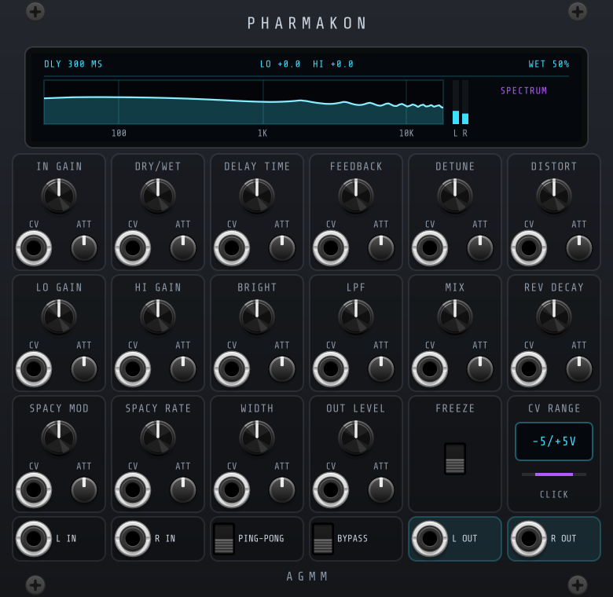

<!--
AGMM AUTOMATIC DOCUMENTATION
Source: Pharmakon.cpp
-->

# Pharmakon

## 1. Overview

`Pharmakon` is a 26 HP stereo multi-FX module combining a modulated stereo delay (with ping-pong option and detune/chorus tap), a small Schroeder reverb, a distortion stage, a two-band shelving EQ, an output low-pass with "spacy" LFO modulation, and an M/S stereo width control. Each of its 16 main parameters has a dedicated CV input and attenuverter, and the display can show the output waveform, a bar spectrum, or a continuous spectrum curve.

Key features:
- Modulated stereo delay (ping-pong, detune/chorus tap)
- Schroeder reverb (4 combs + 2 all-passes per side)
- Distortion (tanh soft clip with drive)
- Two-band shelving EQ (low/high shelf)
- "Spacy" LFO-modulated LPF
- M/S stereo width
- Freeze (latch + gate)
- Bypass (click-free)
- 16 main parameters with CV and attenuverters
- 3 display modes (WAVE, BARS, SPECTRUM)
- Pre/post EQ (context menu)
- Output soft limiter

## Module Screenshot



## 2. Architecture

### Main Classes

- `Pharmakon`: Core module class inheriting from `rack::Module`
- `PHDelay`: Interpolated delay line
- `PHOnePole`: One-pole LP filter
- `PHBiquad`: RBJ shelving biquad
- `PHReverb`: 4-comb + 2-all-pass Schroeder reverb
- `PHFFT`: 1024-point FFT analyzer (UI only)
- `PHPanelBackground`: Static panel artwork
- `PHDisplayWidget`: Live display (3 modes)
- `PHCvRangeWidget`: Clickable CV range toggle
- `PHChoiceItem`: Generic checkmark menu item

### Inheritance

- `Pharmakon` inherits from `rack::Module`
- All UI widgets inherit from `rack::TransparentWidget`

### Structures

- `PHCtlSpec`: `{ name, label, lo, hi, def, unit, dispBase, dispMul }`
- `PH_CTL[16]`: table of the 16 controls

### State (grouped)

| Group | Storage |
|-------|---------|
| Delay | `PHDelay delayL, delayR` |
| Damping | `PHOnePole brightL, brightR` |
| Output LPF | `PHOnePole outLpfL, outLpfR` |
| Reverb | `PHReverb reverb` |
| EQ | `PHBiquad loL, loR, hiL, hiR` |
| Sample rate | `float dspSr`, `bool needSnap` |
| LFOs | `float lfoPhase`, `spacyPhase` |
| DC block | `float dcR, dcXL, dcYL, dcXR, dcYR` |
| Smoothing | `float kSmooth, kDelay` |
| Smoothed params | `float sIn, sWet, sDelay, sLo, sHi, sWidth, sOut, sDist, sBypass, sFreeze, sPing` |
| Display | `float scopeMin[160]`, `scopeMax[160]`, `scopeHead`, `scopeCount`, `scopeBMin`, `scopeBMax`, `peakL`, `peakR`, `fftRing[4096]`, `fftHead`, `dispDelay`, `dispWet`, `dispLo`, `dispHi`, `dispBypass`, `dispFreeze`, `clipTimer` |
| Settings | `CVRange cvRangeMode`, `int visMode`, `bool eqPost`, `bool softClip`, `float loFreq, hiFreq` |

## 3. DSP Theory

### The signal flow

```
in → input gain → DC block → distortion → delay → reverb → M/S width → EQ → LPF → mix → out gain → post EQ? → bypass → limiter → out
```

### Modulated delay

Each channel has its own delay line with smoothed time:

$$
\text{dOut} = \text{delay}.\text{read}(sDelay)
$$

Detune adds a chorus tap:

$$
\text{tapTime} = sDelay + \text{detune\_ms} \cdot \sin(2\pi \text{lfoPhase}) \cdot 0.001
$$

$$
\text{dly} = 0.5 \cdot (\text{dOut} + \text{delay}.\text{read}(\text{tapTime}))
$$

### Feedback with ping-pong

Normal stereo feedback:

$$
\text{writeL} = \text{in} + \text{delayL}.\text{read}(sDelay) \cdot fb
$$

Ping-pong:

$$
\text{writeL} = \text{mono} + \text{delayR}.\text{read}(sDelay) \cdot fb, \quad \text{writeR} = \text{delayL}.\text{read}(sDelay) \cdot fb
$$

The actual write is crossfaded between the two by `sPing`.

### Schroeder reverb

4 parallel combs + 2 series all-passes per channel:

$$
\begin{aligned}
\text{wetL} &= \sum_{i=0}^3 \text{comb}_i(\text{dlyL}) \\
\text{wetL} &= \text{allpass}_0(\text{wetL}) \\
\text{wetL} &= \text{allpass}_1(\text{wetL})
\end{aligned}
$$

Each comb has damping in the feedback, so higher damping = darker tail.

### Mix between delay and reverb

$$
\text{wetL} = \text{dlyL}(1 - \text{mix}) + \text{revL} \cdot \text{mix}
$$

### M/S width

$$
\text{mid} = \frac{L+R}{2}, \quad \text{side} = \frac{L-R}{2} \cdot \text{width}
$$

$$
L' = \text{mid} + \text{side}, \quad R' = \text{mid} - \text{side}
$$

### Spacy LPF

A global one-pole LP with cutoff modulated by an LFO:

$$
f_c = \text{LPF\_cutoff} \cdot (0.5 + \text{spacy\_lfo} \cdot \text{spacy\_mod} \cdot 1.5)
$$

### EQ

Two RBJ shelves, one low (200 Hz) and one high (4 kHz), each with a gain knob from −12 to +12 dB.

### Bypass

The bypass crossfades between the wet output and the dry input:

$$
\text{out} = \text{wet} \cdot (1 - s_{\text{bypass}}) + \text{dry} \cdot s_{\text{bypass}}
$$

The smoothed bypass ensures no click.

### Output protection

If either output exceeds ±10 V, `clipTimer = 0.3`. If `softClip` is enabled, both outputs are `phSoftLimit`-ed (linear below ±6 V, tanh shoulder above).

### Distortion

A tanh-based soft clipper with a level-preserving blend:

$$
d = \text{fx} + (5 \tanh(\text{fx} \cdot 0.2 \cdot \text{drive}) - \text{fx}) \cdot \text{satAmt}
$$

with `drive = 1 + sDist * 10`, `satAmt = clamp(sDist * 10, 0, 1)`.

## 4. Parameters and Controls

### Knobs (16, from PH_CTL table)

| Parameter | Min | Max | Default | Description |
|-----------|-----|-----|---------|-------------|
| `PARAM_IN_GAIN` | 0 | 2 | 1 | Input gain |
| `PARAM_DRYWET` | 0 | 1 | 0.5 | Dry/wet |
| `PARAM_DELAY_TIME` | 5 ms | 2 s | 0.3 s | Delay time |
| `PARAM_FEEDBACK` | 0 | 0.98 | 0.5 | Delay feedback |
| `PARAM_DETUNE` | 0 | 1 | 0.3 | Detune depth |
| `PARAM_DISTORTION` | 0 | 1 | 0 | Distortion |
| `PARAM_LO_GAIN` | −12 dB | 12 dB | 0 | Low shelf gain |
| `PARAM_HI_GAIN` | −12 dB | 12 dB | 0 | High shelf gain |
| `PARAM_BRIGHTNESS` | 0 | 1 | 0.7 | Brightness |
| `PARAM_LPF` | 0 | 1 | 1 | LPF cutoff |
| `PARAM_MIX` | 0 | 1 | 0.5 | Delay/reverb mix |
| `PARAM_REV_DECAY` | 0 | 0.95 | 0.5 | Reverb decay |
| `PARAM_SPACY_MOD` | 0 | 1 | 0 | Spacy mod |
| `PARAM_SPACY_RATE` | 0.05 | 5 | 0.5 | Spacy rate |
| `PARAM_WIDTH` | 0 | 2 | 1 | Stereo width |
| `PARAM_OUT_LEVEL` | 0 | 2 | 1 | Output level |

### Attenuverters (16)

Each knob has a corresponding attenuverter (`ATTN_FIRST + i`), range −1 to +1, default 0.

### Switches / Buttons

| Parameter | Description |
|-----------|-------------|
| `PARAM_PINGPONG` | Ping-pong mode |
| `PARAM_BYPASS` | Bypass |
| `PARAM_FREEZE` | Freeze |

### Inputs

| Input | Description |
|-------|-------------|
| `INPUT_LEFT` | L in |
| `INPUT_RIGHT` | R in |
| `CV_FIRST + i` (16) | CV for each knob |

### Outputs

| Output | Description |
|--------|-------------|
| `OUTPUT_LEFT` | L out |
| `OUTPUT_RIGHT` | R out |

### Menu

- CV range: bipolar/unipolar
- Display: WAVE, BARS, SPECTRUM
- EQ position: pre-reverb / post-reverb
- Low shelf frequency: 100, 200, 300, 500 Hz
- High shelf frequency: 2500, 4000, 6000, 8000 Hz
- Output soft limiter: on/off

### Enumerations

- `CVRange`: BIPOLAR_M5_5, UNIPOLAR_0_10
- `VisMode`: VIS_WAVE, VIS_BARS, VIS_SPECTRUM, VIS_COUNT
- `ParamId`: InGain, DryWet, DelayTime, Feedback, Detune, Distortion, LoGain, HiGain, Brightness, Lpf, Mix, RevDecay, SpacyMod, SpacyRate, Width, OutLevel, AttenFirst..AttenLast, PingPong, Bypass, Freeze
- `InputId`: AudioL, AudioR, CVFirst..CVLast (16)
- `OutputId`: OutL, OutR

## 5. Inputs and Outputs

### Inputs

| Name | Type | Range | Description |
|------|------|-------|-------------|
| `INPUT_LEFT` | Audio | ±10 V | Left audio |
| `INPUT_RIGHT` | Audio | ±10 V | Right audio |
| `CV_FIRST + 0..15` | CV | ±10 V | CV for each of the 16 knobs |

### Outputs

| Name | Type | Range | Description |
|------|------|-------|-------------|
| `OUTPUT_LEFT` | Audio | ±10 V | Left output |
| `OUTPUT_RIGHT` | Audio | ±10 V | Right output |

### Bypass

`configBypass(INPUT_LEFT, OUTPUT_LEFT)` and `configBypass(INPUT_RIGHT, OUTPUT_RIGHT)`.

## 6. Signal Processing Pipeline

1. **Sample-rate setup** — Rebuild all buffers.
2. **Read all 16 params with CV** — `getCtl(i)` combines knob + CV × attenuverter × range.
3. **Button states** — Bypass, Freeze, Ping-pong.
4. **Snap or smooth** — On first sample, snap smoothed values; otherwise one-pole smooth.
5. **LFOs** — Advance both the stereo LFO and spacy LFO.
6. **Control-rate coefficients** — Every 16 samples: brightness, damping, LPF, EQ.
7. **Inputs** — Mono-normal.
8. **DC block** — On the wet path.
9. **Distortion** — Drive + tanh blend.
10. **Delay** — Read, damp, write with feedback (normal or ping-pong).
11. **Detune** — Blend the straight tap with a modulated tap.
12. **Reverb** — Schroeder.
13. **Mix** — Delay/reverb.
14. **M/S width**.
15. **EQ (wet path)** — If `eqPost = false`.
16. **Spacy LPF**.
17. **Dry/wet mix**.
18. **EQ (output)** — If `eqPost = true`.
19. **Output level**.
20. **Bypass** — Click-free crossfade.
21. **Clip detection** — Flash CLIP indicator.
22. **Soft limit** — If enabled.
23. **Write outputs, update display**.

## 7. Important Functions

### `scaleCV(float v)`

Scales the CV according to `cvRangeMode`.

### `getCtl(int i)`

Combines knob + CV × attenuverter for control i.

### `setupDSP(float sr)`

Initialises all buffers and coefficients for a given sample rate.

### `process(const ProcessArgs &args)`

The main callback described in §6.

### `PHDisplayWidget::updateSpectrum()`

Runs an FFT on the ring buffer and updates the dB bins.

## 8. Mathematical Implementation

### Distortion

$$
d = \text{fx} + (5\tanh(0.2 \cdot \text{drive} \cdot \text{fx}) - \text{fx}) \cdot \text{satAmt}
$$

with `drive = 1 + 10*dist`, `satAmt = clamp(10*dist, 0, 1)`.

### Delay feedback smoothing

$$
sDelay \leftarrow sDelay + (target - sDelay) \cdot k_{\text{delay}}
$$

with $k_{\text{delay}} = 1 - e^{-1/(0.05 f_s)}$.

### Reverb comb feedback

$$
g = 0.6 + 0.38 \cdot \text{decay}
$$

### LPF cutoff

$$
f_c = 20000 \cdot 0.0025^{\text{brightness}} \cdot (\text{spacy factor})
$$

### EQ (RBJ shelf)

Standard RBJ shelving biquad, one for each channel (with shared coefficients).

### M/S width

$$
L' = \text{mid} + \text{side} \cdot \text{width}, \quad R' = \text{mid} - \text{side} \cdot \text{width}
$$

### Equal-power mix

$$
\text{out} = \text{dry} \cdot (1 - \text{mix}) + \text{wet} \cdot \text{mix}
$$

Note: `Pharmakon` uses a linear mix, not equal-power.

## 9. Performance and Optimization

### CPU Usage

- Per sample: 16 controls (smoothed) + 2 delays + 1 reverb + 4 EQ biquads + 4 filters ≈ 200 flops
- Plus FFT for the display: 1024 × log(1024) × 4 ≈ 40 K flops/frame
- Total: ~250 flops/sample + 40 K flops/frame for the display

### Memory Allocation

- Delay: 2.5 s × 2 channels = 5 s × 48 kHz = 240 K floats ≈ 960 KB
- Reverb: ~50 K floats ≈ 200 KB
- FFT: 4096 floats × 2 = 32 KB
- No allocation in `process()`

### Buffers

- Delay L/R: 120 K floats each
- Reverb buffers: 4 combs × 2 all-passes × 2 channels
- FFT ring buffer: 4096 floats

### Real-time Processing

- All loops bounded
- No allocation, no blocking
- Control-rate coefficient updates every 16 samples

### Thread Safety

- All state written by audio thread, read by UI thread via torn reads

### Numerical Stability

- Soft limit at ±10 V
- Distortion via tanh
- Feedback capped at 0.98
- Bypass is smoothed to prevent clicks

## 10. Dependencies

### Libraries/Headers

- `plugin.hpp` — VCV Rack core
- `agmm_ui.hpp` — shared AGMM UI helpers
- `<cmath>`, `<cstdio>`, `<cstring>`, `<algorithm>`, `<vector>`, `<string>`, `<functional>`

### External Classes

- `rack::Module`, `rack::TransparentWidget`, `rack::engine::ParamQuantity`
- `agmm::panelBase`, `agmm::bezel`, `agmm::plate`, `agmm::text`, `agmm::screen`, `agmm::plotFrame`, `agmm::sectionHeader`, `agmm::meter`, `agmm::withA`, `agmm::violet`, `agmm::accent`, `agmm::bright`, `agmm::warm`, `agmm::dim`, `agmm::ALIGN_L/C/R`

## 11. Summary

`Pharmakon` is a full stereo multi-FX chain in a single module: delay, reverb, distortion, EQ, LPF, and stereo width. It's designed for "sound design" work — the kind of module you patch a source through when you want to transform it into something unrecognizable.

The signal flow is carefully thought out: the delay feeds the reverb (so reverb tails are echoes), the M/S width comes after the wet mix (so you can widen the tail independently of the dry), and the EQ can be placed pre- or post-reverb (so you can shape either the room response or the output). The spacy LPF adds movement without being an obvious LFO.

The main limitations are: CPU-heavy (200 flops/sample + 40 K flops/frame for the FFT), and the 16 knobs with CV/attenuverters make for a very dense panel. For a simpler multi-FX, look at `Stagger2` or `Vortex`; for a focused single effect, look at the dedicated AGMM reverb/delay modules.
