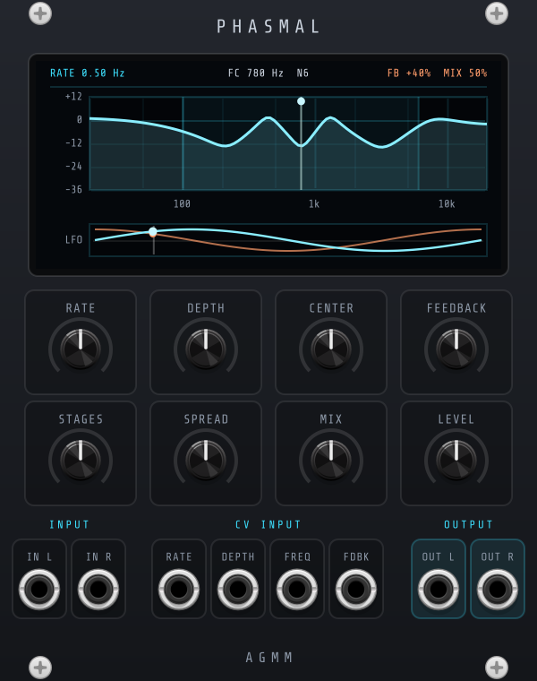

<!--
AGMM AUTOMATIC DOCUMENTATION
Source: Phasmal.cpp
-->

# Phasmal

## 1. Overview

`Phasmal` is a 20 HP stereo phaser. Its core is a chain of first-order all-pass stages (2, 4, 6, 8, 10 or 12 stages) with global feedback, whose corner frequency is swept by an LFO (sine or triangle). The left and right channels can be swept with a phase offset (stereo spread), and the module provides CV control over rate, depth, center frequency and feedback. A small display shows the exact magnitude response of the current settings, the current sweep range, and a small LFO scope.

Key features:
- Chain of 2–12 all-pass stages (selectable)
- Global feedback (bipolar, from −0.95 to +0.95)
- LFO (sine or triangle) sweeps the corner frequency
- Stereo spread (L/R phase offset)
- CV over rate (1 V/oct), depth, center freq (1 V/oct), feedback
- Exact magnitude response display (computed from the same maths as the DSP)
- Sweep range band and L/R center frequency markers
- LFO scope with current-phase dots

## Module Screenshot



## 2. Architecture

### Main Classes

- `Phasmal`: Core module class inheriting from `rack::Module`
- `PhasmalViz`: Struct holding the display snapshot
- `PHPanelBackground`: Static panel artwork
- `PHKnobArcs`: Live value arcs around the knobs
- `PHDisplayWidget`: Live display

### Inheritance

- `Phasmal` inherits from `rack::Module`
- All UI widgets inherit from `rack::TransparentWidget`

### Structures

- `PhasmalViz`: `{ fcL, fcR, fcMin, fcMax, fb, mix, level, rate, depth, spread, phase, stages, shape, fs }`
- `LfoShape`: SHAPE_SINE, SHAPE_TRI, NUM_SHAPES

### State (grouped)

| Group | Storage |
|-------|---------|
| All-pass state | `float st[2][12]` (2 channels × 12 stages) |
| Feedback | `float fbState[2]` |
| LFO | `float phase` |
| Stage count | `int lastN` |
| LFO shape | `LfoShape shape` |
| Display | `PhasmalViz viz` |

## 3. DSP Theory

### First-order all-pass

Each stage is a first-order all-pass with coefficient $a$:

$$
y[n] = a x[n] + x[n-1] - a y[n-1]
$$

where:

$$
a = \frac{\tan(\pi f_c / f_s) - 1}{\tan(\pi f_c / f_s) + 1}
$$

The all-pass passes all frequencies with unity gain, but its phase shifts by $-180°$ at $f_c$ and by $-360°$ over the full range. Cascading $N$ stages gives a total phase shift of $-N \cdot 360°$ over the full range.

### Feedback

Global negative feedback around the chain:

$$
x_{\text{in}}' = x_{\text{in}} + fb \cdot y_{\text{out}}
$$

where $fb$ can be positive or negative. Negative feedback sharpens the notches; positive feedback creates resonances.

### Phaser notches

The wet output is the sum of the dry and the phased signal. The notches appear at frequencies where the all-pass phase is 180° out of phase with the dry signal:

$$
f_{\text{notch}, k} = f_c \cdot \tan\left(\frac{\pi}{2} \cdot \frac{2k+1}{N}\right)
$$

for $k = 0, 1, \ldots, N/2 - 1$.

### LFO sweep

The LFO modulates the center frequency exponentially:

$$
f_c = f_{c0} \cdot 2^{\text{depth} \cdot 3 \cdot \text{LFO}(t)}
$$

where $f_{c0}$ is the center knob (in semitones), and $\text{LFO}(t) \in [-1, 1]$. So the sweep range is $\pm 3 \cdot \text{depth}$ octaves.

### LFO shapes

- **Sine**: $\sin(2\pi \phi)$
- **Triangle**: $1 - 4|\phi - 0.5|$ (with a 90° phase offset so it starts at 0 when sine would start at 0)

### Stereo spread

The two channels use different LFO phases:

$$
\phi_L = \phi(t), \quad \phi_R = \phi(t) + \text{spread} \cdot 0.5
$$

With `spread = 0.5`, the two channels are 90° out of phase. With `spread = 1`, they're 180° out of phase (full anti-phase).

### Stability

The feedback is $\pm 0.95$ max, and the state is bounded by a `tanh` at the input of the feedback:

$$
x_{\text{fb}} = 5 \tanh(x/5)
$$

This prevents runaway at high resonance.

## 4. Parameters and Controls

### Knobs

| Parameter | Min | Max | Default | Description |
|-----------|-----|-----|---------|-------------|
| `RATE_PARAM` | −5 | 4 | −1 | Rate (2^rate Hz) |
| `DEPTH_PARAM` | 0 | 1 | 0.6 | Depth |
| `FREQ_PARAM` | 6.64 | 12.3 | 9.6 | Center frequency (2^freq Hz) |
| `FEEDBACK_PARAM` | −0.95 | 0.95 | 0.4 | Feedback |
| `STAGES_PARAM` | 0 | 5 | 2 | Stages (2/4/6/8/10/12) |
| `SPREAD_PARAM` | 0 | 1 | 0.5 | Stereo spread |
| `MIX_PARAM` | 0 | 1 | 0.5 | Mix |
| `LEVEL_PARAM` | 0 | 2 | 1 | Output level |

### Inputs

| Input | Description |
|-------|-------------|
| `IN_L_INPUT` | Left (mono) |
| `IN_R_INPUT` | Right (normalled to left) |
| `RATE_CV_INPUT` | Rate CV (1 V/oct) |
| `DEPTH_CV_INPUT` | Depth CV (±5 V = ±50%) |
| `FREQ_CV_INPUT` | Center freq CV (1 V/oct) |
| `FB_CV_INPUT` | Feedback CV (±5 V = ±50%) |

### Outputs

| Output | Description |
|--------|-------------|
| `OUT_L_OUTPUT` | Left |
| `OUT_R_OUTPUT` | Right |

### Enumerations

- `LfoShape`: SHAPE_SINE, SHAPE_TRI, NUM_SHAPES
- `ParamId`: Rate, Depth, Freq, Feedback, Stages, Spread, Mix, Level
- `InputId`: InL, InR, RateCV, DepthCV, FreqCV, FbCV
- `OutputId`: OutL, OutR

### Menu

- LFO shape: sine or triangle

## 5. Inputs and Outputs

### Inputs

| Name | Type | Range | Description |
|------|------|-------|-------------|
| `IN_L_INPUT` | Audio | ±10 V | Left audio |
| `IN_R_INPUT` | Audio | ±10 V | Right audio |
| `RATE_CV_INPUT` | CV | ±5 V | Rate modulation (1 V/oct) |
| `DEPTH_CV_INPUT` | CV | ±5 V | Depth modulation |
| `FREQ_CV_INPUT` | CV | ±5 V | Center freq modulation (1 V/oct) |
| `FB_CV_INPUT` | CV | ±5 V | Feedback modulation |

### Outputs

| Name | Type | Range | Description |
|------|------|-------|-------------|
| `OUT_L_OUTPUT` | Audio | ±10 V | Left |
| `OUT_R_OUTPUT` | Audio | ±10 V | Right |

### Bypass

`configBypass(IN_L_INPUT, OUT_L_OUTPUT)` and `configBypass(IN_R_INPUT, OUT_R_OUTPUT)`.

## 6. Signal Processing Pipeline

1. **Parameter read** — Rate (2^rate), depth, feedback, center freq (2^freq), spread, mix, level.
2. **Read CVs** — Rate, depth, freq, feedback.
3. **Stage change** — Clear all-pass state beyond `N` if the stage count decreases.
4. **Advance LFO** — `phase += rate * dt`.
5. **Compute LFO values** — Left and right with spread offset.
6. **Compute sweep** — `sweep = depth * 3` (octaves each way), then `f_cL = fc0 * 2^(sweep * lfoL)`.
7. **For each channel**:
   - Read input.
   - Add feedback (with tanh).
   - Run `N` all-pass stages.
   - Compute the normalised feedback term (`1 - 0.5*|fb|`).
   - Mix dry and wet (with mix and normalisation).
   - Apply level.
8. **Write outputs**.
9. **Update `viz`** — Display snapshot.

## 7. Important Functions

### `phLfo(float p, int shape)`

Evaluates the LFO waveform at normalised phase `p`.

```cpp
if (shape == 1) {
    float q = p + 0.25f;
    q -= std::floor(q);
    return 1.f - 4.f * std::fabs(q - 0.5f);  // triangle
}
return std::sin(2.f * (float)M_PI * p);  // sine
```

### `phStageCoef(float fc, float fs)`

Computes the all-pass coefficient:

```cpp
float t = std::tan((float)M_PI * fc / fs);
return (t - 1.f) / (t + 1.f);
```

### `phMagDb(float f, float fc, const PhasmalViz &v)`

Computes the exact magnitude response (in dB) of the full phaser at frequency `f`:

```cpp
float w = 2.f * (float)M_PI * f / fs;
std::complex<float> z1 = std::polar(1.f, -w);
float a = phStageCoef(fc, fs);
std::complex<float> A1 = (a + z1) / (1.f + a * z1);
std::complex<float> A(1.f, 0.f);
for (int i = 0; i < v.stages; ++i) A *= A1;
std::complex<float> W = A / (1.f - v.fb * A * z1);
float norm = 1.f - 0.5f * std::fabs(v.fb);
std::complex<float> H = (1.f - v.mix) + v.mix * norm * W;
return 20.f * std::log10(std::abs(H) + 1e-5f) + 20.f * std::log10(std::max(v.level, 1e-3f));
```

### `process(const ProcessArgs &args)`

The main callback described in §6.

## 8. Mathematical Implementation

### First-order all-pass coefficient

$$
a = \frac{\tan(\pi f_c / f_s) - 1}{\tan(\pi f_c / f_s) + 1}
$$

### All-pass recurrence

$$
y[n] = a x[n] + x[n-1] - a y[n-1]
$$

### Sweep

$$
f_c = f_{c0} \cdot 2^{\text{sweep} \cdot \text{LFO}(t)}, \quad \text{sweep} = 3 \cdot \text{depth}
$$

### Rate

$$
\text{rate} = 2^{\text{knob} + \text{CV}}
$$

### Feedback

$$
fb = \text{clamp}(\text{knob} + \text{CV} \cdot 0.1, -0.95, 0.95)
$$

### Normalisation

$$
\text{norm} = 1 - 0.5 |fb|
$$

### LFO

$$
\text{LFO}_{\text{sine}}(p) = \sin(2\pi p), \quad \text{LFO}_{\text{tri}}(p) = 1 - 4|(p + 0.25) \bmod 1 - 0.5|
$$

## 9. Performance and Optimization

### CPU Usage

- Per sample: 2 channels × (N all-passes + feedback + mix) ≈ 2 × (12 + 3) × 5 = 150 flops
- Display: 100-point response + 80-point LFO scope ≈ 5000 flops/frame
- Total: ~150 flops/sample + 5 K flops/frame

### Memory Allocation

- All state is fixed-size
- No allocation in `process()`
- `st[2][12]`, `fbState[2]`, `phase` — very small

### Buffers

- `st[2][12]`: 24 floats
- `fbState[2]`: 2 floats
- Display: `PhasmalViz` struct + 100-point curves

### Real-time Processing

- Loop bounded by N (max 12)
- No allocation, no blocking
- Display curves computed on the UI thread

### Thread Safety

- `viz` is written by audio thread, read by UI thread via torn reads
- All other state is audio-thread only

### Numerical Stability

- Feedback is clamped to `±0.95`
- Feedback state is `tanh`-limited at 5 V
- `!std::isfinite` checks on output
- No runaway at any setting

## 10. Dependencies

### Libraries/Headers

- `plugin.hpp` — VCV Rack core
- `agmm_ui.hpp` — shared AGMM UI helpers
- `<cmath>`, `<cstdio>`, `<cstring>`, `<complex>`, `<algorithm>`, `<memory>`

### External Classes

- `rack::Module`, `rack::TransparentWidget`, `rack::engine::ParamQuantity`
- `agmm::panelBase`, `agmm::bezel`, `agmm::cell`, `agmm::text`, `agmm::screen`, `agmm::plotFrame`, `agmm::sectionHeader`, `agmm::withA`, `agmm::violet`, `agmm::accent`, `agmm::bright`, `agmm::warm`, `agmm::dim`, `agmm::ALIGN_L/C/R`

## 11. Summary

`Phasmal` is a stereo phaser with 2–12 all-pass stages, global feedback, and a sine/triangle LFO. The "Fancy" in `FancyADSR` is here too: the display shows not only the live LFO, but the exact magnitude response of the current phaser setting, computed analytically. This is a rare feature — most phasers just show a wobbly LFO — and it makes the module much easier to understand and use.

The design choices are interesting: the stage count is selectable (2–12), the feedback is bipolar (−0.95 to +0.95), the LFO is swept exponentially (3 octaves each way), and the display shows both the sweep range band and the L/R center markers. Together these make it possible to dial in a very wide range of phaser sounds, from subtle vintage swirl to wild resonant sweeps.

The main limitations are: the all-pass chain is single-precision (which is fine for 12 stages but would have issues at 24+), and the display's response curve is computed from the same formula as the DSP, so it's very accurate. No complaints.
