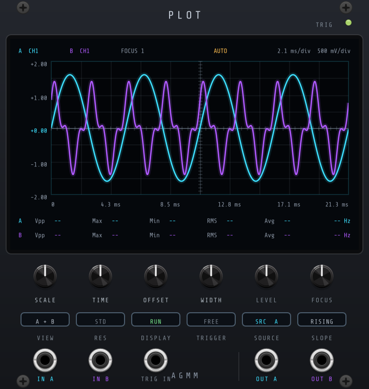

<!--
AGMM AUTOMATIC DOCUMENTATION
Source: Plot.cpp
-->

# Plot

## 1. Overview

`Plot` is a 24 HP polyphonic oscilloscope and signal visualizer. It records two independent polyphonic inputs (A and B, up to 16 channels each) into ring buffers and renders them on a 340 × 206 oscilloscope screen with a proper trigger engine, a 10 × 8 division voltage/time grid, and per-window statistics for the focus channel of each input.

Unlike a naive scope that just draws the last N samples, `Plot` implements **true oscilloscope triggering** (Free / Auto / Normal, rising or falling slope, internal or external source) with Schmitt hysteresis and sub-sample interpolation, so the trace locks to the waveform instead of drifting or jittering. Two polyphonic thru outputs mirror the inputs, so the module can be inserted inline in a signal chain.

Key features:
- Two polyphonic inputs and two polyphonic thru outputs (≤ 16 channels each)
- Free / Auto / Normal trigger modes with rising/falling slope and Schmitt hysteresis
- Sub-sample trigger interpolation (the crossing sits exactly on the trigger marker)
- External trigger input that overrides the internal source
- 10 × 8 grid with voltage and time labels; time and volts per division in the header
- Real-time statistics for the focus channel of each input: Vpp, Max, Min, RMS, Avg, frequency
- 2× / 4× plot resolution (min/max envelope keeps fast signals and narrow pulses intact)
- Display hold (pass-through keeps working while the scope is frozen)
- Thread-safe display snapshot (audio thread publishes a packed 64-bit window description)
- Module-browser preview with two synthetic demo waves

## Module Screenshot



## 2. Architecture

### Main Classes

- `Plot` — Rack module class inheriting from `rack::Module`
- `PlotDisplay` — the 340 × 206 oscilloscope screen widget
- `PlotPanel` — static panel chrome (title, bezel, divider)
- `PlotLabel` — small centered text label widget
- `SelectorButton` — click-to-cycle parameter widget

### Inheritance

- `Plot` inherits from `rack::Module`
- `PlotDisplay`, `PlotPanel` and `PlotLabel` inherit from `rack::TransparentWidget`
- `SelectorButton` inherits from `rack::app::ParamWidget`

### Structures

- `Stats { bool valid; float vmin, vmax, mean, rms; bool hasFreq; float freq; }` — window statistics
- `DispSnap { int start, len, pre; float shift; }` — unpacked window description

### State (grouped)

| Group | Storage |
|-------|---------|
| Parameters | 12 params (scale, time, offset, level, focus, mode, src, slope, view, hold, width, res) |
| Buffers | `std::vector<float> wave[2][16]` — two inputs × 16 channels × 65536 samples |
| Write pointer | `int writePos` |
| Channels | `int channels[2]` |
| Published window | `std::atomic<uint64_t> disp`, `std::atomic<uint32_t> dispId` |
| Display metadata | `float dispSr`, `bool trigActive` |
| Cached controls | `int win, pre, mode, src, slope, focus; float level, hyst; bool hold` |
| Control-rate divider | `dsp::ClockDivider ctrlDiv` |
| Trigger state | `bool armed, capturing; int trigIdx, capWin, capPre, postRemaining; float capShift, prevX; int sinceTrig` |

## 3. DSP Theory

### Recording

Both inputs are read sample-by-sample and stored into two independent ring buffers, one per input, one row per polyphonic channel:

$$
\text{wave}_k[\text{ch}][\text{writePos}] = \text{in}_k.\text{getVoltage}(\text{ch}), \quad k \in \{A, B\}
$$

`writePos` advances modulo `BUFFER_SIZE = 65536` each sample. Newly appearing channels are zero-filled so they don't start with stale history.

### Display window

The window length is derived from the TIME knob:

$$
\text{win} = \text{clamp}\!\left(\lfloor 2^{\text{TIME}} \cdot f_s \rfloor,\; 32,\; \text{MAX\_WINDOW}\right)
$$

with `TIME` stored as `log2(seconds)` in `[−10, 0]`, so the knob covers 1 ms – 1 s. The pre-trigger portion is `pre = win / 4` (25 %).

### Schmitt trigger

The trigger input is either the external `TRIG IN` (when patched) or the focus channel of the selected internal source. For a rising trigger, the sample is used directly; for a falling trigger it is negated along with the level, so the detection logic is always a rising edge:

$$
x = \begin{cases} v & \text{rising} \\ -v & \text{falling} \end{cases}, \quad
\ell = \begin{cases} L & \text{rising} \\ -L & \text{falling} \end{cases}
$$

The arm/fire state machine uses hysteresis `hyst = max(0.05 V, 0.02 · SCALE)`:

$$
\text{armed} \leftarrow \text{true} \text{ if } x < \ell - hyst
$$
$$
\text{edge} = \text{armed} \land (x \ge \ell)
$$

### Sub-sample interpolation

Between the previous sample `prevX` and the current sample `x`, the exact crossing of `ℓ` is found by linear interpolation:

$$
\text{frac} = \text{clamp}\!\left(\frac{\ell - \text{prevX}}{x - \text{prevX}},\; 0,\; 1\right)
$$

The published window is then shifted by `shift = 1 − frac` samples so the interpolated crossing lands exactly on the trigger marker, regardless of where the edge fell between samples.

### Trigger modes

| Mode   | Behaviour |
|--------|-----------|
| Free   | Publish the most recent `win` samples every sample. No trigger. |
| Auto   | Wait for an edge. If no edge for `max(2·win, 0.25 s)`, fall back to free-run. |
| Normal | Wait for an edge. If none, keep the previous window (or show "WAITING FOR TRIGGER"). |

In Auto and Normal modes, when an edge fires, the engine arms `capturing`, remembers the write index at the edge (`trigIdx`), and waits `postRemaining = win − pre` samples before publishing the window `(trigIdx − pre, win, pre, shift)`. This ensures the display only updates on complete captured windows.

### Window statistics

For each input, the focus channel's window is scanned without decimation:

$$
\text{min},\, \text{max},\, \text{mean} = \frac{1}{n}\sum v_i,\, \text{RMS} = \sqrt{\frac{1}{n}\sum v_i^2}
$$

Frequency is measured from **rising crossings of the mid-level** with hysteresis `h = 0.1 · Vpp`:

$$
\text{mid} = \tfrac{1}{2}(\text{max} + \text{min}),\quad
f = \frac{(\text{count} - 1) \cdot f_s}{\text{last} - \text{first}}
$$

Frequency is only reported when `count ≥ 2` and `Vpp > 0.02 V`.

### Thread-safe snapshot

The audio thread publishes the window as **one packed 64-bit word**:

```
bits  0–15  start   (ring buffer start index)
bits 16–31  len     (window length in samples)
bits 32–47  pre     (pre-trigger samples)
bits 48–55  shift   (sub-sample trigger offset, ×256)
```

plus a generation counter `dispId` that bumps on every publish. The UI reads `dispId` with `memory_order_acquire`; if it changed, the UI copies the whole window into a local cache. This guarantees the UI never sees a half-updated `(start, len, pre)` combination, and a slow trigger can't let newer samples creep into the left edge of the display.

### Trace rendering

If the window has few enough samples (`len ≤ cols·2`, where `cols = max(2, PW · resMul)` and `resMul ∈ {1, 2, 4}` from the RES selector), the trace is drawn as a direct polyline, one vertex per sample. Otherwise each output column summarizes the samples it covers:

$$
y_\text{hi} = Y(\max),\quad y_\text{lo} = Y(\min)
$$

where `Y(v) = yMid − (v + OFFSET) / SCALE · halfH`. The min/max segment is oriented so it connects to the previous column's last point, avoiding vertical jumps. This min/max envelope means fast signals and narrow pulses are never lost to decimation.

The focus channel is drawn brighter with a soft glow; other polyphonic channels are drawn at 40 % alpha with a thinner line.

### Grid

`H_DIVS = 10` horizontal divisions (time) and `V_DIVS = 8` vertical divisions (voltage). The center lines are brighter. Voltage labels on the left are placed on even divisions and read

$$
v = n \cdot \text{SCALE} - \text{OFFSET}, \quad n = 1 - \frac{j}{V_\text{DIVS}/2}
$$

so the label at line `j` shows the actual voltage at that height, including the offset.

## 4. Parameters and Controls

### Knobs

| Parameter | Min | Max | Default | Description |
|-----------|-----|-----|---------|-------------|
| `PARAM_SCALE` | 0.5 | 10 | 2.0 | Volts at top/bottom edge of the display |
| `PARAM_TIME` | −10 (1 ms) | 0 (1 s) | −3.32 (100 ms) | Time per screen, stored as log2(seconds) |
| `PARAM_OFFSET` | −10 | +10 | 0 | Vertical offset of the trace (V) |
| `PARAM_WIDTH` | 0.5 | 4 | 1.3 | Trace line width (px) |
| `PARAM_LEVEL` | −10 | +10 | 0 | Trigger level (V) |
| `PARAM_CHAN` | 1 | 16 | 1 | Focus channel (used for trigger and readouts), snapped |

### Selectors (click to cycle; right-click for menu)

| Parameter | States | Default | Description |
|-----------|--------|---------|-------------|
| `PARAM_VIEW` | A+B / A only / B only | A+B | Which traces are shown |
| `PARAM_RES` | STD / HIGH / ULTRA | HIGH | Plot resolution (1× / 2× / 4× columns per pixel) |
| `PARAM_HOLD` | RUN / HOLD | RUN | Freeze the display (pass-through keeps working) |
| `PARAM_MODE` | FREE / AUTO / NORMAL | AUTO | Trigger mode |
| `PARAM_SRC` | SRC A / SRC B | SRC A | Internal trigger source |
| `PARAM_SLOPE` | RISING / FALLING | RISING | Trigger edge |

## 5. Inputs and Outputs

### Inputs

| Name | Type | Channels | Description |
|------|------|----------|-------------|
| `INPUT_A` | Audio | Poly (≤16) | Signal A — recorded and displayed |
| `INPUT_B` | Audio | Poly (≤16) | Signal B — recorded and displayed |
| `INPUT_TRIG` | Trigger | Mono | External trigger; overrides `SOURCE` when patched |

### Outputs

| Name | Type | Channels | Description |
|------|------|----------|-------------|
| `OUTPUT_A` | Audio | Poly (thru) | Pass-through of IN A, channel count preserved |
| `OUTPUT_B` | Audio | Poly (thru) | Pass-through of IN B, channel count preserved |

Outputs continue to work in HOLD mode, so the module can be used purely as a buffered splitter while the scope is frozen.

### Lights

- `LIGHT_TRIG` — green while the display is in a triggered state (off on HOLD / FREE).

## 6. Signal Processing Pipeline

Per sample, `Plot::process(args)` runs:

1. Every 16 samples (via `ctrlDiv`), call `updateControls(sr)` to refresh the cached control values (window length, pre-trigger, mode, source, slope, focus, level, hold, hysteresis).
2. Write inputs to outputs (pass-through) — always, even when held.
3. If HOLD, dim the trigger light and return (buffers stop advancing).
4. For each input, read `getChannels()` and record all channels into the ring buffer at `writePos`. Newly appearing channels are zero-filled.
5. Advance `writePos`; bump `sinceTrig` (saturating).
6. Compute the trigger-domain sample `x` and the level `ℓ` from the trigger source (external jack or internal focus channel).
7. Run the Schmitt state machine; on an edge, compute `frac` by linear interpolation and set up the capture.
8. In FREE mode, publish the most recent window every sample. In AUTO / NORMAL mode, either wait for the capture to finish (`postRemaining`), start a new capture, or (AUTO only) fall back to free-run after a timeout.
9. Update `trigActive` and drive the trigger light.

On the UI side, `PlotDisplay::drawLayer` (layer 1) runs every frame:

1. `syncCache()` — read `dispId`, copy the published window into the local cache if it changed, recompute stats if the window or focus changed.
2. Draw the screen background and bezel `plotFrame`.
3. Draw the grid (`drawGrid`): lines, labels, minor ticks.
4. If data is available, clip to the plot rectangle, draw the trigger level marker, then the traces (non-focus channels first, focus last), then the trigger position marker.
5. Draw the time-axis labels below the plot.
6. Draw the header (channel counts, focus, trigger state, time/div, V/div).
7. Draw the two measurement rows (A and B) with Vpp / Max / Min / RMS / Avg / frequency.

## 7. Important Functions

### `static std::string fmtTime(float t)`

Formats a time value with an appropriate unit (s / ms / us). Used in the header, time-axis labels, and `TIME`/div display.

### `static std::string fmtVoltsPerDiv(float v)`

Formats a volts-per-division value (mV/div or V/div). Used in the header.

### `static Stats computeStats(const float* buf, int start, int len, float sr)`

Scans a window of a ring buffer (all samples, no decimation) and returns min, max, mean, RMS, and frequency (from mid-level rising crossings with hysteresis `0.1·Vpp`). Frequency is only reported when at least two crossings are found and `Vpp > 0.02 V`.

### `static uint64_t packDisp(int start, int len, int pre, float shift)` / `static DispSnap unpackDisp(uint64_t p)`

Pack and unpack the window description into a single 64-bit word. The shift is quantized to 1/256 sample so it fits in 8 bits.

### `void Plot::publish(int start, int len, int pre, float shift)`

Atomically publishes the window. Stores the packed word with `memory_order_relaxed` and bumps `dispId` with `memory_order_release`, so the UI reading with `memory_order_acquire` sees a consistent `(word, id)` pair.

### `void Plot::updateControls(float sr)`

Refreshes the cached control values from the parameters. Called every 16 samples from `process()` through the `ctrlDiv` divider so the hot loop stays cheap. Hysteresis is scaled by the vertical scale so noisy signals don't double-trigger.

### `void Plot::process(const ProcessArgs& args)`

Main callback described in §6.

### `void PlotDisplay::syncCache()`

Reads `dispId` with acquire, and if it changed, copies the whole published window (all active channels, both inputs) into the local cache. Then recomputes statistics for the focus channel of each input, reusing the `Stats` structs stored in the cache. This is what makes the display stable when the trigger is slow or the UI thread lags.

### `void PlotDisplay::traceChannel(...)`

Draws one channel of one input. If `len ≤ cols·2`, draws a polyline, one vertex per sample. Otherwise draws a min/max envelope, one vertical segment per output column, oriented so it connects to the previous column's last point. `shiftSamples` shifts the trace right by the sub-sample offset so the trigger crossing lands on the marker.

### `void PlotDisplay::drawGrid(NVGcontext* vg, float scale, float offset)`

Draws the 10 × 8 grid: vertical time lines (with the center line brighter), horizontal voltage lines with labels on the left, and minor ticks along the center lines.

### `void PlotDisplay::drawLayer(const DrawArgs& args, int layer)`

Live drawing (layer 1). Renders the whole screen: grid, traces, trigger markers, header, and measurement rows.

### `SelectorButton::onButton(const ButtonEvent& e)`

Left-click cycles the parameter to the next state (wrapping back to the minimum after the maximum). Right-click falls through to `ParamWidget`, which opens the standard Rack parameter context menu.

### `PlotWidget::addSelector(float x, float y, int paramId, Plot* module, std::vector<std::string> labels, std::vector<NVGcolor> colors)`

Convenience helper: creates a `SelectorButton` centered at `(x, y)`, bound to `paramId`, with the given state labels and per-state colors.

## 8. Mathematical Implementation

### Window length

$$
\text{win} = \text{clamp}\!\left(\lfloor 2^{\text{TIME}} \cdot f_s \rfloor,\; 32,\; \tfrac{3}{4} \cdot 65536\right)
$$

### Pre-trigger

$$
\text{pre} = \text{win} / 4
$$

### Schmitt trigger

$$
\text{armed} \leftarrow \text{true} \quad \text{if } x < \ell - h,\quad
\text{edge} = \text{armed} \land (x \ge \ell)
$$

$$
h = \max(0.05,\; 0.02 \cdot \text{SCALE})
$$

### Sub-sample interpolation

$$
\text{frac} = \text{clamp}\!\left(\frac{\ell - x_\text{prev}}{x - x_\text{prev}},\; 0,\; 1\right), \quad
\text{shift} = 1 - \text{frac}
$$

### Voltage mapping

$$
Y(v) = y_\text{mid} - \frac{v + \text{OFFSET}}{\text{SCALE}} \cdot \frac{PH}{2}
$$

### Focus vs non-focus alpha

$$
\alpha = \begin{cases} 1.0 & \text{focus} \\ 0.4 & \text{other} \end{cases}
$$

### Min/max envelope

$$
y_\text{hi} = Y(\max),\; y_\text{lo} = Y(\min),\; \text{connect to previous by nearest}
$$

### Header labels

$$
\text{voltage}(j) = \left(1 - \frac{j}{V_\text{DIVS}/2}\right) \cdot \text{SCALE} - \text{OFFSET}
$$

### Time per division

$$
t_\text{div} = \frac{\text{len}}{H_\text{DIVS} \cdot f_s}
$$

### Frequency

$$
f = \frac{(\text{count} - 1) \cdot f_s}{\text{last} - \text{first}}
$$

### Packed window word

$$
\text{word} = \text{start} + (\text{len} \ll 16) + (\text{pre} \ll 32) + (\lfloor \text{shift} \cdot 256 \rfloor \ll 48)
$$

### Stats RMS

$$
\text{RMS} = \sqrt{\frac{1}{n}\sum_{i=1}^{n} v_i^2}
$$

### Stats mean

$$
\text{mean} = \frac{1}{n}\sum_{i=1}^{n} v_i
$$

## 9. Performance and Optimization

### CPU Usage

- Recording: 2 inputs × up to 16 channels × 1 sample = up to 32 multiply-adds per sample
- Trigger: 1 Schmitt comparison, 1 interpolation on edge
- Pass-through: 2 × up to 16 `getVoltage` / `setVoltage` per sample
- Stats: 2 windows scanned per published frame (only when the window changes)
- FFT: none — the frequency is measured from crossings, not FFT
- Display: up to 2 inputs × 16 channels × 1 polyline per frame; focus channels get a glow pass

Rough estimate: ~100 – 200 flops/sample (dominated by the polyphonic recording and pass-through), plus the display work.

### Memory Allocation

- Ring buffers: `2 × 16 × 65536 × 4 B = 8 MB`
- Cache: `2 × 16 × 65536 × 4 B = 8 MB` worst case (only allocated up to `MAX_WINDOW = 49152` in practice)
- `Stats` and control caches: negligible

All buffers are allocated in the constructor or on first `syncCache()`; no allocation in the audio path.

### Real-time Processing

- All inner loops bounded by fixed constants (`MAX_CHANNELS = 16`, `BUFFER_SIZE = 65536`)
- The UI uses `std::vector` caches sized once (`MAX_WINDOW`); the audio thread never touches them
- No allocation, no locks in the audio path
- The control-rate divider (every 16 samples) keeps `updateControls` off the hot path

### Thread Safety

- All audio-side state written by the audio thread only
- UI reads the audio state through `std::atomic<uint64_t> disp` and `std::atomic<uint32_t> dispId`
- The packed word is stored with `memory_order_relaxed`, the id bumped with `memory_order_release`; the UI reads the id with `memory_order_acquire`, guaranteeing it sees a consistent `(word, id)` pair
- UI reads of `channels[k]`, `focus`, `level`, `mode`, `hold` may be torn, but a torn read only causes a cosmetic glitch for one frame; the next frame re-reads

### Numerical Stability

- `hyst` scaled by `SCALE` prevents double-triggering on noisy signals
- Interpolation denominator is clamped to `1e-9` before division
- The window length is clamped to `[32, MAX_WINDOW]`; `MAX_WINDOW = 3/4 · BUFFER_SIZE` leaves slack so the UI can copy a latched window while the audio thread wraps
- The `dispId` counter is monotonically increasing; a wrap-around is practically impossible (2^32 publishes at 48 kHz = ~25 hours)
- All output voltages clamped by Rack

## 10. Dependencies

### Libraries/Headers

- `plugin.hpp` — VCV Rack core
- `agmm_ui.hpp` — shared AGMM UI helpers
- `<cmath>`, `<cstdint>`, `<cstdio>`, `<cstring>`, `<algorithm>`, `<atomic>`, `<string>`, `<vector>`

### External Classes

- `rack::Module`, `rack::ModuleWidget`, `rack::TransparentWidget`, `rack::app::ParamWidget`
- `rack::ParamQuantity` (for `SelectorButton`)
- `rack::dsp::ClockDivider`
- `rack::math::clamp`, `rack::math::round`
- `agmm::panelBase`, `agmm::bezel`, `agmm::screen`, `agmm::plotFrame`, `agmm::text`, `agmm::accent`, `agmm::violet`, `agmm::dim`, `agmm::ALIGN_L/C/R`

## 11. Summary

`Plot` is a compact but complete polyphonic oscilloscope. It records two independent polyphonic inputs into ring buffers, runs a real oscilloscope trigger engine with Schmitt hysteresis and sub-sample interpolation, and renders the captured windows on a 10 × 8 grid with voltage and time labels, trigger markers, and per-window statistics.

The design keeps the audio thread free of allocations and locks: the audio thread records samples, runs the trigger state machine, and publishes the window to show as a single packed 64-bit word with a generation counter. The UI thread copies the window into its own cache and draws from there, so a slow trigger or a UI hitch never causes the display to tear or drift.

The controls are deliberately simple: six knobs (Scale, Time, Offset, Width, Level, Focus) and six click-to-cycle selectors (View, Res, Display, Trigger, Source, Slope). The RES selector gives 1× / 2× / 4× columns per pixel, so high-frequency content can be inspected without losing narrow pulses thanks to the min/max envelope. The DISPLAY selector freezes the display without interrupting the pass-through, making the module useful as a buffered splitter while the scope is held.

Typical uses: verifying a waveform after a VCO or filter, measuring frequency and amplitude of a modulation source, comparing two signals on the same screen (view = A+B), inspecting polyphonic signals one channel at a time (Focus), and driving downstream modules through the polyphonic thru outputs. The external trigger input lets the scope lock to an external clock or gate, and the AUTO fallback keeps the display alive on silent inputs.