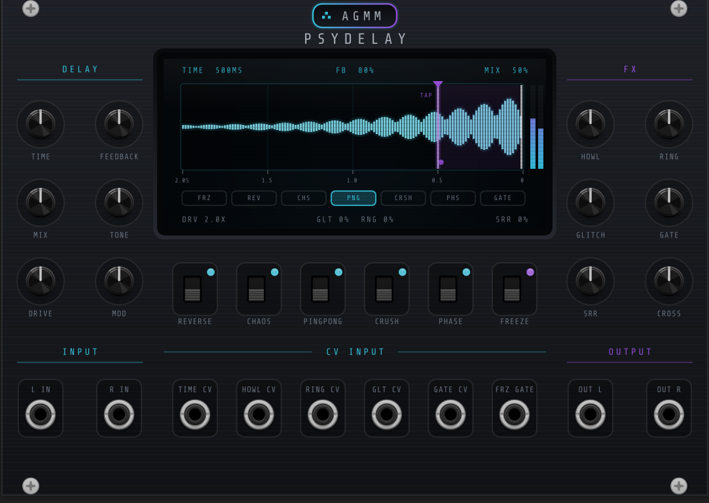

<!--
AGMM AUTOMATIC DOCUMENTATION
Source: PsyDelay.cpp
Generated: 2026-11-04 06:26
-->

# PsyDelay

## 1. Overview

The `PsyDelay` module is a stereo delay effect for VCV Rack that provides advanced delay functionality with modulation, feedback control, and various audio processing effects. It features a dual-channel delay line with configurable delay time, feedback, mix, tone filtering, and multiple special effects including bitcrushing, ring modulation, glitching, sample rate reduction, and chaos LFO.

The module includes a visual display showing the contents of the delay buffer, read position, and various effect states. It supports both mono and stereo inputs with independent processing for left and right channels, and provides CV control for most parameters.

## Module Screenshot

## 2. Architecture

### Main Classes
- `PsyDelay`: Core module class inheriting from `rack::Module`
- `PsyDelayWidget`: UI widget class inheriting from `rack::ModuleWidget`
- Anonymous namespace containing:
  - Display drawing helpers (`PDDisplayWidget`, `PDPanelBackground`)
  - Theme color definitions
  - Custom light widgets (`TPDCyanLight`, `TPDVioletLight`)
  - Panel layout constants and drawing functions

### Inheritance
- `PsyDelay` inherits from `rack::Module`
- `PsyDelayWidget` inherits from `rack::ModuleWidget`
- Custom light widgets inherit from `GrayModuleLightWidget`

### Structures
- `std::vector<float>` for delay buffers (`delayL`, `delayR`)
- `std::mt19937` and `std::uniform_real_distribution<float>` for random number generation
- `float` arrays for display data (`peakBins`)
- Enumerations for parameters, inputs, outputs, and lights

### Relationships
- `PsyDelayWidget` owns and manages the `PsyDelay` module instance
- The module maintains internal state for delay buffers, LFO, RNG, and effect processing
- Display widgets read from module's internal state for visualization
- All UI elements are created in the widget constructor and linked to module parameters

### Module Organization
The module is organized into:
1. Parameter definitions (enum `ParamId`)
2. Input/output definitions (enum `InputId`, `OutputId`, `LightId`)
3. Internal state variables
4. Core processing functions (`process()`, `setSampleRate()`)
5. UI components and drawing logic

## 3. DSP Theory

### Mathematical Equations

**Delay Line Read/Write Operations:**
$$ \text{readPos} = \text{writePos} - \text{delaySamples} $$
$$ \text{wetRaw}[L/R] = (1-f) \cdot \text{delay}[idxL1] + f \cdot \text{delay}[idxL2] $$

**Feedback Loop:**
$$ \text{feedbackAmount} = \text{feedback} + \text{howl} \cdot 0.2 + \text{howlSignal} \cdot 0.1 $$
$$ \text{howlSignal} = \tanh(\text{wetRaw}[L] \cdot \text{howl} \cdot 2) $$

**Soft Limiting:**
$$ f(x) = \begin{cases}
x & \text{if } |x| \leq 8 \\
8 + 4 \cdot \tanh\left(\frac{|x| - 8}{4}\right) \cdot \text{sgn}(x) & \text{otherwise}
\end{cases} $$

**Chaos LFO:**
$$ x_{n+1} = 3.9 \cdot x_n \cdot (1 - x_n) $$

**Ring Modulation:**
$$ \text{carrier} = \sin(2\pi f t) $$
$$ \text{output}[L/R] = \text{output}[L/R] \cdot (1 - \text{amount} \cdot 0.5) + \text{output}[L/R] \cdot \text{carrier} \cdot \text{amount} $$

**Low-pass Filter:**
$$ y[n] = \alpha \cdot x[n] + (1 - \alpha) \cdot y[n-1] $$
where $\alpha = \text{color}$

### Algorithms
- **Linear interpolation**: For fractional delay read positions
- **Soft limiting**: Prevents feedback oscillation
- **Chaos LFO**: Logistic map for chaotic modulation
- **Ring modulation**: Sine wave carrier multiplication
- **Bitcrushing**: Quantization to fewer bits
- **Sample rate reduction**: Decimation with hold
- **Glitching**: Random buffer position jumps with crossfading

### Filters
- First-order low-pass filter implemented as IIR:
  $$ y[n] = \alpha \cdot x[n] + (1 - \alpha) \cdot y[n-1] $$
  where $\alpha$ is the color parameter

### Oscillators
- Sine wave LFO for modulation when chaos mode is off
- Ring modulator carrier oscillator

### Delay Lines
- Dual-channel delay buffers (`delayL`, `delayR`)
- Circular buffer implementation with write position tracking
- Fractional read positions with linear interpolation

### Feedback Systems
- Standard feedback loop with soft limiting
- Howl effect adds additional feedback through tanh function
- Freeze mode maintains previous samples with 0.999 decay

### Modulation
- LFO modulation (sine wave or chaos)
- CV input scaling to parameter range
- Cross-modulation between channels

### Random Processes
- Glitch events using uniform random distribution
- Chaos LFO using logistic map iteration

## 4. Parameters and Controls

### Knobs
- **TIME**: Delay time, 0.01s to 2.0s (default: 0.5)
- **FEEDBACK**: Feedback amount, 0% to 120% (default: 80%)
- **MIX**: Dry/wet mix, 0% to 100% (default: 50%)
- **COLOR**: Tone filtering, 1% to 50% (default: 20%)
- **DRIVE**: Drive/saturation, 0x to 3x (default: 1x)
- **MOD_DEPTH**: Modulation depth, 0% to 100% (default: 20%)
- **HOWL**: Howl effect amount, 0% to 100% (default: 0%)
- **RING_MOD**: Ring modulation amount, 0% to 100% (default: 0%)
- **GLITCH**: Glitch effect amount, 0% to 100% (default: 0%)
- **GATE_THRESH**: Input gate threshold, 0V to 4V (default: 0V)
- **SRR**: Sample rate reduction, 0% to 100% (default: 0%)
- **CROSS_MOD**: Cross-modulation amount, 0% to 100% (default: 0%)

### Switches
- **REVERSE**: Reverse playback direction (Off/On)
- **CHAOS**: Chaos LFO modulation (Off/On)
- **PINGPONG**: Ping-pong stereo effect (Off/On)
- **BITCRUSH**: Bitcrusher effect (Off/On)
- **FREEZE**: Freeze mode (Off/On)
- **PHASE_FLIP**: Phase flip effect (Off/On)

### CV Inputs
- **TIME_CV**: Time CV input, 0 to 10V
- **FREEZE_CV**: Freeze gate input, 1.0V+ to activate
- **HOWL_CV**: Howl CV input, 0 to 10V
- **RING_CV**: Ring mod CV input, 0 to 10V
- **GLITCH_CV**: Glitch CV input, 0 to 10V
- **GATE_CV**: Gate threshold CV input, 0 to 10V

### Gates
- **FREEZE_CV**: Freeze gate input (1.0V+ activates freeze)

## 5. Processing Flow

The `process()` function implements the following pipeline:

1. **Input handling**: Read left/right inputs and CV values
2. **Delay time calculation**: Convert TIME parameter to samples with CV scaling
3. **Buffer read/write**: 
   - Calculate fractional read position
   - Perform linear interpolation
   - Apply soft limiting to prevent oscillation
4. **Feedback processing**:
   - Add howl effect through tanh function
   - Combine with standard feedback
5. **Effect processing**:
   - Apply bitcrushing if enabled
   - Apply ring modulation if enabled
   - Apply sample rate reduction if enabled
   - Apply glitching if enabled
6. **Mixing**: Combine dry and wet signals according to MIX parameter
7. **Output**: Generate stereo output with optional ping-pong effect

## 6. Special Effects

### Bitcrushing
Applies quantization to reduce bit depth using integer truncation.

### Ring Modulation
Multiplies input signal with a sine wave carrier at 100Hz, creating metallic or bell-like sounds.

### Glitching
Randomly jumps read position in delay buffer with crossfading to smooth transitions.

### Sample Rate Reduction (SRR)
Decimates the output signal by holding samples for multiple cycles.

### Howl Effect
Adds additional feedback through a tanh function that creates harmonic distortion.

### Freeze Mode
Maintains current delay buffer contents with 0.999 decay factor.

## 7. Display System

The display widget shows:
- Delay line contents as mirrored bars (newest on right)
- Read tap position indicator
- Modulation wobble effect
- Current time markers
- Output meters for left/right channels
- State indicators for all active effects
- Parameter readouts (time, feedback, mix, etc.)

## 8. Hardware Considerations

The module uses:
- Dual circular buffers for stereo processing
- Linear interpolation for fractional delay reads
- Soft limiting to prevent clipping in feedback loops
- Efficient IIR filtering for tone control
- Random number generation for glitch effects
- Real-time parameter scaling from CV inputs

All processing is done in the audio thread with appropriate buffer management and memory allocation.