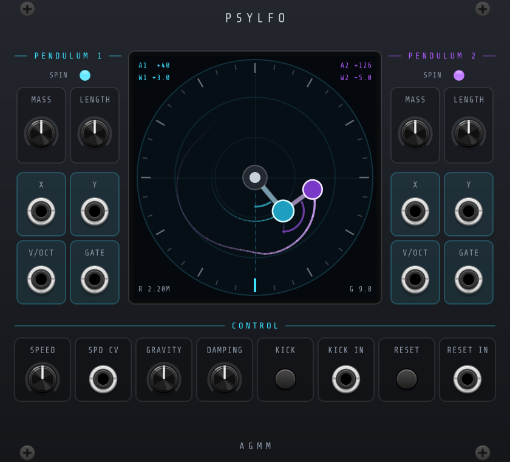

<!--
AGMM AUTOMATIC DOCUMENTATION
Source: PsyLFO.cpp
-->

# PsyLFO

## 1. Overview

`PsyLFO` is a 28 HP chaotic modulation source built from a real double-pendulum physics simulation. Two coupled pendulum bobs swing under gravity with configurable mass/length, integrated with RK4 at the audio rate. The module exposes, per pendulum: X/Y position outputs (in volts, ±5 V), a V/Oct output that latches a new random voltage on every zero-crossing of that pendulum's angle, and a gate output that fires for a selectable duration on the same zero-crossings. Global controls are Speed (time-scaling), Gravity, Damping, plus Kick and Reset buttons and their CV inputs.

Key features:
- Real double-pendulum physics (RK4 integration at audio rate)
- Per-pendulum X/Y position outputs (±5 V)
- Per-pendulum V/Oct (latched on zero-crossing)
- Per-pendulum gate (configurable duration)
- Global Speed, Gravity, Damping
- Kick and Reset buttons + CV
- 200×200 live display with double pendulum, fading trails, angle arcs, mass-sized bobs, gate flash rings
- Selectable V/Oct range (via menu)
- Selectable gate duration (via menu)

## Module Screenshot

## 2. Architecture

### Main Classes

- `PsyLFO`: Core module class inheriting from `rack::Module`
- `PLPanelBackground`: Static panel artwork
- `PLDisplayWidget`: Live double-pendulum display

### Inheritance

- `PsyLFO` inherits from `rack::Module`
- Both UI widgets inherit from `rack::TransparentWidget`

### Structures

- `VoctRange`: Range0_1, RangeN1_1, RangeN2_2, RangeN5_5, Range0_5, NUM_RANGES
- `GateDuration`: Trigger, 5ms, 10ms, 20ms, 50ms, 100ms, 200ms, NUM_GATE_DURS

### State (grouped)

| Group | Storage |
|-------|---------|
| Pendulum state | `double theta1, theta2, omega1, omega2` |
| Parameters | `double mass1, mass2, len1, len2, speedFactor, g, damping` |
| V/Oct | `double voct1Voltage, voct2Voltage`, `prevTheta1Sign, prevTheta2Sign` |
| Gates | `int gate1Timer, gate2Timer` |
| Ranges | `VoctRange voct1Range, voct2Range` |
| Gate durations | `GateDuration gate1Duration, gate2Duration` |
| Transport | `bool lastResetState, lastKickState` |
| RNG | `std::mt19937 rng` |
| Display | `float trailX1[120], trailY1[120], trailX2[120], trailY2[120]`, `trailHead, trailCount, trailTimer`, `flash1, flash2` |

## 3. DSP Theory

### Double pendulum dynamics

The double pendulum has two angles (θ₁, θ₂) and two angular velocities (ω₁, ω₂). The equations of motion (coupled rigid-body dynamics) are:

$$
\begin{aligned}
\ddot{\theta}_1 &= \frac{m_2 L_1 \omega_1^2 \sin\Delta \cos\Delta + m_2 g \sin\theta_2 \cos\Delta + m_2 L_2 \omega_2^2 \sin\Delta - (m_1+m_2) g \sin\theta_1}{(m_1+m_2) L_1 - m_2 L_1 \cos^2\Delta} \\
\ddot{\theta}_2 &= \frac{-m_2 L_2 \omega_2^2 \sin\Delta \cos\Delta + (m_1+m_2) g \sin\theta_1 \cos\Delta - (m_1+m_2) L_1 \omega_1^2 \sin\Delta - (m_1+m_2) g \sin\theta_2}{L_2 (m_1+m_2 - m_2 \cos^2\Delta)}
\end{aligned}
$$

where $\Delta = \theta_2 - \theta_1$, and a damping term is subtracted from both accelerations.

### RK4 integration

The state is advanced by `dt = sampleTime * speedFactor` using the classical 4th-order Runge-Kutta:

$$
\mathbf{s}_{n+1} = \mathbf{s}_n + \frac{dt}{6}(\mathbf{k}_1 + 2\mathbf{k}_2 + 2\mathbf{k}_3 + \mathbf{k}_4)
$$

with `dt` capped at 0.001 to avoid instability at extreme speed.

### Zero-crossing detection

Each pendulum's angle is watched for sign changes:

$$
\text{sign}(\theta[n-1]) \ne \text{sign}(\theta[n]) \implies \text{fire gate, re-roll V/Oct}
$$

The absolute value is checked against a small epsilon (1e-6) to avoid firing during wrap-around.

### V/Oct random generation

On each zero-crossing, a new random value is generated in the current range:

$$
\text{voct} = \text{range\_scale} \cdot u, \quad u \sim \text{Uniform}[-1, 1]
$$

The ranges are: 0..1 ($(u+1)/2$), −1..1 ($u$), −2..2 ($2u$), −5..5 ($5u$), 0..5 ($(u+1)/2 \cdot 5$).

### Position output

The positions of the two bobs are:

$$
x_1 = L_1 \sin\theta_1, \quad y_1 = -L_1 \cos\theta_1
$$

$$
x_2 = x_1 + L_2 \sin\theta_2, \quad y_2 = y_1 - L_2 \cos\theta_2
$$

These are clamped to ±5 V and output directly.

### Kick

A kick adds a random angular velocity to both pendulums:

$$
\omega_1 \leftarrow \omega_1 + u_1, \quad u_1 \sim \text{Uniform}[-4, 4]
$$

$$
\omega_2 \leftarrow \omega_2 + u_2, \quad u_2 \sim \text{Uniform}[-6, 6]
$$

This is enough to destabilize a near-still double pendulum.

## 4. Parameters and Controls

### Knobs

| Parameter | Min | Max | Default | Description |
|-----------|-----|-----|---------|-------------|
| `SPEED_PARAM` | 0 | 1 | 0.3 | Speed (0.2–10×) |
| `MASS1_PARAM` | 0.1 | 10 | 1 | Mass 1 (kg) |
| `MASS2_PARAM` | 0.1 | 10 | 1 | Mass 2 (kg) |
| `LEN1_PARAM` | 0.1 | 3 | 1 | Length 1 (m) |
| `LEN2_PARAM` | 0.1 | 3 | 1 | Length 2 (m) |
| `GRAVITY_PARAM` | 1 | 25 | 9.81 | Gravity (m/s²) |
| `DAMPING_PARAM` | 0 | 1 | 0 | Damping (1/s) |

### Buttons

| Button | Description |
|--------|-------------|
| `RESET_BUTTON` | Reset the pendulum state |
| `KICK_BUTTON` | Kick the pendulum with random angular velocity |

### Inputs

| Input | Description |
|-------|-------------|
| `RESET_CV_INPUT` | Reset gate |
| `SPEED_CV_INPUT` | Speed CV (0–10 V) |
| `KICK_INPUT` | Kick trigger |

### Outputs

| Output | Description |
|--------|-------------|
| `X1_OUTPUT` | Mass 1 X (±5 V) |
| `Y1_OUTPUT` | Mass 1 Y (±5 V) |
| `X2_OUTPUT` | Mass 2 X (±5 V) |
| `Y2_OUTPUT` | Mass 2 Y (±5 V) |
| `VOCT1_OUTPUT` | V/Oct 1 |
| `VOCT2_OUTPUT` | V/Oct 2 |
| `GATE1_OUTPUT` | Gate 1 |
| `GATE2_OUTPUT` | Gate 2 |

### Lights

- `MASS1_LIGHT` — pendulum 1 angular speed
- `MASS2_LIGHT` — pendulum 2 angular speed

### Menu

- V/Oct range for each pendulum (5 options)
- Gate duration for each pendulum (7 options)

### Enumerations

- `VoctRange`: Range0_1, RangeN1_1, RangeN2_2, RangeN5_5, Range0_5
- `GateDuration`: Trigger, 5ms, 10ms, 20ms, 50ms, 100ms, 200ms
- `ParamId`: Speed, Mass1, Mass2, Len1, Len2, Reset, Gravity, Damping, Kick
- `InputId`: ResetCV, SpeedCV, Kick
- `OutputId`: X1, Y1, X2, Y2, VOct1, VOct2, Gate1, Gate2
- `LightId`: Mass1, Mass2

## 5. Inputs and Outputs

### Inputs

| Name | Type | Range | Description |
|------|------|-------|-------------|
| `RESET_CV_INPUT` | Gate | > 1 V | Reset |
| `SPEED_CV_INPUT` | CV | 0–10 V | Speed |
| `KICK_INPUT` | Gate | > 1 V | Kick trigger |

### Outputs

| Name | Type | Range | Description |
|------|------|-------|-------------|
| `X1_OUTPUT` | CV | ±5 V | Mass 1 X |
| `Y1_OUTPUT` | CV | ±5 V | Mass 1 Y |
| `X2_OUTPUT` | CV | ±5 V | Mass 2 X |
| `Y2_OUTPUT` | CV | ±5 V | Mass 2 Y |
| `VOCT1_OUTPUT` | CV | see range | V/Oct 1 (random) |
| `VOCT2_OUTPUT` | CV | see range | V/Oct 2 (random) |
| `GATE1_OUTPUT` | Gate | 0/10 V | Gate 1 |
| `GATE2_OUTPUT` | Gate | 0/10 V | Gate 2 |

## 6. Signal Processing Pipeline

1. **Parameter read** — Speed, masses, lengths, gravity, damping.
2. **Reset detection** — Button or CV → `resetState()`.
3. **Kick detection** — Button or CV → random angular impulse.
4. **Advance physics** — `dt = sampleTime * speedFactor` (capped at 0.001), then `rk4(dt)`.
5. **NaN guard** — If any state is non-finite, reset.
6. **Zero-crossing detection** — For each pendulum, check sign change; if crossing, fire gate and re-roll V/Oct.
7. **Gate timer decrement**.
8. **Outputs** — V/Oct, gate, X, Y.
9. **LEDs** — Angular speed brightness.
10. **Display** — Flash decay, trail sampling.

## 7. Important Functions

### `rk4(double dt)`

Classical 4th-order Runge-Kutta for the double pendulum state.

### `computeDerivatives(double t1, double t2, double w1, double w2, double &dw1, double &dw2)`

The double-pendulum derivative function.

### `generateRandomVoct1()`, `generateRandomVoct2()`

Generate a new random V/Oct value in the current range.

### `getGateDurationSeconds(GateDuration dur)`

Returns the gate duration in seconds.

### `process(const ProcessArgs &args)`

The main callback described in §6.

## 8. Mathematical Implementation

### Double pendulum derivatives

$$
\begin{aligned}
\Delta &= \theta_2 - \theta_1 \\
D_1 &= (m_1 + m_2) L_1 - m_2 L_1 \cos^2\Delta \\
D_2 &= L_2 (m_1 + m_2 - m_2 \cos^2\Delta) \\
\ddot{\theta}_1 &= \frac{m_2 L_1 \omega_1^2 \sin\Delta\cos\Delta + m_2 g \sin\theta_2 \cos\Delta + m_2 L_2 \omega_2^2 \sin\Delta - (m_1+m_2)g\sin\theta_1}{D_1} - d \omega_1 \\
\ddot{\theta}_2 &= \frac{-m_2 L_2 \omega_2^2 \sin\Delta\cos\Delta + (m_1+m_2)g\sin\theta_1\cos\Delta - (m_1+m_2)L_1\omega_1^2\sin\Delta - (m_1+m_2)g\sin\theta_2}{D_2} - d \omega_2
\end{aligned}
$$

### RK4

$$
k_1 = f(s_n), \quad k_2 = f(s_n + h k_1/2), \quad k_3 = f(s_n + h k_2/2), \quad k_4 = f(s_n + h k_3)
$$

$$
s_{n+1} = s_n + \frac{h}{6}(k_1 + 2k_2 + 2k_3 + k_4)
$$

### Position

$$
x_1 = L_1 \sin\theta_1, \quad y_1 = -L_1 \cos\theta_1
$$

$$
x_2 = x_1 + L_2 \sin\theta_2, \quad y_2 = y_1 - L_2 \cos\theta_2
$$

### Output clamping

$$
\text{out} = \text{clamp}(x/1 \cdot 5, -5, 5)
$$

### V/Oct ranges

| Range | Formula |
|-------|---------|
| 0..1 | $(u+1)/2$ |
| −1..1 | $u$ |
| −2..2 | $2u$ |
| −5..5 | $5u$ |
| 0..5 | $(u+1)/2 \cdot 5$ |

## 9. Performance and Optimization

### CPU Usage

- RK4: 4 derivative evaluations per sample, each with ~10 sin/cos calls ≈ 40 transcendental calls/sample
- This is heavy: at 48 kHz, that's ~2 M transcendentals/sec
- Plus envelope followers, zero-crossing detection, output writes ≈ 100 flops/sample
- Total: ~50 trig calls/sample — significant CPU

### Memory Allocation

- All state is fixed-size
- No allocation in `process()`
- Trails: 120 × 4 × 4 = 1.9 KB

### Buffers

- `trailX1[120]`, `trailY1[120]`, `trailX2[120]`, `trailY2[120]`: 480 floats

### Real-time Processing

- RK4 is deterministic
- `dt` capped at 0.001 so the integrator is stable
- Speed factor 0.2–10×
- No allocation, no blocking

### Thread Safety

- All state written by audio thread, read by UI thread via torn reads

### Numerical Stability

- `dt` capped at 0.001
- `!std::isfinite` check → reset
- Angles wrapped to [-π, π]
- No runaway

## 10. Dependencies

### Libraries/Headers

- `plugin.hpp` — VCV Rack core
- `agmm_ui.hpp` — shared AGMM UI helpers
- `<cmath>`, `<cstdio>`, `<cstring>`, `<algorithm>`, `<random>`, `<limits>`

### External Classes

- `rack::Module`, `rack::TransparentWidget`, `rack::engine::ParamQuantity`
- `rack::dsp::SchmittTrigger`
- `agmm::panelBase`, `agmm::bezel`, `agmm::plate`, `agmm::text`, `agmm::screen`, `agmm::plotFrame`, `agmm::sectionHeader`, `agmm::withA`, `agmm::violet`, `agmm::accent`, `agmm::bright`, `agmm::warm`, `agmm::dim`, `agmm::ALIGN_L/C/R`, `agmm::CyanLight`, `agmm::VioletLight`

## 11. Summary

`PsyLFO` is a chaotic modulation source built on real double-pendulum physics. It's a beautiful example of using physics as a sound source: the double pendulum is chaotic, so the X/Y outputs and the V/Oct latches are unpredictable but not random. The display shows the pendulum swinging in real time, with trails and flashes, which makes the connection between the physics and the outputs clear.

The double pendulum is integrated with RK4 at audio rate — this is expensive (40+ sin/cos calls per sample) but necessary for the chaos to be authentic. Slower integration would smooth out the chaos, and faster would alias.

The main strengths are: the physical authenticity, the beauty of the display, and the multiple V/Oct and gate outputs (2 voices from one module). The main limitations are: CPU-heavy (50 trig calls/sample), and the double pendulum is chaotic but not very controllable — you can kick it, but you can't aim it.
