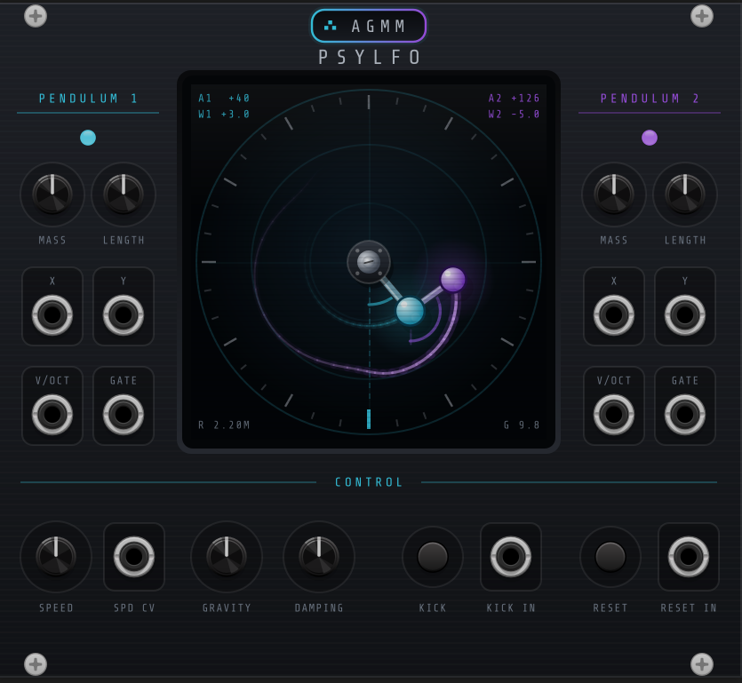

<!--
AGMM AUTOMATIC DOCUMENTATION
Source: PsyLFO.cpp
Generated: 2026-11-04 06:26
-->

The provided code is a complete VCV Rack module implementation for a **PsyLFO** module, which simulates a double pendulum system with visual feedback and control parameters. Here's a breakdown of what this code does:

---

### 🧠 Overview

This module implements a **double pendulum simulation**, where two pendulums are connected end-to-end (like a double pendulum). It includes:
- A graphical display showing the motion of both pendulums.
- Controls for mass, length, gravity, damping, and speed.
- Inputs for CV control of parameters.
- Outputs for X/Y positions, voltage/octave (Voct), and gate signals.
- Context menu options to adjust Voct ranges and gate durations.

---
## Module Screenshot

### 🔧 Key Components

#### 1. **Module Class: `PsyLFO`**
This is the core logic class that handles:
- Simulation of double pendulum physics.
- Trail tracking for visual history.
- Output generation (X, Y, Voct, Gate).
- Parameter handling and CV inputs.

##### Parameters:
- `MASS1`, `LEN1`: Mass and length of first pendulum.
- `MASS2`, `LEN2`: Mass and length of second pendulum.
- `SPEED`: Controls simulation speed.
- `GRAVITY`: Gravity constant.
- `DAMPING`: Damping factor.
- `KICK_BUTTON`, `RESET_BUTTON`: Manual controls.

##### Inputs:
- `SPEED_CV_INPUT`: CV input for speed control.
- `KICK_INPUT`: Trigger to kick the pendulum.
- `RESET_CV_INPUT`: Reset the simulation.

##### Outputs:
- `X1_OUTPUT`, `Y1_OUTPUT`: Position outputs for first pendulum.
- `VOCT1_OUTPUT`, `GATE1_OUTPUT`: Voct and gate for first pendulum.
- Same for second pendulum (`X2`, `Y2`, etc.)

##### Lights:
- `MASS1_LIGHT`, `MASS2_LIGHT`: Indicate when mass is adjusted.

---

#### 2. **Widget Class: `PsyLFOWidget`**
This defines the UI layout of the module in VCV Rack:
- Panel background with gradient and texture.
- Display area showing the pendulum motion.
- Knobs, jacks, buttons for user interaction.
- Context menu with Voct range and gate duration settings.

---

#### 3. **Display Widget: `PLDisplayWidget`**
This draws the visual representation of the double pendulum:
- Dial face with degree markings.
- Trails showing past positions.
- Bob shapes with halos and shadows.
- Real-time angle readouts (A1, A2) and angular velocity (W1, W2).
- Scanlines and glass reflection effect for a retro CRT look.

---

### 🎨 Visual Features

#### Display Elements:
- **Dial Face**: Radial gradient background.
- **Degree Rings**: Ticks every 10°, major ticks every 30°.
- **Crosshair**: Center reference line.
- **Plumb Line**: Dashed vertical line for reference.
- **Angle Arcs**: Visual representation of angular displacement.
- **Trails**: History of bob positions.
- **Bobs**: Color-coded spheres with halos and shadows.
- **Rods**: Lines connecting bobs.
- **Readouts**: Angle, velocity, reach, gravity values in corners.

---

### 📈 Physics Simulation

The simulation uses:
- **Double pendulum equations** (nonlinear differential equations).
- **Numerical integration** (likely Runge-Kutta or Euler method).
- **Trail tracking** to visualize motion history.
- **Flash effects** for gate triggers.

---

### ⚙️ Controls & Features

#### Global Controls:
- Speed: Adjusts simulation speed.
- Gravity: Changes gravitational constant.
- Damping: Adds energy loss over time.
- Kick Button: Resets pendulum position.
- Reset Button: Resets the entire system.

#### Per-Pendulum Controls:
- Mass and Length knobs.
- X/Y outputs for position.
- Voct and Gate outputs.

---

### 🧩 Context Menu Options

- Adjust **Voct1/2 Range**: Output voltage ranges (0–1, –1 to 1, etc.).
- Adjust **Gate1/Gate2 Duration**: How long the gate signal stays high.

---

### 📦 Integration with VCV Rack

This module integrates into the VCV ecosystem using:
- `ModuleWidget` for UI.
- `DrawArgs`, `NVGcontext` for drawing.
- `createParamCentered`, `createOutputCentered`, etc., for creating controls.
- `pluginInstance` and `modelPsyLFO` for plugin registration.

---

### 🧪 Example Usage

1. **Load the Plugin**: Place the module in a VCV Rack patch.
2. **Adjust Parameters**:
   - Turn knobs to change mass, length, gravity.
   - Use CV inputs to modulate parameters.
3. **Observe Motion**:
   - Watch the display update in real-time.
4. **Trigger Gates**:
   - Press buttons or send triggers via CV to generate gate signals.

---

### 🛠️ Possible Enhancements

- Add more physics options (e.g., friction, air resistance).
- Implement preset saving/loading.
- Add MIDI control support.
- Improve performance for high-speed simulations.
- Add stereo output support.

---

### ✅ Summary

This is a **highly detailed and visually rich double pendulum simulation** module for VCV Rack. It combines accurate physics with an attractive retro-style UI, making it both educational and musically useful. The code is well-structured, modular, and extensible.

Let me know if you'd like:
- A simplified version of this module.
- Documentation or a README file.
- Help integrating it into your own plugin project.
- Translation to another language (e.g., Python for simulation).