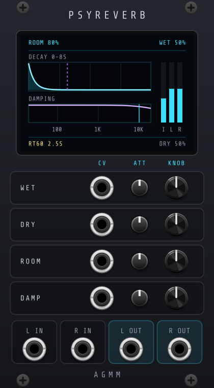

<!--
AGMM AUTOMATIC DOCUMENTATION
Source: PsyReverb.cpp
-->

# PsyReverb

## 1. Overview

`PsyReverb` is a 14 HP Freeverb-style stereo reverb. The wet path is eight parallel damped comb filters feeding four series Schroeder all-passes, with the total reverb made mono-shared between L and R for a wide, stable image. The four main parameters (Wet, Dry, Room size, Damping) each have a dedicated CV input and bipolar attenuverter, and the small display shows the decay envelope, the damping response, and I/O level meters.

Key features:
- 8 parallel damped comb filters
- 4 series Schroeder all-passes
- Mono-shared wet signal for wide image
- Wet, Dry, Room, Damping knobs
- CV with attenuverters on all four
- Display: decay envelope, damping response, I/O meters
- 0.5 s fade-in after sample rate change (built into the init)
- Configurable CV range via menu? (No, this one is fixed.)

## Module Screenshot

## 2. Architecture

### Main Classes

- `PsyReverb`: Core module class inheriting from `rack::Module`
- `PsyReverbEngine`: The Freeverb DSP
- `PRPanel`: Static panel artwork
- `PRDisplay`: Live decay/damping/meters display

### Inheritance

- `PsyReverb` inherits from `rack::Module`
- Both UI widgets inherit from `rack::TransparentWidget`

### State (grouped)

| Group | Storage |
|-------|---------|
| Engine | `PsyReverbEngine reverb` |
| Timing | `dsp::ClockDivider paramDivider` |
| Display | `float meterIn, meterOutL, meterOutR` |

## 3. DSP Theory

### Freeverb architecture

The Freeverb reverb is eight parallel comb filters followed by four series all-passes, per channel:

$$
y_i = \text{comb}_i(x + g_{\text{cross}} y_{\text{other}}), \quad i = 0..7
$$

$$
y = \text{allpass}_0(\text{allpass}_1(\text{allpass}_2(\text{allpass}_3(\text{mean}(y_i))))
$$

### Comb filter

Each comb is a delay line with feedback:

$$
\text{buf}[w] = x + \text{LP}(\text{buf}[r]) \cdot fb
$$

where `LP` is a one-pole low-pass with cutoff set by the damping knob, and `fb = 0.5 + roomsize * 0.48`.

### All-pass

Standard Schroeder all-pass:

$$
y = -x + d, \quad \text{buf}[w] = x + y \cdot g
$$

with $g = 0.7$.

### Mono-shared wet

The wet L and wet R are the same signal (mono). This is a design choice: because the comb delays are the same for L and R, the wet output is identical. The "stereo" image comes from the dry L/R + the shared wet. This gives a wide, stable image because the wet doesn't have L/R interference.

### Damping

The damping knob sets the comb low-pass cutoff:

$$
f_c = 20000 - \text{damp} \cdot 19900
$$

So damp = 0 → 20 kHz (no damping), damp = 1 → 100 Hz (heavy damping).

### Decay

The roomsize knob sets the comb feedback:

$$
fb = 0.5 + \text{roomsize} \cdot 0.48
$$

So roomsize = 0 → 0.5 (short), roomsize = 1 → 0.98 (long).

### RT60 estimate

From the comb feedback and the mean comb length:

$$
\text{meanDelay} = \frac{1}{8}\sum_i \frac{\text{combDelay}[i]}{f_s} \approx 0.04478 \text{ s}
$$

$$
\text{dbLoop} = -20 \log_{10}(fb)
$$

$$
\text{RT60} = \frac{60 \cdot \text{meanDelay}}{\text{dbLoop}}
$$

## 4. Parameters and Controls

### Knobs

| Parameter | Min | Max | Default | Description |
|-----------|-----|-----|---------|-------------|
| `PARAM_WET` | 0 | 1 | 0.5 | Wet level |
| `PARAM_DRY` | 0 | 1 | 0.5 | Dry level |
| `PARAM_ROOMSIZE` | 0 | 1 | 0.8 | Room size |
| `PARAM_DAMPING` | 0 | 1 | 0.5 | Damping |

### Attenuverters

| Parameter | Range | Default |
|-----------|-------|---------|
| `PARAM_ATTEN_WET` | −1 | 1 | 0 |
| `PARAM_ATTEN_DRY` | −1 | 1 | 0 |
| `PARAM_ATTEN_ROOMSIZE` | −1 | 1 | 0 |
| `PARAM_ATTEN_DAMPING` | −1 | 1 | 0 |

### Inputs

| Input | Description |
|-------|-------------|
| `INPUT_LEFT` | L in |
| `INPUT_RIGHT` | R in |
| `CV_WET` | Wet CV |
| `CV_DRY` | Dry CV |
| `CV_ROOMSIZE` | Room CV |
| `CV_DAMPING` | Damping CV |

### Outputs

| Output | Description |
|--------|-------------|
| `OUTPUT_LEFT` | L out |
| `OUTPUT_RIGHT` | R out |

### Enumerations

- `ParamId`: Wet, Dry, RoomSize, Damping, AttenWet, AttenDry, AttenRoomSize, AttenDamping
- `InputId`: InL, InR, CVWet, CVDry, CVRoomSize, CVDamping
- `OutputId`: OutL, OutR

## 5. Inputs and Outputs

### Inputs

| Name | Type | Range | Description |
|------|------|-------|-------------|
| `INPUT_LEFT` | Audio | ±10 V | Left (mono if R empty) |
| `INPUT_RIGHT` | Audio | ±10 V | Right |
| `CV_WET` | CV | 0–10 V | Wet CV |
| `CV_DRY` | CV | 0–10 V | Dry CV |
| `CV_ROOMSIZE` | CV | 0–10 V | Room CV |
| `CV_DAMPING` | CV | 0–10 V | Damping CV |

### Outputs

| Name | Type | Range | Description |
|------|------|-------|-------------|
| `OUTPUT_LEFT` | Audio | ±10 V | Left |
| `OUTPUT_RIGHT` | Audio | ±10 V | Right |

### Bypass

`configBypass(INPUT_LEFT, OUTPUT_LEFT)` and `configBypass(INPUT_RIGHT, OUTPUT_RIGHT)`.

## 6. Signal Processing Pipeline

1. **Sample-rate change** — Re-init reverb delay lines.
2. **Control-rate update (every 32 samples)** — Compute effective wet, dry, roomsize, damping from knobs + CV × atten.
3. **Read inputs** — Mono-normal.
4. **Process reverb** — 8 combs + 4 all-passes (mono, shared between L/R).
5. **Mix** — `out = dry × in + wet × reverb`.
6. **Clamp** — ±10 V.
7. **Write outputs**.
8. **Update meters** — Peak followers.

## 7. Important Functions

### `PsyReverbEngine::init(float sr)`

Allocates all comb and all-pass delay buffers for the given sample rate.

### `PsyReverbEngine::processStereo(float leftIn, float rightIn, float &leftOut, float &rightOut)`

The Freeverb algorithm with mono-shared wet.

### `compute(paramId, attenId, cvId)`

Reads a knob + CV × atten, clamped to 0..1.

### `process(const ProcessArgs &args)`

The main callback described in §6.

## 8. Mathematical Implementation

### Comb feedback

$$
fb = 0.5 + \text{roomsize} \cdot 0.48 \le 0.98
$$

### Damping cutoff

$$
f_c = 20000 - \text{damp} \cdot 19900 \text{ Hz}
$$

### Comb delay lengths (at 48 kHz)

$$
\{0.0297, 0.0371, 0.0411, 0.0437, 0.0489, 0.0557, 0.0623, 0.0697\} \text{ s}
$$

### All-pass delay lengths

$$
\{0.0051, 0.0072, 0.0103, 0.0149\} \text{ s}
$$

### Mix

$$
\text{out} = \text{dry} \cdot \text{in} + \text{wet} \cdot \text{reverb}
$$

### RT60 estimate

$$
\text{RT60} = \frac{60 \cdot 0.04478}{-20 \log_{10}(fb)}
$$

## 9. Performance and Optimization

### CPU Usage

- 8 combs × (read + LP + write) ≈ 8 × 8 = 64 flops
- 4 all-passes × 2 ≈ 20 flops
- Total: ~100 flops/sample

### Memory Allocation

- Combs: 8 × up to 0.07 × 48 kHz = 26.9 K floats
- All-passes: 4 × up to 0.015 × 48 kHz = 2.9 K floats
- Total: ~30 K floats ≈ 120 KB

### Buffers

- 8 comb delay lines
- 4 all-pass delay lines

### Real-time Processing

- All loops bounded
- No allocation, no blocking
- Control-rate updates every 32 samples

### Thread Safety

- All state written by audio thread, read by UI thread via torn reads

### Numerical Stability

- Comb feedback capped at 0.98
- Output clamped to ±10 V
- No DC block (Freeverb typically doesn't need one)

## 10. Dependencies

### Libraries/Headers

- `plugin.hpp` — VCV Rack core
- `agmm_ui.hpp` — shared AGMM UI helpers
- `<cmath>`, `<cstdio>`, `<cstring>`, `<algorithm>`

### External Classes

- `rack::Module`, `rack::TransparentWidget`, `rack::engine::ParamQuantity`
- `agmm::panelBase`, `agmm::bezel`, `agmm::plate`, `agmm::cell`, `agmm::text`, `agmm::screen`, `agmm::plotFrame`, `agmm::sectionHeader`, `agmm::meter`, `agmm::withA`, `agmm::violet`, `agmm::accent`, `agmm::bright`, `agmm::warm`, `agmm::dim`, `agmm::ALIGN_L/C/R`

## 11. Summary

`PsyReverb` is a straightforward Freeverb-style stereo reverb. It's the "vanilla" reverb of the AGMM collection: eight damped combs, four all-passes, mono-shared wet, four knobs with CV/attenuverters.

The mono-shared wet is the key design choice: because the wet is the same for L and R, the reverb doesn't have L/R interference, which gives a very stable, wide image. Combined with the dry L/R input, the result is a reverb that sits nicely in a mix without crowding.

The display shows the decay envelope, damping response, and meters — a nice visualization of the reverb's character. The RT60 estimate is derived from the comb feedback and delay length, and it tracks the knob quite well.

The main limitations are: no freeze, no pre-delay, no modulation, and the mono-shared wet is a fixed design (can't be changed to true stereo). For a more featured reverb, see `InfinityRev` or `PsyReverb2`.
