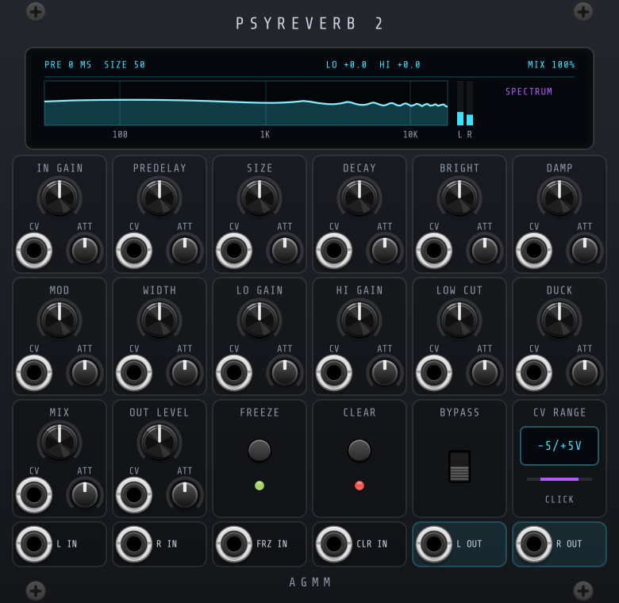

<!--
AGMM AUTOMATIC DOCUMENTATION
Source: PsyReverb2.cpp
-->

# PsyReverb2

## 1. Overview

`PsyReverb2` is a 26 HP "galactic" reverb based on Airwindows Galactic / Sapphire Galaxy, wrapped in an AGMM-styled panel with a full set of extra tone and workflow features. It's the most feature-rich reverb in the collection, with 14 main parameters (each with CV and attenuverter), pre/post EQ, low cut, ducking, freeze, clear, and three display modes.

Key features:
- 13 delay lines organized into 3 feedback quads + 1 modulated tank line
- Hadamard-like feedback matrix (energy-preserving)
- Pre-delay (0–100 ms)
- Size, decay (RT60), brightness, damping
- Modulation with slow LFO
- Stereo width (M/S)
- Pre-reverb or post-reverb shelving EQ (menu-selectable)
- Low cut (20 Hz .. 1 kHz)
- Input ducking (reverb ducks when input is loud)
- Freeze (button latch + gate)
- Clear (fade out, reset, fade in)
- 14 CV inputs with attenuverters
- 3 display modes (WAVE, BARS, SPECTRUM)
- Selectable CV range (bipolar/unipolar) via menu, persisted

## Module Screenshot

## 2. Architecture

### Main Classes

- `PsyReverb2Module`: Core module class inheriting from `rack::Module`
- `psyrv::Engine`: The Airwindows-inspired reverb tank
- `psyrv::DelayLine`, `psyrv::StereoFrame`, `psyrv::StereoQuad`: Data structures
- `psyrv::OnePole`, `psyrv::Biquad`: Filters
- `psyrv::FFT`: 1024-point FFT for display
- `P2CtlSpec`: Table entry for one knob
- `P2PanelBackground`: Static panel artwork
- `P2DisplayWidget`: Live display with 3 modes
- `P2CvRangeWidget`: Clickable CV range toggle
- `P2ChoiceItem`: Generic checkmark menu item

### Inheritance

- `PsyReverb2Module` inherits from `rack::Module`
- All UI widgets inherit from `rack::TransparentWidget`

### Structures

- `StereoFrame`: 2 doubles (L, R)
- `StereoQuad`: 4 StereoFrames
- `DelayLine`: ring buffer of StereoFrames
- `OnePole`: one-pole LP with settable cutoff
- `Biquad`: RBJ shelving biquad
- `FFT`: radix-2 FFT

### Engine constants

- `NDELAYS = 13` (12 tank lines + 1 modulated tank)
- `MOD_TANK_DELAY = 256` (samples)
- `MAX_PREDELAY = 24000` (0.5 s at 48 kHz)
- `tankSize[12] = {4801, 2909, 1153, 461, 7607, 4217, 2269, 1597, 3407, 1823, 859, 331}`

### State (grouped)

| Group | Storage |
|-------|---------|
| Engine | `psyrv::Engine engine` |
| EQ | `psyrv::Biquad loL, loR, hiL, hiR` |
| Low cut | `psyrv::OnePole hpL1, hpL2, hpR1, hpR2` |
| DC block | `float dcR, dcXL, dcYL, dcXR, dcYR` |
| Smoothing | `float kSmooth, kAtk, kRel, env` |
| Smoothed | `float sIn, sMix, sOut, sLo, sHi, sDuck, sBypass` |
| Freeze | `bool freezeLatch`, `prevFreezePressed` |
| Clear | `bool prevClearPressed`, `float clearFlash` |
| Display | `float scopeMin[160]`, `scopeMax[160]`, `scopeHead`, `scopeCount`, `scopeBMin`, `scopeBMax`, `peakL`, `peakR`, `fftRing[4096]`, `fftHead`, `dispPre`, `dispSize`, `dispMix`, `dispLo`, `dispHi`, `dispBypass`, `dispFreeze`, `clipTimer` |
| Settings | `CVRange cvRangeMode`, `int visMode`, `bool eqPre`, `bool softClip`, `float loFreq`, `float hiFreq` |

## 3. DSP Theory

### The Airwindows Galactic tank

The `Engine` has 13 delay lines: 12 are organized as 3 quads (4 lines each) for the feedback tank, and 1 is a modulated tank line for the phasor read.

Each tank line has:
- Base delay length `tankSize[i]`
- Per-line damping state
- Feedback gain from RT60

### Multirate cycling

The engine supports multirate cycling (MIN_CYCLE = 1, MAX_CYCLE = 4) based on the host sample rate. At 44.1/48 kHz, cycle = 1 (one full tank pass per sample). At higher rates, it takes multiple samples per tank update.

### Feedback matrix ("stir")

The feedback matrix is a Hadamard-like transform that mixes 4 lines:

$$
\begin{aligned}
g_0 &= f_0 - (f_1 + f_2 + f_3) \\
g_1 &= f_1 - (f_0 + f_2 + f_3) \\
g_2 &= f_2 - (f_0 + f_1 + f_3) \\
g_3 &= f_3 - (f_0 + f_1 + f_2)
\end{aligned}
$$

This is **energy-preserving** (the sum of squares is constant), so the tail can only decay through the per-line gains.

### Decay

The decay knob controls the feedback gain per round trip:

$$
\text{regen} = 0.0625 + \text{decay} \cdot 0.0625
$$

Freeze sets `regen = 0.5`, `atten = 0` (no damping, input muted).

### Damping

The damping knob controls a one-pole LP applied to the feedback:

$$
\alpha = 1 - \text{damp} \cdot 0.9
$$

$$
\text{dampState} \leftarrow \alpha \cdot \text{dampState} + (1 - \alpha) \cdot \text{feedback}
$$

### Brightness

The brightness knob sets a per-sample LP coefficient:

$$
\text{lowpass} = \frac{(1 - (1 - \text{brightness}))^2}{\sqrt{\text{overallscale}}}
$$

This is applied to the modulated phasor.

### Pre-delay

The pre-delay is a shared ring buffer, read at `predelayKnob * 0.1 * sr` samples back.

### Modulation

The modulation is a slow LFO that modulates the read position of the modulated tank line:

$$
\text{modPhase} \leftarrow \text{modPhase} + \text{oldFpd} \cdot \text{modSpeed}
$$

with `modSpeed = modKnob^3 * 0.001`.

### Stereo width

After the wet output, M/S processing:

$$
\text{mid} = \frac{L+R}{2}, \quad \text{side} = \frac{L-R}{2} \cdot \text{width}
$$

$$
L' = \text{mid} + \text{side}, \quad R' = \text{mid} - \text{side}
$$

### Mix

The mix uses a cubic taper:

$$
\text{wet} = 1 - (1 - \text{mix})^3
$$

This makes the knob feel more natural at low values.

### Dithering

The output is dithered with a tiny pseudo-random noise (`fpd[0]`, `fpd[1]`) to prevent denormal accumulation.

### Low cut

Two cascaded one-pole HP filters at 20 Hz .. 1 kHz:

$$
y = x - \text{HP}(x), \quad y' = y - \text{HP}(y)
$$

### Ducking

The input envelope is tracked with fast attack (5 ms) and slow release (300 ms):

$$
\text{env} \leftarrow \text{env} + (\text{level} - \text{env}) \cdot \begin{cases} a_{\text{atk}} & \text{level} > \text{env} \\ a_{\text{rel}} & \text{level} \le \text{env} \end{cases}
$$

Then the wet is reduced by the ducking amount:

$$
\text{duckGain} = 1 - \text{duck} \cdot \text{clamp}(\text{env}/3, 0, 1)
$$

### Clear

When CLEAR is pressed (button or trigger), the wet path fades out over 100 ms, the tank is reset, then it fades back in.

### Bypass

The bypass crossfades between the wet output and the dry input, smoothed over 10 ms.

## 4. Parameters and Controls

### 14 knobs (with CV + attenuverters)

| Parameter | Min | Max | Default | Description |
|-----------|-----|-----|---------|-------------|
| `IN_GAIN_PARAM` | 0 | 2 | 1 | Input gain |
| `PREDELAY_PARAM` | 0 | 1 | 0 | Pre-delay (0–100 ms) |
| `SIZE_PARAM` | 0 | 1 | 0.5 | Size |
| `DECAY_PARAM` | 0 | 1 | 0.5 | Decay |
| `BRIGHT_PARAM` | 0 | 1 | 0.5 | Brightness |
| `DAMP_PARAM` | 0 | 1 | 0.3 | Damping |
| `MOD_PARAM` | 0 | 1 | 0.3 | Modulation |
| `WIDTH_PARAM` | 0 | 1 | 0.5 | Stereo width (0–200%) |
| `LO_GAIN_PARAM` | −12 | 12 | 0 | Low shelf gain (dB) |
| `HI_GAIN_PARAM` | −12 | 12 | 0 | High shelf gain (dB) |
| `LOW_CUT_PARAM` | 0 | 1 | 0 | Low cut |
| `DUCK_PARAM` | 0 | 1 | 0 | Ducking |
| `MIX_PARAM` | 0 | 1 | 1 | Mix |
| `OUT_LEVEL_PARAM` | 0 | 2 | 1 | Output level |

### 14 attenuverters

Each knob has a corresponding attenuverter (`ATTN_FIRST + i`), range −1 to +1, default 0.

### Buttons / Switches

| Parameter | Description |
|-----------|-------------|
| `FREEZE_PARAM` | Freeze (toggle) |
| `CLEAR_PARAM` | Clear tank |
| `BYPASS_PARAM` | Bypass |

### Inputs

| Input | Description |
|-------|-------------|
| `AUDIO_L_INPUT` | Audio L |
| `AUDIO_R_INPUT` | Audio R |
| `FREEZE_GATE_INPUT` | Freeze gate |
| `CLEAR_TRIG_INPUT` | Clear trigger |
| `CV_FIRST + 0..13` | CV for each of the 14 knobs |

### Outputs

| Output | Description |
|--------|-------------|
| `AUDIO_L_OUTPUT` | Audio L |
| `AUDIO_R_OUTPUT` | Audio R |

### Lights

- `FREEZE_LIGHT` — On when freeze active
- `CLEAR_LIGHT` — Flash on clear

### Menu

- CV range: bipolar/unipolar
- Display: WAVE, BARS, SPECTRUM
- EQ position: pre-reverb / post-reverb
- Low shelf frequency: 100, 200, 300, 500 Hz
- High shelf frequency: 2500, 4000, 6000, 8000 Hz
- Output soft limiter: on/off
- Clear reverb tank

### Enumerations

- `CVRange`: BIPOLAR_M5_5, UNIPOLAR_0_10
- `VisMode`: VIS_WAVE, VIS_BARS, VIS_SPECTRUM, VIS_COUNT
- `ParamId`: InGain, Predelay, Size, Decay, Bright, Damp, Mod, Width, LoGain, HiGain, LowCut, Duck, Mix, OutLevel, AttenFirst..AttenLast, Freeze, Clear, Bypass
- `InputId`: AudioL, AudioR, FreezeGate, ClearTrig, CVFirst..CVLast
- `OutputId`: AudioL, AudioR
- `LightId`: Freeze, Clear

## 5. Inputs and Outputs

### Inputs

| Name | Type | Range | Description |
|------|------|-------|-------------|
| `AUDIO_L_INPUT` | Audio | ±10 V | Left audio |
| `AUDIO_R_INPUT` | Audio | ±10 V | Right audio |
| `FREEZE_GATE_INPUT` | Gate | > 2 V | Freeze |
| `CLEAR_TRIG_INPUT` | Gate | > 1 V | Clear tank |
| `CV_FIRST + 0..13` | CV | ±10 V | CV for each knob |

### Outputs

| Name | Type | Range | Description |
|------|------|-------|-------------|
| `AUDIO_L_OUTPUT` | Audio | ±10 V | Left |
| `AUDIO_R_OUTPUT` | Audio | ±10 V | Right |

### Bypass

`configBypass(AUDIO_L_INPUT, AUDIO_L_OUTPUT)` and `configBypass(AUDIO_R_INPUT, AUDIO_R_OUTPUT)`.

## 6. Signal Processing Pipeline

1. **Sample-rate setup** — Rebuild engine.
2. **Read all 14 params with CV** — `getCtl(i)` combines knob + CV × attenuverter × range.
3. **Freeze state** — Button latch + gate input.
4. **Clear state** — Button + trigger input, with fade.
5. **Bypass state**.
6. **Snap or smooth** — On first sample, snap smoothed values.
7. **Control-rate coefficients** — Every 16 samples: EQ, low cut, reverb decay, damping.
8. **Inputs** — Mono-normal.
9. **DC block**.
10. **Input envelope** — Track for ducking.
11. **Pre-EQ (optional)** — If `eqPre = true`.
12. **Reverb** — Run the engine.
13. **Post-EQ (optional)** — If `eqPre = false`.
14. **Low cut** — 12 dB/oct.
15. **Ducking**.
16. **Dry/wet mix**.
17. **Output level**.
18. **Bypass**.
19. **Clip detection** — Flash CLIP indicator.
20. **Soft limit** — If enabled.
21. **Write outputs, update display**.

## 7. Important Functions

### `psyrv::softLimit(float x)`

Soft-limits to ±10 V with a tanh shoulder above ±6 V.

### `psyrv::Biquad::setLowShelf(float freq, float dB, float sr)`

RBJ low shelf.

### `psyrv::Biquad::setHighShelf(float freq, float dB, float sr)`

RBJ high shelf.

### `psyrv::Engine::initialize()`

Resets all delay lines, feedback matrix, damp state, predelay.

### `psyrv::Engine::process(double sr, double inL, double inR, double &outL, double &outR)`

The main reverb callback.

### `PsyReverb2Module::getCtl(int i)`

Combines knob + CV × atten.

### `PsyReverb2Module::process(const ProcessArgs &args)`

The main callback described in §6.

## 8. Mathematical Implementation

### Reverb decay

$$
\text{regen} = 0.0625 + \text{decay} \cdot 0.0625
$$

### Brightness

$$
\text{lowpass} = \frac{(1 - (1 - \text{brightness}))^2}{\sqrt{\text{overallscale}}}
$$

### Damping

$$
\alpha = 1 - \text{damp} \cdot 0.9
$$

### Stereo width

$$
L' = \text{mid} + \text{side} \cdot \text{width}, \quad R' = \text{mid} - \text{side} \cdot \text{width}
$$

### Mix

$$
\text{wet} = 1 - (1 - \text{mix})^3
$$

### Ducking

$$
\text{duckGain} = 1 - \text{duck} \cdot \text{clamp}(\text{env}/3, 0, 1)
$$

### Low cut

$$
y = x - \text{HP}_1(x), \quad y' = y - \text{HP}_2(y)
$$

## 9. Performance and Optimization

### CPU Usage

- Per sample: 13 delay lines × (read + LP + write) + feedback matrix ≈ 500 flops
- Plus EQ (4 biquads) + low cut (4 one-poles) + ducking + mix ≈ 100 flops
- Plus FFT for the display: 1024 × log(1024) × 4 ≈ 40 K flops/frame
- Total: ~600 flops/sample + 40 K flops/frame

### Memory Allocation

- Delay lines: 13 × up to 15220 floats ≈ 100 K floats ≈ 400 KB
- Pre-delay: 24000 floats ≈ 96 KB
- FFT: 4096 floats × 2 = 32 KB
- No allocation in `process()`

### Buffers

- 12 tank delay lines (up to 15220 samples each)
- 1 modulated tank line (1024 samples)
- Pre-delay (24000 samples)
- FFT ring buffer (4096 samples)

### Real-time Processing

- All loops bounded
- No allocation, no blocking
- Control-rate coefficient updates every 16 samples

### Thread Safety

- All state written by audio thread, read by UI thread via torn reads

### Numerical Stability

- Hadamard-like feedback matrix preserves energy
- Per-line gains < 1
- Soft limiter at ±10 V
- Dither on output prevents denormals
- Freeze/clear transitions are smoothed

## 10. Dependencies

### Libraries/Headers

- `plugin.hpp` — VCV Rack core
- `agmm_ui.hpp` — shared AGMM UI helpers
- `<cmath>`, `<cstdint>`, `<cstdio>`, `<cstring>`, `<algorithm>`, `<functional>`, `<memory>`, `<string>`, `<vector>`

### External Classes

- `rack::Module`, `rack::TransparentWidget`, `rack::engine::ParamQuantity`
- `agmm::panelBase`, `agmm::bezel`, `agmm::plate`, `agmm::text`, `agmm::screen`, `agmm::plotFrame`, `agmm::sectionHeader`, `agmm::meter`, `agmm::chip`, `agmm::withA`, `agmm::violet`, `agmm::accent`, `agmm::bright`, `agmm::warm`, `agmm::dim`, `agmm::ALIGN_L/C/R`, `agmm::CyanLight`, `agmm::VioletLight`

## 11. Summary

`PsyReverb2` is the "deluxe" reverb of the AGMM collection. It's based on the Airwindows Galactic algorithm, which uses a multirate Hadamard-like feedback matrix to produce a lush, dense reverb that sounds like a real space. The extra features (pre-delay, modulation, damping, stereo width, low cut, ducking, shelving EQ, freeze, clear, CV on everything) make it extremely versatile.

The display is well-designed: 3 modes (WAVE, BARS, SPECTRUM) with full readouts and status chips. The spectrum analyzer makes it easy to see what the reverb is doing, and the freeze/clear/bypass states are always visible.

The main limitations are: CPU-heavy (~600 flops/sample + 40 K flops/frame), and the very dense panel (14 knobs + 14 attenuverters + 4 jacks + 3 buttons) makes it intimidating at first. But for a "big" reverb with all the options, this is excellent.
