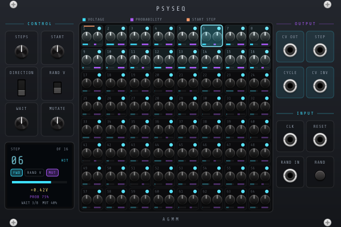

<!--
AGMM AUTOMATIC DOCUMENTATION
Source: PsySeq.cpp
-->

# PsySeq

## 1. Overview

`PsySeq` is a 38 HP 8×8 step sequencer with probabilistic node visiting and periodic mutation. Each of the 64 cells has a voltage trimpot (0..1, scaled into a user-selectable voltage range) and a probability trimpot (0..1) that decides whether the step is visited on that clock. The sequencer supports forward, reverse and random directions, a configurable start step, and a "random voltage per step" mode.

Key features:
- 8×8 grid of steps (up to 64)
- Per-step voltage and probability trimpots
- Forward, reverse, random directions
- Configurable start step (1–64)
- Random voltage per step mode
- Periodic mutation (with configurable wait cycles)
- Randomize button + trigger
- Clear, set all probabilities 100%, randomize all probabilities
- Polyphonic CV output + inverted CV
- Step trigger, cycle gate
- Live 8×8 grid with playhead, voltage bars, probability bars, skip crosses, start marker
- Status screen with current step, HIT/SKIP flag, direction/RAND V/MUT chips

## Module Screenshot

## 2. Architecture

### Main Classes

- `PsySeq`: Core module class inheriting from `rack::Module`
- `WaitCyclesParamQuantity`: Custom ParamQuantity that snaps to 0/4/8/16
- `PSPanelBackground`: Static panel artwork
- `PSGridWidget`: Live 8×8 grid
- `PSStatusWidget`: Status screen

### Inheritance

- `PsySeq` inherits from `rack::Module`
- All UI widgets inherit from `rack::TransparentWidget`

### Structures

- `WaitCyclesParamQuantity`: snaps to `{0, 4, 8, 16}`

### State (grouped)

| Group | Storage |
|-------|---------|
| Playhead | `int position`, `float voltMin, voltMax`, `float heldVoltage` |
| Cycle | `int cycleCounter` |
| Triggers | `dsp::SchmittTrigger clockTrigger, resetTrigger, randomizeTrigger, randomizeInputTrigger` |
| Pulses | `dsp::PulseGenerator cyclePulse, stepPulse` |
| Transport | `float lastSteps, lastStart` |
| Display | `int curIndex`, `bool curVisited`, `float stepFlash, mutFlash` |

## 3. DSP Theory

### Grid to index mapping

The `mapIndex(pos)` function maps a sequence position (0..63) to a cell in the 8×8 grid, offset by the current start step:

$$
\text{idx} = ((\text{start} - 1 + \text{pos}) \bmod 64 + 64) \bmod 64
$$

### Clock stepping

On each clock edge, the position advances according to the direction:

- **Forward**: `position++`, wrap to 0 at `steps`
- **Reverse**: `position--`, wrap to `steps-1`
- **Random**: `position = floor(random * steps)`, clamped to `[0, steps-1]`

### Probability gate

For each step, a probability is read from the cell's probability trimpot:

$$
\text{visited} = (\text{prob} > 10^{-4}) \land (u < \text{prob})
$$

where $u \sim \text{Uniform}[0, 1]$.

If visited:
- Fire the step trigger
- Update the held voltage to the current cell's value

If skipped:
- Do not fire the trigger
- Keep the held voltage (hold the previous value)

### Voltage per step

If `RANDOM_VOLTAGE` is on:

$$
\text{voltage} = u \cdot (\text{voltMax} - \text{voltMin}) + \text{voltMin}
$$

If off:

$$
\text{voltage} = \text{voltMin} + \text{knob} \cdot (\text{voltMax} - \text{voltMin})
$$

where `knob` is the cell's voltage trimpot (0..1).

### Periodic mutation

When a forward/reverse cycle completes, the module may attempt a mutation:

- `waitCycles = 0, 4, 8, 16`
- `mutationProb = knob value`

If `cycleCounter >= waitCycles`:
- With probability `mutationProb`, randomize all **active** step voltages (all steps in the sequence, not all 64)
- Reset `cycleCounter = 0`

### Inverted CV output

$$
\text{inv} = \text{voltMin} + \text{voltMax} - \text{heldVoltage}
$$

This flips the voltage range, which can be useful for patching.

### Cycle gate

A 1 ms pulse on the cycle output whenever a full cycle completes.

### Step trigger

A 5 ms pulse whenever a step is visited.

## 4. Parameters and Controls

### Knobs

| Parameter | Min | Max | Default | Description |
|-----------|-----|-----|---------|-------------|
| `STEPS_PARAM` | 1 | 64 | 8 | Steps |
| `START_PARAM` | 1 | 64 | 1 | Start step |
| `MUTATION_PARAM` | 0 | 1 | 0 | Mutation probability |
| `MUTATION_WAIT_PARAM` | 0, 4, 8, 16 | 0 | 0 | Wait cycles before mutation |

### Switches

| Parameter | Description |
|-----------|-------------|
| `DIRECTION_PARAM` | Forward / Reverse / Random |
| `RANDOM_VOLTAGE_PARAM` | Random voltage per step |

### Buttons

| Button | Description |
|--------|-------------|
| `RANDOMIZE_BUTTON` | Randomize all step voltages |

### Per-step trimpots (64 × 2)

| Parameter | Min | Max | Default | Description |
|-----------|-----|-----|---------|-------------|
| `KNOB_OFFSET + 0..63` | 0 | 1 | 0 | Voltage trimpot |
| `PROB_OFFSET + 0..63` | 0 | 1 | 1 | Probability trimpot |

### Inputs

| Input | Description |
|-------|-------------|
| `CLOCK_INPUT` | Clock |
| `RESET_INPUT` | Reset |
| `RANDOMIZE_TRIGGER_INPUT` | Randomize trigger |

### Outputs

| Output | Description |
|--------|-------------|
| `OUTPUT_OUT` | CV out |
| `CYCLE_GATE_OUTPUT` | Cycle gate |
| `STEP_TRIGGER_OUTPUT` | Step trigger |
| `INV_OUTPUT` | Inverted CV |

### Lights

- `LIGHT_OFFSET + 0..63` — per-cell gate LEDs

### Menu

- Voltage range (0..1, −1..1, −2..2, −5..5, 0..5, 0..10, −10..10)
- Randomize all step voltages
- Clear all step voltages
- All probabilities 100%
- Randomize all probabilities

### Enumerations

- `ParamId`: Steps, Start, Direction, RandomVoltage, RandomizeButton, KnobOffset..KnobMax, Mutation, MutationWait, ProbOffset..ProbMax
- `InputId`: Clock, Reset, RandomizeTrigger
- `OutputId`: Out, CycleGate, StepTrigger, InvOut
- `LightId`: LightOffset..LightMax

## 5. Inputs and Outputs

### Inputs

| Name | Type | Range | Description |
|------|------|-------|-------------|
| `CLOCK_INPUT` | Gate | > 1 V | Clock edge steps the sequencer |
| `RESET_INPUT` | Gate | > 1 V | Reset to step 0 |
| `RANDOMIZE_TRIGGER_INPUT` | Gate | > 1 V | Randomize all voltages |

### Outputs

| Name | Type | Range | Description |
|------|------|-------|-------------|
| `OUTPUT_OUT` | CV | see range | Current held voltage |
| `CYCLE_GATE_OUTPUT` | Gate | 0/10 V | 1 ms pulse at cycle end |
| `STEP_TRIGGER_OUTPUT` | Gate | 0/10 V | 5 ms pulse on visited step |
| `INV_OUTPUT` | CV | see range | Inverted voltage |

## 6. Signal Processing Pipeline

1. **Randomize button** — On rising edge, randomize all 64 voltage trimpots.
2. **Randomize input** — Same.
3. **Read params** — Steps, start, direction.
4. **Steps/start change** — Reset cycle counter.
5. **Reset input** — Reset position and cycle counter.
6. **Clock edge**:
   - Advance position according to direction.
   - Read probability of the current cell.
   - Roll probability; if visited, fire step trigger, update held voltage. If skipped, do not update.
   - If a cycle completed, increment cycle counter. If `waitCycles == 0` or `cycleCounter >= waitCycles`, attempt mutation.
   - Fire cycle pulse on cycle completion.
7. **Write outputs** — CV, inverted CV, cycle gate, step trigger.
8. **Update LEDs** — Light the current cell if visited.
9. **Update display** — Flash step, flash mutation.

## 7. Important Functions

### `mapIndex(int pos)`

Maps a sequence position to a grid index.

### `computeVoltageForStep(int stepIndex, bool randomMode)`

Returns the voltage for the given cell.

### `updateHeldVoltage()`

Recomputes the held CV output from the current position and settings.

### `setVoltageRange(float min, float max)`

Sets the voltage range and refreshes the held CV.

### `randomizeAllStepKnobs()`

Randomizes all 64 voltage trimpots.

### `clearAllStepKnobs()`

Sets all voltage trimpots to 0.

### `setAllProbabilities(float v)`

Sets all 64 probability trimpots to `v`.

### `randomizeAllProbabilities()`

Randomizes all 64 probability trimpots.

### `process(const ProcessArgs &args)`

The main callback described in §6.

## 8. Mathematical Implementation

### Index mapping

$$
\text{idx} = ((\text{start} - 1 + \text{pos}) \bmod 64 + 64) \bmod 64
$$

### Voltage per step

$$
v = \text{randomMode} ? u \cdot (\text{max} - \text{min}) + \text{min} : \text{min} + k \cdot (\text{max} - \text{min})
$$

### Inverted CV

$$
\text{inv} = \text{min} + \text{max} - v
$$

### Probability gate

$$
\text{visited} = (\text{prob} > 10^{-4}) \land (u < \text{prob})
$$

## 9. Performance and Optimization

### CPU Usage

- Per clock edge: 1 random roll + 1 probability read + 1 voltage read ≈ 20 flops
- Per sample: 4 output writes + 16 LED updates ≈ 50 flops
- Display: 64 cell renders per frame ≈ 500 flops/frame
- Total: ~50 flops/sample

### Memory Allocation

- No allocation in `process()`
- All state is fixed-size
- 64 trimpots × 2 (voltage + probability) = 128 floats
- `ruleset[8]`: 8 ints

### Buffers

- `ruleset[8]`: 8 ints

### Real-time Processing

- All loops bounded
- No allocation, no blocking
- `random::uniform()` used for randomize

### Thread Safety

- All state written by audio thread, read by UI thread via torn reads
- The 64 trimpots are writable from the UI thread (drag) and readable from the audio thread; a torn read is only cosmetic

### Numerical Stability

- All values clamped to safe ranges
- No numerical issues

## 10. Dependencies

### Libraries/Headers

- `plugin.hpp` — VCV Rack core
- `agmm_ui.hpp` — shared AGMM UI helpers
- `<cmath>`, `<cstdio>`, `<cstring>`, `<algorithm>`

### External Classes

- `rack::Module`, `rack::TransparentWidget`, `rack::engine::ParamQuantity`
- `rack::dsp::SchmittTrigger`, `rack::dsp::PulseGenerator`
- `agmm::panelBase`, `agmm::bezel`, `agmm::cell`, `agmm::text`, `agmm::screen`, `agmm::plotFrame`, `agmm::sectionHeader`, `agmm::chip`, `agmm::withA`, `agmm::violet`, `agmm::accent`, `agmm::bright`, `agmm::warm`, `agmm::dim`, `agmm::ALIGN_L/C/R`, `agmm::CyanLight`

## 11. Summary

`PsySeq` is an 8×8 step sequencer with per-cell voltage and probability. The probability feature is what makes it distinctive: each step has a chance of being skipped, which turns a simple sequence into a probabilistic one. Combined with the mutation feature, the sequence evolves over time.

The display is excellent: the 8×8 grid shows the current step, the voltage bars and probability bars, the start marker, and the skip crosses. The status screen shows the current step, the HIT/SKIP flag, and the direction/mode chips. The voltage range can be set from 0..1 up to ±10 V, and the inverted CV output makes it easy to patch inverted melodies.

The main limitations are: only 8×8 (64 steps), no per-step gate length, and the mutation only affects voltages (not probabilities). For a more flexible sequencer, see `DiceOnSteroids` (which has a pattern recorder) or `ExpressArpeggiator` (which has an interactive display).
