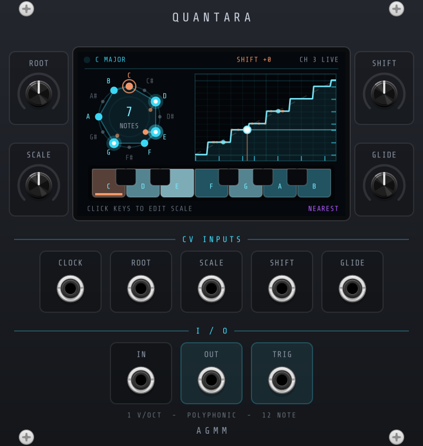

<!--
AGMM AUTOMATIC DOCUMENTATION
Source: Quantara.cpp
-->

# Quantara

## 1. Overview

`Quantara` is a 24 HP polyphonic pitch quantizer. It takes a polyphonic 1 V/oct input and snaps each voice to the nearest (or nearest-above / nearest-below) note of a selectable scale, with optional glide and a semitone transpose. Each voice emits a short note-change trigger whenever its quantized note changes.

Key features:
- Polyphonic 1 V/oct quantizer (up to 16 voices)
- 16 built-in scales + user-editable custom scale
- 3 quantize modes: nearest, down, up
- Glide (portamento)
- Transpose via knob + CV (1 V/oct)
- Optional clocked sample & hold
- Per-voice note-change trigger
- Root and scale CV
- Interactive display: pitch-class wheel + staircase transfer plot + clickable keyboard

## Module Screenshot

## 2. Architecture

### Main Classes

- `Quantara`: Core module class inheriting from `rack::Module`
- `QZPanelBackground`: Static panel artwork
- `QZKnobArcs`: Live value arcs
- `QZDisplayWidget`: Interactive display

### Inheritance

- `Quantara` inherits from `rack::Module`
- All UI widgets inherit from `rack::TransparentWidget` or `rack::Widget`

### Structures

- `QZ_NOTE_NAMES[12]` — note names
- `QZ_SCALE_SHORT[17]` — scale short names
- `QZ_SCALE_FULL[17]` — scale long names
- `QZ_SCALE_MASK[16]` — 12-bit masks for the 16 built-in scales
- `Mode`: MODE_NEAREST, MODE_DOWN, MODE_UP, NUM_MODES

### State (grouped)

| Group | Storage |
|-------|---------|
| Custom scale | `uint16_t userMask` |
| Mode | `int mode` |
| Per-voice state | `float heldIn[16]`, `targetQ[16]`, `outS[16]`, `int lastNote[16]` |
| Cache | `float cacheIn[16]`, `int cacheNote[16]`, `float cacheQ[16]`, `bool cacheOk[16]`, `uint32_t cacheKey` |
| Transport | `int lastCh` |
| Triggers | `dsp::SchmittTrigger clkTrig`, `dsp::PulseGenerator trigs[16]` |
| Display | `int vRoot, vScale, vShift, vNch`, `uint16_t vMask`, `bool vClocked`, `int vNote[16]`, `float pcFlash[12]`, `float clockFlash`, `float trailIn[40], trailOut[40]`, `int trailHead, trailCount`, `float trailTimer` |

## 3. DSP Theory

### Scale masks

Each of the 16 built-in scales is represented as a 12-bit mask (bit `i` = scale contains semitone `i` above the root). The 16 scales are chromatic, major, minor, harmonic minor, melodic minor, dorian, phrygian, lydian, mixolydian, locrian, major pentatonic, minor pentatonic, blues, whole tone, diminished, phrygian dominant.

The custom scale is also a 12-bit mask, editable by clicking the keyboard.

### Rotating the mask to the absolute pitch classes

Given a relative mask (semitone offsets from root) and a root note (0..11):

$$
\text{absMask} = \text{rotate}(\text{relMask}, \text{root})
$$

The rotation is a bitwise circular shift:

$$
\text{absMask} = (\text{relMask} << \text{root}) \mid (\text{relMask} >> (12 - \text{root})) \& 0xFFF
$$

### Quantization

The quantizer takes a float semitone value `n` and an absolute mask, and returns the nearest allowed note:

- **Nearest**: search `[base-13, base+13]` for the candidate with smallest `|cand - n|`
- **Down**: last candidate with `cand <= n`
- **Up**: first candidate with `cand >= n`

If the mask is empty (bypass mode), the input is simply rounded.

### Glide

When the quantized note changes, the output voltage glides toward the new target with a time constant of 2 ms .. 1 s:

$$
\tau = 0.002 \cdot 500^{\text{glide}}
$$

$$
a = 1 - e^{-\Delta t/\tau}
$$

$$
\text{outV} \leftarrow \text{outV} + a(\text{target} - \text{outV})
$$

### Clocked sample & hold

If a clock is patched, the quantizer only updates on clock edges:

$$
\text{edge} = \text{clockHigh} \land \lnot\text{lastClock}
$$

Without a clock, it quantizes continuously.

### Note-change trigger

When a voice's quantized note changes:

$$
\text{lastNote}[c] \ne \text{note}[c] \implies \text{fire 1 ms trigger}
$$

Also flash the pitch class in the display.

## 4. Parameters and Controls

### Knobs

| Parameter | Min | Max | Default | Description |
|-----------|-----|-----|---------|-------------|
| `ROOT_PARAM` | 0 | 11 | 0 | Root note |
| `SCALE_PARAM` | 0 | 16 | 1 | Scale index |
| `SHIFT_PARAM` | −12 | 12 | 0 | Transpose (semitones) |
| `GLIDE_PARAM` | 0 | 1 | 0 | Glide |

### Inputs

| Input | Description |
|-------|-------------|
| `IN_INPUT` | Pitch (1 V/oct, polyphonic) |
| `CLOCK_INPUT` | Clock (sample & hold; unpatched = continuous) |
| `ROOT_CV_INPUT` | Root CV (1 V/oct) |
| `SCALE_CV_INPUT` | Scale CV (0–10 V) |
| `SHIFT_CV_INPUT` | Transpose CV (1 V/oct) |
| `GLIDE_CV_INPUT` | Glide CV (0–10 V) |

### Outputs

| Output | Description |
|--------|-------------|
| `OUT_OUTPUT` | Quantized pitch (1 V/oct, polyphonic) |
| `TRIG_OUTPUT` | Note change trigger (polyphonic) |

### Enumerations

- `Mode`: MODE_NEAREST, MODE_DOWN, MODE_UP, NUM_MODES
- `ParamId`: Root, Scale, Shift, Glide
- `InputId`: In, Clock, RootCV, ScaleCV, ShiftCV, GlideCV
- `OutputId`: Out, Trig

### Menu

- Scale (17 options)
- Quantize mode (nearest/down/up)
- Custom scale: copy current scale, clear all notes, all notes on

## 5. Inputs and Outputs

### Inputs

| Name | Type | Range | Description |
|------|------|-------|-------------|
| `IN_INPUT` | CV | 1 V/oct | Poly pitch |
| `CLOCK_INPUT` | Gate | > 1 V | Sample & hold clock |
| `ROOT_CV_INPUT` | CV | ±10 V | Root offset |
| `SCALE_CV_INPUT` | CV | 0–10 V | Scale index |
| `SHIFT_CV_INPUT` | CV | ±10 V | Transpose offset |
| `GLIDE_CV_INPUT` | CV | 0–10 V | Glide offset |

### Outputs

| Name | Type | Range | Description |
|------|------|-------|-------------|
| `OUT_OUTPUT` | Poly CV | 1 V/oct | Quantized pitch |
| `TRIG_OUTPUT` | Poly Gate | 0/10 V | Note change trigger |

### Bypass

`configBypass(IN_INPUT, OUT_OUTPUT)` — pitch passes through when no patch.

## 6. Signal Processing Pipeline

1. **Read params** — Root, scale, shift, glide.
2. **Read CVs** — Root CV, scale CV, shift CV, glide CV.
3. **Compute absolute mask** — Rotate the relative mask by the current root.
4. **Cache key** — If the mask or mode changed, clear the cache.
5. **Clock detection** — Read clock edge.
6. **Per-voice processing**:
   - If unclocked or edge or fresh voice: quantize the input.
   - Update target, `lastNote`, fire trigger if changed.
   - Glide `outS` toward target.
   - Add shift and write output.
7. **Update display** — Root, scale, shift, mask, note array, flashes.

## 7. Important Functions

### `relMaskFor(int s)`

Returns the relative 12-bit mask for scale index `s` (built-in or custom).

### `toggleNote(int absPc)`

Flips the bit for absolute pitch class `absPc` in the custom scale, and switches to custom.

### `qzQuant(float n, uint16_t mask, int mode)`

The quantizer core function.

### `process(const ProcessArgs &args)`

The main callback described in §6.

## 8. Mathematical Implementation

### Absolute mask rotation

$$
\text{absMask} = ((\text{relMask} << \text{root}) \mid (\text{relMask} >> (12 - \text{root}))) \& 0xFFF
$$

### Quantize (nearest)

$$
\text{best} = \arg\min_{c \in [\text{base}-13, \text{base}+13]} |c - n|
$$

where `c` ranges over integers whose pitch class is in the mask.

### Quantize (down)

$$
\text{best} = \max\{c : c \le n, \text{mask}[c \bmod 12] = 1\}
$$

### Quantize (up)

$$
\text{best} = \min\{c : c \ge n, \text{mask}[c \bmod 12] = 1\}
$$

### Glide

$$
\tau = 0.002 \cdot 500^{\text{glide}}, \quad a = 1 - e^{-\Delta t/\tau}
$$

### Shift

$$
\text{out} = \text{outV} + \text{shift}/12
$$

## 9. Performance and Optimization

### CPU Usage

- Per voice: ~14 candidate checks for nearest mode, 1 for down/up ≈ 30 flops
- Max 16 voices × 30 flops = 480 flops/sample
- Display: 100-point staircase + 12-point wheel + 100-point LFO ≈ 3000 flops/frame
- Total: ~500 flops/sample

### Memory Allocation

- All state fixed-size
- No allocation in `process()`
- Scale table is static

### Buffers

- `heldIn[16]`, `targetQ[16]`, `outS[16]`, `cacheIn[16]`, `cacheNote[16]`, `cacheQ[16]`, `cacheOk[16]`, `lastNote[16]`: 128 values
- `trigs[16]`: 16 PulseGenerators

### Real-time Processing

- All loops bounded by 16 (voices)
- No allocation, no blocking
- Display curves computed on the UI thread

### Thread Safety

- All state written by audio thread, read by UI thread via torn reads
- The custom scale is written from the UI thread (clicking the keyboard) and read by the audio thread; a torn read is only cosmetic

### Numerical Stability

- All values clamped
- `std::isfinite` checks not needed (input is bounded by ±10 V, quantize is deterministic)
- Cache prevents recomputation when nothing changed

## 10. Dependencies

### Libraries/Headers

- `plugin.hpp` — VCV Rack core
- `agmm_ui.hpp` — shared AGMM UI helpers
- `<cmath>`, `<cstdio>`, `<cstdint>`, `<climits>`, `<cstring>`, `<algorithm>`, `<memory>`, `<string>`, `<vector>`

### External Classes

- `rack::Module`, `rack::TransparentWidget`, `rack::Widget`, `rack::engine::ParamQuantity`
- `rack::dsp::SchmittTrigger`, `rack::dsp::PulseGenerator`
- `agmm::panelBase`, `agmm::bezel`, `agmm::cell`, `agmm::text`, `agmm::screen`, `agmm::plotFrame`, `agmm::sectionHeader`, `agmm::withA`, `agmm::violet`, `agmm::accent`, `agmm::bright`, `agmm::warm`, `agmm::dim`, `agmm::ALIGN_L/C/R`, `agmm::CyanLight`

## 11. Summary

`Quantara` is a fully-featured polyphonic pitch quantizer. It has 16 built-in scales (chromatic, major, minor, modes, pentatonics, blues, whole tone, diminished, phrygian dominant) plus a custom scale that you can edit by clicking the on-screen keyboard.

The display is the standout feature: a pitch-class wheel with the scale polygon, a staircase transfer plot showing what the quantizer is doing, and a clickable keyboard for editing the custom scale. It's the most usable quantizer display I've seen — you can understand exactly what's happening at a glance.

The quantize modes (nearest/down/up) and the glide make it flexible: nearest for smooth melodies, down for "always fall to the next note below" (useful for bass lines), up for "always rise". The clock input lets you sample & hold, so the quantizer updates only on clock edges — useful for rhythmic quantization.

The main limitation is that the custom scale editing is only via the on-screen keyboard (not via a menu or CV), which makes it awkward for large-scale editing. But for a playable quantizer, this is excellent.
