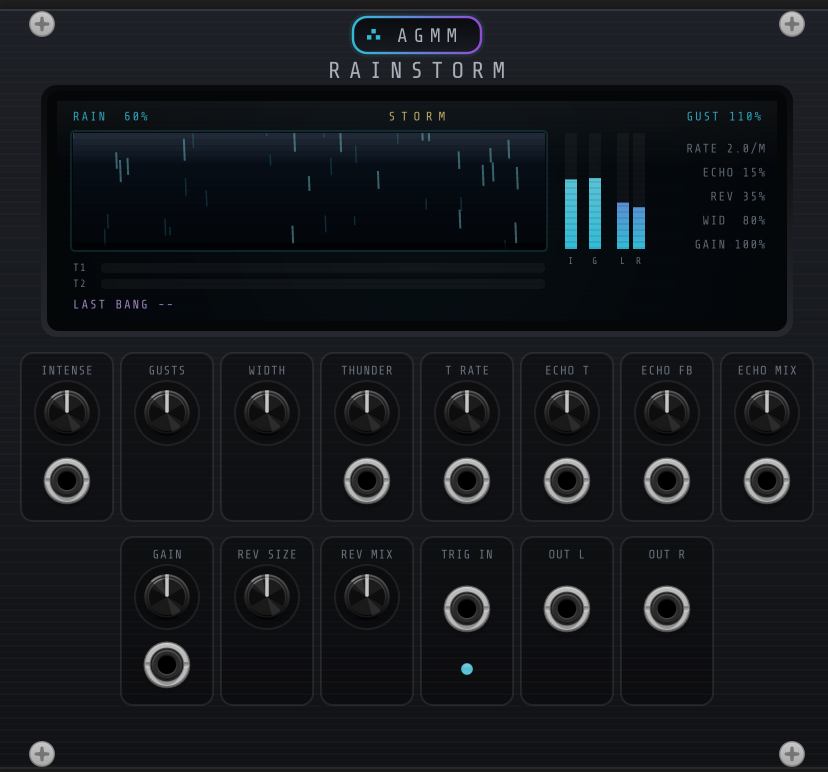

<!--
AGMM AUTOMATIC DOCUMENTATION
Source: RainStorm.cpp
Generated: 2026-11-04 06:29
-->

This code defines a VCV Rack module called **RainStorm**, which simulates an atmospheric sound environment with rain, wind, and thunder effects. Here's a breakdown of its key components:

## Module Screenshot

---

### 🧠 **Core Functionality**

#### 1. **Audio Processing Loop**
The main processing happens in the `process` function:
- **Stereo panning** (`rL`, `rR`) using width control.
- **Thunder generation**:
  - Manual trigger via input jack.
  - Random thunder strikes based on rate parameter.
  - Lightning flash animation with delay.
- **Voice synthesis** (2 voices):
  - Each voice processes rain-like sounds with roll parameters.
  - Outputs are mixed with thunder intensity.
- **Effects Chain**:
  - Echo effect (`echo`).
  - Reverb (`reverb`).
  - Final gain control and output limiting using `std::tanh`.

#### 2. **Parameters & Inputs**
| Name | Type | Description |
|------|------|-------------|
| `INTENSITY_PARAM` | Knob | Controls rain intensity. |
| `GUST_PARAM` | Knob | Wind gustiness. |
| `WIDTH_PARAM` | Knob | Stereo width of rain. |
| `THUNDER_INTENSITY_PARAM` | Knob | Thunder loudness. |
| `THUNDER_RATE_PARAM` | Knob | Frequency of random thunder. |
| `ECHO_TIME_PARAM` | Knob | Echo delay time. |
| `ECHO_FEEDBACK_PARAM` | Knob | Echo feedback level. |
| `ECHO_MIX_PARAM` | Knob | Mix between dry and echoed signal. |
| `REVERB_SIZE_PARAM` | Knob | Size of reverb room. |
| `REVERB_MIX_PARAM` | Knob | Mix between dry and reverberated signal. |
| `OUTPUT_GAIN_PARAM` | Knob | Overall output gain. |
| `TRIG_INPUT` | Jack | Manual thunder trigger. |
| CV inputs for most parameters (e.g., `INTENSITY_CV`, `THUNDER_RATE_CV`) |

---

### 🎨 **Visual Display (`RSDisplay`)**
A custom widget that renders:
- Animated rain scene with two layers of falling rain.
- Lightning bolt flashes and movement.
- Thunder voice indicators showing active status and distance.
- Vertical meters for intensity, gust, left/right channel levels.
- Text labels for various settings like rate, echo, reverb, etc.

#### Features:
- Dynamic rain animation using sine wave hashing (`hsh`) for pseudo-randomness.
- Flashing lightning bolt with fading effect.
- Animated progress bars for thunder voices and audio meters.
- Real-time display of module parameters and status.

---

### 🖼️ **Panel Layout (`RSPanel`)**
The UI layout includes:
- 8 knobs in the top row (rain intensity, gust, width, thunder intensity, rate, echo time, feedback, mix).
- 4 knobs in the second row (gain, reverb size, reverb mix, trigger input jack).
- Output jacks for left and right channels.
- A central display area showing visual rainstorm simulation.

---

### 🔧 **Module Structure**

#### `RainStorm` Class
- Inherits from `rack::Module`.
- Contains:
  - Voice structures (`voices[2]`) for rain synthesis.
  - Thunder logic including timing, randomness, and flash effects.
  - Audio processing functions (`process`, `triggerThunder`, etc.).
  - Display variables (`dispIntensity`, `meterL`, `flash`, etc.).

#### `RainStormWidget` Class
- Inherits from `rack::ModuleWidget`.
- Sets up the visual panel and connects controls to module parameters.
- Adds:
  - Custom display widget (`RSDisplay`).
  - Knobs, CV jacks, trigger input, lights, and output jacks.

---

### 🧪 **Usage Notes**
- **Rain Simulation**: Adjust `INTENSITY_PARAM` and `GUST_PARAM` to simulate different weather conditions.
- **Thunder Control**:
  - Use `TRIG_INPUT` for manual thunder.
  - Set `THUNDER_RATE_PARAM` for automatic strikes.
- **Effects**:
  - Tweak `ECHO_*` and `REVERB_*` parameters to shape the sound field.
- **Output Gain**: Fine-tune `OUTPUT_GAIN_PARAM` to match your system's needs.

---

### 📦 **Dependencies**
This module requires:
- VCV Rack SDK (version compatible with current API).
- Standard C++ libraries (`<rack.hpp>`, `<cmath>`, `<vector>`, etc.).
- Font assets (`ShareTechMono-Regular.ttf`) for UI text rendering.

---

### ✅ Summary
`RainStorm` is a richly featured atmospheric sound generator that blends realistic rain, wind, and thunder effects with modern audio processing techniques like echo and reverb. Its visual feedback makes it both functional and engaging to use in modular synthesis setups.