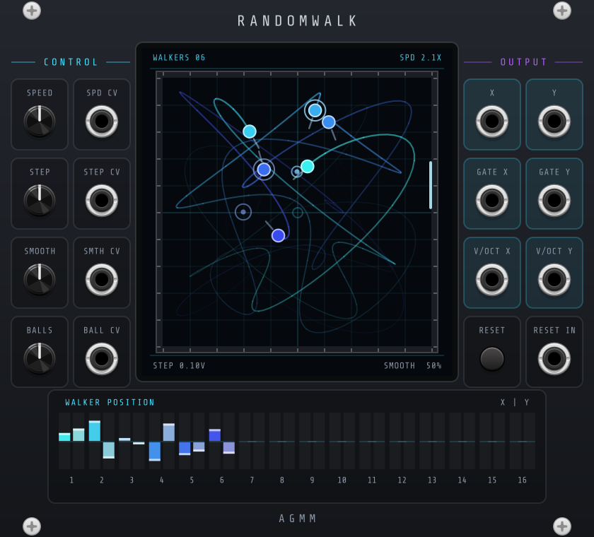

<!--
AGMM AUTOMATIC DOCUMENTATION
Source: RandomWalk.cpp
-->

# RandomWalk

## 1. Overview

`RandomWalk` is a 28 HP polyphonic random-voltage generator built from up to 16 independently wandering "walkers" confined to a ±10 V square arena. Each walker takes Gaussian-distributed random steps; the STEP knob sets the step magnitude and the SPEED knob scales how often those steps happen. A SMOOTHNESS control adds AR(1) momentum so that consecutive steps correlate, turning the pure white-noise walk into a meandering or drifting path.

Key features:
- Up to 16 walkers in a ±10 V arena
- Gaussian random steps with adjustable size and speed
- AR(1) momentum for smoothness
- Per-walker X/Y position outputs
- Per-walker zero-crossing gates
- Per-walker random V/Oct latched on zero-crossing
- Selectable V/Oct range (via menu)
- Selectable gate duration (via menu)
- Live arena display with trails
- 16-bar position strip
- Wall-hit and crossing flashes

## Module Screenshot

## 2. Architecture

### Main Classes

- `RandomWalk`: Core module class inheriting from `rack::Module`
- `RWPanelBackground`: Static panel artwork
- `RWDisplayWidget`: Live arena display
- `RWBarsWidget`: 16-bar position strip

### Inheritance

- `RandomWalk` inherits from `rack::Module`
- All UI widgets inherit from `rack::TransparentWidget`

### Structures

- `VoctRange`: Range0_1, RangeN1_1, RangeN2_2, RangeN5_5, Range0_5, NUM_RANGES
- `GateDuration`: Trigger, 5ms, 10ms, 20ms, 50ms, 100ms, 200ms, NUM_GATE_DURS

### State (grouped)

| Group | Storage |
|-------|---------|
| Positions | `std::array<double, 16> x, y, prevX, prevY` |
| Momentum | `std::array<double, 16> prevDeltaX, prevDeltaY` |
| Gate timers | `std::array<int, 16> gateXTimer, gateYTimer` |
| V/Oct | `std::array<double, 16> voctX, voctY` |
| Params | `int numBalls`, `double speedFactor, stepSize, smoothness` |
| Ranges | `VoctRange voctXRange, voctYRange` |
| Gate durations | `GateDuration gateXDuration, gateYDuration` |
| RNG | `std::mt19937 rng` |
| Display | `float trailX[16][200]`, `trailY[16][200]`, `int trailHead[16], trailCount[16]`, `float lastTX[16], lastTY[16]`, `float trailTimer` |
| Flash | `float flashXc[16], flashYc[16], flashWall[16]` |
| Wall info | `int wallSide[16]`, `float wallPos[16], xcPos[16], ycPos[16]` |

## 3. DSP Theory

### Random walk with momentum

The classic random walk takes a Gaussian step every sample:

$$
\mathbf{p}_{n+1} = \mathbf{p}_n + \sigma \cdot \mathbf{g}_n
$$

where $\mathbf{g}_n \sim \mathcal{N}(0, 1)$ and $\sigma = \text{stepSize} \cdot \sqrt{\text{speedFactor} \cdot \Delta t}$.

This module adds **AR(1) momentum**: the step is a mix of the previous step and a fresh random step:

$$
\Delta \mathbf{p}_n = \text{smooth} \cdot \Delta \mathbf{p}_{n-1} + (1 - \text{smooth}) \cdot \sigma \cdot \mathbf{g}_n
$$

With smooth = 0, this is the classic random walk. With smooth = 1, the walker keeps moving in the same direction forever (constant velocity). With intermediate smooth, the walker has "inertia" and meanders more smoothly.

### Wall reflection

If the walker crosses the ±10 V boundary, it's reflected and the sign of the velocity is flipped:

$$
x > 10 \implies x' = 20 - x, \quad v_x' = -v_x
$$

### Zero-crossing detection

For each axis, if the sign of the position changed since the last sample:

$$
\text{sign}(x_{n-1}) \ne \text{sign}(x_n) \implies \text{fire gate, re-roll V/Oct}
$$

### Random V/Oct

The V/Oct value is a fresh random in the current range:

$$
\text{voct} = \text{range\_scale} \cdot u
$$

### Trail

The trail ring buffer stores a point every time the walker has moved far enough:

$$
\| \mathbf{p}_n - \mathbf{p}_{\text{last}} \|^2 \ge \text{trailDist}^2
$$

This keeps the trail visible at any speed — slow walkers get spaced-out trails, fast walkers get dense trails.

## 4. Parameters and Controls

### Knobs

| Parameter | Min | Max | Default | Description |
|-----------|-----|-----|---------|-------------|
| `SPEED_PARAM` | 0 | 30 | 0.2 | Speed (0.1–297×) |
| `STEP_SIZE_PARAM` | 0.01 | 0.1 | 0.1 | Step size (V) |
| `NUM_BALLS_PARAM` | 1 | 16 | 1 | Number of walkers |
| `SMOOTHNESS_PARAM` | 0 | 1 | 0 | Smoothness (momentum) |

### Buttons

| Button | Description |
|--------|-------------|
| `RESET_BUTTON` | Reset all walkers |

### Inputs

| Input | Description |
|-------|-------------|
| `RESET_CV_INPUT` | Reset gate |
| `SPEED_CV_INPUT` | Speed CV (10 V adds 30) |
| `STEP_CV_INPUT` | Step size CV (10 V adds 0.09 V) |
| `SMOOTH_CV_INPUT` | Smoothness CV (10 V adds 100%) |
| `BALLS_CV_INPUT` | Ball count CV (10 V adds 15 balls) |

### Outputs

| Output | Description |
|--------|-------------|
| `X_OUTPUT` | X (±10 V, polyphonic) |
| `Y_OUTPUT` | Y (±10 V, polyphonic) |
| `GATE_X_OUTPUT` | X zero-crossing gate |
| `GATE_Y_OUTPUT` | Y zero-crossing gate |
| `VOCT_X_OUTPUT` | Random V/Oct X |
| `VOCT_Y_OUTPUT` | Random V/Oct Y |

### Enumerations

- `VoctRange`: Range0_1, RangeN1_1, RangeN2_2, RangeN5_5, Range0_5
- `GateDuration`: Trigger, 5ms, 10ms, 20ms, 50ms, 100ms, 200ms
- `ParamId`: Speed, StepSize, ResetButton, NumBalls, Smoothness
- `InputId`: ResetCV, SpeedCV, StepCV, SmoothCV, BallsCV
- `OutputId`: XOut, YOut, GateX, GateY, VOctX, VOctY

### Menu

- V/Oct X range (5 options)
- V/Oct Y range (5 options)
- Gate X duration (7 options)
- Gate Y duration (7 options)

## 5. Inputs and Outputs

### Inputs

| Name | Type | Range | Description |
|------|------|-------|-------------|
| `RESET_CV_INPUT` | Gate | > 1 V | Reset |
| `SPEED_CV_INPUT` | CV | 0–10 V | Speed offset |
| `STEP_CV_INPUT` | CV | 0–10 V | Step size offset |
| `SMOOTH_CV_INPUT` | CV | 0–10 V | Smoothness offset |
| `BALLS_CV_INPUT` | CV | 0–10 V | Ball count offset |

### Outputs

| Name | Type | Range | Description |
|------|------|-------|-------------|
| `X_OUTPUT` | Poly CV | ±10 V | X position |
| `Y_OUTPUT` | Poly CV | ±10 V | Y position |
| `GATE_X_OUTPUT` | Poly Gate | 0/10 V | X zero-crossing |
| `GATE_Y_OUTPUT` | Poly Gate | 0/10 V | Y zero-crossing |
| `VOCT_X_OUTPUT` | Poly CV | see range | Random V/Oct X |
| `VOCT_Y_OUTPUT` | Poly CV | see range | Random V/Oct Y |

## 6. Signal Processing Pipeline

1. **Read parameters** — Speed, step, smoothness, ball count with CV.
2. **Reset detection** — Reset all walkers and re-seed initial momentum.
3. **Flash decay** — Decay visual flash values.
4. **Per-walker physics** — For each walker:
   - Save previous position.
   - Generate independent white-noise increments.
   - Apply AR(1) momentum.
   - Update position.
   - Reflect off walls (record wall-hit).
   - Detect zero-crossings (fire gate, re-roll V/Oct, record flash).
5. **Outputs** — X, Y, gate, V/Oct for each walker.
6. **Trail** — Sample walker positions into trail ring when moved far enough.

## 7. Important Functions

### `resetWalkers()`

Clears all positions, trails, and flash data. Intentionally keeps prevDeltaX/Y so momentum survives a reset if the user wants it to.

### `generateRandomVoctForBall(int ball, bool forX)`

Generates a fresh random V/Oct value in the current range.

### `updateParameters()`

Reads controls and CVs, computes the effective values, creates newly active walkers, and restarts the trails of newly added walkers.

### `process(const ProcessArgs &args)`

The main callback described in §6.

## 8. Mathematical Implementation

### Step size

$$
\sigma = \text{stepSize} \cdot \sqrt{\text{speedFactor} \cdot \Delta t}
$$

### AR(1) momentum

$$
\Delta \mathbf{p}_n = \text{smooth} \cdot \Delta \mathbf{p}_{n-1} + (1 - \text{smooth}) \cdot \sigma \cdot \mathbf{g}_n
$$

### Position update

$$
\mathbf{p}_n = \mathbf{p}_{n-1} + \Delta \mathbf{p}_n
$$

### Wall reflection

$$
x > 10 \implies x' = 20 - x, \quad v_x' = -v_x
$$

### V/Oct ranges

| Range | Formula |
|-------|---------|
| 0..1 | $(u+1)/2$ |
| −1..1 | $u$ |
| −2..2 | $2u$ |
| −5..5 | $5u$ |
| 0..5 | $(u+1)/2 \cdot 5$ |

### Trail sampling

$$
\| \mathbf{p}_n - \mathbf{p}_{\text{last}} \|^2 \ge 0.15^2
$$

## 9. Performance and Optimization

### CPU Usage

- 16 walkers × (position + wall check + zero-crossing + timer decrement) ≈ 16 × 15 flops = 240 flops
- 16 Gaussian random calls per sample (std::normal_distribution) ≈ 16 × 20 flops
- Display: 16 trails × 200 points ≈ 3200 segments/frame
- Total: ~600 flops/sample + ~5000 flops/frame

### Memory Allocation

- All state is fixed-size
- Trails: 16 × 200 × 2 = 6400 floats ≈ 26 KB
- No allocation in `process()`

### Buffers

- `trailX[16][200]`, `trailY[16][200]`: 6400 floats

### Real-time Processing

- All loops bounded by 16
- No allocation, no blocking
- `std::mt19937` used for all random generation

### Thread Safety

- All state written by audio thread, read by UI thread via torn reads

### Numerical Stability

- Physics done in `double` to avoid float accumulation error
- Positions clamped to ±10 V
- `!std::isfinite` checks not needed (std::normal_distribution is bounded in practice)

## 10. Dependencies

### Libraries/Headers

- `plugin.hpp` — VCV Rack core
- `agmm_ui.hpp` — shared AGMM UI helpers
- `<cmath>`, `<cstdio>`, `<cstring>`, `<algorithm>`, `<random>`, `<limits>`, `<array>`

### External Classes

- `rack::Module`, `rack::TransparentWidget`, `rack::engine::ParamQuantity`
- `rack::dsp::SchmittTrigger`
- `agmm::panelBase`, `agmm::bezel`, `agmm::plate`, `agmm::text`, `agmm::screen`, `agmm::plotFrame`, `agmm::sectionHeader`, `agmm::meter`, `agmm::withA`, `agmm::violet`, `agmm::accent`, `agmm::bright`, `agmm::warm`, `agmm::dim`, `agmm::ALIGN_L/C/R`

## 11. Summary

`RandomWalk` is a polyphonic random-voltage generator that uses real 2D random walks. Each walker takes Gaussian steps with adjustable size and speed, plus optional AR(1) momentum. The momentum is the key feature: at smooth = 0, the walker is pure white noise (very jittery); at smooth = 0.95, the walker is nearly a sine wave (very smooth); at smooth = 1, the walker keeps moving in the same direction forever.

The module outputs the walker positions (X/Y), zero-crossing gates, and random V/Oct values latched on zero-crossings. The 16 walkers are independent, so you can patch one walker into a VCO (random melody), another into a filter (random timbre), another into a VCA (random amplitude), etc.

The main limitations are: the speed range is very wide (0.1–297×) which makes it hard to dial in "medium" speeds, and the momentum coefficient is a fixed formula (not user-adjustable per walker). But for a generative modulation source, this is very capable.
