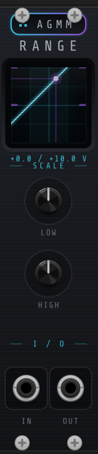

<!--
AGMM AUTOMATIC DOCUMENTATION
Source: Range.cpp
Generated: 2026-11-04 06:29
-->

# Range

## 1. Overview

The **Range** module is a signal scaling module that maps an input voltage range to a user-defined output voltage range. It accepts a single audio signal input and scales it linearly between two configurable voltage levels, specified by the LOW and HIGH parameters.

The module features:
- A graphical display showing the current transfer function and live signal visualization
- Two knobs for setting the low and high output voltage values
- An input port for the signal to be scaled
- An output port for the scaled signal
- Visual feedback through a retro-styled UI with gradient backgrounds, scanlines, and glowing elements

## Module Screenshot



## 2. Architecture

### Main Classes

- `Range`: The core module class inheriting from `rack::Module`
- `RGPanelBackground`: Custom widget for drawing the panel background
- `RGDisplayWidget`: Custom widget for rendering the transfer function display
- `RangeWidget`: Module widget that assembles all UI elements

### Inheritance

```cpp
struct Range : Module
```

The `Range` class inherits from VCV Rack's base `Module` class.

### Structures

- **Parameter IDs**: Defined in `enum ParamId`
  - `LOW_PARAM`
  - `HIGH_PARAM`

- **Input IDs**: Defined in `enum InputId`
  - `SIGNAL_INPUT`

- **Output IDs**: Defined in `enum OutputId`
  - `SIGNAL_OUTPUT`

- **Light IDs**: Defined in `enum LightId` (empty)

### Relationships

- The `RangeWidget` creates and manages:
  - `RGPanelBackground` for panel rendering
  - `RGDisplayWidget` for transfer function visualization
  - Two `RoundSmallBlackKnob` parameters for LOW/HIGH control
  - Input/output ports (`DarkPJ301MPort`)
- The `RGDisplayWidget` references the `Range` module to access:
  - Parameter values (LOW/HIGH)
  - Last input/output voltages
  - Active status

### Module Organization

The module is organized into:
1. Core processing logic in `Range::process()`
2. UI rendering in anonymous namespace functions (`drawText`, `drawLogo`, etc.)
3. Panel background drawing in `RGPanelBackground::draw()`
4. Display widget drawing in `RGDisplayWidget::drawLayer()`

## 3. DSP Theory

### Mathematical Equations

The core scaling operation is a linear transformation:

$$
\text{out} = \left( \frac{\text{in} + 5}{10} \right) \cdot (\text{high} - \text{low}) + \text{low}
$$

Where:
- `in` ∈ [-5V, +5V] (normalized input range)
- `out` ∈ [low, high] (output range)
- `low`, `high` are user-defined parameters in volts

This maps the standard VCV Rack audio signal range (-5V to +5V) to a custom output voltage range.

### Algorithms

1. **Linear Mapping**: The module performs a simple linear interpolation from the normalized input range [-5, 5] to the user-specified output range [low, high].
2. **Signal Processing Pipeline**:
   - Check if input is connected
   - Read input voltage
   - Read LOW/HIGH parameter values
   - Apply linear transformation
   - Output scaled voltage

### Filters

None implemented.

### Oscillators

None implemented.

### Delay Lines

None implemented.

### Feedback Systems

None implemented.

### Modulation

The module does not implement modulation or feedback systems. It simply scales the input signal based on static parameters.

### Random Processes

None implemented.

## 4. Parameters and Controls

### Knobs

- **LOW_PARAM**
  - Range: -10.0 V to +10.0 V
  - Default: 0.0 V
  - Label: "Low"
  - Unit: " V"

- **HIGH_PARAM**
  - Range: -10.0 V to +10.0 V
  - Default: 10.0 V
  - Label: "High"
  - Unit: " V"

### Switches

None.

### Buttons

None.

### CV Inputs

- **SIGNAL_INPUT**
  - Voltage Range: -5.0 V to +5.0 V (standard VCV Rack audio range)
  - Behavior: Input signal to be scaled

### Gates

None.

### Enumerations

- `ParamId`: LOW_PARAM, HIGH_PARAM
- `InputId`: SIGNAL_INPUT
- `OutputId`: SIGNAL_OUTPUT
- `LightId`: Empty

### Parameter Ranges and Default Values

| Parameter | Min Value | Max Value | Default Value |
|-----------|-----------|-----------|---------------|
| LOW_PARAM | -10.0 V   | 10.0 V    | 0.0 V         |
| HIGH_PARAM| -10.0 V   | 10.0 V    | 10.0 V        |

## 5. Inputs and Outputs

### Input Ports

- **SIGNAL_INPUT**
  - Voltage Range: -5.0 V to +5.0 V
  - Signal Type: Audio signal
  - Behavior: The input signal to be scaled according to LOW/HIGH parameters

### Output Ports

- **SIGNAL_OUTPUT**
  - Voltage Range: [LOW_PARAM, HIGH_PARAM] (user-defined)
  - Signal Type: Scaled audio signal
  - Behavior: Outputs the linearly scaled version of the input signal

## 6. Signal Processing Pipeline

1. **Input Check**: Verify that `SIGNAL_INPUT` is connected
2. **Voltage Reading**: Read input voltage from `SIGNAL_INPUT`
3. **Parameter Reading**: Read LOW and HIGH parameter values
4. **Scaling Calculation**:
   - Normalize input from [-5, 5] to [0, 1]
   - Scale to output range using linear interpolation
   - Apply offset to shift to desired range
5. **Output Setting**: Set scaled voltage on `SIGNAL_OUTPUT`
6. **Display Update**: Store last input/output voltages for UI visualization

## 7. Important Functions

### `Range::process()`

The main DSP processing function:
- Checks if input is connected
- Reads input voltage and parameter values
- Applies linear scaling transformation
- Sets output voltage
- Updates display variables (`lastIn`, `lastOut`, `active`)

### `RGDisplayWidget::drawLayer()`

Renders the graphical transfer function display:
- Draws grid lines and axes
- Renders the current transfer curve
- Shows live signal marker with position tracking
- Displays parameter readout

### `RGPanelBackground::draw()`

Draws the panel background:
- Gradient base
- Brushed texture
- Logo and title
- Section dividers
- Knob rings and labels
- Port plates and labels

## 8. Mathematical Implementation

The mathematical implementation is straightforward linear mapping:

$$
\text{out} = \left( \frac{\text{in} + 5}{10} \right) \cdot (\text{high} - \text{low}) + \text{low}
$$

Where:
- `in` is the input voltage in range [-5, 5]
- `low` and `high` are parameter values in volts
- The expression `(in + 5) / 10` maps the input from [-5, 5] to [0, 1]
- Multiplying by `(high - low)` scales the range
- Adding `low` shifts the result to the desired output range

## 9. Performance and Optimization

### CPU Usage Considerations

- Simple linear arithmetic operations
- Minimal floating-point calculations
- No complex DSP algorithms or filters
- Constant-time processing per audio block

### Memory Allocation

- Uses stack variables for temporary calculations
- No dynamic memory allocation
- Static buffers for UI rendering

### Buffers

- None required for core functionality
- Display widget uses fixed-size buffers for rendering

### Real-time Processing

- All operations are performed in real-time within the audio thread
- No blocking or time-consuming operations
- Efficient use of VCV Rack's process loop

### Thread Safety

- The `lastIn`, `lastOut`, and `active` variables are accessed by both audio thread (write) and UI thread (read)
- No explicit synchronization is used, relying on atomicity of float reads/writes
- This is acceptable for simple display updates

### Numerical Stability

- Uses standard floating-point arithmetic
- No iterative or recursive calculations
- Linear mapping ensures stable results across all parameter ranges

## 10. Dependencies

### Libraries and Headers

- `plugin.hpp`: VCV Rack plugin interface definitions
- `<cmath>`: Standard math functions (not used directly in this module)
- `<cstdio>`: Standard C I/O (not used directly in this module)
- `<algorithm>`: Standard algorithms (not used directly in this module)

### VCV Rack Classes

- `rack::Module`: Base module class
- `rack::ParamId`, `rack::InputId`, `rack::OutputId`: Enumerations for module ports
- `rack::Widget`: Base widget class
- `rack::TransparentWidget`: Widget with transparent background
- `rack::DrawArgs`: Arguments for drawing functions
- `rack::NVGcontext`: NanoVG rendering context
- `rack::Vec`, `rack::Color`: Vector and color types
- `rack::createParamCentered`, `createInputCentered`, `createOutputCentered`: Factory functions for UI elements

## 11. Summary

The **Range** module is a simple yet effective signal scaling unit that maps input voltages from the standard VCV Rack audio range (-5V to +5V) to a user-defined output voltage range. It implements a linear transformation using basic arithmetic operations and provides visual feedback through an interactive display showing the current transfer function and live signal position.

The module is optimized for real-time performance with minimal CPU usage, making it suitable for use in complex patch setups. Its clean UI design features retro aesthetics with gradient backgrounds, scanlines, and glowing elements that provide both functional and aesthetic value.

Key technical characteristics:
- Linear voltage scaling with configurable range
- Real-time processing in audio thread
- Thread-safe display updates
- Efficient memory usage
- Standard VCV Rack module interface compliance