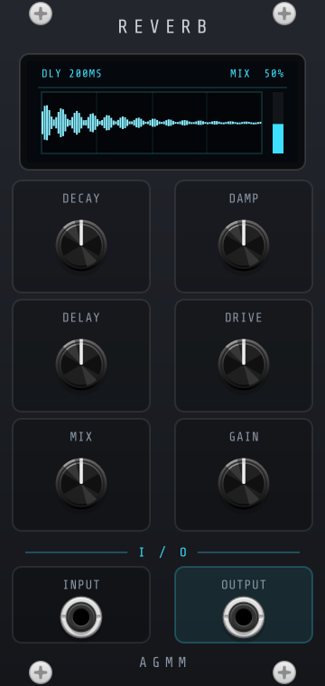

<!--
AGMM AUTOMATIC DOCUMENTATION
Source: Reverb.cpp
-->

# Reverb

## 1. Overview

`Reverb` is a 12 HP single-line feedback delay reverb with damping, drive and dry/wet mix. It is deliberately minimal: one mono delay line (up to ~4 s at 48 kHz) with a damped feedback path, a soft-clipping tanh write, an optional input drive saturator, and an output gain. The result is a warm, feedback-based ambience rather than a full FDN.

Key features:
- Single feedback delay line (up to 4 s)
- Damped feedback (one-pole LP in the loop)
- Soft-clipped write (tanh)
- Optional drive saturation
- Dry/wet mix
- Output gain (0–3×)
- Scope + single mono meter
- Six knobs: Decay, Damp, Delay Time, Drive, Mix, Gain

## Module Screenshot

## 2. Architecture

### Main Classes

- `Reverb`: Core module class inheriting from `rack::Module`
- `RvPanelBackground`: Static panel artwork
- `RvDisplayWidget`: Live scope + meter + readouts

### Inheritance

- `Reverb` inherits from `rack::Module`
- Both UI widgets inherit from `rack::TransparentWidget`

### Structures

- `RvCellDef { const char *name; int param; }` — table of 6 control cells

### State (grouped)

| Group | Storage |
|-------|---------|
| Delay buffer | `float delayBuffer[192000]` |
| Write head | `int writePos` |
| Damping | `float lowpass` |
| Display | `float scopeMin[96]`, `scopeMax[96]`, `scopeHead`, `scopeCount`, `scopeBMin`, `scopeBMax`, `float peakOut` |

## 3. DSP Theory

### The feedback delay loop

The reverb is a single delay line with feedback:

$$
\text{buf}[w] = \tanh(\text{in} + \text{filtered} \cdot \text{decay})
$$

where `filtered` is a one-pole low-pass of the read output. The tanh keeps the write bounded (soft clipping).

### Delay read

Read at `delayMs` back with linear interpolation:

$$
\text{readPos} = \text{writePos} - \text{delaySamples}
$$

$$
\text{delayed} = \text{buf}[i_0] + \text{frac} \cdot (\text{buf}[i_1] - \text{buf}[i_0])
$$

### Damping

One-pole low-pass in the feedback path:

$$
\text{lowpass} \leftarrow \text{lowpass} + c \cdot (\text{delayed} - \text{lowpass})
$$

where $c = 1 - e^{-2\pi f_c / f_s}$ and $f_c = 200 \cdot 40^{\text{damp}}$ (200 Hz .. 8 kHz).

### Drive

Optional tanh saturation with makeup gain:

$$
\text{wet} = \frac{\tanh(\text{driveAmt} \cdot \text{wet})}{\tanh(\text{driveAmt})}
$$

with `driveAmt = drive * 4`.

### Dry/wet mix

$$
\text{mixed} = (1 - \text{mix}) \cdot \text{in} + \text{mix} \cdot \text{wet}
$$

### Output

$$
\text{out} = 5 \tanh(\text{mixed} \cdot \text{outGain})
$$

## 4. Parameters and Controls

### Knobs

| Parameter | Min | Max | Default | Description |
|-----------|-----|-----|---------|-------------|
| `TIME_PARAM` | 0 | 0.995 | 0.5 | Decay (feedback) |
| `DAMP_PARAM` | 0 | 1 | 0.5 | Damping (200 Hz .. 8 kHz) |
| `DELAY_MS_PARAM` | 0 | 1000 | 200 | Delay time (ms) |
| `DRIVE_PARAM` | 0 | 1 | 0 | Drive |
| `MIX_PARAM` | 0 | 1 | 0.5 | Dry/wet |
| `OUTPUT_GAIN_PARAM` | 0 | 3 | 1 | Output gain |

### Inputs

| Input | Description |
|-------|-------------|
| `AUDIO_INPUT` | Audio in |

### Outputs

| Output | Description |
|--------|-------------|
| `AUDIO_OUTPUT` | Audio out |

### Enumerations

- `ParamId`: Time, Damp, DelayMs, Drive, Mix, OutputGain
- `InputId`: AudioIn
- `OutputId`: AudioOut

## 5. Inputs and Outputs

### Input

| Name | Type | Range | Description |
|------|------|-------|-------------|
| `AUDIO_INPUT` | Audio | ±10 V | Audio in |

### Output

| Name | Type | Range | Description |
|------|------|-------|-------------|
| `AUDIO_OUTPUT` | Audio | ±5 V | Audio out |

### Bypass

`configBypass(AUDIO_INPUT, AUDIO_OUTPUT)` — with no cable, input passes through.

## 6. Signal Processing Pipeline

1. **Read params** — Time, damp, delayMs, drive, mix, outGain.
2. **Compute damping coefficient** — `c = 1 - exp(-2π * cutoff / fs)`, with `cutoff = 200 * 40^damp`.
3. **Read delay** — Interpolate at `writePos - delayInt - frac`.
4. **Damping** — `lowpass += c * (delayed - lowpass)`.
5. **Write** — `buf[writePos] = tanh(in + lowpass * time)`.
6. **Advance** — `writePos = (writePos + 1) % MAX_DELAY`.
7. **Drive** — If `drive > 0`, apply tanh saturation.
8. **Mix** — Dry + wet.
9. **Output** — `out = 5 * tanh(mixed * outGain)`.
10. **Display** — Peak follower, scope ring buffer.

## 7. Important Functions

### `process(const ProcessArgs &args)`

The only function; it's the entire DSP in one loop.

## 8. Mathematical Implementation

### Damping cutoff

$$
f_c = 200 \cdot 40^{\text{damp}}
$$

So damp = 0 → 200 Hz, damp = 0.5 → ~1.26 kHz, damp = 1 → 8 kHz.

### Damping coefficient

$$
c = 1 - e^{-2\pi f_c / f_s}
$$

### Feedback write

$$
\text{buf}[w] = \tanh(\text{in} + \text{lowpass} \cdot \text{time})
$$

### Drive

$$
\text{out} = \tanh(4d \cdot \text{in}) / \tanh(4d)
$$

### Output

$$
\text{out} = 5 \tanh(\text{mixed} \cdot g)
$$

### Scope

`scopeMin`/`scopeMax` are min/max of the output, updated every 2.5 ms.

## 9. Performance and Optimization

### CPU Usage

- Per sample: 2 tanh calls + 4 arith + 2 reads + 1 write ≈ 30 flops
- Display: ~100 flops/frame
- Total: ~30 flops/sample

### Memory Allocation

- `delayBuffer[192000]` = 750 KB
- No allocation in `process()`

### Buffers

- 192000 floats

### Real-time Processing

- All operations are O(1) per sample
- No allocation, no blocking

### Thread Safety

- All state written by audio thread, read by UI thread via torn reads

### Numerical Stability

- `tanh` on write and on output
- Delay feedback is bounded by 0.995
- `!std::isfinite` check on output

## 10. Dependencies

### Libraries/Headers

- `plugin.hpp` — VCV Rack core
- `agmm_ui.hpp` — shared AGMM UI helpers
- `<cmath>`, `<cstdio>`, `<cstring>`, `<algorithm>`

### External Classes

- `rack::Module`, `rack::TransparentWidget`, `rack::engine::ParamQuantity`
- `agmm::panelBase`, `agmm::bezel`, `agmm::cell`, `agmm::text`, `agmm::screen`, `agmm::plotFrame`, `agmm::sectionHeader`, `agmm::meter`, `agmm::withA`, `agmm::violet`, `agmm::accent`, `agmm::bright`, `agmm::warm`, `agmm::dim`, `agmm::ALIGN_L/C/R`

## 11. Summary

`Reverb` is the simplest reverb in the AGMM collection: a single feedback delay line with damping, drive, and mix. It's not an algorithmic reverb — it's a delay that happens to sound like a small room. This is intentional: the module is designed to be a "one-knob ambience" that you can drop in anywhere without worrying about parameters.

The tanh write is the key to stability: without it, high feedback + high input would drive the delay line into runaway. With it, the reverb saturates gracefully as it gets loud, which sounds musical (like a real room).

The main limitations are: only one delay line (so no density), no pre-delay, no modulation, and no stereo input. But for a compact reverb that always sounds good, this is excellent.
