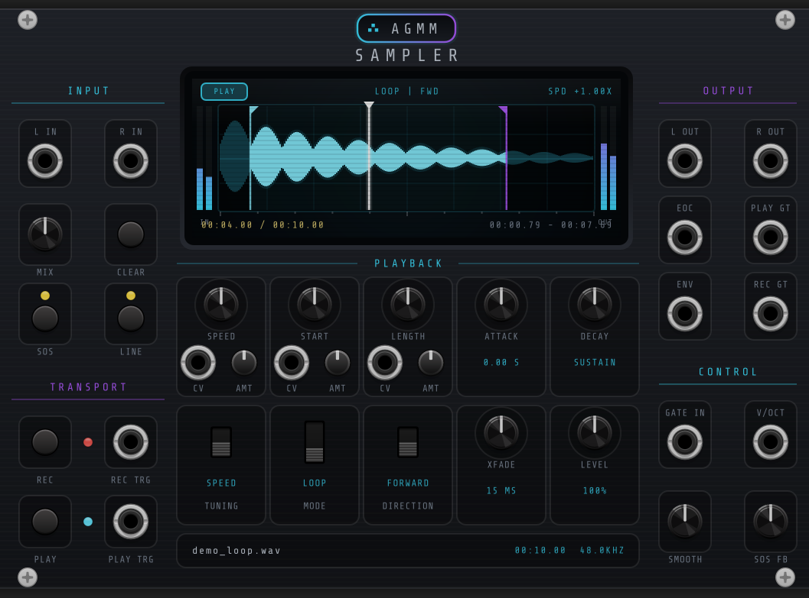

<!--
AGMM AUTOMATIC DOCUMENTATION
Source: Sampler.cpp
Generated: 2026-11-04 06:30
-->

The provided C++ code defines a VCV Rack module for a **sampler**, including its visual widget and associated UI elements. It's a complex, feature-rich implementation that handles audio playback, recording, loop control, and various user interactions.

Here's a breakdown of what this code does:

---

### 🧠 Overview

This is the source code for a **Sampler module** in VCV Rack (a modular synthesizer framework). The module allows users to:
- Load WAV files.
- Play them back with controls like speed, start/length, pitch mode, direction.
- Record audio into the module.
- Overdub samples on top of existing ones ("Sound-on-Sound").
- Visualize waveform data in real-time.
- Adjust parameters via knobs, switches, and CV inputs.

## Module Screenshot

---

### 🔧 Key Components

#### 1. **Sampler Module Class (`Sampler`)**
This class inherits from `Module` and manages:
- Audio buffers (main and recording).
- Playback state: playing, recording, overdubbing.
- Loop settings: start, length, direction.
- Metering for input/output levels.
- UI interaction logic like loading/saving samples.

#### 2. **SamplerWidget Class (`SamplerWidget`)**
This class inherits from `ModuleWidget` and defines how the module looks in the Rack GUI:
- Panel layout with inputs/outputs/knobs/switches.
- Custom drawing code for waveform visualization (`SPDisplayWidget`).
- Context menu options for file operations (load/save, normalize, reverse, etc.).
- Readouts under knobs to show current values.

#### 3. **Custom Widgets**
These are custom UI components defined inside the widget class:
- `SPDisplayWidget`: Draws the waveform display with loop markers, playhead, meters.
- `SPReadout`: Shows parameter values (e.g., time, pitch mode) below knobs.
- `SPInfoWidget`: Displays file name, length, sample rate.

---

### 🖼️ Visual Features

The `SPDisplayWidget::drawLayer` function draws:
- A **waveform** with gradient coloring and glow effects.
- Loop region highlighting.
- Playhead indicator (with different colors during overdub).
- Level meters for input/output.
- Time ruler ticks.
- Scanlines and glass reflection effect for a retro look.
- Top status bar showing:
  - Recording/playing state.
  - Mode (one-shot, loop, ping-pong).
  - Speed or tuning setting.
- Bottom time info strip showing:
  - Elapsed time during playback.
  - Loop start/end times.

---

### 📦 File Operations

The context menu includes actions like:
- Load WAV sample
- Save WAV sample
- Normalize
- Reverse
- Trim to loop region
- Clear sample

These are handled by methods in the `Sampler` class (`loadWavDialog`, `saveWavDialog`, etc.).

---

### ⚙️ Parameters & Controls

The module has many parameters:
- **Playback controls**: Speed, start, length, attack, decay.
- **Switches**: Pitch mode (V/Oct or speed), play mode (one-shot, loop, ping-pong), direction (forward/reverse).
- **Knobs**: Mix, crossfade, level.
- **Buttons**: SOS (sound-on-sound), line switch, record, play.
- **CV inputs**: For controlling parameters via external signals.

---

### 🧪 Demo Mode

When no module is loaded (e.g., in the browser or demo mode), it shows:
- A placeholder waveform.
- Sample info like "demo_loop.wav".
- Dummy meter readings.

---

### 📁 Related Files

Based on the header file (`plugin.hpp`), this code is part of a larger plugin that includes other modules such as reverb, delay, sequencers, etc. This suggests it's a **modular audio effects suite** or **sound design toolkit**.

---

### ✅ Summary

This is a **highly functional and visually rich sampler module** for VCV Rack:
- Supports full playback and recording.
- Offers advanced features like overdubbing, loop control, pitch shifting.
- Includes a detailed waveform display with visual feedback.
- Provides intuitive controls and real-time parameter readouts.
- Integrates seamlessly into the Rack ecosystem.

It's suitable for both live performance and studio use, offering flexibility in sound manipulation and creative workflows.

Let me know if you'd like help:
- Adding new features.
- Optimizing performance.
- Porting to another platform.
- Understanding specific parts of the code.