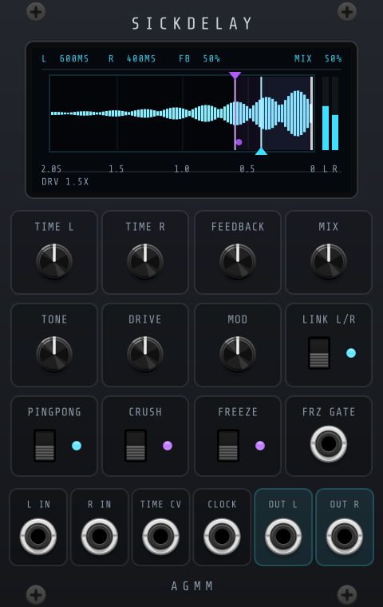

<!--
AGMM AUTOMATIC DOCUMENTATION
Source: SickDelay.cpp
-->

# SickDelay

## 1. Overview

`SickDelay` is a 16 HP stereo delay with independent left/right times (or linked), feedback, dry/wet mix, a tone (one-pole lowpass) control, drive saturation, modulation (LFO on both delay times), ping-pong stereo routing, a bitcrusher, freeze, and clock-synced delay times.

Key features:
- Independent L/R delay times (or linked)
- Clock sync (when a clock is patched, the time knob selects a note division)
- Feedback, mix, tone, drive
- Modulation (LFO on delay times)
- Ping-pong
- Bitcrusher
- Freeze
- Live delay-line timeline display
- Sync/link/ping-pong/crush state indicators

## Module Screenshot

## 2. Architecture

### Main Classes

- `SickDelay`: Core module class inheriting from `rack::Module`
- `SDPanel`: Static panel artwork
- `SDDisplay`: Live delay-line timeline display

### Inheritance

- `SickDelay` inherits from `rack::Module`
- Both UI widgets inherit from `rack::TransparentWidget`

### State (grouped)

| Group | Storage |
|-------|---------|
| Delay buffers | `float bufferL[96000]`, `bufferR[96000]` |
| Write heads | `int writePosL`, `writePosR` |
| Filters | `float lastSampleL`, `lastSampleR` |
| LFO | `float lfoPhase` |
| Clock | `dsp::SchmittTrigger clockTrigger`, `float clockTimer`, `clockPeriod`, `bool clockHasEdge, clockValid` |
| Display | `float peakBins[82]`, `int peakWriteBin, lastBin`, `float dispAgeL, dispAgeR, dispMsL, dispMsR`, `int dispDivL, dispDivR`, `bool dispSync`, `float dispMod, meterL, meterR` |

## 3. DSP Theory

### Clock sync

If a clock is patched, the module measures the time between rising edges:

$$
\text{clockPeriod} \leftarrow \text{clockTimer} \quad (\text{on edge})
$$

The time knob then selects one of 10 note divisions:

$$
\{1/16, 1/8T, 1/8, 1/4T, 1/8., 1/4, 1/4., 1/2, 1/2., 1/1\}
$$

The delay time in samples is:

$$
\text{delaySamples} = \text{clockPeriod} \cdot \text{mult} \cdot f_s
$$

If the result exceeds the buffer, it's halved until it fits.

### Free-running time

Without a clock, the time knob maps directly to the buffer:

$$
\text{delaySamples} = \text{knob} \cdot (\text{BUFFER\_SIZE} - 2000)
$$

### Modulation

A shared LFO modulates both delay times:

$$
\text{delaySamples} \leftarrow \text{delaySamples} + \text{lfo} \cdot 200 \cdot \text{modDepth}
$$

where `lfo = sin(2π * 0.5 * t)` and the modulation is up to ±200 samples (about ±4 ms at 48 kHz).

### Feedback

The delay output is mixed with the feedback:

$$
\text{buf}[w] = \text{in} + \text{processed} \cdot \text{feedback}
$$

The `processed` term is the delay output after drive + tone:

$$
\text{processed} = \tanh(\text{delayed} \cdot (1 + \text{drive}))
$$

$$
\text{lastSample} \leftarrow \text{lastSample} + \text{tone} \cdot (\text{processed} - \text{lastSample})
$$

### Bitcrusher

Quantization to 6 bits:

$$
\text{delayed} \leftarrow \text{round}(\text{delayed} \cdot 6) / 6
$$

### Freeze

When frozen, the buffer is attenuated to 0.999 per sample instead of being written with input:

$$
\text{buf}[w] \leftarrow \text{lastSample} \cdot 0.999
$$

### Ping-pong

When ping-pong is on, the right output is the inverted left:

$$
\text{outR} = -\text{outL}
$$

### Output

$$
\text{out} = \text{crossfade}(\text{in}, \text{wet}, \text{mix})
$$

## 4. Parameters and Controls

### Knobs

| Parameter | Min | Max | Default | Description |
|-----------|-----|-----|---------|-------------|
| `TIME_PARAM` | 0 | 1 | 0.5 | Left delay time / division |
| `TIME_R_PARAM` | 0 | 1 | 0.5 | Right delay time / division |
| `FEEDBACK_PARAM` | 0 | 1 | 0.5 | Feedback |
| `MIX_PARAM` | 0 | 1 | 0.5 | Dry/wet |
| `COLOR_PARAM` | 0.01 | 0.5 | 0.2 | Tone |
| `DRIVE_PARAM` | 0 | 3 | 0.5 | Drive |
| `MOD_PARAM` | 0 | 1 | 0.2 | Modulation depth |

### Switches

| Parameter | Description |
|-----------|-------------|
| `PINGPONG_SWITCH` | Ping-pong |
| `BITCRUSH_SWITCH` | Bitcrusher |
| `FREEZE_SWITCH` | Freeze |
| `LINK_SWITCH` | Link L/R time |

### Inputs

| Input | Description |
|-------|-------------|
| `LEFT_INPUT` | Left audio |
| `RIGHT_INPUT` | Right audio |
| `TIME_CV_INPUT` | Time CV (both channels) |
| `FREEZE_CV_INPUT` | Freeze gate |
| `CLOCK_INPUT` | Clock (syncs delay times) |

### Outputs

| Output | Description |
|--------|-------------|
| `OUT_L_OUTPUT` | Left |
| `OUT_R_OUTPUT` | Right |

### Lights

- `FREEZE_LIGHT` — Freeze active
- `BITCRUSH_LIGHT` — Bitcrusher active
- `PINGPONG_LIGHT` — Ping-pong active
- `LINK_LIGHT` — Link active

### Enumerations

- `ParamId`: Time, Feedback, Mix, Color, Drive, Mod, PingPong, Bitcrush, Freeze, TimeR, Link
- `InputId`: Left, Right, TimeCV, FreezeCV, Clock
- `OutputId`: OutL, OutR
- `LightId`: Freeze, Bitcrush, Pingpong, Link

## 5. Inputs and Outputs

### Inputs

| Name | Type | Range | Description |
|------|------|-------|-------------|
| `LEFT_INPUT` | Audio | ±10 V | Left (mono if R empty) |
| `RIGHT_INPUT` | Audio | ±10 V | Right |
| `TIME_CV_INPUT` | CV | 0–10 V | Time modulation |
| `FREEZE_CV_INPUT` | Gate | > 2 V | Freeze |
| `CLOCK_INPUT` | Gate | > 1 V | Clock (syncs time) |

### Outputs

| Name | Type | Range | Description |
|------|------|-------|-------------|
| `OUT_L_OUTPUT` | Audio | ±10 V | Left |
| `OUT_R_OUTPUT` | Audio | ±10 V | Right |

### Bypass

`configBypass(LEFT_INPUT, OUT_L_OUTPUT)` and `configBypass(RIGHT_INPUT, OUT_R_OUTPUT)`.

## 6. Signal Processing Pipeline

1. **Input read** — Mono-normal.
2. **Freeze state** — Switch OR gate.
3. **Clock tracking** — Measure period between edges.
4. **Modulation LFO** — Advance phase.
5. **Compute delay times** — Clock-synced or free-running.
6. **Read delay lines** — Interpolate at `writePos - delaySamples`.
7. **Bitcrush** — If enabled.
8. **Drive + tone** — tanh + one-pole LP.
9. **Write delay lines** — Input + processed × feedback (or freeze decay).
10. **Output** — Wet mix (with ping-pong if enabled), then dry/wet crossfade.
11. **Meters + display** — Update peaks.

## 7. Important Functions

### `process(const ProcessArgs &args)`

The main callback described in §6.

### `dataToJson()`, `dataFromJson(json_t*)`

No persistence (all params are knob values).

## 8. Mathematical Implementation

### Clock-synced delay

$$
\text{delaySamples} = \text{clockPeriod} \cdot \text{mult} \cdot f_s
$$

### Free-running delay

$$
\text{delaySamples} = \text{knob} \cdot (\text{BUFFER\_SIZE} - 2000)
$$

### Modulation

$$
\text{delaySamples} \leftarrow \text{delaySamples} + \sin(2\pi f_{\text{LFO}} t) \cdot 200 \cdot \text{modDepth}
$$

### Drive

$$
\text{processed} = \tanh(\text{delayed} \cdot (1 + \text{drive}))
$$

### Tone

$$
\text{lastSample} \leftarrow \text{lastSample} + \text{tone} \cdot (\text{processed} - \text{lastSample})
$$

### Freeze decay

$$
\text{buf}[w] \leftarrow \text{lastSample} \cdot 0.999
$$

### Feedback write

$$
\text{buf}[w] = \text{in} + \text{processed} \cdot \text{feedback}
$$

### Ping-pong

$$
\text{outR} = -\text{outL}
$$

### Dry/wet mix

$$
\text{out} = \text{crossfade}(\text{in}, \text{wet}, \text{mix})
$$

## 9. Performance and Optimization

### CPU Usage

- Per sample: 2 delay reads + 2 drive + 2 tone + 2 writes ≈ 100 flops
- Display: 82 bins ≈ 200 flops/frame
- Total: ~100 flops/sample

### Memory Allocation

- `bufferL[96000]`, `bufferR[96000]`: 192 K floats ≈ 768 KB
- No allocation in `process()`

### Buffers

- 96000 × 2 floats

### Real-time Processing

- All loops bounded
- No allocation, no blocking
- Clock trigger is a `dsp::SchmittTrigger` (sample-rate tracking)

### Thread Safety

- All state written by audio thread, read by UI thread via torn reads

### Numerical Stability

- `tanh` on drive
- Feedback is not clamped but the input is bounded by ±10 V and the buffer is 96000 samples, so feedback > 1 would eventually blow up — the user must keep feedback < 1 (which is enforced by the knob range)
- Freeze mode decays the buffer

## 10. Dependencies

### Libraries/Headers

- `plugin.hpp` — VCV Rack core
- `agmm_ui.hpp` — shared AGMM UI helpers
- `<cmath>`, `<cstdio>`, `<cstring>`, `<algorithm>`

### External Classes

- `rack::Module`, `rack::TransparentWidget`, `rack::engine::ParamQuantity`
- `rack::dsp::SchmittTrigger`
- `agmm::panelBase`, `agmm::bezel`, `agmm::cell`, `agmm::text`, `agmm::screen`, `agmm::plotFrame`, `agmm::sectionHeader`, `agmm::meter`, `agmm::withA`, `agmm::violet`, `agmm::accent`, `agmm::bright`, `agmm::warm`, `agmm::dim`, `agmm::ALIGN_L/C/R`, `agmm::CyanLight`, `agmm::VioletLight`

## 11. Summary

`SickDelay` is a stereo delay with a lot of character options: clock sync, ping-pong, bitcrush, freeze, drive, tone. It's the kind of delay you patch when you want the delay to be more than just an echo — it's an instrument.

The clock sync is the standout feature: when you patch a clock in, the time knob becomes a note-division selector, so you can dial in 1/8, 1/4, 1/8 triplet, etc., and the delay will always be in sync with the rest of your patch. This is essential for rhythmic delays, and it's rare to find in a modular delay module.

The display shows the delay line as a timeline with L/R read taps, "now" line, and modulation wobble. The state chips (SYNC, LINK, PNG, CRSH) make it easy to see what's active.

The main limitations are: the bitcrusher is fixed at 6 bits (no parameter), and the modulation LFO is fixed at 0.5 Hz (no rate control). But for a character delay, this is excellent.
