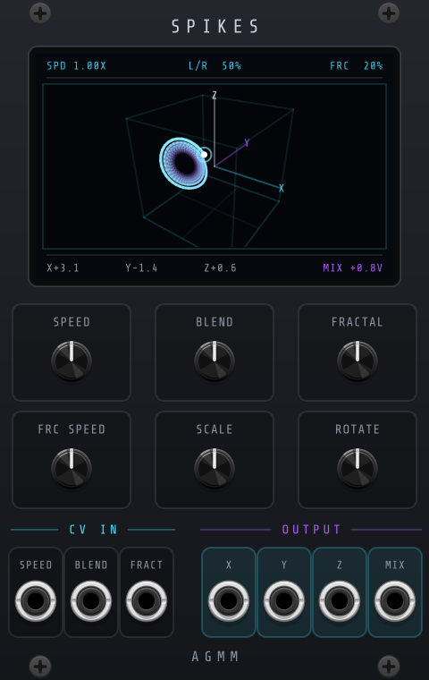

<!--
AGMM AUTOMATIC DOCUMENTATION
Source: Spikes.cpp
-->

# Spikes

## 1. Overview

`Spikes` is a 16 HP chaotic modulation source that combines two classical strange attractors (Lorenz and Rössler) with a fractal-correlated noise generator. The two attractors are integrated in real time with RK4, blended together per-sample by the BLEND knob, then optionally crossfaded toward a 6-octave fractional Brownian motion noise (FRACTAL knob) before being scaled and written to X / Y / Z / MIX outputs.

Key features:
- Lorenz + Rössler attractors integrated with RK4
- Fractal-correlated fBm noise (6 octaves, Hurst = 0.65)
- Per-sample blend of attractor and noise
- Speed (with 1 V/oct CV), blend, fractal amount, fractal speed, scale
- Auto-rotation of the 3D display with manual drag override
- 3D trail view of the recent trajectory
- 4 outputs: X, Y, Z, MIX

## Module Screenshot

## 2. Architecture

### Main Classes

- `Spikes`: Core module class inheriting from `rack::Module`
- `SPPanel`: Static panel artwork
- `SPDisplay`: Live 3D trail display

### Inheritance

- `Spikes` inherits from `rack::Module`
- Both UI widgets inherit from `rack::TransparentWidget`

### Structures

- `Octave { double current, target, phase; bool initialized; }` — one fBm octave

### State (grouped)

| Group | Storage |
|-------|---------|
| Lorenz state | `double lorenzX, lorenzY, lorenzZ` |
| Rössler state | `double rosslerX, rosslerY, rosslerZ` |
| Fractal octaves | `Octave octaves[6]` |
| RNG | `uint32_t rngState` |
| Display — trail | `float trailX[400]`, `trailY[400]`, `trailZ[400]`, `trailHead`, `trailCount`, `trailAcc` |
| Display — outputs | `float outX, outY, outZ, outMix`, `dispSpeed, dispBlend, dispFractal` |

## 3. DSP Theory

### Lorenz attractor

The Lorenz system is a classic chaotic attractor:

$$
\begin{aligned}
\dot{x} &= \sigma(y - x) \\
\dot{y} &= x(\rho - z) - y \\
\dot{z} &= xy - \beta z
\end{aligned}
$$

with σ = 10, ρ = 28, β = 8/3.

### Rössler attractor

The Rössler system is another classic chaotic attractor:

$$
\begin{aligned}
\dot{x} &= -y - z \\
\dot{y} &= x + a y \\
\dot{z} &= b + z(x - c)
\end{aligned}
$$

with a = 0.2, b = 0.2, c = 5.7.

### RK4 integration

Both attractors are integrated with the classical 4th-order Runge-Kutta at audio rate, with 2 sub-steps per sample:

$$
\mathbf{s}_{n+1} = \mathbf{s}_n + \frac{h}{6}(\mathbf{k}_1 + 2\mathbf{k}_2 + 2\mathbf{k}_3 + \mathbf{k}_4)
$$

where $h = \text{speed}/\text{sampleRate}/2$. The 2 sub-steps give better accuracy for the stiff Lorenz system.

### Fractal noise (fBm)

The fractal noise is 6 octaves of smoothed random values, each with a different frequency and amplitude:

$$
\text{total} = \sum_{i=0}^{5} v_i \cdot a_i
$$

where each octave has:
- Frequency $f_i = f_{\text{base}} \cdot 2^i$
- Amplitude $a_i = 2^{-H \cdot i}$ (H = Hurst = 0.65)
- A smoothstep interpolation between current and target random values

The output is normalized by $\sqrt{\sum a_i^2}$ so it's approximately in $[-1, 1]$.

### Blend

The two attractors are blended by the BLEND knob:

$$
\mathbf{m} = (1 - b) \mathbf{L} + b \mathbf{R}
$$

where $\mathbf{L}$ is the normalized Lorenz and $\mathbf{R}$ is the normalized Rössler.

### Normalization

Each attractor is normalized to approximately $[-1, 1]$ by dividing by a fixed constant:

- Lorenz: x/20, y/25, (z−25)/25
- Rössler: x/12, y/12, (z−5)/15

### Fractal mix

The blended attractor is then crossfaded toward the fractal noise:

$$
\mathbf{m} \leftarrow (1 - f) \mathbf{m} + f \cdot \text{fractal}
$$

### Output scaling

$$
\text{out} = \text{clamp}(\mathbf{m} \cdot \text{scale}, -10, 10)
$$

### MIX output

$$
\text{mix} = \frac{x + y + z}{3}
$$

### Speed scaling

$$
\text{speed} = \text{clamp}(\text{knob} \cdot 2^{\text{CV}}, 0.001, 100)
$$

### 3D trail

One point is added to the trail every 0.015 units of attractor time:

$$
\text{trailAcc} \leftarrow \text{trailAcc} + \text{dt}
$$

$$
\text{trailAcc} \ge 0.015 \implies \text{push new point}
$$

This keeps the trail shape independent of the speed setting.

### 3D projection

The display projects attractor-space points (x, y, z) into 2D using a rotating view:

1. Map attractor coordinates to world: (x, -z, y) — z becomes up
2. Yaw rotation around the vertical axis
3. Pitch rotation around the horizontal axis
4. Perspective divide: `k = 1 / (1 + z2 * 0.22)`

## 4. Parameters and Controls

### Knobs

| Parameter | Min | Max | Default | Description |
|-----------|-----|-----|---------|-------------|
| `SPEED_PARAM` | 0.01 | 10 | 1 | Speed |
| `BLEND_PARAM` | 0 | 1 | 0.5 | Lorenz ↔ Rössler blend |
| `FRACTAL_PARAM` | 0 | 1 | 0.2 | Fractal amount |
| `FRACTAL_SPEED_PARAM` | 0.01 | 50 | 1 | Fractal base frequency (Hz) |
| `SCALE_PARAM` | 0.1 | 10 | 5 | Output scale (V) |
| `ROTATE_PARAM` | −1 | 1 | 0.25 | Display rotation speed |

### Inputs

| Input | Description |
|-------|-------------|
| `SPEED_INPUT` | Speed CV (1 V/oct) |
| `BLEND_INPUT` | Blend CV (10 V = 100%) |
| `FRACTAL_INPUT` | Fractal CV (10 V = 100%) |

### Outputs

| Output | Description |
|--------|-------------|
| `X_OUTPUT` | X |
| `Y_OUTPUT` | Y |
| `Z_OUTPUT` | Z |
| `MIX_OUTPUT` | Mix |

### Enumerations

- `ParamId`: Speed, Blend, Fractal, FractalSpeed, Scale, Rotate
- `InputId`: Speed, Blend, Fractal
- `OutputId`: X, Y, Z, Mix

## 5. Inputs and Outputs

### Inputs

| Name | Type | Range | Description |
|------|------|-------|-------------|
| `SPEED_INPUT` | CV | ±5 V | Speed modulation (1 V/oct) |
| `BLEND_INPUT` | CV | ±10 V | Blend modulation |
| `FRACTAL_INPUT` | CV | ±10 V | Fractal amount modulation |

### Outputs

| Name | Type | Range | Description |
|------|------|-------|-------------|
| `X_OUTPUT` | CV | ±10 V | Lorenz/Rössler X |
| `Y_OUTPUT` | CV | ±10 V | Lorenz/Rössler Y |
| `Z_OUTPUT` | CV | ±10 V | Lorenz/Rössler Z |
| `MIX_OUTPUT` | CV | ±10 V | (X+Y+Z)/3 |

### Menu

No menu options.

## 6. Signal Processing Pipeline

1. **Read params + CVs** — Speed, blend, fractal amount, fractal speed, scale.
2. **Integrate Lorenz** — RK4 with 2 sub-steps.
3. **Integrate Rössler** — RK4 with 2 sub-steps.
4. **NaN guard** — Re-seed attractors if they blow up.
5. **Compute fractal** — Advance 6 octaves.
6. **Normalize** — Map each attractor to ±1.
7. **Blend** — Mix Lorenz and Rössler.
8. **Mix fractal** — Crossfade toward fractal noise.
9. **Compute MIX** — Average.
10. **Output** — Scale and clamp.
11. **Trail sampling** — Push new point if enough attractor time elapsed.

## 7. Important Functions

### `lorenzDeriv(const double s[3], double d[3])`

The Lorenz derivative function.

### `rosslerDeriv(const double s[3], double d[3])`

The Rössler derivative function.

### `rk4(double s[3], double dt, void (*deriv)(const double *, double *))`

RK4 integration step.

### `computeFractal(double baseFreq, double sr)`

Advances the 6-octave fBm noise and returns a normalized bipolar value.

### `Spikes::process(const ProcessArgs &args)`

The main callback described in §6.

## 8. Mathematical Implementation

### Lorenz

$$
\dot{x} = 10(y - x), \quad \dot{y} = x(28 - z) - y, \quad \dot{z} = xy - \tfrac{8}{3}z
$$

### Rössler

$$
\dot{x} = -y - z, \quad \dot{y} = x + 0.2 y, \quad \dot{z} = 0.2 + z(x - 5.7)
$$

### RK4

$$
s_{n+1} = s_n + \frac{h}{6}(k_1 + 2k_2 + 2k_3 + k_4)
$$

### fBm

$$
\text{total} = \sum_{i=0}^{5} v_i \cdot 2^{-0.65 i}, \quad \text{out} = \frac{\text{total}}{\sqrt{\sum 2^{-1.3 i}}}
$$

### Normalization

$$
x_L = x/20, \quad y_L = y/25, \quad z_L = (z-25)/25
$$

$$
x_R = x/12, \quad y_R = y/12, \quad z_R = (z-5)/15
$$

### 3D projection

$$
\text{world} = (x, -z, y)
$$

$$
x_1 = w_x \cos(\text{yaw}) + w_z \sin(\text{yaw}), \quad z_1 = -w_x \sin(\text{yaw}) + w_z \cos(\text{yaw})
$$

$$
y_2 = w_y \cos(\text{pitch}) - z_1 \sin(\text{pitch}), \quad z_2 = w_y \sin(\text{pitch}) + z_1 \cos(\text{pitch})
$$

$$
k = \frac{1}{1 + 0.22 z_2}, \quad \text{px} = c_x + x_1 \cdot S \cdot k, \quad \text{py} = c_y + y_2 \cdot S \cdot k
$$

## 9. Performance and Optimization

### CPU Usage

- Per sample: 8 derivative evaluations (2 attractors × 2 substeps × 2 evaluations per derivative... actually 4 per attractor per substep = 16 deriv calls) ≈ 16 × 20 flops = 320 flops
- Plus fractal (6 octaves) ≈ 50 flops
- Plus output math ≈ 20 flops
- Total: ~400 flops/sample

### Memory Allocation

- All state fixed-size
- No allocation in `process()`
- Trails: 400 × 3 = 1200 floats ≈ 4.8 KB

### Buffers

- `trailX[400]`, `trailY[400]`, `trailZ[400]`: 1200 floats
- 6 fractal octaves

### Real-time Processing

- All loops bounded
- No allocation, no blocking
- 16 RK4 deriv calls/sample at 48 kHz = 768 K trig calls/sec

### Thread Safety

- All state written by audio thread, read by UI thread via torn reads

### Numerical Stability

- RK4 with small `dt` (speed capped at 100, so `dt` ≤ 100/48000 ≈ 0.002)
- NaN guard: re-seed attractors if non-finite
- Output clamped to ±10 V
- xorshift32 RNG for fractal (fast, deterministic seed)

## 10. Dependencies

### Libraries/Headers

- `plugin.hpp` — VCV Rack core
- `agmm_ui.hpp` — shared AGMM UI helpers
- `<cstdint>`, `<cmath>`, `<cstdio>`, `<algorithm>`

### External Classes

- `rack::Module`, `rack::TransparentWidget`, `rack::engine::ParamQuantity`
- `agmm::panelBase`, `agmm::bezel`, `agmm::cell`, `agmm::text`, `agmm::screen`, `agmm::plotFrame`, `agmm::sectionHeader`, `agmm::withA`, `agmm::violet`, `agmm::accent`, `agmm::bright`, `agmm::warm`, `agmm::dim`, `agmm::ALIGN_L/C/R`

## 11. Summary

`Spikes` is a chaotic modulation source combining two famous attractors (Lorenz and Rössler) with fractal-correlated noise. It's the "artistic" counterpart to `PsyLFO`: instead of a physical pendulum, it uses mathematical chaos, which gives a different kind of unpredictability.

The 3D trail display is the standout feature: you can see the attractor's shape emerging from the trail, and you can drag the view to rotate it manually or let it rotate automatically. The blend between Lorenz and Rössler creates a continuous family of attractors, from the classic butterfly (Lorenz) to the Rössler spiral.

The main limitations are: CPU-heavy (400 flops/sample due to the 16 RK4 derivative evaluations), and the outputs are very chaotic (almost random), so it's better for modulation than for pitch (unless you use the V/Oct outputs from `PsyLFO` or `RandomWalk`).